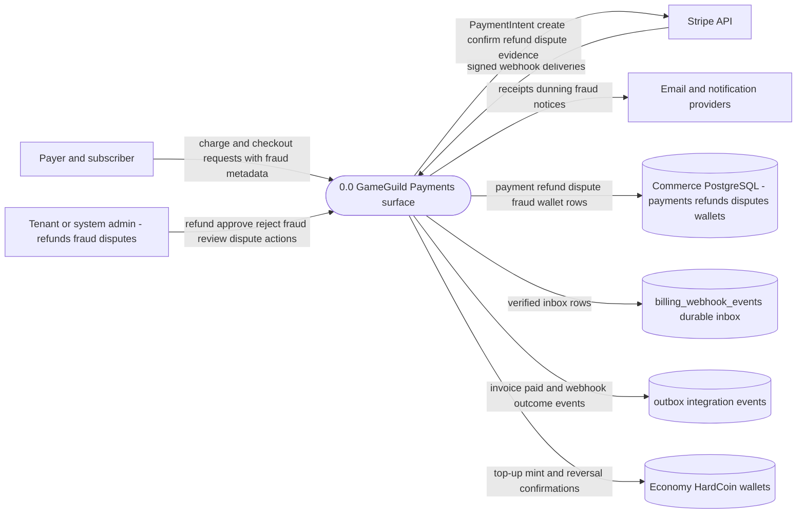
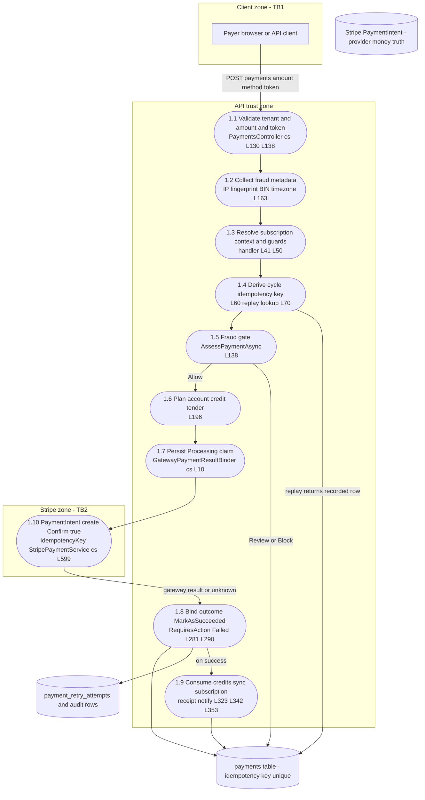
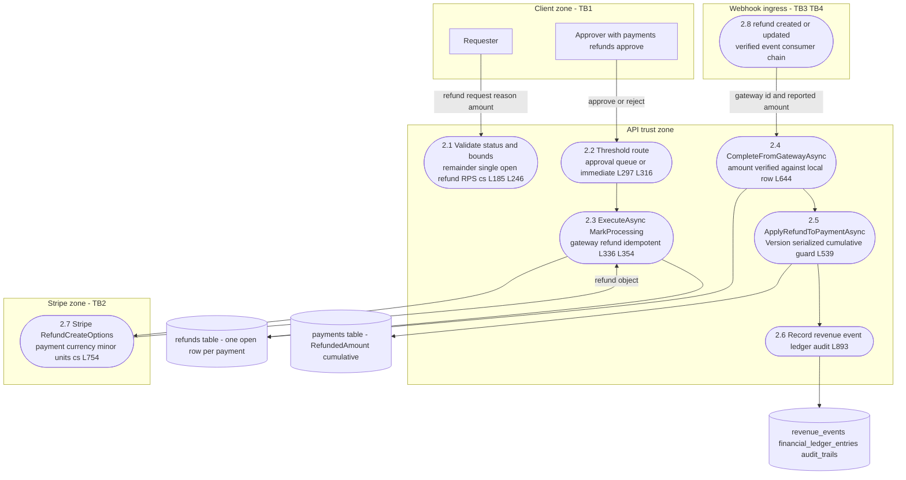
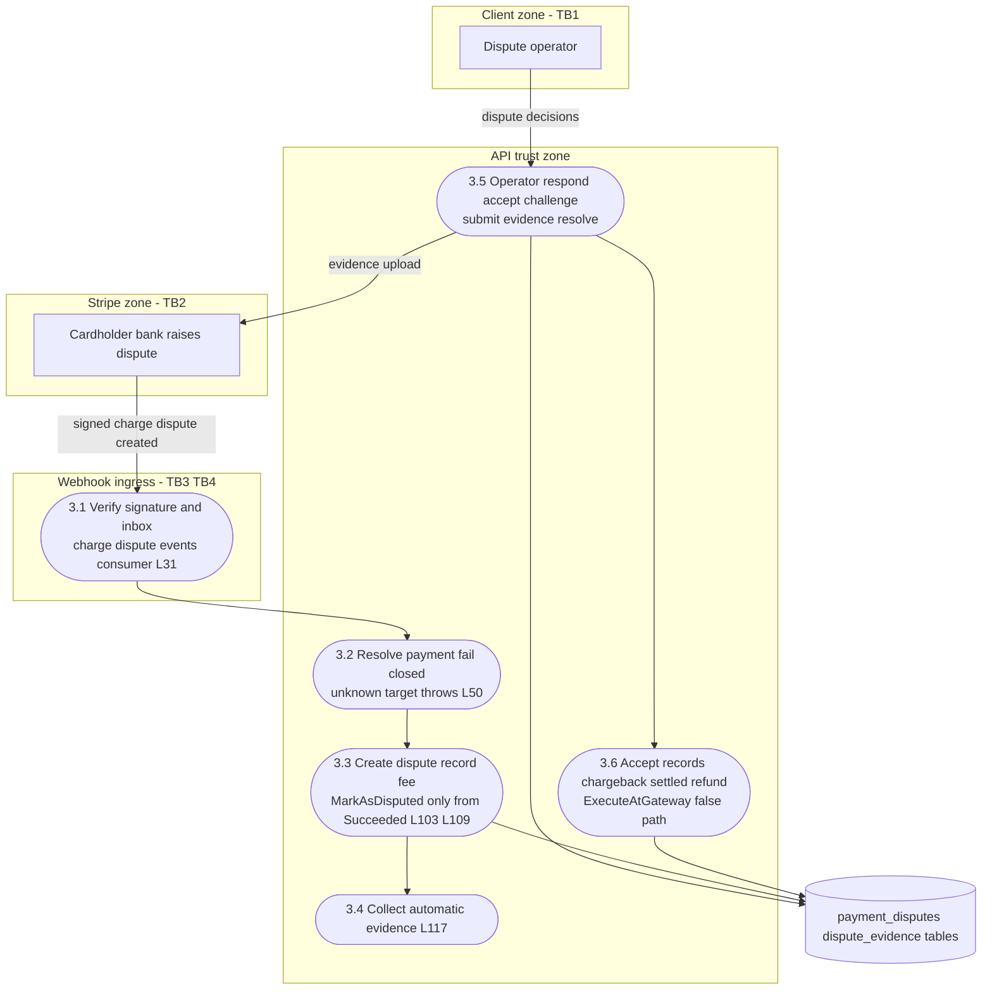
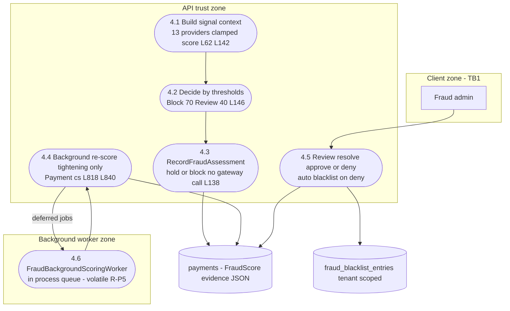
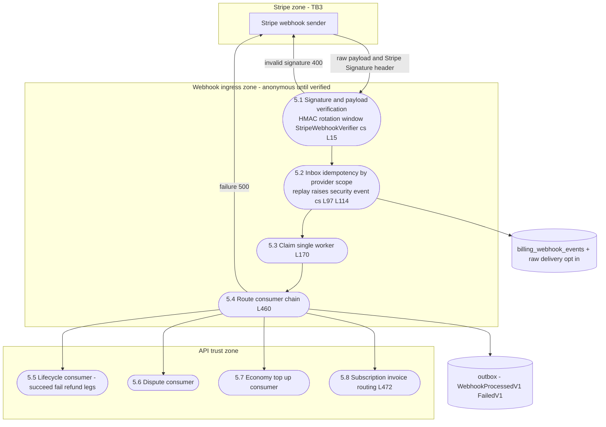
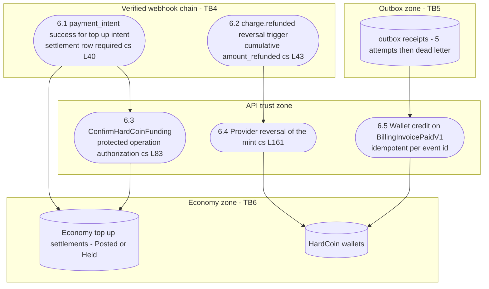

# Payments Data Flow Diagrams — DFDs

> Module `GameGuild.Commerce.Payments` (+ Stripe ingress in `GameGuild.Commerce.Billing`, Economy top-up in `GameGuild.Finance.Economy`) · Documented against `develop` commit `21b58ac6a7`.
> Companion documents: flows (`01`), STRIDE (`07-stride-threat-model.md`), architecture (`../09-security-architecture.md`). Threat numbering in the annotations refers to the STRIDE document.

## 1. Notation and conventions

Mermaid flowchart with standard DFD shapes:

- External entity — rectangle: `E1["Client"]`
- Process — stadium: `P1(["1.1 Validate and enrich charge request"])`
- Data store — cylinder: `D1[("payments table")]`
- Trust boundary — one subgraph per zone

Zones used throughout (money-path trust boundaries, detailed in `../09-security-architecture.md` §2):

| Zone | Boundary id | Meaning |
|------|-------------|---------|
| Client | TB1 | User-controlled browser or API consumer |
| API | — | The modular monolith trust zone (controllers, CQRS, entities) |
| Stripe | TB2 | Outbound provider zone — money actually moves here |
| Webhook ingress | TB3/TB4 | Anonymous perimeter that becomes trusted only after signature verification |
| Outbox | TB5 | Durable integration-event transport |
| Economy | TB6 | HardCoin mint/reversal authority |

Citation shorthand: `Payments:` = `apps/api/Source/Modules/GameGuild.Commerce.Payments/`, `Billing:` = `apps/api/Source/Modules/GameGuild.Commerce.Billing/`, `Economy:` = `apps/api/Source/Modules/GameGuild.Finance.Economy/`, `API:` = `apps/api/Source/GameGuild.API/`.

## 2. Level 0 — context diagram

The payments surface as one process against its external actors and stores.

Boundaries crossed at level 0: TB1 client to API, TB2 API to Stripe, TB3 Stripe to webhook ingress, TB5 outbox, TB6 Economy.

## 3. Level 1 — flow families

### F1 — Payment initiation and Stripe exchange

Entry `POST api/v1/payments` (`Payments:/Controllers/PaymentsController.cs:130-184`); core `ProcessPaymentCommandHandler` (`Payments:/Commands/ProcessPayment/ProcessPaymentCommandHandler.cs:36-389`); gateway `StripePaymentService.cs:593-642`.

Key flows across boundaries: fraud metadata crosses TB1 inbound (server-side collected, client AVS or CVV ignored — STRIDE 4.2); the idempotency key crosses TB2 so a replayed charge cannot double-move money (STRIDE 1.4); outcome-unknown responses keep the local claim and never re-cross TB2 blindly (STRIDE 1.7).

### F2 — Refund legs — request approval execution webhook completion

Entries `PaymentsController.cs:445` and `RefundsController.cs:36`; execution `RefundProcessingService.ExecuteAsync :336`; webhook completion `CompleteFromGatewayAsync :607+`.

Boundary notes: the refund amount crosses TB2 converted with the **payment's** currency (the #1202 class fix, `StripePaymentService.cs:754-768`); the webhook leg crosses TB3/TB4 and its reported amount is checked against the local row before completion (`RefundProcessingService.cs:644-653`); both completion paths serialize on the entity `Version` token (STRIDE 3.3).

### F3 — Dispute and chargeback

Ingress `Billing:/Services/StripeDisputeEventConsumer.cs:25-80`; operator surface `Payments:/Controllers/DisputesController.cs`.

Open note: the operator respond action can set arbitrary dispute statuses through the default branch (`Payments:/Services/DisputeService.cs:81`) — STRIDE 5.4, residual R-P1.

### F4 — Fraud assessment review blacklist

Gate `Payments:/Services/FraudDetection/FraudDetectionService.cs:36-174`; review queue `FraudReviewsController`; background re-score `PaymentsModule.cs:147`.

### F5 — Webhook ingress — Stripe to platform

Entry `BillingWebhooksController.cs:186-189`; pipeline `StripeBillingWebhookService.cs:70+`.

The entire ingress zone is untrusted until 5.1 passes; signature-unverified legacy rows are never replayed (`StripeBillingWebhookService.cs:235-245`).

### F6 — Economy interface — top up mint and reversal

`Economy:/Integrations/StripeEconomyTopUpEventConsumer.cs`; wallet credit `API:/Core/Billing/BillingInvoicePaidWalletCreditHandler.cs`.

The mint (6.1→6.3) only fires on a verified success event bound to an existing settlement row; the reversal (6.2→6.4) exists since #1266 and closes the refund-then-keep-coins drain (STRIDE 7.2).

## 4. Data store inventory on the money path

| Store | Contents that matter | Money integrity role |
|-------|----------------------|----------------------|
| `payments` | status, amount, currency, idempotency key unique, provider mapping, `RefundedAmount`, `Version` | double-charge and double-refund backstop |
| `refunds` | one open row per payment, status, gateway refund id, approval state | refund leg serialization |
| `payment_disputes` + `dispute_evidence` | dispute lifecycle, fee, evidence | chargeback truth |
| `billing_webhook_events` | `(ExternalEventId, Provider)` unique, attempts, dead-letter | replay and poison control |
| `outbox` + receipts | integration events, per-consumer attempts | durable fan-out |
| module-local `revenue_events` `financial_ledger_entries` `audit_trails` | accounting mirror of every money mutation | repudiation defense |
| `user_wallets` `wallet_transactions` | Commerce wallet balances | account-credit and refund-credit target |

## 5. Coverage notes

- Every flow family of `01-user-flows.md` is rendered: initiation (F1), refunds (F2), disputes (F3), fraud (F4), webhook ingress (F5), payment-method lifecycle folds into F1 (checkout sub-flow, `PaymentsController.cs:208-311`), currency suggestion and FX surfaces are read-only config flows with no money mutation and are covered at architecture level (`../09-security-architecture.md` §6).
- Threat annotations map 1:1 to `07-stride-threat-model.md` sections.
