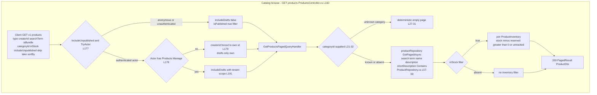
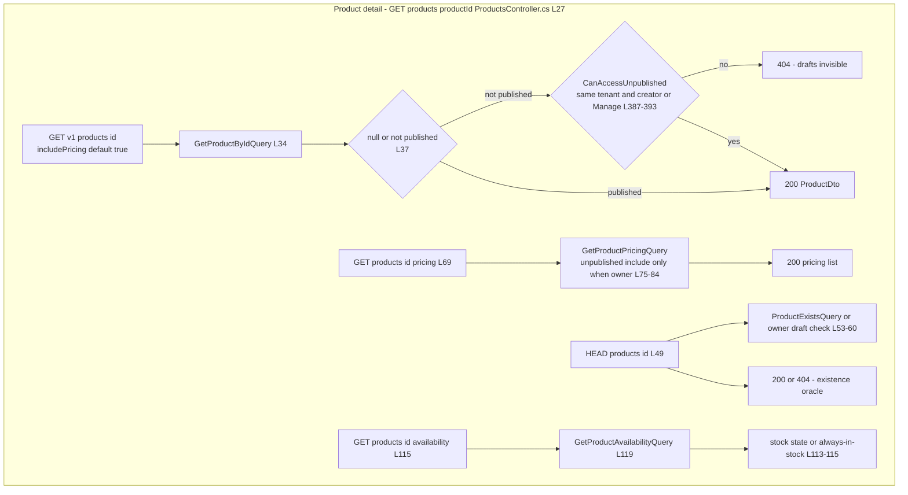
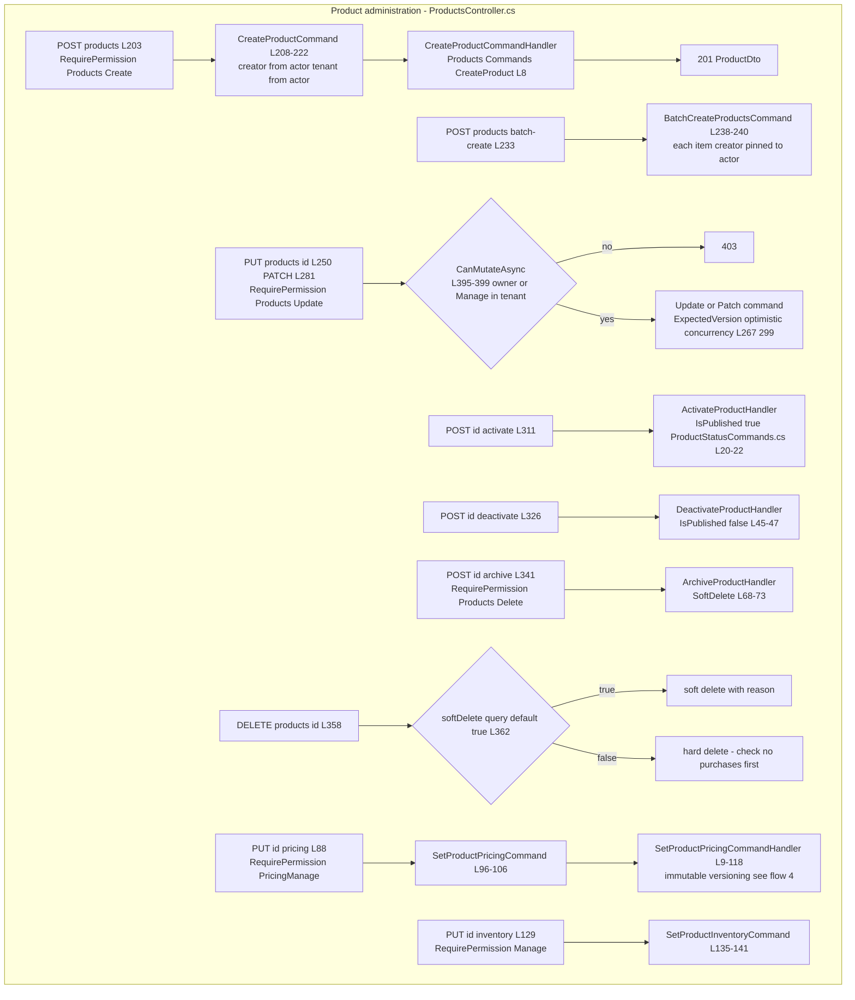
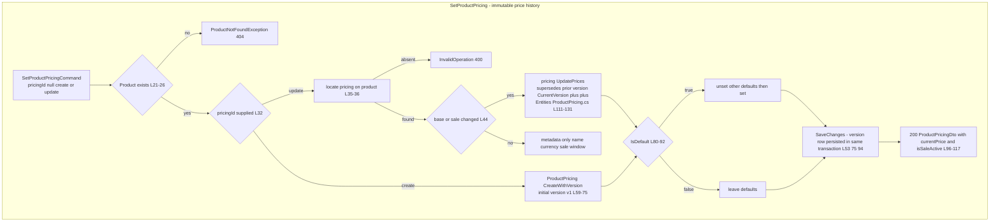
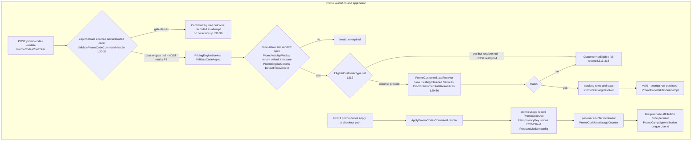
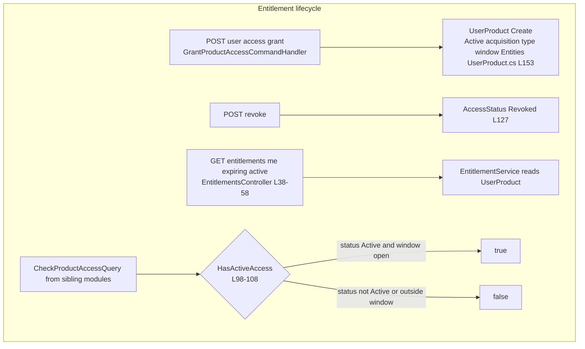

# Products user flows — happy path and every edge case

> Module `GameGuild.Commerce.Products` · Documented against `develop` commit `60100459e6`.
> Citation shorthand: `Products:` = `apps/api/Source/Modules/GameGuild.Commerce.Products/`.

## 1. Catalog browse / search (anonymous)

`GET v{v}/products` (`Products:/Controllers/ProductsController.cs:160-196`) → `GetProductsPagedQuery` (`Queries/GetProducts/GetProductsPagedQuery.cs`) → handler (`GetProductsPagedQueryHandler.cs:20-90`) → repository paged filter (`Repositories/ProductRepository.cs`).

### 1a. Edge-case matrix — browse/search

| # | Edge case | Code path | Outcome |
|---|-----------|-----------|---------|
| 1 | Anonymous caller asks for drafts | `includeUnpublished && TryActor` (`ProductsController.cs:177`) | drafts flag collapses to false — anonymous catalog is published-only |
| 2 | Non-manager creator asks for drafts | creator pin (`:178-179`) | sees only **own** drafts (no permission escalation via includeUnpublished) |
| 3 | Unknown `categoryId` | empty-determinism guard (`GetProductsPagedQueryHandler.cs:26-31`) | empty page, not an unfiltered listing (classical filter-injection guard) |
| 4 | Search term casing | `ToLower().Contains` (`Repositories/ProductRepository.cs:57-59`) | case-insensitive by lowercasing both sides (note: not `EF.Functions.ILike` — full scan semantics on non-indexed text) |
| 5 | `inStock=true` on untracked product | inventory join semantics (`ProductRepository.cs` inventory predicates) | untracked products report always-in-stock (`ProductsController.cs:113-115` documents the contract) |
| 6 | Pagination abuse (`take=100000`) | `GetProductsPagedQueryValidator` (default take 50; validator clamps) | bounded page |

## 2. Product detail / pricing / availability (anonymous + drafts for owners)

### 2a. Edge-case matrix — detail

| # | Edge case | Code path | Outcome |
|---|-----------|-----------|---------|
| 1 | Draft product, anonymous | 404 (not 403) (`ProductsController.cs:37-38`) | existence of drafts not leaked |
| 2 | Cross-tenant draft | tenant equality in `CanAccessUnpublished` (`:389`) | 404 |
| 3 | `HEAD` as an existence oracle for drafts | owner-gated branch (`:53-57`) | anonymous HEAD only proves published existence |
| 4 | Pricing of a draft | include-unpublished re-checks product access first (`:75-81`) | no draft price leak |

## 3. Admin create → lifecycle (create / patch / activate / deactivate / archive / delete)

### 3a. Edge-case matrix — administration

| # | Edge case | Code path | Outcome |
|---|-----------|-----------|---------|
| 1 | Creator id spoofing via body | actor-pinned `creatorId` (`ProductsController.cs:207, 222, 238`) | creator always the authenticated actor |
| 2 | Optimistic-concurrency race on update | `ExpectedVersion` plumbed (`:267, :299`) | stale writers rejected by entity version |
| 3 | Mutating another creator's product | `CanMutateAsync` → `CanAccessUnpublished` (`:395-399, :387-393`) | 403 without Manage |
| 4 | Two-layer permission on pricing | controller `PricingManage` + command-layer `monetization:monetize` (AuthorizationBehavior; proven by `MonetizationPermissionHttpTests.cs:222-277`) | both must pass — endpoint permission alone is not enough |
| 5 | Archive vs delete | archive = soft (`ProductStatusCommands.cs:68-73`); delete defaults soft, supports hard | hard delete gated behind explicit query flag |
| 6 | Deactivate a product with live entitlements | no guard in `DeactivateProductHandler` (`:41-52`) | unpublished but entitlements untouched (display-only change) — see `03-state-machines.md` §1 note |

## 4. Pricing set — immutable versioning (the product-side price source of truth)

`PUT products/{id}/pricing` → `SetProductPricingCommandHandler` (`Products:/Commands/SetProductPricing/SetProductPricingCommandHandler.cs:9-118`).

### 4a. Edge-case matrix — pricing

| # | Edge case | Code path | Outcome |
|---|-----------|-----------|---------|
| 1 | Negative price | `UpdatePrices` guards (`Entities/ProductPricing.cs:115-120`) | rejected — price cannot be negative |
| 2 | Sale price ≥ base price | guard (`:119-120`) | rejected — sale must be a real discount |
| 3 | Price change without version bump | impossible — `UpdatePrices` always supersedes + increments (`:122-130`) | every change is auditable via `ProductPricingVersion` |
| 4 | Historical price at date D | `GetVersionAt` (`:146-152`) | order reconciliation can resolve what the price was |
| 5 | Effective price with windowed sale | `IsSaleActive` window check (`:169-182`), handler duplicates the check (`SetProductPricingCommandHandler.cs:96-102`) | sale applies strictly inside `[SaleStartDate, SaleEndDate)` |
| 6 | Setting default on a second option | first-unset-then-set (`:80-92`) | exactly one default per product |

## 5. Promo validate → apply (the promo engine)

`ValidatePromoCodeCommandHandler` (`Products:/Commands/ValidatePromoCode/ValidatePromoCodeCommandHandler.cs:22+`) and `ApplyPromoCodesCommandHandler` (`Commands/ApplyPromoCode/ApplyPromoCodesCommandHandler.cs:20+`), engine in `Services/PricingEngineService.cs:10-120, 300-330`.

### 5a. Edge-case matrix — promo engine

| # | Edge case | Code path | Outcome |
|---|-----------|-----------|---------|
| 1 | Anonymous code farming | CAPTCHA gate design (`ValidatePromoCodeCommandHandler.cs:30-36`) | **in the composed host the gate is null (P1/P4) — probing is ungated**, but denied attempts still record for anomaly velocity (which is also off — P4) |
| 2 | Customer-type-restricted code (first-time only, win-back) | resolver (`PricingEngineService.cs:312-321`) | **host reality: resolver null → every restricted code fails `CustomerNotEligible`** (P4) |
| 3 | Replay of an apply request | `PromoCodeUse.IdempotencyKey` unique (`ProductsModule.cs:232-236`) | second application is a replay, never a second use |
| 4 | Per-user cap races | `PromoCodeUserUsageCounter` composite key (`:252-256`) | counter row per (code,user) |
| 5 | Multi-code stacking abuse | stacking rules + max caps (`Services/PromoStackingResolver.cs`) | total discount clamped |
| 6 | Attempt-tracking failure | best-effort persistence (`ValidatePromoCodeCommandHandler.cs:10-13` doc comment) | validation succeeds; tracking failure logged only |
| 7 | Campaign timezone | `PromoEngineOptions.DefaultTimeZoneId` (`Configuration/PromoEngineOptions.cs:20`) | **host reality: never bound to config — always UTC fallback (P1)** |

## 6. Entitlements — grant / revoke / check

`GrantProductAccessCommand`/`RevokeProductAccessCommand` (`Commands/GrantProductAccess/`, `Commands/RevokeProductAccess/`), `CheckProductAccessQuery` (`Queries/CheckProductAccess/`), `EntitlementsController` (`Controllers/EntitlementsController.cs:19+`).

### 6a. Edge-case matrix — entitlements

| # | Edge case | Code path | Outcome |
|---|-----------|-----------|---------|
| 1 | Duplicate grant | unique `(UserId,ProductId)` (`ProductsModule.cs:163`) | one access row per user/product |
| 2 | Future-dated window | `AccessStartDate > now` fails `HasActiveAccess` (`Entities/UserProduct.cs:101-103`) | entitlement exists but not yet active |
| 3 | Expired window | `AccessEndDate <= now` (`:105-107`) | access lapses without a job — time-based, computed at read |
| 4 | Expiring-soon listing | `GetExpiringEntitlementsAsync` (`EntitlementsController.cs:44-50`) | N-day horizon query |
| 5 | Reading all users' entitlements | `RequirePermission(EntitlementsPermission.Keys.ReadAll)` (`:36`) | typed permission, not just `[Authorize]` |
