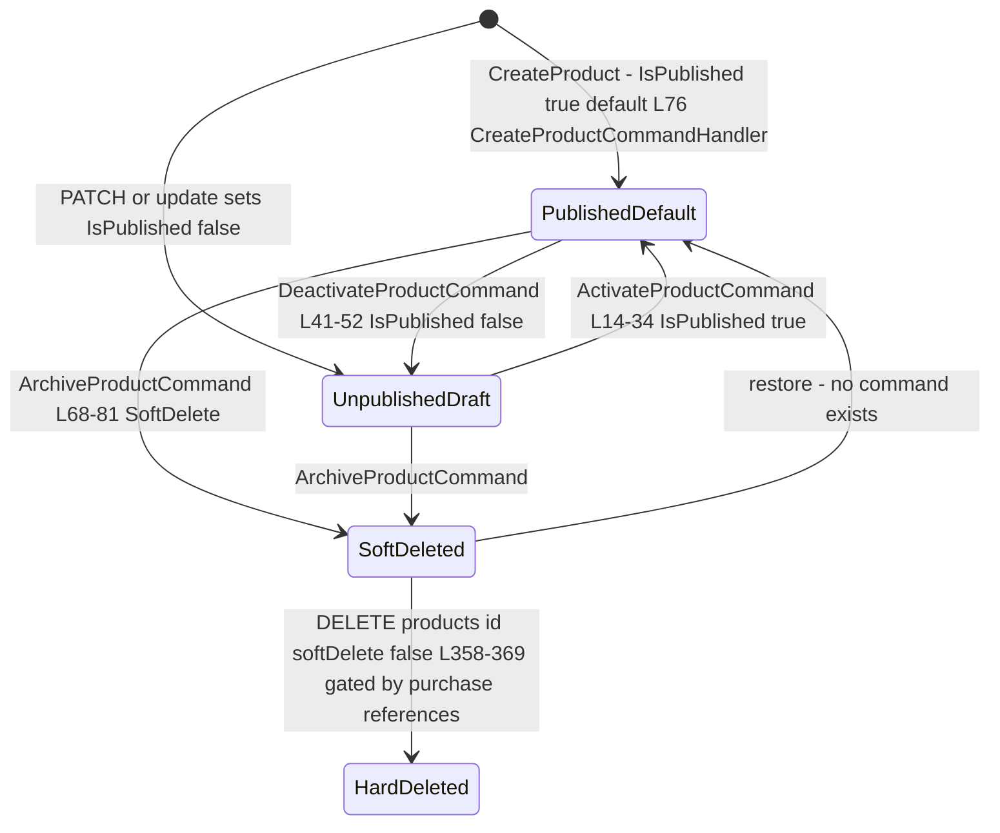
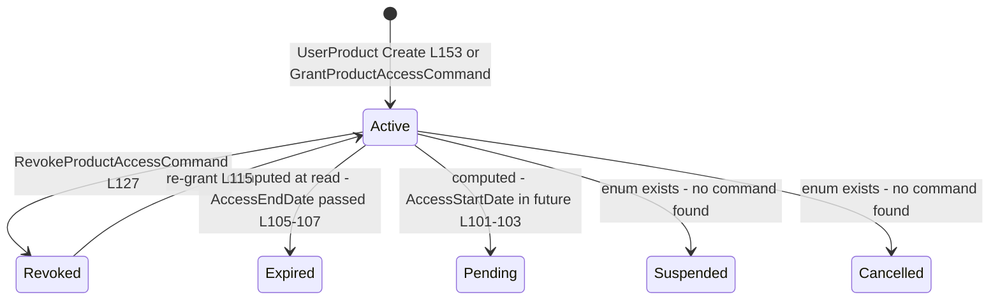
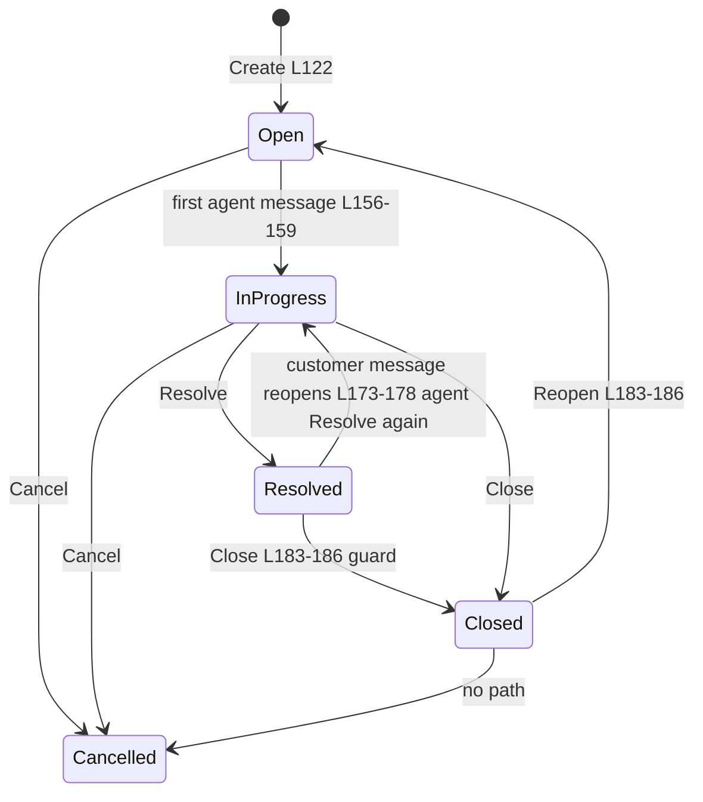
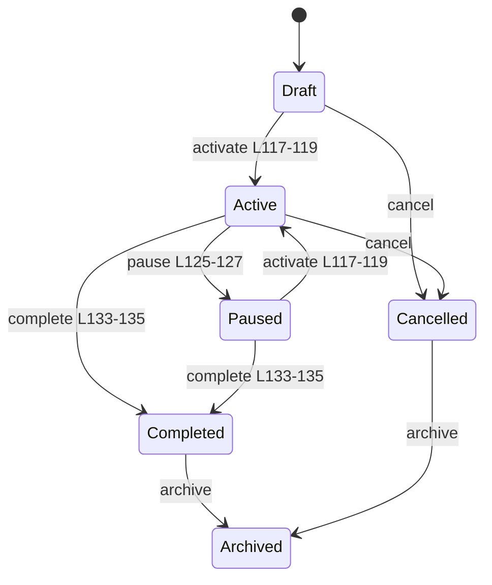
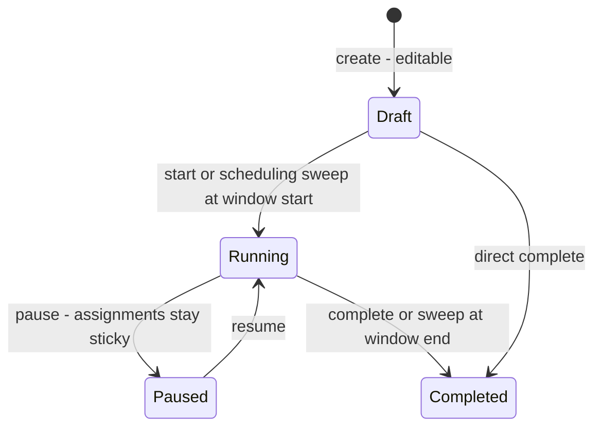

# Products — state machines

> Module `GameGuild.Commerce.Products` · Documented against `develop` commit `60100459e6`.
> Citation shorthand: `Products:` = `apps/api/Source/Modules/GameGuild.Commerce.Products/`.

## 1. Product lifecycle (publication + soft delete)

`Product` (`Entities/Product.cs:25`) has **no Status enum** — the lifecycle is the `IsPublished` flag (`:76`) plus `EntityBase` soft delete, driven by three commands in `Commands/ProductStatusCommands.cs`.

Transitions audit:

| Transition | Trigger | Guard | Reachable? |
|---|---|---|---|
| create → published | `CreateProduct` (default `IsPublished = true`, `Entities/Product.cs:76`) | none — new products are born public; drafts require an immediate deactivate | yes |
| published ⇄ unpublished | activate/deactivate commands (`ProductStatusCommands.cs:14-52`) | owner/Manage via controller | yes |
| any → soft-deleted | archive (`:68-81`) | `RequirePermission(Delete)` | yes |
| soft-deleted → hard-deleted | delete with `softDelete=false` (`ProductsController.cs:358-369`) | handler checks purchase references | yes |
| soft-deleted → restored | **no command** | — | **unreachable** — archived products cannot come back (missing guard/feature, noted in `06-gaps.md` P8) |

Notes: deactivate does **not** revoke entitlements (display-only); there is no "draft" state distinct from unpublished.

## 2. UserProduct access (`ProductAccessStatus`)

`Enums/ProductEnums.cs:112-137`; window logic in `Entities/UserProduct.cs:98-108`.

| State | Setter | Reachable? |
|---|---|---|
| Active | grant/re-grant (`UserProduct.cs:115, :153`) | yes |
| Revoked | revoke command (`:127`) | yes |
| Expired / Pending | **computed** by `HasActiveAccess` (`:98-108`) — no stored transition | implicitly (time-based) |
| Suspended / Cancelled | enum values with **no writing code path found** | **unreachable** (declared-but-dead states — `06-gaps.md` P9) |

## 3. Support ticket (`SupportTicketStatus`)

`Entities/SupportTicket.cs:7-14`; guards at `:139-186`.

Guards: messages rejected on `Closed/Cancelled` (`:139-141`); customer messages rejected on `Resolved` (`:146-148`); reopen only from `Resolved/Closed` (`:183-186`). Priority is a parallel attribute (`SupportTicketPriority`, `:16-22`) mutable via `ChangeSupportTicketPriorityCommand`.

## 4. Promo campaign (`PromoCampaignStatus`)

`Entities/PromoCampaign.cs:8-26`; guards `:117-134`.

Campaign status gates whether codes under its key may run (`:117` doc), but each code keeps its own validity window — pausing a campaign does not shorten code windows (documented in the enum remarks `:9-25`).

## 5. Pricing experiment (`PricingExperimentStatus`)

`Commerce:/Entities/PricingExperiment.cs:88-101`.

**Host caveat (P1)**: the "or scheduling sweep" transitions are driven by `PricingSchedulingBackgroundService` → `IPricingExperimentService.RunSchedulingSweepAsync` (`BackgroundServices/PricingSchedulingBackgroundService.cs:33-45`), which is never hosted — so window-based start/complete do not happen automatically; only the manual API transitions run. Assignments are sticky via `(ExperimentId, BucketKey)` unique (`ProductsModule.cs:321`).

## 6. Pricing rule activation window (scheduled)

`Commerce:/Entities/PricingRule.cs` (`IsScheduled`, `UsageMetricKey`, date windows) — a rule is active when manually activated, or when scheduled and inside its window; version bumps on transition change the engine cache stamp (`BackgroundServices/PricingSchedulingBackgroundService.cs:11-18` doc). With the worker dead (P1), `IsScheduled=true` rules stay in whatever state manual commands left them — the date window is inert.

## 7. Machine inventory (for the tracker)

| Machine | States | Declared in | Entry wired? |
|---|---|---|---|
| Product publication | 2 flags + soft delete | `Entities/Product.cs:76` + `EntityBase` | yes (restore missing) |
| UserProduct access | 6 enum, 2 computed, 2 dead | `Enums/ProductEnums.cs:112-137` | yes (Suspended/Cancelled unreachable) |
| Support ticket | 5 | `Entities/SupportTicket.cs:7-14` | yes |
| Promo campaign | 6 | `Entities/PromoCampaign.cs:8-26` | yes |
| Pricing experiment | 4 | `Commerce:/Entities/PricingExperiment.cs:88-101` | manual only — sweep dead (P1) |
| Scheduled pricing rule | windowed boolean | `Commerce:/Entities/PricingRule.cs` | sweep dead (P1) |
| Price option (per pricing row) | immutable version ladder | `Entities/ProductPricing.cs:61-131` | yes |
