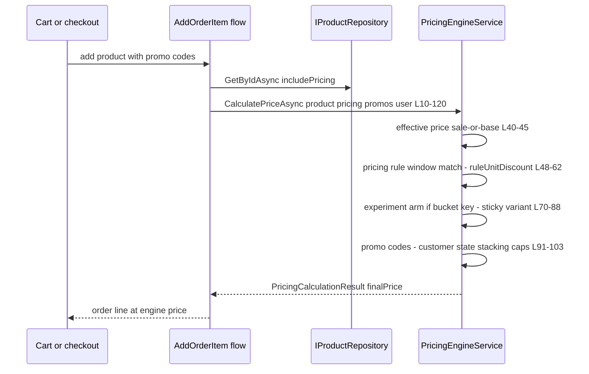
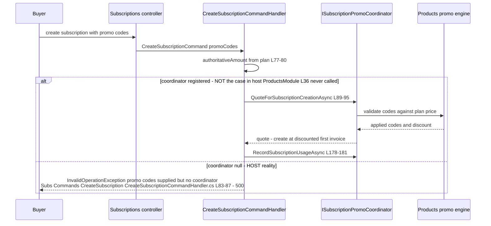
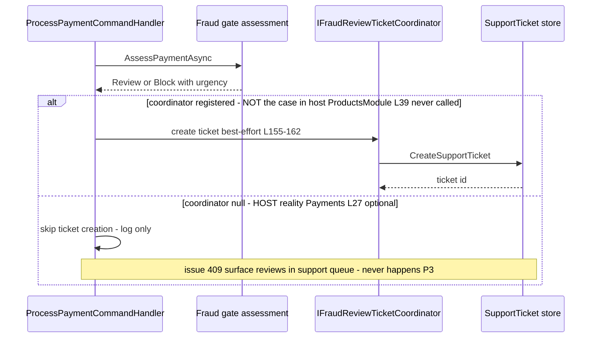
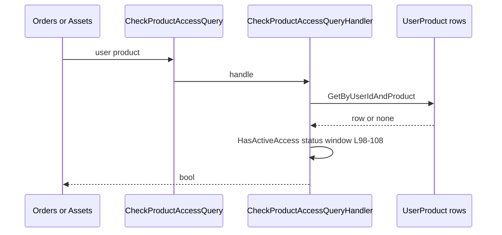
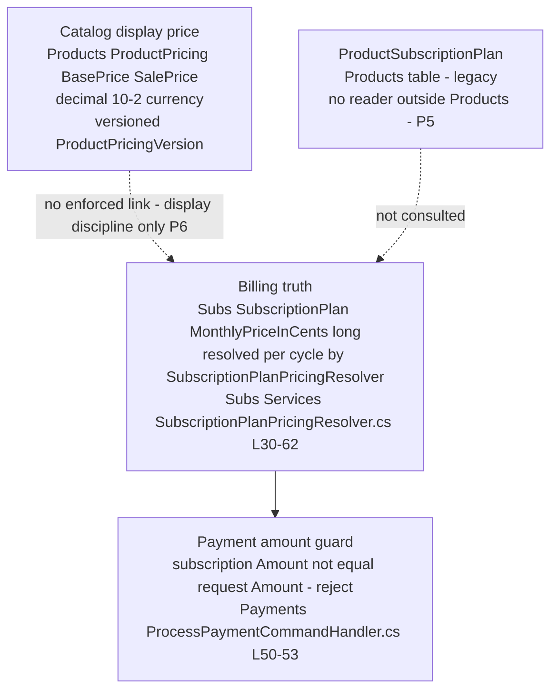

# Products — cross-module sequences

> Module `GameGuild.Commerce.Products` · Documented against `develop` commit `60100459e6`.
> Citation shorthand: `Products:` = `apps/api/Source/Modules/GameGuild.Commerce.Products/`, `Subs:` = `apps/api/Source/Modules/GameGuild.Commerce.Subscriptions/`, `Payments:` = `apps/api/Source/Modules/GameGuild.Commerce.Payments/`, `Orders:` = `apps/api/Source/Modules/GameGuild.Commerce.Orders/`.

## 1. Checkout pricing — Orders asks Products for the effective price

Note the order of adjustments (rule → experiment → promo) is fixed in the engine (`Products:/Services/PricingEngineService.cs:48-103`); the same engine serves `CalculatePricingCommand` for preview surfaces.

## 2. Subscription creation with promo codes — the broken seam (P2)

Fail verdict: **fail-closed as an unplanned 500** — the guard is correct (codes must not be silently dropped), but the registration hole turns every promo-coded subscription creation into an error (P2).

## 3. Fraud manual review → support ticket — the silent seam (P3)

Same shape in `Subs:/Commands/SubscriptionChangeFraudGate.cs:66` — optional injection, silent skip.

## 4. Entitlement check — sibling modules pull access

Assets' paid-download windows ride this seam via `CommerceOrderValidationService` (`API:/Core/Setup/InfrastructureLayerExtensions.cs:295-297`), which itself consults order/payment state — the entitlement answer is one of two inputs.

## 5. Pricing display vs. billing truth — the consistency contract post-#1266

Two independent price surfaces must agree for a subscription product:

The contract that holds: **the money path is closed** — plan price (cents) is authoritative, resolved through `IPlanPricingResolver` for preview/checkout/renewal alike (issue #416 note in `SubscriptionPlanPricingResolver.cs:10-14`), and the payments handler rejects any requested amount that diverges (`:50-53`), the #1266-era hardening documented in `docs/commerce/payments/01-user-flows.md` edge 2.

The contract that does NOT hold: nothing reconciles `ProductPricing` (what the product page shows) with `SubscriptionPlan.MonthlyPriceInCents` (what is billed). A merchandiser editing one without the other produces an honest-but-wrong price tag; the guard downstream only protects the charge, not the display. `ProductSubscriptionPlan` (`ProductsModule.cs:258-266`) is a third, orphaned plan table with no reader outside the module (`06-gaps.md` P5).

## 6. Shared surfaces with the payments/billing matrices

Cross-referenced against `docs/commerce/payments/02-cqrs-wiring-matrix.md` and `docs/commerce/billing-orders/cqrs-wiring-matrix.md`:

| Shared surface | Owner | Where the other matrix references it |
|---|---|---|
| `IPromoDiscountCalculator` | implemented here (adapter), abstraction in Payments | payments matrix Pricing/Promo rows (issue #417 seam) |
| Pricing preview at checkout | engine here, consumed by Orders/Subscriptions | billing-orders matrix `pricing:preview` / `breakdown` rows (plan side) |
| Subscription promo codes | quotes/usage recorded here via `ISubscriptionPromoCoordinator` | billing-orders matrix plan-change/upgrade rows apply promos through the same coordinator (registration hole P2 applies there too — any Subs path taking promo codes) |
| Fraud review tickets | `IFraudReviewTicketCoordinator` implemented here | payments matrix fraud family (reviews surface as tickets — silent skip P3) |
