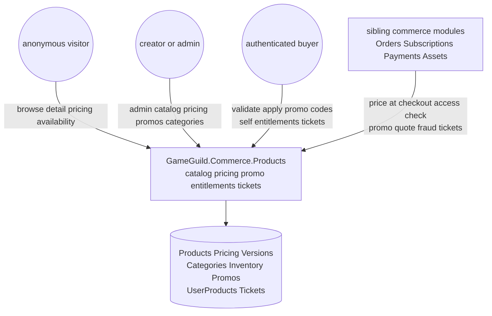
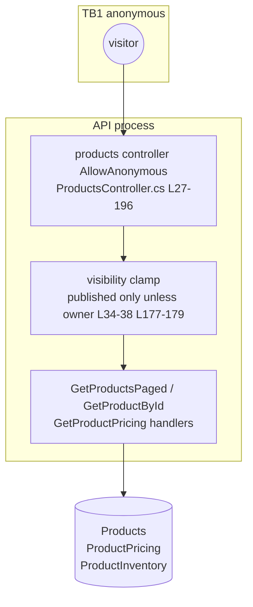
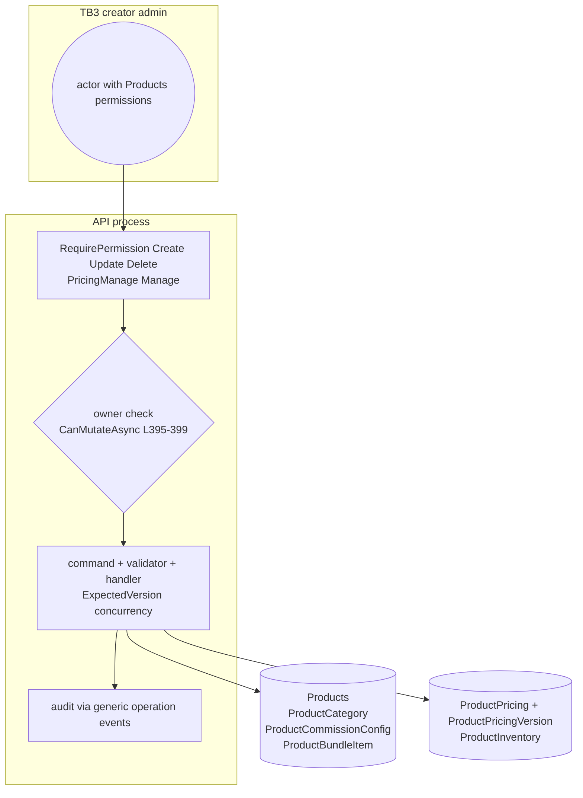
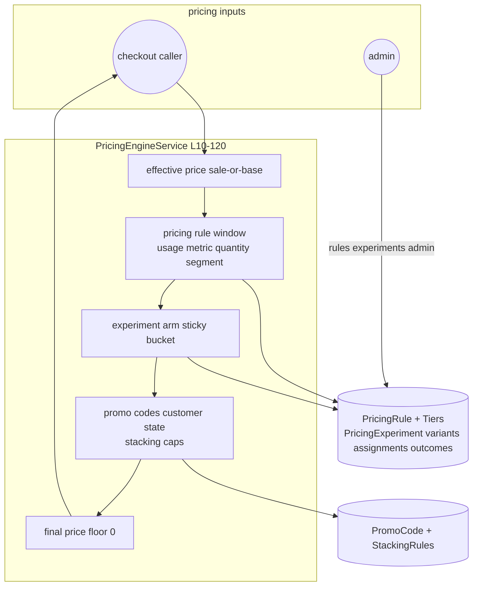
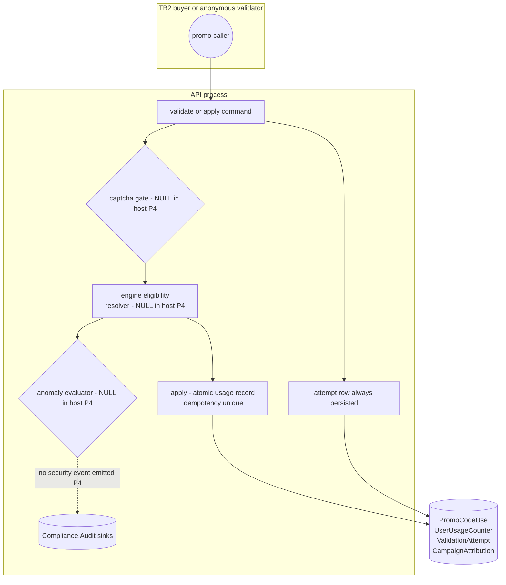
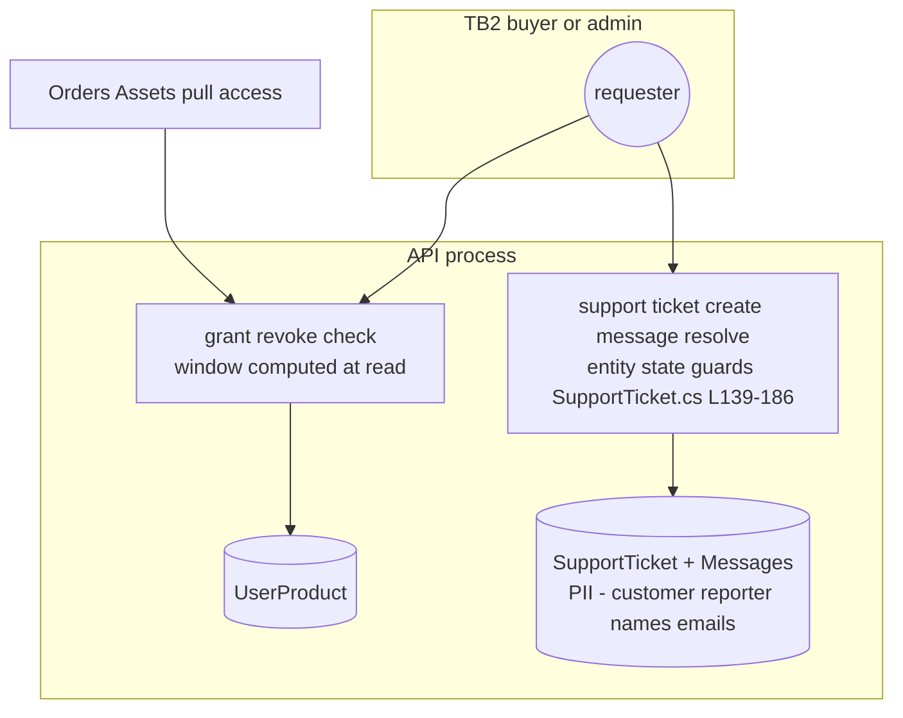
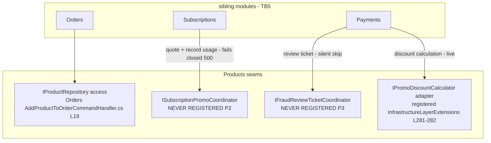

# Products — data-flow diagrams

> Module `GameGuild.Commerce.Products` · Documented against `develop` commit `60100459e6`.
> PII marked per flow. The module stores no direct personal identifiers beyond user/creator ids and support-ticket contact fields (customer/reporter names and emails — flagged below).

## Level 0 — context

Trust boundaries: TB1 anonymous/visitor → API; TB2 authenticated buyer → API; TB3 creator/admin (typed permissions) → API; TB4 API → stores (in-process); TB5 sibling modules → module seams (in-process, coordinator interfaces).

## C1 — Catalog reads (level 1)

PII: none crosses TB1.

## C2 — Catalog administration (level 1)

PII: none.

## C3 — Pricing engine (level 1)

Dormant leg: scheduler worker (P1) would drive rule/experiment window transitions inside S3 — edge absent in the composed host.

## C4 — Promo engine (level 1)

PII: usage rows carry user ids (pseudonymous references), no contact data.

## C5 — Entitlements + tickets (level 1)

PII: `SupportTicket.CustomerName/ReporterName/ReporterEmail` (`ProductsModule.cs:376-378`) cross TB2 — the module's only direct PII columns; exposure governed by typed read permissions and self-scope on `MySupportTicketsController`.

## C6 — Cross-module seams (level 1)

## Boundary inventory

| Boundary | Crossers | Control |
|---|---|---|
| TB1 anonymous → API | catalog reads | published-only clamp; drafts 404; no rate limit (residual C1.6) |
| TB2 buyer → API | promo validate/apply, self entitlements, own tickets | `[Authorize]`; idempotent apply; **captcha off (P4)** |
| TB3 creator/admin → API | catalog + pricing + promo admin | typed permissions + owner checks + monetize command gate (pricing) |
| TB4 API ↔ stores | 20+ tables | in-process EF Core; unique indexes for idempotency/eligibility floors |
| TB5 siblings ↔ module seams | 4 coordinator/repository seams | two live, two unregistered (P2/P3) — the seams' consumers fail closed or silent per optionality |
