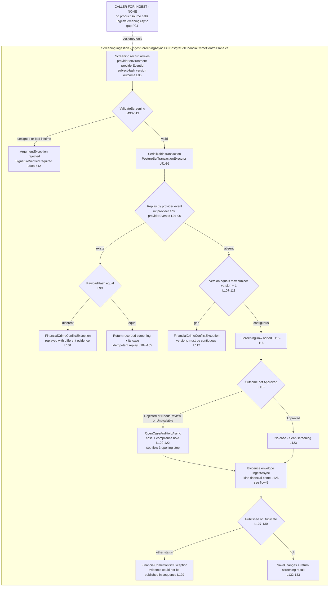
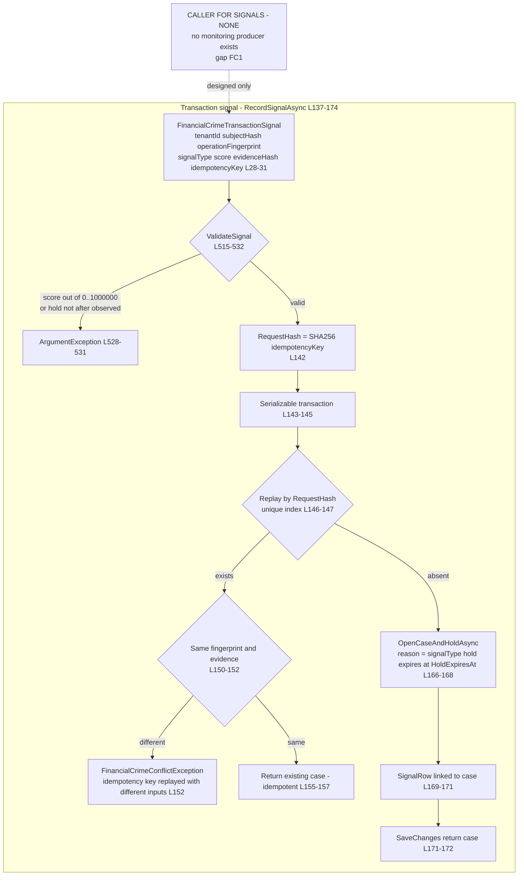
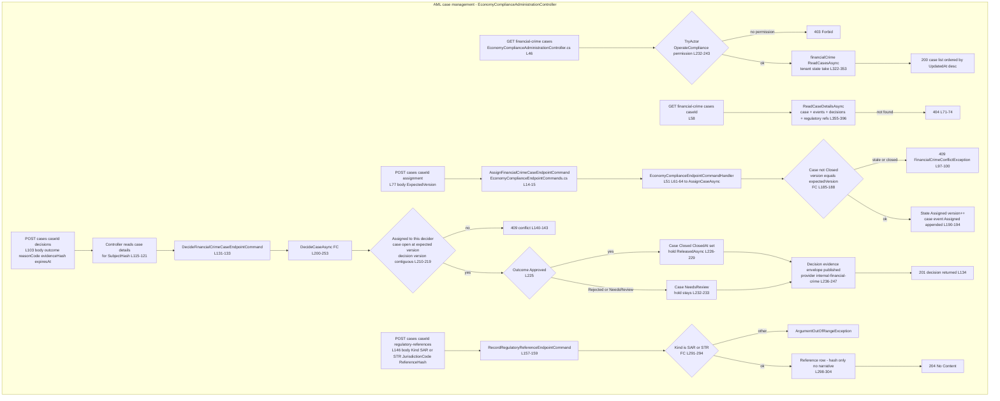
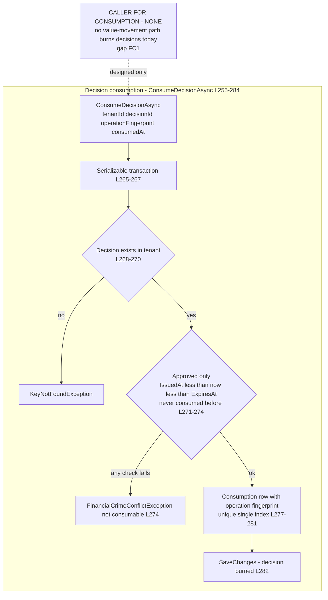
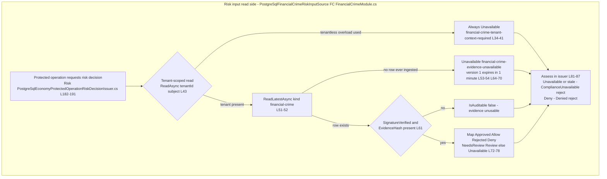

# FinancialCrime (AML) user flows — happy path and every edge case

> Module `GameGuild.Compliance.FinancialCrime` + host composition · Documented against `develop` commit `60100459e6`.
> Citation shorthand: `FC:` = `apps/api/Source/Modules/GameGuild.Compliance.FinancialCrime/`, `API:` = `apps/api/Source/GameGuild.API/`, `Risk:` = `apps/api/Source/Modules/GameGuild.Finance.Economy/Risk/`.

## 1. Screening ingestion — sanctions / PEP / adverse-media (DESIGNED; ingress has no caller)

The designed happy path: a screening provider (or an internal connector) delivers a signed screening event; `IngestScreeningAsync` (`FC:/PostgreSqlFinancialCrimeControlPlane.cs:86-135`) validates it, detects replays, enforces the contiguous per-subject version ladder, auto-opens an AML case + compliance hold when the outcome is anything but `Approved`, publishes the evidence envelope to the durable compliance ledger, and saves — all inside one `Serializable` transaction.

### 1a. Edge-case matrix — screening ingestion

| # | Edge case | Code path | Outcome |
|---|-----------|-----------|---------|
| 1 | Provider replays the same event id | replay lookup (`FC:/PostgreSqlFinancialCrimeControlPlane.cs:94-96`) | recorded screening returned with its case; no second row |
| 2 | Provider replays with a different payload | payload-hash guard (`:99-102`) | `FinancialCrimeConflictException` — treated as evidence tampering |
| 3 | Out-of-order delivery (version gap) | contiguous-version guard (`:107-113`) | conflict exception; the provider must resend the missing version |
| 4 | Unsigned screening | `ValidateScreening` (`:508-512`) | rejected before any transaction — `SignatureVerified=true` is mandatory |
| 5 | Screening with `ExpiresAt <= IssuedAt` or `NextScreenAt <= IssuedAt` | lifetime validation (`:509`) | rejected |
| 6 | `ReceivedAt` predates `IssuedAt` (future-dated evidence) | validation (`:509`) | rejected |
| 7 | Non-approved outcome for a subject that already has an open case | `OpenCaseAndHoldAsync` reuse (`:402-407`) | existing active case returned; no duplicate case or hold |
| 8 | Evidence ledger rejects the envelope (out-of-sequence version) | ingestion status check (`:127-130`) | whole transaction rolls back — screening row and case never persist without evidence |
| 9 | Who calls this today | search at `60100459e6` | **nobody** — no controller, no worker, no webhook (`06-gaps.md` FC1) |

## 2. Transaction-monitoring signal → case (DESIGNED; ingress has no caller)

`RecordSignalAsync` (`FC:/PostgreSqlFinancialCrimeControlPlane.cs:137-174`) is the designed hook for transaction-monitoring scores (velocity, structuring patterns, anomaly detectors): a signal carries an idempotency key hashed to `RequestHash`, and any signal always opens (or reuses) a case + hold.

### 2a. Edge-case matrix — transaction signal

| # | Edge case | Code path | Outcome |
|---|-----------|-----------|---------|
| 1 | Same idempotency key sent twice with identical inputs | request-hash replay (`FC:/PostgreSqlFinancialCrimeControlPlane.cs:146-158`) | existing case returned; one signal row |
| 2 | Same idempotency key, different fingerprint/evidence | input-match guard (`:150-152`) | conflict exception — key reuse across different operations is a bug/tamper signal |
| 3 | Two different signals for the same subject with an open case | `OpenCaseAndHoldAsync` reuse (`:402-407`) | both signals attach to the same case |
| 4 | Signal arrives after the hold expired but case still open | no state guard on the case in this path (`:166-168`) | case reused; hold reactivation is not attempted (hold TTL was set by the first opener) |
| 5 | Who calls this today | search at `60100459e6` | **nobody** (`06-gaps.md` FC1) |

## 3. AML case review — the LIVE admin flow

The only reachable flow: an analyst with `economy:operate:compliance` lists cases, opens details, self-assigns, and decides. Route base `api/v{v}/admin/economy/compliance` (`API:/Core/Controllers/EconomyComplianceAdministrationController.cs:36`).

### 3a. Edge-case matrix — case management

| # | Edge case | Code path | Outcome |
|---|-----------|-----------|---------|
| 1 | Analyst without `OperateCompliance` | `TryActor` gate (`API:/Core/Controllers/EconomyComplianceAdministrationController.cs:232-243`) | 403 on every endpoint, reads included |
| 2 | Concurrent assignment with stale `ExpectedVersion` | optimistic-version guard (`FC:/PostgreSqlFinancialCrimeControlPlane.cs:185-188`) | 409 — no lost update |
| 3 | Decision by an analyst the case is not assigned to | assignee guard (`:210-213`) | 409 — decisions require self-assignment first |
| 4 | Decision version skipping | contiguous decision versions (`:215-219`) | 409 conflict |
| 5 | Second Approved decision after close | closed-state guard (`:185, :210`) | 409 — closed cases accept nothing |
| 6 | Decision evidence ledger rejects the envelope | status check (`:245-248`) | whole decision transaction rolls back — case state and decision stay untouched |
| 7 | Regulatory reference with a kind other than SAR/STR | kind whitelist (`:291-294`) | rejected — the only two report kinds the schema understands |
| 8 | SAR reference content itself | hash-only storage (`:298-304`) | only `ReferenceHash` is stored; the narrative lives with the FIU, never here |
| 9 | Case with zero rows today | `ReadCasesAsync` (`:322-353`) | 200 `[]` — because nothing can open a case (FC1) |
| 10 | Rate limiting on these endpoints | none on the controller (`:35-44`) | no policy — `06-gaps.md` FC7 (mirrors compliance N8) |

## 4. Decision consumption at the money path (DESIGNED; no caller)

An `Approved` case decision is a scarce, single-use, windowed release: `ConsumeDecisionAsync` (`FC:/PostgreSqlFinancialCrimeControlPlane.cs:255-284`) burns it exactly once for one operation fingerprint inside `[IssuedAt, ExpiresAt)`.

### 4a. Edge-case matrix — decision consumption

| # | Edge case | Code path | Outcome |
|---|-----------|-----------|---------|
| 1 | Replay of the same consumption | consumed-before guard + unique index (`FC:/PostgreSqlFinancialCrimeControlPlane.cs:271-272`, `FC:/FinancialCrimePersistence.cs:194`) | conflict — one release per decision |
| 2 | Consumption at/beyond `ExpiresAt` | window guard (`:271`) | conflict — expired approvals cannot release anything |
| 3 | Non-approved decision consumed | outcome guard (`:271`) | conflict by design — only `Approved` is consumable |
| 4 | Who calls this today | search at `60100459e6` | **nobody** — the hold-release consumption leg of the design is dormant (`06-gaps.md` FC1) |

## 5. Evidence publication → risk-gate read side (LIVE read side)

Every screening ingestion and every case decision publishes a `ComplianceEvidenceEnvelope` with `EvidenceKind = "financial-crime"` through `IComplianceEvidenceStore` (`FC:/PostgreSqlFinancialCrimeControlPlane.cs:126, 236-247`); the money path reads the latest row of that kind through `PostgreSqlFinancialCrimeRiskInputSource` (`FC:/FinancialCrimeModule.cs:43-62`).

### 5a. Edge-case matrix — read side

| # | Edge case | Code path | Outcome |
|---|-----------|-----------|---------|
| 1 | Evidence exists but expired | freshness check (`Risk:/EconomyProtectedRiskDecisionIssuerSupport.cs:22-38`) | `ComplianceStale` — deny (fail-closed) |
| 2 | Evidence result `NeedsReview` | assess (`:41-49`) | `Review` outcome → risk review case submitted (`Risk:/PostgreSqlEconomyProtectedOperationRiskDecisionIssuer.cs:145-150`) |
| 3 | Evidence `Allow` but signature unverified | `IsAuditable` flag (`FC:/FinancialCrimeModule.cs:61`) | evidence inadmissible — `RequireFreshAllow` throws (`Risk:/ExternalRiskEvidence.cs:67-71`) on conversion paths |
| 4 | Evidence row today | table state | none — ingestion has no caller (FC1), so every subject is `Unavailable` |
