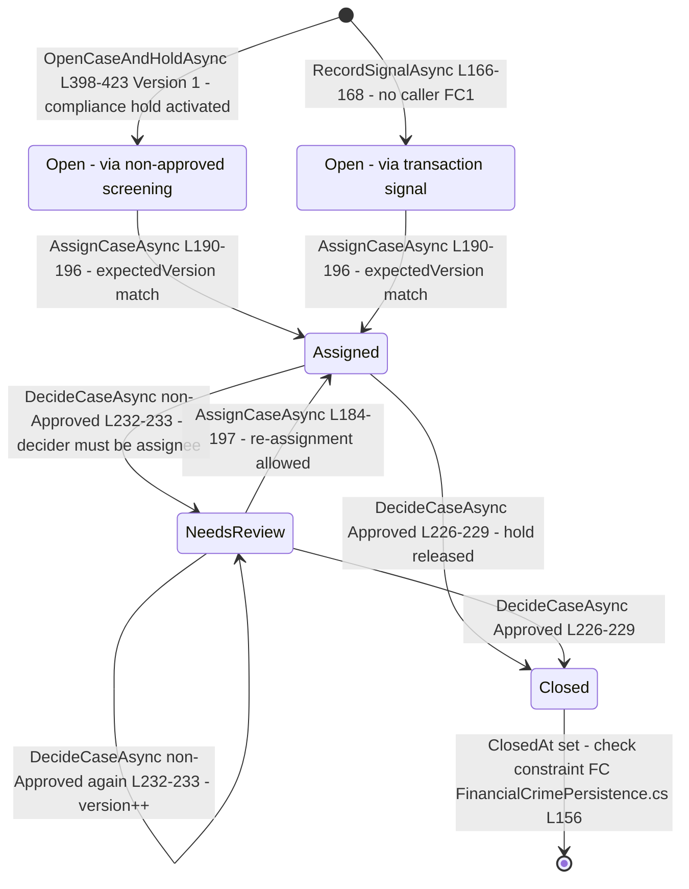
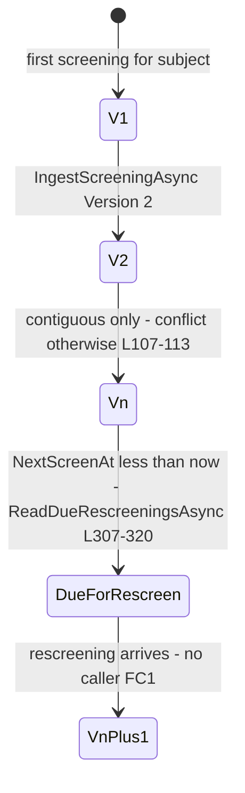
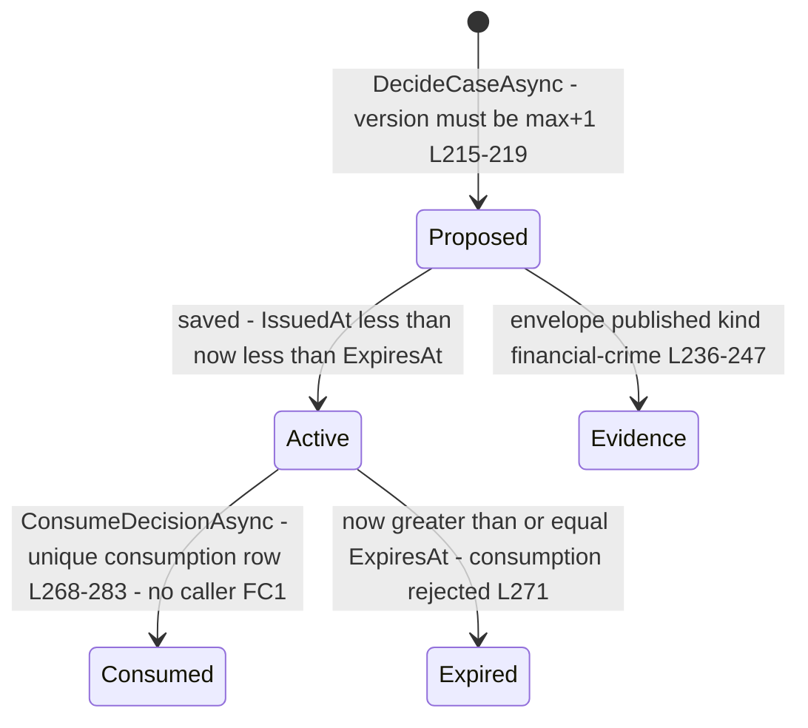

# FinancialCrime (AML) — state machines

> Module `GameGuild.Compliance.FinancialCrime` · Documented against `develop` commit `60100459e6`.
> Citation shorthand: `FC:` = `apps/api/Source/Modules/GameGuild.Compliance.FinancialCrime/`.

## 1. AML case lifecycle (`FinancialCrimeCaseRow.State`)

States (`FC:/PostgreSqlFinancialCrimeControlPlane.cs:11`): `Open = 1`, `Assigned = 2`, `NeedsReview = 3`, `Closed = 4`.

### Transitions audit

| Transition | Trigger | Guard | Evidence | Reachable? |
|---|---|---|---|---|
| `*` → `Open` | non-approved screening or any signal | none (implicit: outcome ≠ Approved / signal path); active-case reuse guard returns existing instead | `FC:/PostgreSqlFinancialCrimeControlPlane.cs:118-123, 166-168, 402-416` | **no** — both openers have no caller (FC1) |
| `Open/NeedsReview/Assigned` → `Assigned` | analyst assignment | `State != Closed` AND `Version == expectedVersion` | `:185-196` | yes (endpoint `:77-101`) |
| `Assigned` → `Closed` | Approved decision | assignee == decider AND case version match AND decision version contiguous | `:210-229` | yes (endpoint `:103-144`) |
| `Assigned` → `NeedsReview` | non-approved decision | same guards | `:232-233` | yes |
| `Closed` → anything | — | **hard stop**: every mutation path rejects `Closed` | `:185-188, :210-213` | n/a (by design) |

**Unreachable states today**: all four — because no case can be created through any wired path (FC1). The machine itself is sound; its only entry events are unwired.

**Missing guards** (found by this audit):
- The `Unavailable` screening outcome also opens a case (`:118-123`) — a provider outage becomes a case + hold per subject. Intended fail-closed, but with no `Unavailable`-specific reason routing a rescreening that repairs evidence still needs a manual Approved decision to release the hold.
- `NeedsReview` after a `Rejected` decision keeps the case open forever if nobody re-assigns — no closure path exists besides an Approved decision (a rejection is never terminal for the case). No deadline/sweeper exists.
- Assignment has no target-actor eligibility check (any `OperateCompliance` actor can assign to themselves — the decider-must-be-assignee guard at `:210` then makes self-service approval possible by a single analyst). No two-person rule on Approved decisions — STRIDE F3 (S4 Elevation).

## 2. Screening version ladder (`compliance_financial_crime_screenings`)

Per `(TenantId, SubjectHash)` the `Version` column must advance by exactly 1 (`FC:/PostgreSqlFinancialCrimeControlPlane.cs:107-113`); the unique index `(TenantId, SubjectHash, Version)` (`FC:/FinancialCrimePersistence.cs:130-131`) makes gaps and duplicates impossible even under races.

- Latest-wins semantics: `ReadDueRescreeningsAsync` returns only rows with no higher-version sibling (`:315-318`) — the designed rescreening worklist.
- Replay window: `(Provider, Environment, ProviderEventId)` unique (`:128-129`); same id + different `PayloadHash` = conflict (`:99-102`).
- Outcome mapping to the evidence ledger: `Approved/Rejected/NeedsReview/Unavailable` → `Allow/Deny/Review/Unavailable` (`FC:/FinancialCrimeModule.cs:72-78`).

## 3. Decision lifecycle (per case)

- Decisions are immutable rows; corrections are new, higher-version decisions on the same case (`:222-224`).
- Only `Approved` is consumable, only once, only inside the window (`:271-274`); the unique index on `DecisionId` in `compliance_financial_crime_decision_consumptions` (`FC:/FinancialCrimePersistence.cs:194`) is the physical single-use fence.
- `Rejected`/`NeedsReview` decisions exist for the record (and evidence ledger) but grant nothing.

## 4. Compliance-hold shadow lifecycle (economy-owned)

Every open case activates an `IComplianceHoldStore` hold (`:418-421`) with the synthetic system actor `Guid 00000000-0000-0000-0000-000000000001`; an Approved decision releases it (`:229`). The hold's own states (`Activated → ReleaseProposed → ReleaseApproved → Released`, plus admin propose/approve via `ProposeComplianceHoldReleaseEndpointCommand`/`ApproveComplianceHoldReleaseEndpointCommand` with step-up — `API:/Core/Commands/EconomyComplianceEndpointCommands.cs:22-28, 79-90`) are owned by the economy risk surface; the FinancialCrime module only activates/releases. Note the actor-id placeholder is a literal inline constant (`FC:/PostgreSqlFinancialCrimeControlPlane.cs:420`) — audit rows in the hold store will attribute case-opening to "system" with no linkage back to the triggering screening id except via the case's `Opened` event evidence hash (`:417`).

## 5. Machine-inventory summary for the tracker

| Machine | States | Declared in | Entry events wired? |
|---|---|---|---|
| AML case | 4 (`Open/Assigned/NeedsReview/Closed`) | `FC:/PostgreSqlFinancialCrimeControlPlane.cs:11` | no (openers unwired, FC1) |
| Screening version ladder | unbounded monotonic | `FC:/FinancialCrimePersistence.cs:130-131` + ingest guard | no (ingest unwired, FC1) |
| Decision + consumption | proposed → active → consumed/expired | `FC:/PostgreSqlFinancialCrimeControlPlane.cs:215-283` | decide wired; consume unwired (FC1) |
| Compliance hold (shadow) | economy-owned 4-state | `Risk:/PostgreSqlComplianceHoldAdministrationStore.cs:12-15` | activate on case-open (dormant with FC1), release on Approved decision (wired) |
