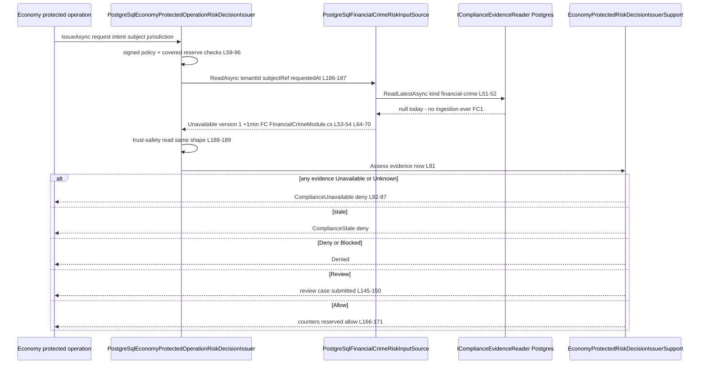
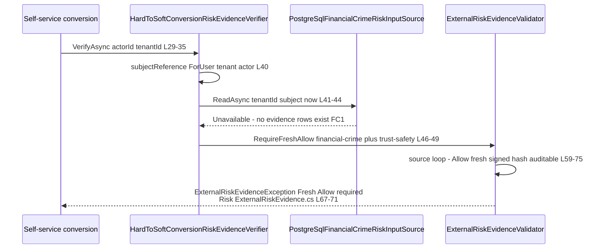
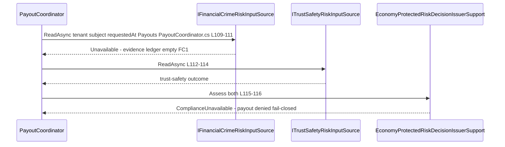
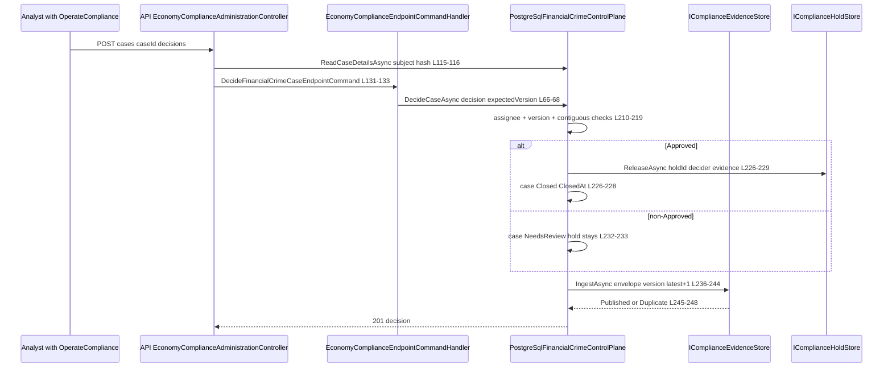
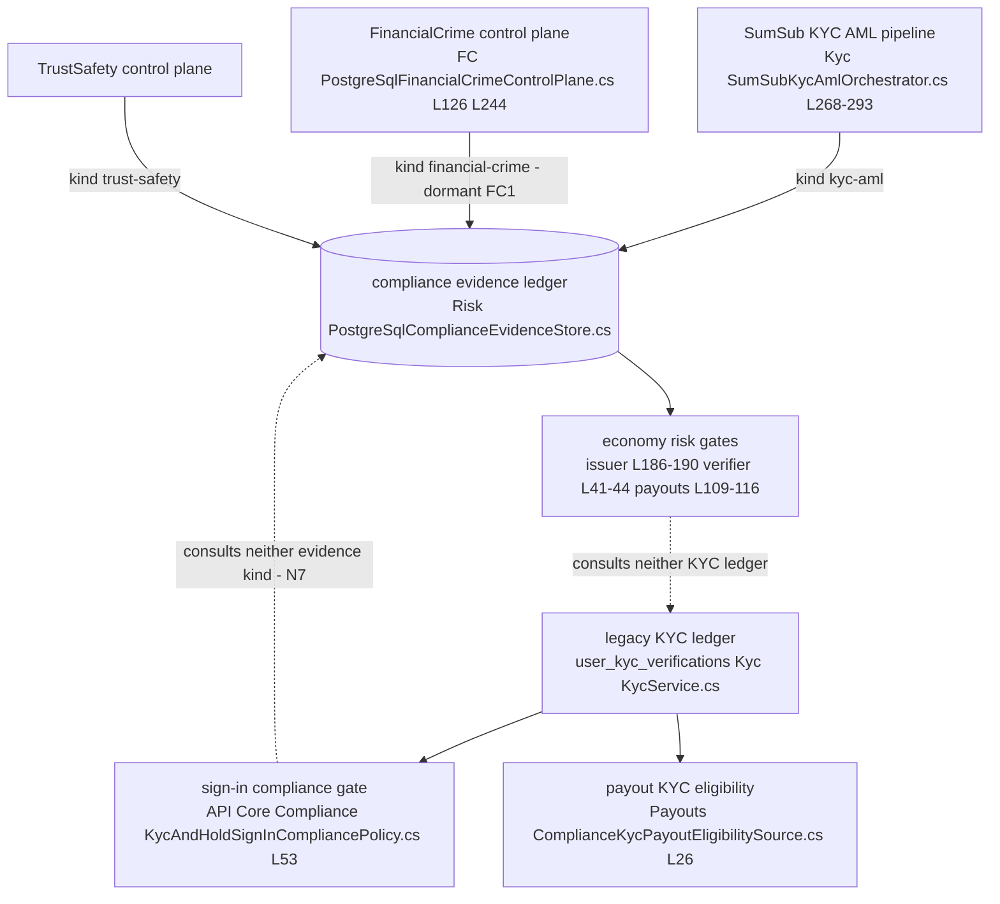

# FinancialCrime (AML) — cross-module sequences

> Module `GameGuild.Compliance.FinancialCrime` · Documented against `develop` commit `60100459e6`.
> Citation shorthand: `FC:` = `apps/api/Source/Modules/GameGuild.Compliance.FinancialCrime/`, `Risk:` = `apps/api/Source/Modules/GameGuild.Finance.Economy/Risk/`, `Payouts:` = `apps/api/Source/Modules/GameGuild.Finance.Economy.Payouts/`, `API:` = `apps/api/Source/GameGuild.API/`, `Kyc:` = `apps/api/Source/Modules/GameGuild.Compliance.KYC/`.

## 1. Protected operation → risk decision reading AML evidence (LIVE)

Fail-open/fail-closed verdict: **fail-closed** — absent, stale, or unsigned AML evidence blocks the operation. With FC1 (no ingestion), the Allow branch is unreachable for every subject.

## 2. HardCoin → SoftCoin conversion verification (LIVE)

Hard gate: conversions require **fresh explicit Allow from both external sources**; absence is an exception, not a downgrade.

## 3. Payout coordination (LIVE read side)

The legacy KYC payout eligibility source (`Payouts:/ComplianceKycPayoutEligibilitySource.cs`) is a **separate, earlier** check against `user_kyc_verifications` — the two gates stack, and neither reads the other's evidence (see §5).

## 4. Case decision → evidence ledger → hold release (LIVE)

Timeouts/failure verdicts: every leg is one `Serializable` DB transaction — an evidence-store rejection rolls back the case mutation and the hold release together (no partial release).

## 5. The three evidence ledgers and the two gates that consult neither — N7 extended

The compliance package's N7 finding (two KYC ledgers, no bridge) extends into three ledgers once AML is considered: a SumSub-verified user produces `kyc-aml` evidence but **no** `financial-crime` evidence, so the risk gates still deny; conversely a future screening provider producing `financial-crime` Allow evidence says nothing about the sign-in gate. The gates that protect money and the gates that protect access read disjoint evidence sets — an AML examiner will ask which one is authoritative (`07-stride-threat-model.md` F6; `06-gaps.md` FC5).
