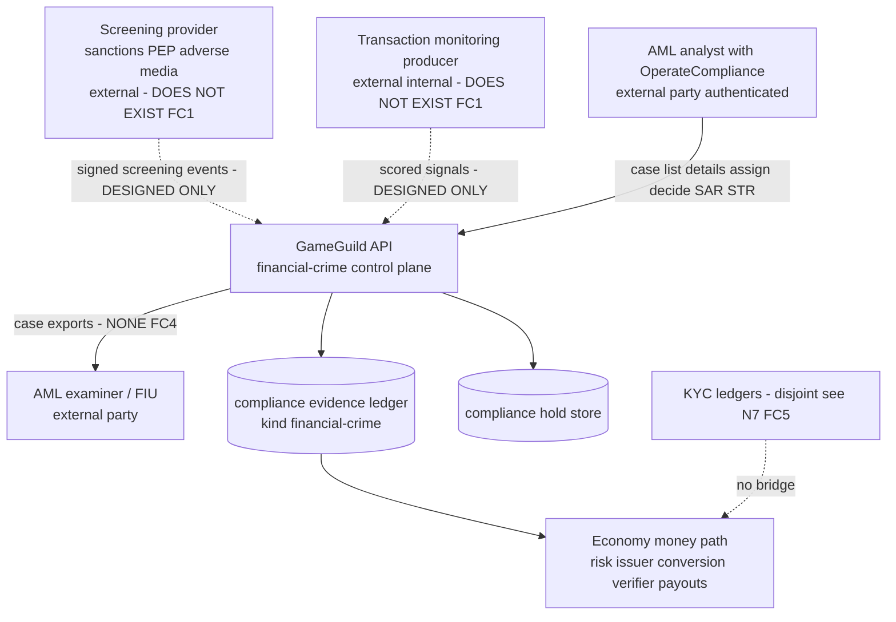
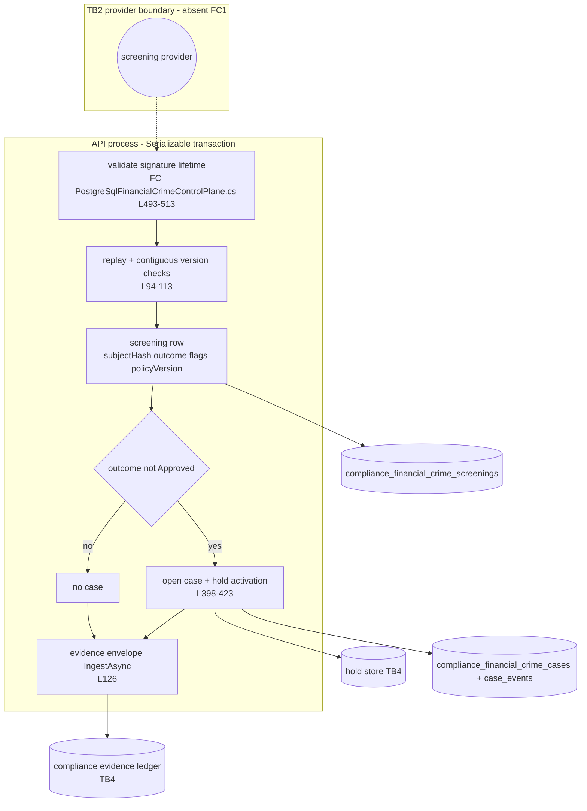
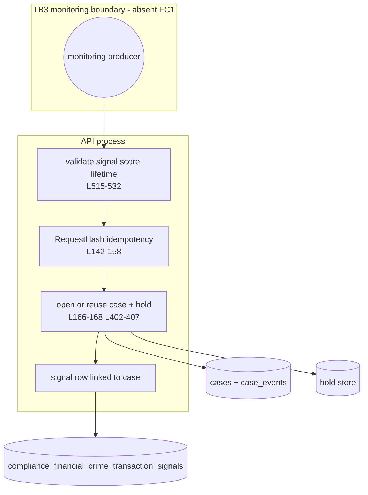
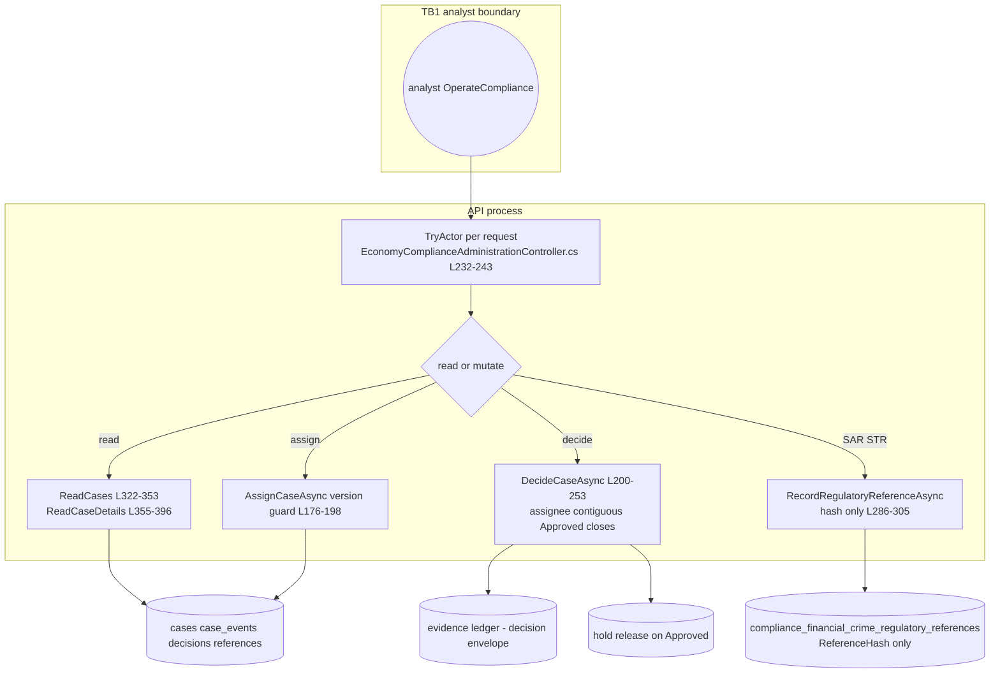
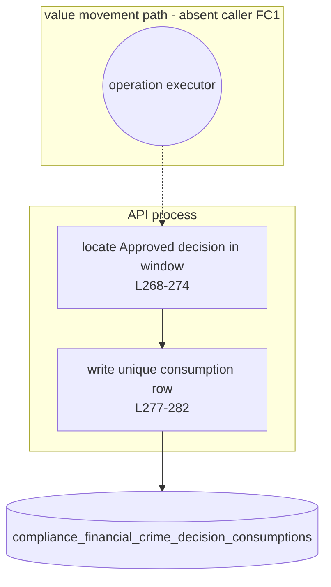
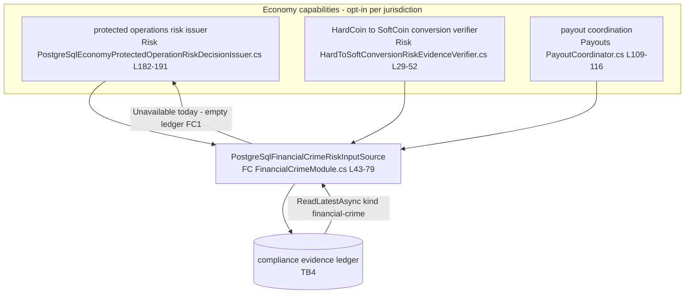

# FinancialCrime (AML) — data-flow diagrams

> Module `GameGuild.Compliance.FinancialCrime` · Documented against `develop` commit `60100459e6`.
> PII note: no direct personal identifiers cross any boundary — subjects move as `SubjectHash` (SHA-256, ≤128 hex chars) everywhere in this module.

## Level 0 — context

Trust boundaries: TB1 analyst→API (authenticated + `OperateCompliance`); TB2 provider→API (designed, absent); TB3 monitoring→API (designed, absent); TB4 API→evidence/hold stores (in-process, transactional); TB5 API→examiner (absent).

## F1 — Screening ingestion (level 1)

Flows marked PII: none — `SubjectHash` only. The dashed input edge is the FC1 void.

## F2 — Transaction monitoring (level 1)

## F3 — Case management (level 1, live)

Flows marked PII: none (subject hashes + hashes of external references).

## F4 — Decision consumption (level 1, designed)

## F5/F6 — Evidence ledger and money-path gates (level 1, live read side)

Flows marked PII: none; the subject reference is derived from actor id + tenant (`Risk:/EconomySubjectReference.cs:13`) and hashed before storage.

## Boundary inventory

| Boundary | Crossers | Control |
|---|---|---|
| TB1 analyst → API | case reads/writes | `[Authorize]` + `OperateCompliance` per request; no rate limit (FC7); no step-up on decisions (FC2) |
| TB2 provider → API (absent) | screening events | designed: signature-verified envelopes only (`FC:/PostgreSqlFinancialCrimeControlPlane.cs:508-512`) |
| TB3 monitoring → API (absent) | signals | designed: idempotency-key hashed, input-match replay guards (`:142-158`) |
| TB4 API ↔ stores | evidence, holds, 7 tables | in-process `Serializable` transactions; single-use and contiguity enforced by unique indexes |
| TB5 API → examiner (absent) | case exports | none exists (FC4) |
| TB6 evidence kinds ↔ KYC ledgers | none — disjoint (FC5) | no bridge, no precedence rule |
