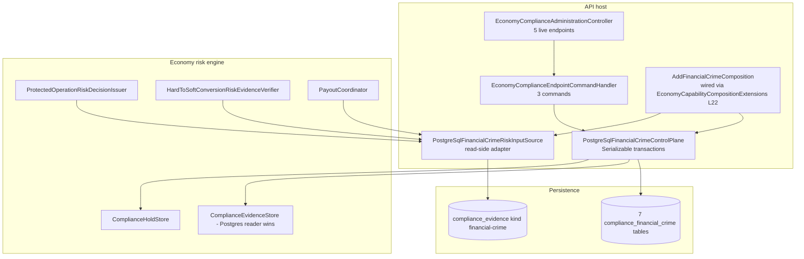

# FinancialCrime (AML) — security architecture

> Module `GameGuild.Compliance.FinancialCrime` · Documented against `develop` commit `60100459e6`.
> Consolidates `07-stride-threat-model.md` and `08-dfds.md` into the component view, permission map, integrity chain, and fail-verdicts an AML program owner needs.

## 1. Components and trust boundaries

Boundaries: analyst→API (typed `OperateCompliance`); provider/monitoring→API (designed, absent — FC1); API↔stores (in-process transactional); API→examiner (absent — FC4); evidence kinds↔KYC ledgers (disjoint — FC5).

## 2. Who-can-do-what permission map

| Capability | Gate | Evidence |
|---|---|---|
| List/read AML cases | `economy:operate:compliance` | `API:/Core/Controllers/EconomyComplianceAdministrationController.cs:232-243` |
| Assign case | same | `:77-101` |
| Decide case (approve→release hold) | same — **no step-up** (FC2) | `:103-144` |
| Record SAR/STR reference | same | `:146-166` |
| Ingest screening / record signal / consume decision / rescreen | **no caller exists** | `02-cqrs-wiring-matrix.md` §2 (FC1) |
| Move value (gated on this evidence) | economy capability opt-in + jurisdiction allowlist | `Risk:/EconomyRiskComposition.cs:36-64` |

## 3. Integrity chain (what holds today)

1. Screening evidence: contiguous versions per subject + provider-event replay conflict (`FC:/PostgreSqlFinancialCrimeControlPlane.cs:94-113`).
2. Cases: optimistic versions, append-only sequenced events, closed⇒ClosedAt check constraint (`:176-253`, `FC:/FinancialCrimePersistence.cs:151-173`).
3. Decisions: contiguous per case, immutable, single-use windowed consumption enforced by unique index (`:215-283`, `:194`).
4. Evidence ledger: transactional with the case mutation; non-`Published` ingestion rolls everything back (`:126-130, :245-248`).
5. Money path: risk decision rows carry the financial-crime evidence hash (`Risk:/PostgreSqlEconomyProtectedOperationRiskDecisionIssuer.cs:272-305`).

Missing links: the producer side of (1) and the consumer side of (3) — i.e., the chain is sound but **unfed** (FC1).

## 4. Fail-open/fail-closed verdicts

| Dependency | Failure | Verdict |
|---|---|---|
| Screening evidence absent (today, universal) | risk input `Unavailable` | **fail-closed** — value movement denied (`ComplianceUnavailable`) |
| Evidence stale | freshness check | **fail-closed** (`ComplianceStale`) |
| Evidence unsigned/hashless | `IsAuditable` false | **fail-closed** — inadmissible |
| Evidence store unreachable | read throws | **fail-closed** (exception propagates; no fallback reader active in the composed host — the `UnavailableComplianceEvidenceReader` singleton is shadowed by the Postgres registration) |
| Hold store unreachable on case-open | transaction aborts | **fail-closed** — no case without hold |
| Admin endpoints under load | none | neutral (no rate limit — FC7 residual) |

## 5. Deployment invariants

1. Never register a *screening ingress* that bypasses `IngestScreeningAsync` validation — unsigned evidence must not reach the ledger (`:508-512`).
2. The evidence-reader registration order is load-bearing: capability composition (Unavailable fallback) before core composition (Postgres reader) — last-wins is the live path; reordering silently swaps the reader for a always-null one (`API:/Core/Setup/ApiProductComposition.cs:123-124`).
3. Enabling Economy value movement without a screening connector makes every subject AML-denied — deliberate fail-closed, must be a rollout decision, not a surprise (FC1).
4. Approved case decisions release holds transactionally; never add a hold-release path that skips `DecideCaseAsync` (it is the only place evidence + release commit together).
