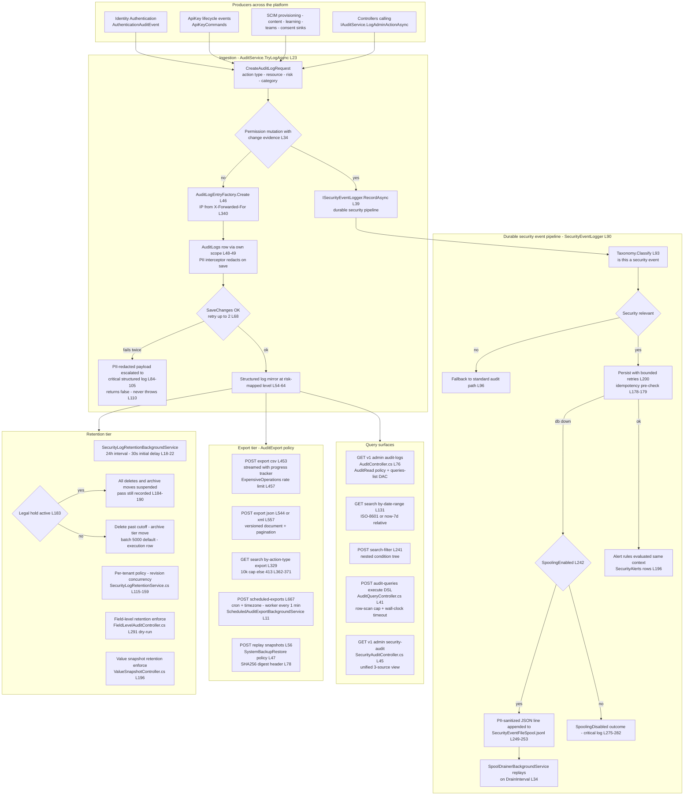
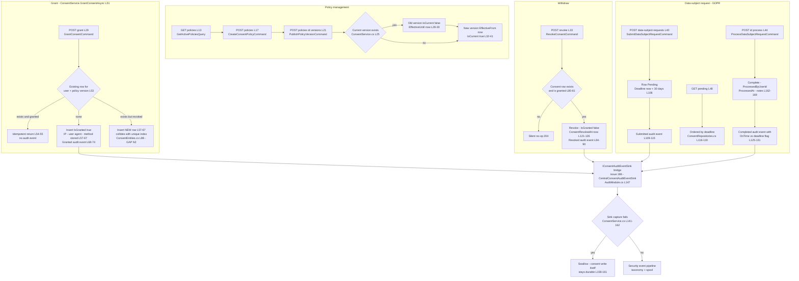
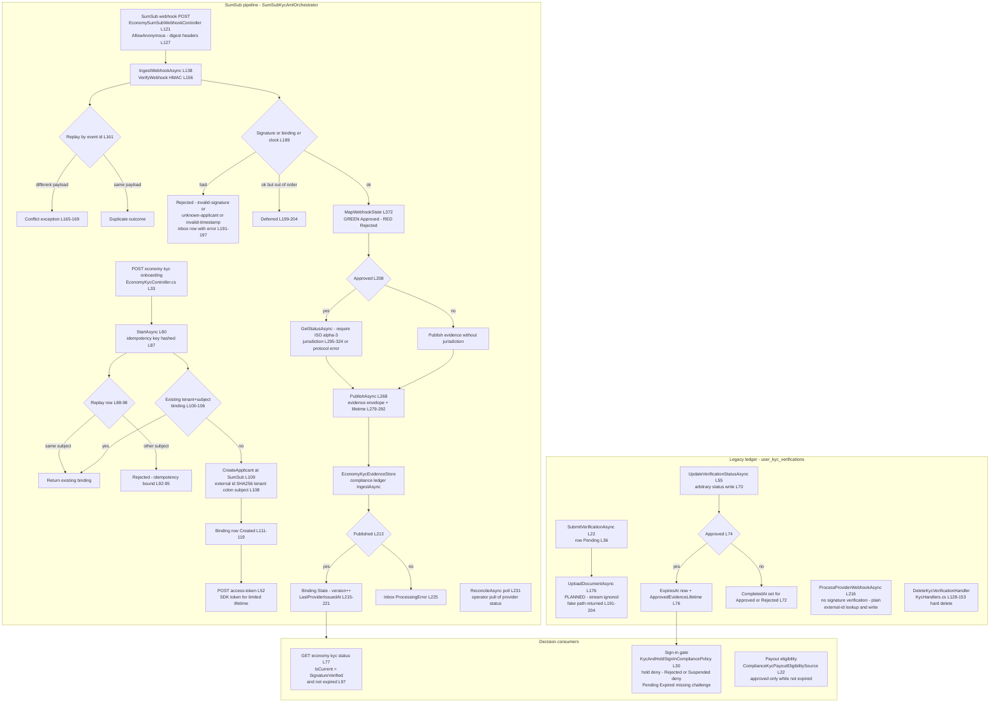

# Compliance User Flows — happy path and every edge case

> Modules `GameGuild.Compliance.Audit` / `Consent` / `FERPA` / `KYC` · Documented against `develop` commit `ac959fd8f`.
> Citation shorthand: `Audit:` = `apps/api/Source/Modules/GameGuild.Compliance.Audit/`, `Consent:` = `apps/api/Source/Modules/GameGuild.Compliance.Consent/`, `Ferpa:` = `apps/api/Source/Modules/GameGuild.Compliance.FERPA/`, `Kyc:` = `apps/api/Source/Modules/GameGuild.Compliance.KYC/`, `API:` = `apps/api/Source/GameGuild.API/`.

## 1. Audit event ingestion → storage → retention / export

Ingress is the central `IAuditService` seam plus the durable security-event pipeline. Producers across the platform call `IAuthenticationAuditEventSink` / `IApiKeyAuditEventSink` / module sinks (see `04-event-inventory.md`); the sinks land in `AuditService.TryLogAsync` (`Audit:/Services/AuditService.cs:23-113`), which routes permission-mutation events through `ISecurityEventLogger` (`:34-41`), persists through a fresh scope so the PII-redaction `SaveChangesInterceptor` applies (`Audit:/Services/PiiRedaction/AuditLogPiiRedactionInterceptor.cs:15-27`), retries twice, and on final failure writes a critical structured log with a PII-sanitized payload rather than throwing (`:84-110`).

### 1a. Edge-case matrix — ingestion, query, export, retention

| # | Edge case | Code path | Outcome |
|---|-----------|-----------|---------|
| 1 | DB down while persisting a plain audit event | 2 attempts then critical-log fallback (`AuditService.cs:68-110`) | business op proceeds; event only in structured logs; `false` returned for callers that check |
| 2 | DB down while persisting a *security* event | retry → disk spool (`SecurityEventLogger.cs:200-260`) | event survives outage as sanitized JSONL; drainer replays idempotently (`:105-155`) |
| 3 | Spool write itself fails | critical log with sanitized payload (`SecurityEventLogger.cs:262-272`) | `SpoolingDisabled` — the only path where a security event is not durably captured |
| 4 | Required MFA audit must persist in the owning transaction | `RecordInCommandAsync` throws without ambient transaction (`SecurityEventLogger.cs:73-76`); sink rethrows (`CentralAuthenticationAuditEventSink.cs:50-53,68`) | the MFA command fails rather than committing without its audit |
| 5 | Unparseable spool record | kept verbatim for operator inspection (`SecurityEventLogger.cs:120-122`) | never dropped silently; blocks nothing |
| 6 | Replay of an already-persisted spooled event | `AlreadyPersistedAsync` pre-check (`SecurityEventLogger.cs:125-129,178-179,285-291`) | no duplicate row or duplicate alerts |
| 7 | Client-supplied `X-Forwarded-For` spoofing | first header value wins (`SecurityEventLogger.cs:340-342`) | spoofable IP of record — accepted (behind trusted proxy), documented in `06-security-analysis.md` |
| 8 | Cross-tenant audit query by a tenant admin | `TryClampToTenantScope` fail-closed 403 (`AuditController.cs:48-71,85-88`) | non-system admins pinned to own tenant (issue #294) |
| 9 | `Take` above 1000 on list/export streams | clamp (`AuditController.cs:111`, `AuditService.cs:440`) | silently capped |
| 10 | DSL query wider than budget | row-scan cap + wall-clock timeout (`AuditQueryDslOptions` bounds, `AuditModule.cs:188-223`) | bounded executor error, not a DB melt |
| 11 | Export matching >10k rows (action-type surface) | 413 with guidance (`AuditController.cs:362-371`) | must narrow filters |
| 12 | CSV export cancelled mid-stream by client | `OperationCanceledException` branch (`AuditController.cs:515-519`) | progress marked Cancelled, webhook notified `cancelled`, empty 200 |
| 13 | Export write fails after headers sent | `HttpContext.Abort()` (`AuditController.cs:525-529`) | connection killed instead of a corrupt trailing file |
| 14 | Webhook URL not in server allow-list | `ValidateWebhookUrl` (`AuditExportWebhookNotifier.cs:63-86`) | 400 at request time; delivery skipped with warning if raced |
| 15 | Concurrent scheduled-export runs | `Version` concurrency token (`AuditModelConfiguration.cs:159`) + stale-claim steal threshold (`AuditModule.cs:55-67`) | one worker wins; stale claims stolen |
| 16 | Retention pass while legal hold active | hold branch (`SecurityLogRetentionService.cs:176-190`) | zero deletions, zero archive moves, execution row still recorded |
| 17 | Retention policy edited concurrently | `ExpectedRevision` mismatch → 409-shaped validation error (`SecurityLogRetentionService.cs:121-127`) | reload-and-retry UX |
| 18 | Replay snapshot over 10 000 events or 16 MiB | atomic fail (`AuditReplayController.cs:53-106`) | 400; digest never computed over a partial set |
| 19 | Tampered client-held replay document | digest mismatch in reconstruction (`AuditReplayController.cs:127-175`) | nothing returned; 400 |
| 20 | Audit read triggers… another audit row | every admin read logs `LogAdminActionAsync` (`AuditController.cs:95,187,298,412`) | self-referential growth — see `05-retention-and-performance.md` §6 |

## 2. Consent grant / withdraw / data-subject-request lifecycle

`ConsentController` (`api/compliance/consent`, `Consent:/Controllers/ConsentController.cs:9-10`) — bare `[Authorize]`, no permission policies, no rate limit, no validator classes. **Gap N1: the service layer behind these endpoints is never registered by the host** (`AddConsentModule` at `Consent:/Extensions/DependencyInjection.cs:7` has zero host call sites), so today every endpoint fails at DI resolution. The flows below document the code as written.

### 2a. Edge-case matrix — consent

| # | Edge case | Code path | Outcome |
|---|-----------|-----------|---------|
| 1 | Any endpoint called today | `IConsentService` unregistered (host never calls `AddConsentModule`) | 500 DI resolution failure — **gap N1** |
| 2 | Re-grant after revoke | insert collides with unique `(UserId, PolicyVersionId)` (`ConsentEntities.cs:88` vs `ConsentService.cs:57-67`) | unique-constraint 500 — **gap N2**; no re-consent path exists |
| 3 | Revoke of an already-revoked or unknown consent | early return (`ConsentService.cs:81`) | silent 204, no audit event |
| 4 | User A reads or revokes user B's consent | no ownership/permission check (`ConsentController.cs:25-38`) | any authenticated caller may act on any user — **gap N4** |
| 5 | DSR `process` names an arbitrary `ProcessedByUserId` | body-supplied (`ConsentController.cs:45-46`) | attribution is client-chosen — repudiation risk, **gap N4** |
| 6 | DSR past its 30-day deadline | deadline stored (`ConsentService.cs:106`) but never enforced; `Expired` never set (`ConsentEntities.cs:198` unused) | late completion still audits `OnTime false` — no escalation worker — **gap N3** |
| 7 | `Reject` / `InProgress` DSR states | entity methods exist (`ConsentEntities.cs:171-178`), no command reaches them | unreachable states — see `03-state-machines.md` |
| 8 | Policy version published while consents reference old version | grants key on `PolicyVersionId` (`ConsentEntities.cs:95`) | old consents stay bound to the superseded version — no re-consent trigger |
| 9 | Tenant filtering | `GetAllActiveAsync` optional tenant (`ConsentRepositories.cs:42-49`); controller passes raw query param | policy list is tenant-optional with no clamp, unlike the audit tier |
| 10 | Audit sink outage during a consent write | swallow-all except cancellation (`ConsentService.cs:152-161`) | consent state durable, audit event lost (non-security fallback tier) |

## 3. FERPA request handling

`FerpaController` (`api/compliance/ferpa`, `Ferpa:/Controllers/FerpaController.cs:9-10`) — same bare `[Authorize]` posture as Consent. Education records are registered by trusted callers; disclosures require an active consent **only** when the basis is student/guardian consent (`Ferpa:/Services/FerpaService.cs:110-123`); inspection requests run a 45-day statutory deadline (`Ferpa:/Entities/FerpaEntities.cs:216`).

```mermaid
flowchart TD
    subgraph REC["Education records"]
        A1["POST records L21<br/>RegisterEducationRecordCommand"] --> A2["Row with ProtectionLevel<br/>EducationRecord default L27-43"]
        A3["GET students id records L13"] --> A4["All records regardless of<br/>protection level L45-46"]
        A5["GET students id directory-information L17"] --> A6["Only IsDirectoryInformation rows"]
    end

    subgraph DIR["Directory information policy"]
        B1["GET directory-policy L25"] --> B2["PUT directory-policy L29<br/>UpsertDirectoryInformationPolicyCommand"]
        B2 --> B3{"Tenant policy exists L53"}
        B3 -- "yes" --> B4["Update in place L56-58"]
        B3 -- "no" --> B5["Create - unique per tenant<br/>FerpaEntities.cs L88"]
    end

    subgraph CON["Disclosure consent"]
        C1["POST consents L37<br/>GrantFerpaDisclosureConsentCommand"] --> C2["Row - optional GuardianUserId<br/>recipient - purpose - scope - expiry L76-90"]
        C3["POST consents id revoke L41"] --> C4{"RevokedAt already set<br/>FerpaEntities.cs L146-150"}
        C4 -- "yes" --> C5["Idempotent no-op"]
        C4 -- "no" --> C6["RevokedAt now - active false"]
        C7["IsActiveAt L142-143"] --> C8["Active only when not revoked<br/>effective and not expired"]
    end

    subgraph DIS["Disclosure"]
        E1["POST disclosures L47<br/>RecordFerpaDisclosureCommand"] --> E2{"Basis is StudentConsent<br/>or GuardianConsent L110"}
        E2 -- "yes" --> E3{"Active matching consent for<br/>recipient and scope L112-117"}
        E3 -- "none" --> E4["InvalidOperationException - 500<br/>FERPA disclosure requires consent L119-122"]
        E3 -- "found" --> E5["DisclosureLog row with basis<br/>and RecordIdsJson L125-136"]
        E2 -- "no - SchoolOfficial CourtOrder etc" --> E5
    end

    subgraph INSP["Inspection request - 45-day clock"]
        F1["POST inspection-requests L55<br/>SubmitFerpaInspectionRequestCommand"] --> F2["Row Pending<br/>Deadline now + 45 days L216"]
        F3["GET pending L63"] --> F4["All Pending across tenants<br/>FerpaRepositories GetPendingAsync"]
        F5["POST id complete L59<br/>Approved flag from body L60-61"] --> F6{"Status Pending or InReview<br/>EnsureCanBeProcessed L245-251"}
        F6 -- "terminal already" --> F7["InvalidOperationException - 500"]
        F6 -- "ok - Approved true" --> F8["Complete L225-233"]
        F6 -- "ok - Approved false" --> F9["Deny L235-243"]
    end

    A1 --> GAPC["No tenant or ownership checks<br/>any authenticated caller - GAP N5"]
    C1 --> GAPC
    F5 --> GAPD["ProcessedByUserId supplied by body<br/>GAP N4"]
```

### 3a. Edge-case matrix — FERPA

| # | Edge case | Code path | Outcome |
|---|-----------|-----------|---------|
| 1 | Non-consent disclosure basis (SchoolOfficial, CourtOrder, HealthOrSafetyEmergency) | bypass of consent check (`FerpaService.cs:110-123`) | logged without verification — the basis string is caller-asserted; no evidence attached |
| 2 | Disclosure consent expired | `IsActiveAt` window (`FerpaEntities.cs:142-143`) | rejected like a missing consent |
| 3 | Guardian consent | `GuardianUserId` caller-supplied (`FerpaCommands.cs:29`, `FerpaService.cs:81`) | no verification that the guardian relationship exists — **gap N5** |
| 4 | Directory-information disclosure ignoring the tenant's opt-out policy | `OptOutEnabled` exists (`FerpaEntities.cs:93`) but no read path consults it | policy is stored, never enforced — **gap N6** |
| 5 | Inspection request past 45-day deadline | deadline stored (`FerpaEntities.cs:216`), no expiry sweep; `Expired` never assigned | late completion still allowed; no `Expired` transition — **gap N3 (shared shape)** |
| 6 | `InReview` status | only permitted by `EnsureCanBeProcessed` (`FerpaEntities.cs:247`), nothing sets it | unreachable state — see `03-state-machines.md` |
| 7 | Duplicate record registration (same `ExternalRecordId`) | plain insert (`FerpaService.cs:27-43`) | duplicates allowed; `ferpa_education_records` indexes are non-unique (`FerpaEntities.cs:53`) |
| 8 | Any authenticated user reads any student's full records | `GET students/{id}/records` (`FerpaController.cs:13-15`) | no scope check — FERPA itself violated by the FERPA module — **gap N5** |
| 9 | Retention of education records | `RetentionUntil` stored (`FerpaEntities.cs:70`) | no worker consumes it — records never purged by policy |
| 10 | Tenant scoping | `TenantId` optional on registration (`FerpaCommands.cs:12`); queries don't filter by caller tenant | platform-wide reads by default |

## 4. KYC submission → provider review → decision

Two parallel ledgers exist. (a) The **legacy ledger** (`user_kyc_verifications`, `Kyc:/Services/KycService.cs`) — submissions and status updates are service calls; nothing in the tree exposes them over HTTP today (handlers registered, no controller). (b) The **SumSub evidence pipeline** — `EconomyKycController` onboarding + SDK access token, SumSub webhook ingest, evidence published to the economy compliance ledger through `IKycEvidenceStore` (host bridge `API:/Core/Integration/EconomyKycEvidenceStore.cs:7`).

### 4a. Edge-case matrix — KYC

| # | Edge case | Code path | Outcome |
|---|-----------|-----------|---------|
| 1 | Onboarding idempotency key reused for another subject | binding check (`SumSubKycAmlOrchestrator.cs:92-95`) | rejected — idempotency is subject-bound |
| 2 | SumSub applicant already exists (409) | fetch-by-external-id path (`SumSubKycAmlProvider.cs:94-101`) | existing applicant reused |
| 3 | SumSub not configured | `EnsurePolicyConfigured` (`SumSubKycAmlOrchestrator.cs:334-342`) | `SumSubNotConfiguredException` — pipeline refuses to run half-configured |
| 4 | No evidence store configured | `UnavailableKycEvidenceStore` throws (`KycEvidenceContracts.cs:32-36`) | verified evidence is never reported published without a ledger |
| 5 | S3 raw store disabled | `UnavailableComplianceRawObjectStore` (`KycModule.cs:44`) | webhook ingest fails before inbox write — raw payload not silently dropped on floor… it fails the request |
| 6 | Webhook with unknown applicant | `unknown-applicant` rejection (`SumSubKycAmlOrchestrator.cs:191-193`) | inbox row retained with error; no state change |
| 7 | Out-of-order webhook (older than last applied) | `LastProviderIssuedAt` monotonic guard (`:199-205`) | Deferred — stale event never regresses state |
| 8 | Approved evidence without jurisdiction | `RequireApprovedJurisdiction` throws (`:314-324`) | protocol violation — ingest fails rather than publishing unverified jurisdiction |
| 9 | Replay with different payload for same event id | payload-hash compare (`:165-169`) | conflict exception — tamper signal |
| 10 | Webhook endpoint abuse | `[AllowAnonymous]`, no rate limit, no `Webhook` policy (`EconomyKycController.cs:121-123`) | signature is the only gate; unauthenticated DoS surface — **gap N8** |
| 11 | Legacy `UpdateVerificationStatusAsync` with arbitrary status | direct write, no transition table (`KycService.cs:70-72`) | Approved→Pending style regressions possible — **gap N9** |
| 12 | Legacy KYC row deletion | `DeleteKycVerificationHandler` hard-deletes (`KycHandlers.cs:139-152`) | compliance evidence removable without audit trail — **gap N10** |
| 13 | Approved verification lapsing | `HasApprovedVerificationAsync` checks `ExpiresAt` (`KycRepository.cs:39-44`); status stays `Approved` | consumers treat as unverified, status field lies — by-design split (documented in `03-state-machines.md`) |
| 14 | Two ledgers disagree | no bridge between `user_kyc_verifications` and SumSub evidence | sign-in gate reads legacy; economy reads SumSub — same user can be both — **gap N7** |
| 15 | KYC compliance report over a wide window | in-memory aggregation of the full range (`KycService.cs:262-281`) | unbounded `ToListAsync` — see `05-retention-and-performance.md` |
