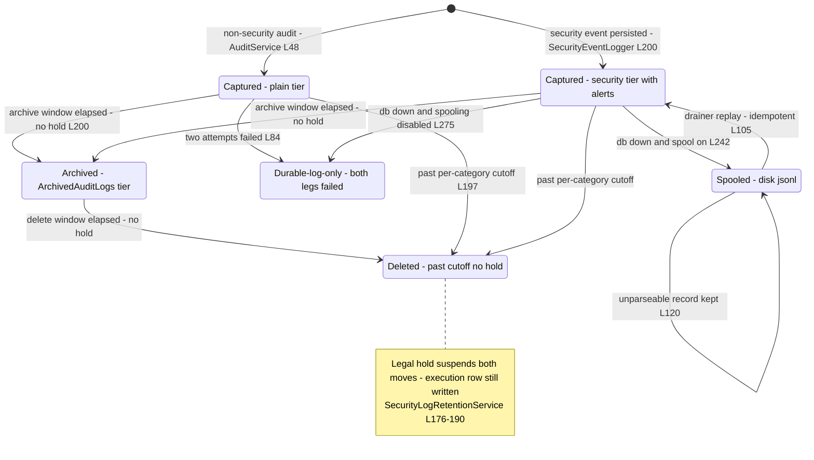
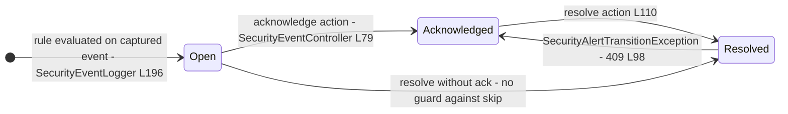
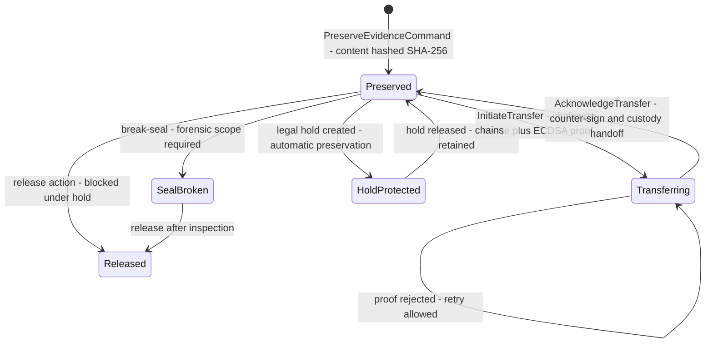
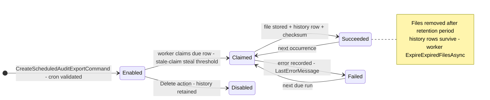
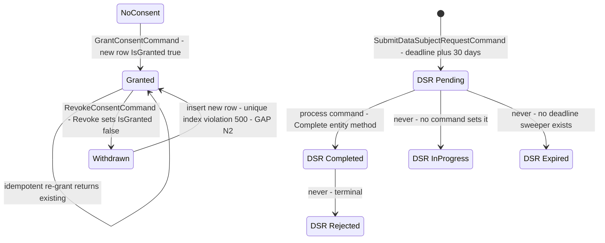
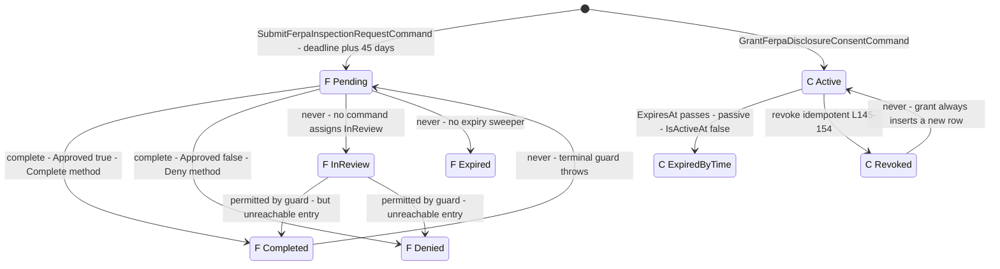
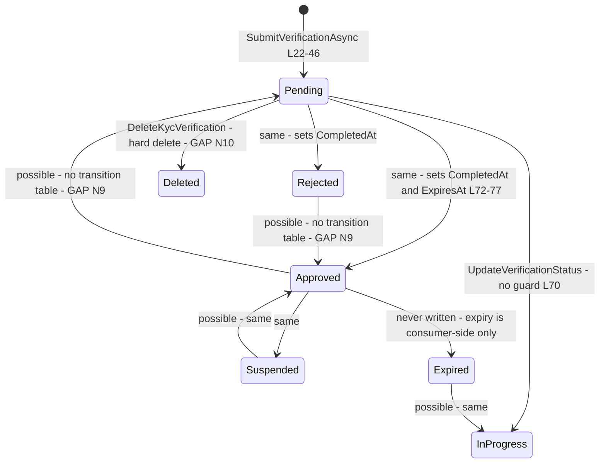
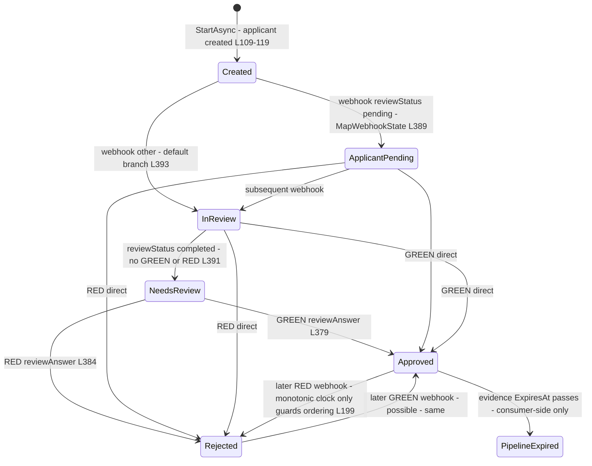

# Compliance State Machines and Transitions Audit

> Modules `GameGuild.Compliance.Audit` / `Consent` / `FERPA` / `KYC` · Documented against `develop` commit `ac959fd8f`.
> Citation shorthand as in `01-user-flows.md`.

## 1. Central audit record lifecycle (`AuditLogs`)

There is no state column on `AuditLog` — a row is born terminal. The lifecycle that matters is *derivational*: soft-delete eligibility under retention, the archive tier move, and the capture tiers that feed it. The tamper-evident tier (`TamperEvidentAuditLogs`) is a separate per-tenant append-only chain.

### 1a. Transitions audit — central audit record

| Transition | Trigger | file:line | Guard |
|------------|---------|-----------|-------|
| birth (plain) | any `IAuditService.LogAsync` | `Audit:/Services/AuditService.cs:46-49` | PII interceptor redacts during save |
| birth (security) | taxonomy-classified events, alerts evaluated same context | `Audit:/Services/SecurityEventLogger.cs:187-198` | idempotency pre-check on replay only |
| capture → spool | db unavailable after bounded retries | `SecurityEventLogger.cs:242-260` | PII-sanitized before disk |
| spool → captured | drainer `ReplaySpooledEventsAsync` | `:105-155`, `SecurityEventSpoolDrainerBackgroundService.cs:34` | `AlreadyPersistedAsync` by event id |
| hot → archived | retention pass archive window | `SecurityLogRetentionService.cs` (issue #193 tiering), endpoints `SecurityEventController.cs:227,254` | legal hold suspends (`:176-190`) |
| archived / hot → deleted | per-category cutoff, batched | `:167-205` + options (`SecurityEventPipelineOptions` DefaultRetentionDays 400 `:57`, batch 5000 `:60`) | hold + dry-run flag |

**Unreachable / dead ends:** `Logged` (both persistence legs failed) has no replay path — the payload only survives in structured logs for manual reconciliation; nothing surfaces `SecurityEventSpoolingDisabled` outcomes as an alert (only a critical log line, `SecurityEventLogger.cs:263-282`).

## 2. Security alert (`SecurityAlerts`)

Audit notes: transitions are guarded (`SecurityAlertTransitionException` → 409, `SecurityEventController.cs:98-103,129-133`); the acting administrator is derived from the request context, not the body (unlike Consent/FERPA). Skip-ahead (Open → Resolved) is permitted. Rules: failed-authentication thresholds, permission-change thresholds, bulk-permission-change thresholds (`AuditModule.cs:86-90`; integration coverage `PermissionPatternAlertsPostgreSqlTests.cs`).

## 3. Custody evidence and transfer (`CustodyEvidenceItems`, `EvidenceTransfers`)

Audit notes: evidence release is **blocked while a legal hold is active** (`ChainOfCustodyController.cs:111-112` doc + `LegalHoldService`); custody reads are themselves logged (`CustodyAccessLogs` table); integrity is re-verifiable at any time against the stored hash (`:134-148`). Custodian registry is fail-closed: only registered active custodians may act (`:165-185`). No dead states observed; transfer has no timeout — a transfer left unacknowledged stays `Transferring` forever (operator-visible via `GET transfers`, no sweeper).

## 4. Scheduled audit export (`ScheduledAuditExports` + `AuditExportHistories`)

Audit notes: `Version` is a concurrency token (`AuditModelConfiguration.cs:159`) so two workers cannot both claim; the `(IsEnabled, NextRunAt)` index (`:160`) backs the due-scan; poll loop is 1 minute (`ScheduledAuditExportBackgroundService.cs:11`).

## 5. Consent and data-subject request (Consent module)

Transitions audit:

| Transition | Trigger | file:line | Guard |
|------------|---------|-----------|-------|
| birth → Granted | grant | `Consent:/Services/ConsentService.cs:57-67` | unique `(UserId, PolicyVersionId)` index (`Entities/ConsentEntities.cs:88`) — **collides on re-grant** (N2) |
| Granted → Withdrawn | revoke | `:80-90` (entity `Revoke()` `:121-126`) | silent no-op when absent/already withdrawn |
| Pending → Completed | process | `:119-133` (entity `Complete` `:162-169`) | overwrites `ProcessingNotes`; `OnTime` recorded as metadata only |
| Pending → Rejected | **nothing calls** `Reject` (`ConsentEntities.cs:171-178`) | — | unreachable |
| Pending/any → Expired | **no worker / no code path sets it** (`:198` enum) | — | unreachable — 30-day GDPR clock is decorative (N3) |
| Pending → InProgress | **no setter exists in service/commands** | — | unreachable |

**Missing guards:** no state guard in `ProcessDataSubjectRequestAsync` — completing an already-Completed request silently overwrites processor attribution/notes (`ConsentService.cs:123-124`), unlike the FERPA entity which throws.

## 6. FERPA inspection request + disclosure consent

Transitions audit:

| Transition | Trigger | file:line | Guard |
|------------|---------|-----------|-------|
| Pending → Completed/Denied | `CompleteFerpaInspectionRequestCommand` | `Ferpa:/Services/FerpaService.cs:155-171`, entity `:225-251` | `EnsureCanBeProcessed` allows Pending **or InReview**; terminal → `InvalidOperationException` (surfaces as 500 — the controller has no mapping for it) |
| Pending → InReview | nothing | only `FerpaEntities.cs:247` references the value | unreachable entry state |
| any → Expired | nothing sets `FerpaRequestStatus.Expired` (`:46`) | deadline `:216` never enforced | unreachable — 45-day clock decorative (N3) |
| consent revoke idempotence | `Revoke()` second call returns | `:146-151` | clean |
| disclosure gate | basis-based | `FerpaService.cs:110-123` | only Student/GuardianConsent require an active consent; all other bases caller-asserted |

## 7. KYC — legacy ledger (`user_kyc_verifications`)

Transitions audit:

1. **No transition table at all** — `UpdateVerificationStatusAsync` assigns any enum value (`Kyc:/Services/KycService.cs:70-72`); `ProcessProviderWebhookAsync` likewise (`:232-241`). Both consumers (sign-in gate, payout eligibility) read only `Approved`, so a regressed row silently flips a verified user to challenged/denied — and back.
2. **`Expired` is never assigned by any writer** — grep shows no assignment; expiry is *derived* (`ExpiresAt` checked in `KycRepository.cs:39-44`, `KycAndHoldSignInCompliancePolicy.cs:80-98`, `ComplianceKycPayoutEligibilitySource.cs:36-37`). The stored status stays `Approved` while the world treats it as lapsed — the sign-in gate documents this deliberately (`KycAndHoldSignInCompliancePolicy.cs:83-86`), but the report endpoint counts `Expired` rows that can never exist (`KycService.cs:270` — `ExpiredVerifications` is permanently 0).
3. **Hard delete of compliance evidence** (`KycHandlers.cs:139-152`) with no audit row and no guard — reachable by any code path that sends the command; no controller today, but the handler is registered.

## 8. KYC — SumSub evidence pipeline (`compliance_sumsub_applicant_bindings` + inbox)

Transitions audit:

1. Ordering is protected by `LastProviderIssuedAt` monotonicity (`SumSubKycAmlOrchestrator.cs:199-205`) — **event-time** ordering, not state-machine legality: a genuine provider reversal (GREEN then RED) is applied, and evidence versions increment (`:217`), so both directions are legal and versioned. This is correct for KYC reality; the contrast with the legacy ledger (no ordering, no versioning) is the finding.
2. `KycAmlState.Expired` (`SumSubKycAmlProvider.cs:20`) is defined but never mapped or assigned — dead enum value, same as the legacy ledger's `Expired` but with consumers deriving expiry from the evidence envelope `ExpiresAt` instead.
3. Inbox states: `Processed` (error null), `Rejected` (invalid-signature / unknown-applicant / invalid-timestamp), `Deferred` (out-of-order), `Duplicate` — rejected/deferred rows have **no retry or DLQ worker**; they sit with `ProcessingError` for operator inspection (`:180-227`). No replay endpoint exists for them (contrast: Billing webhook inbox has `webhook-events/{id}:retry`).
4. DB check constraints back the machine: `State BETWEEN 1 AND 7`, `EvidenceVersion >= 0`, jurisdiction `^[A-Z]{3}$` (`SumSubEvidencePersistence.cs:45-53`), inbox `ReceivedAt >= IssuedAt` (`:71-73`) — good defense in depth.

## 9. Cross-cutting transitions summary

| Machine | Terminal states | Unreachable states | Missing guards |
|---------|-----------------|--------------------|----------------|
| Central audit record | Deleted | — (stateless) | `Logged` tier never replayed; `SpoolingDisabled` never alerted |
| Security alert | Resolved | — | Open → Resolved skip allowed (deliberate?) |
| Custody evidence | Released | — | transfer stuck in Transferring forever (no timeout/sweep) |
| Scheduled export | Disabled (history kept) | — | none observed |
| Consent | Withdrawn (re-grant impossible — bug) | `InProgress`, `Expired`, `Rejected` (DSR) | no re-complete guard on DSR; no deadline sweep |
| FERPA inspection | Completed, Denied | `InReview` (entry), `Expired` | terminal-state failure surfaces as 500 not 409 |
| FERPA consent | Revoked | — | passive expiry correct |
| KYC legacy | none (all reversible) | `Expired` (never written) | **no transition table at all**; hard delete |
| KYC SumSub | evidence expiry is passive | `Expired` enum dead | rejected/deferred inbox rows never retried |
