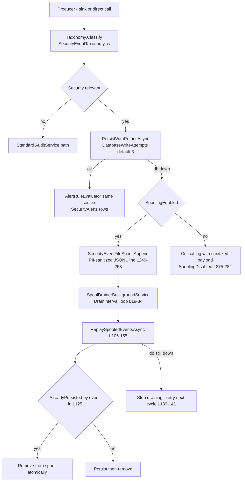

# Compliance Event Inventory — the consumer side of platform auditing

> Modules `GameGuild.Compliance.Audit` / `Consent` / `FERPA` / `KYC` · Documented against `develop` commit `ac959fd8f`.
> This module family is primarily an **event consumer and evidence store**. Citation shorthand as in `01-user-flows.md`.

## 1. Rails overview

Three capture rails meet in `GameGuild.Compliance.Audit`; the other three modules ride rails 1 and 3:

1. **Direct sink bridge (in-process, transactional or best-effort)** — producers depend on a sink *interface defined in the producer's module* and the host binds the central implementation. This keeps the dependency direction producer → abstraction, compliance → storage (`Audit:/Extensions/AuditModule.cs:135-147`).
2. **Durable security-event pipeline** — `ISecurityEventLogger` (`Audit:/Services/SecurityEventLogger.cs:39-52`): bounded DB retries → per-instance disk spool (`SecurityEventFileSpool.cs:31+`) → background drainer (`SecurityEventSpoolDrainerBackgroundService.cs`) with idempotent replay. This is the durability tier for security-relevant events (issue #346).
3. **Module outbox (`OutboxMessage`)** — the platform's transactional outbox (`API:/Core/Eventing/OutboxDispatcher.cs`) with per-consumer receipts, retry and dead-letter. **The Compliance family publishes nothing to it and consumes nothing from it** — its durability is entirely rails 1+2. (`BillingInvoicePaidV1` etc. flow elsewhere; see §6.)
4. **Provider ingress (SumSub)** — a dedicated signed-webhook inbox (`compliance_sumsub_webhook_inbox`) with raw-payload archival in S3 (`Kyc:/S3ComplianceRawObjectStore.cs:43`), separate from the Billing webhook inbox.
5. **Egress webhooks (audit export notifications)** — allow-listed, HMAC-signed POSTs (`Audit:/Services/AuditExportWebhookNotifier.cs`).

## 2. Inbound sinks — who feeds the central audit store

| Sink interface (producer module) | Central implementation | Captured events | Durability posture |
|----------------------------------|------------------------|-----------------|--------------------|
| `IAuthenticationAuditEventSink` (`Identity.Authentication/Abstractions/IAuthenticationAuditEventSink.cs:7`) | `CentralAuthenticationAuditEventSink` (`Audit:/Services/CentralAuthenticationAuditEventSink.cs:11`) | **AuthenticationAuditEvent** — every sign-in outcome, MFA step, failure; risk level mapped to audit risk (`:36-43`) | Security pipeline; **MFA sign-in events are transactional-required** — capture failure fails the command (`:18-19,50-53,68`) |
| `IApiKeyAuditEventSink` (`Identity.Authentication/Abstractions/IApiKeyAuditEventSink.cs:8`) | `CentralApiKeyAuditEventSink` (`Audit:/Services/CentralApiKeyAuditEventSink.cs:10`) | **ApiKeyAuditEvent** — create/rotate/revoke lifecycle, keyed by key id; key material never logged (`:8-9`) | Best-effort `IAuditService.LogAsync`, never throws (`:35-38`); fixed Medium risk (`:29`) |
| `IScimProvisioningAuditSink` (Identity.Provisioning) | `CentralScimProvisioningAuditEventSink` (`Audit:/Services/CentralScimProvisioningAuditEventSink.cs:11`) | SCIM user/group provisioning mutations (issue #180/#184 family) | durable security capture |
| `IContentPagesAuditEventSink` / `ILearningAuditEventSink` / `ITeamsAuditEventSink` | `CentralModuleAuditEventSinks.cs:53,89,124` | content-page, learning, teams mutations — required transactional audit events (issues #180/#181/#184) | `RecordInCommandAsync`-style transactional capture |
| `IConsentAuditEventSink` (`Consent:/Auditing/IConsentAuditEventSink.cs:20`) | `CentralConsentAuditEventSink` (`Audit:/Services/CentralConsentAuditEventSink.cs:13`) | `Consent.Granted`, `Consent.Revoked`, `DataProtection.DataSubjectRequestRecorded`, `DataProtection.DataSubjectRequestCompleted` (action constants `IConsentAuditEventSink.cs:9-12`) | security pipeline; the ConsentService swallows sink failures so consent writes proceed (`ConsentService.cs:141-162`) |
| `IAuditService` direct (dozens of controllers/services) | `AuditService` (`Audit:/Services/AuditService.cs:10`) | admin actions, tenant ops, privacy ops, username ops, security violations (`:115-290`) | 2 attempts → PII-sanitized critical-log fallback (`:68-110`) |
| `IEntityChangeAuditStore` (host bridge) | `EntityChangeAuditStore` (`API:/Core/Setup/InfrastructureLayerExtensions.cs:416`) | EF change-tracking capture of every audited entity mutation (issue #166), redacted through the central PII pipeline before persistence | transactional with the mutation's SaveChanges |

**Producer-side confirmation** (spot checks): authentication services carry the sink into attempt tracking (`Identity.Authentication/Services/AuthAttemptService.cs`, `MfaAttemptTrackingService.cs`, `ApiKeyAuthenticationHandler.cs`); API-key commands take the sink optionally (`Identity.Authentication/Commands/ApiKeyCommands.cs:61,199,333`).

## 3. The durable security-event pipeline in detail

Facts with file:line:

- Retry budget and spool toggles come from `SecurityEventPipelineOptions` bound at `AuditModule.cs:77-94`; alert thresholds (failed authentication, permission change, bulk permission change) ride the same options (`:86-90`).
- Spool is per-instance JSONL with `lock`-serialized append (`SecurityEventFileSpool.cs:47-61`) and atomic-file removal of delivered records; records survive restarts (`:14-18` doc).
- Replay is idempotent by event id (`SecurityEventLogger.cs:125-129,285-291`); unparseable records are retained, not dropped (`:120-122`).
- **DLQ posture: there is no true DLQ.** Terminal-failure outcomes are (a) the spool (retryable, unbounded retention), (b) the `SpoolingDisabled` critical log (not retryable), (c) unparseable spool lines (stuck). No queue depth metric/alert is surfaced for spool growth — `delivery-status` exposes tracker stats (`SecurityEventController.cs:44-48`) but nothing alarms on them.

## 4. Egress — what this family emits

| Event | Producer | Trigger | Consumer | Delivery contract |
|-------|----------|---------|----------|-------------------|
| `audit.export.completed` / `cancelled` / `failed` (`AuditExportWebhookNotification.Type`, `AuditExportWebhookNotifier.cs:34-43`) | `AuditController` export legs (`AuditController.cs:517,524,537,623,630,643`) and `BeginExportAsync` failure paths (`:853-862`) | export state changes | tenant-configured HTTPS endpoint | exact-host allow-list, ≥32-char secret, HMAC-SHA256 `t=…,v1=…` header, `Idempotency-Key` = `exportId:status`, 1-5 attempts, 1-30 s timeout, redirects disabled (`AuditModule.cs:68-69`, `AuditExportWebhookNotifier.cs:63-173`) — **best effort; a dead tenant endpoint never fails the export itself** |
| Scheduled-export completion notifications | `ScheduledAuditExportService` runs (worker `ScheduledAuditExportBackgroundService.cs:23-24`) | cron fire | storage destination + `NotificationEmails` (`AuditModelConfiguration.cs:158`) | history row + file checksum (`AuditExportHistories`, `:164-179`) |
| Security alerts (internal) | `SecurityAlertRuleEvaluator` | thresholds | `SecurityAlerts` table + `alerts` endpoint lifecycle | durable rows; acknowledge/resolve audited |
| KYC evidence publication | `SumSubKycAmlOrchestrator.PublishAsync` (`SumSubKycAmlOrchestrator.cs:268-293`) | webhook/reconcile | `IKycEvidenceStore` → host bridge `EconomyKycEvidenceStore` (`API:/Core/Integration/EconomyKycEvidenceStore.cs:7-22`) → economy compliance ledger | versioned envelopes (`KycEvidenceSubmission`, `KycEvidenceContracts.cs:7-22`) with policy version, payload hash, signature flag, jurisdiction |

Nothing in the family raises `IHasIntegrationEvents` outbox rows: no `OutboxMessage` producer exists in `Modules/GameGuild.Compliance.*` (grep). All cross-module reaction is synchronous or via the durable capture rails.

## 5. SumSub webhook ingress (KYC)

Path: `POST api/v{version}/integrations/economy/sumsub/webhook` (`API:/Core/Controllers/EconomyKycController.cs:121-143`, `[AllowAnonymous]`, digest headers required) → `IngestSumSubWebhookEndpointCommand` → `SumSubKycAmlOrchestrator.IngestWebhookAsync` (`SumSubKycAmlOrchestrator.cs:138-229`):

1. Payload parsed for `applicantId` (+ `inspectionId`-derived event id, `:360-370`).
2. `IKycAmlProvider.VerifyWebhook` HMAC + tolerance window (`SumSubKycAmlProvider.cs:47-52`; tolerance `SumSubKycAmlOptions.WebhookTolerance` `:63`).
3. Raw payload archived to S3 before any state change (`:158-159`; store gated by config `KycModule.cs:37-45`, unavailable store = ingest fails closed).
4. Inbox dedupe by `ProviderEventId`; replay with a different payload hash → conflict exception (`:161-178`).
5. Rejections recorded with a reason (`invalid-signature` / `unknown-applicant` / `invalid-timestamp`, `:189-198`); out-of-order events deferred, not dropped (`:199-205`).
6. Accepted events map to `KycAmlState` (`:372-394`), approved events must carry a verified ISO alpha-3 jurisdiction (`:295-324`), then publish evidence and bump the binding version (`:213-227`).

Contrast with the Billing Stripe inbox: the SumSub inbox has **no replay endpoint, no delivery-attempt counter, no provider-side retry contract surfaced, and no `Webhook` rate-limit policy** — rejected/deferred rows are operator-inspectable only via the DB.

## 6. What does *not* arrive here (known gaps carried from other packages)

- **Payment money movement.** Per the payments package (`docs/commerce/payments/06-gaps.md` N15): refund/chargeback/success audits land in the module-local `audit_trails` table via `RevenueAuditService.RecordAuditTrailAsync`; the central compliance module's `IAuditService.LogAsync` is invoked by Billing only for webhook-secret rotation (`Billing:/Commands/RotateWebhookSecret/RotateWebhookSecretCommand.cs:126-141`). Retention, chain-of-custody and security aggregation of `GameGuild.Compliance.Audit` therefore do not cover payment money movement. (Related filed bug: issue #1202 covers the payments-side refund currency defect; the audit-projection gap remains N15.)
- **`PaymentSucceededEvent`** is raised and discarded platform-wide (payments N13) — no Economy/Compliance durable hook exists.
- **Domain events generally**: `EntityBase.Raise` events are collected and cleared without dispatch (`API:/Database/ApplicationDbContext.cs:348-351` per the payments package) — the compliance family correctly avoids relying on them.

## 7. Hosted workers touching this family

| Worker | Registration | Behavior | Failure posture |
|--------|-------------|----------|-----------------|
| `SecurityEventSpoolDrainerBackgroundService` | `AuditModule.cs:121` | replays spooled security events on `DrainInterval` | stops on first still-failing delivery; retries next cycle |
| `SecurityLogRetentionBackgroundService` | `:125` | 24 h default cadence, per-tenant passes, hold-aware | per-tenant failure logged, loop continues |
| `ScheduledAuditExportBackgroundService` | `:170` | 1-min poll; due exports + expired file sweep (`ScheduledAuditExportBackgroundService.cs:23-24`) | failure logged, retries next minute |
| `PiiRedactionRuleRefreshService` | `:110` | keeps the in-memory rule cache fresh | stale cache keeps last-good rules |
