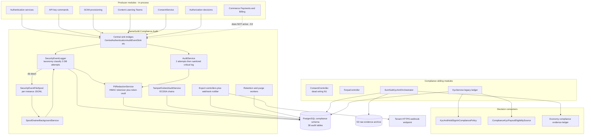
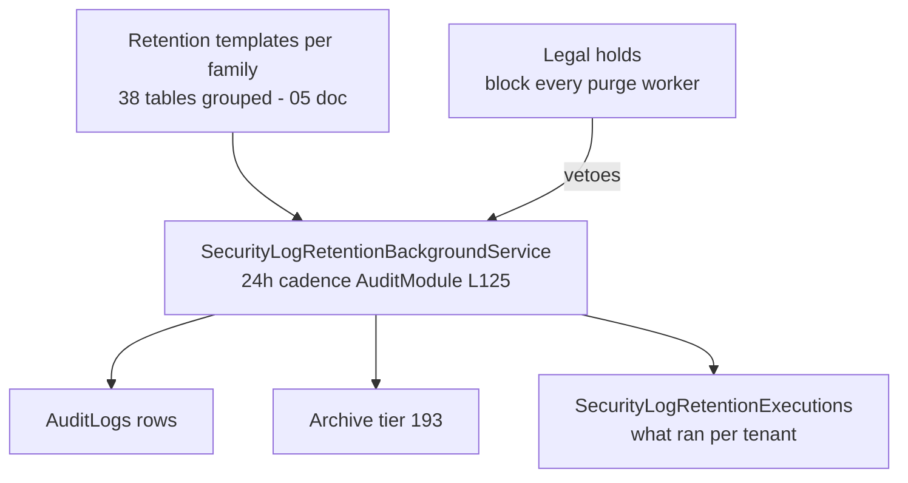

# Compliance Security Architecture — trust boundaries, PII map, evidence chains

Status: living document, current as of 2026-11-04 against `origin/develop` (21b58ac6a7).

Companion documents: [`08-stride-threat-model.md`](08-stride-threat-model.md) (threat model per family), [`11-dfds.md`](11-dfds.md) (data flow diagrams), [`10-cross-module-sequences.md`](10-cross-module-sequences.md) (cross-module sequences). Citation shorthand as in [`README.md`](README.md).

## 1. Component diagram

The fan-in is deliberately one-directional: producers depend on sink interfaces defined in their own module; the host binds the central implementation (`Audit:/Extensions/AuditModule.cs:135-147`) so no producer takes a compile-time dependency on Compliance.Audit.

## 2. Trust boundaries

| # | Boundary | Crossing | Primary control |
|---|----------|----------|-----------------|
| C1 | Internet → reverse proxy → API | All compliance routes | TLS, authenticated JWT, `X-Forwarded-For` trust assumption (K9, `SecurityEventLogger.cs:340-342`) |
| C2 | Anonymous internet → SumSub webhook | `POST integrations/economy/sumsub/webhook` (`EconomyKycController.cs:121-143` region) | HMAC digest + timestamp tolerance, fail-closed ingest (see `08-stride` F8); residual: no rate policy (N8) |
| C3 | API process → PostgreSQL | Every table | Connection string + EF; SECURITY DEFINER surfaces do not exist in this family (unlike Economy); central `AuditLogs` protected by row-level policy stack, not crypto (N14) |
| C4 | API process → local disk (spool) | `SecurityEventFileSpool` appends | PII-sanitized before leaving process (`SecurityEventLogger.cs:246-253`); no integrity check on spool lines (F1 residual) |
| C5 | API process → S3 | SumSub raw payload archival | Store gated by config; unavailability fails ingest closed (`KycModule.cs:37-45`) |
| C6 | API → tenant HTTPS webhook (egress) | Export notifications | Exact-host allow-list, HTTPS default-port, no query/userinfo/fragment, ≥32-byte HMAC secret, idempotency key (`AuditExportWebhookNotifier.cs:63-90,63-173`) |
| C7 | API → regulator/authority (indirect) | DSAR + inspection + export evidence packs | No direct egress; the regulator consumes artifacts humans produce from F2/F4 surfaces — modeled as an external party in `11-dfds.md` |

## 3. Who-can-read-PII permission map

Posture per surface, verified at 21b58ac6a7:

| Surface | PII classes reachable | Who can read | Citation |
|---------|----------------------|--------------|----------|
| Central audit read/search | IP, UA, session ids, descriptions, metadata (redaction-rule dependent) | holders of the audit policy stack — policy + DAC + tenant clamp | three-layer model, `02-cqrs-wiring-matrix.md` |
| PII token unmask | the masked PII itself | any authorized caller WITH a reason; audited at critical risk | `PiiRedactionPipelineController.cs:139-155` |
| Bulk export | everything redaction does not strip, up to caps | `Audit.Export` holders; volume monitoring advisory only | `AuditController.cs:453-645`, `481-489` |
| Scheduled export files | same, offline | tenant-configured destinations + notification emails | `AuditModelConfiguration.cs:158,164-179` |
| Consent rows | policy relationships, IP/UA/method, DSR payloads | ANY authenticated user (N5) — module dead at runtime (N1) | `ConsentController.cs:25-38` |
| FERPA records/disclosures | education records, directory info, disclosure history | ANY authenticated user (N5) | `FerpaController.cs:13-63` |
| KYC legacy rows | document types, provider jsonb, status history | internal services only (no controller); full rows to internal callers | `KycService.cs`, `UserKycVerification.cs:73-74` |
| KYC SumSub evidence | subject-hashed envelopes, raw refs in S3 | self only (`TryActor`) + economy compliance ledger readers | `EconomyKycController.cs:100-110`, `EconomyKycEvidenceStore.cs:7-22` |

The two red rows are the platform's own privacy modules — the authorization inversion documented as N5 and targeted by open PR #1268.

## 4. Retention/purge enforcement chain

Chain properties (citations in [`05-retention-and-performance.md`](05-retention-and-performance.md)):

1. Holds are honored by every purge worker — a hold row vetoes deletion for its tenant/scope.
2. Every pass writes execution history, so "what was purged, when, by which rule" is answerable.
3. The reverse question — "prove nothing ELSE was deleted" — has no answer on the central table: deletion by purge and deletion by a malicious DB actor are indistinguishable (N14; only the opt-in tamper-evident tier carries cryptographic gap detection).
4. Archived payloads inherit no additional at-rest redaction — the archive destination must be treated as PII-bearing storage.

## 5. The audit sink fan-in — who actually feeds the store

| Stream | Arrives? | Route | Citation |
|--------|----------|-------|----------|
| Authentication (`AuthenticationAuditEvent`) | yes — security pipeline; MFA events transactional-required | `IAuthenticationAuditEventSink` → `CentralAuthenticationAuditEventSink` | `Audit:/Services/CentralAuthenticationAuditEventSink.cs:11,18-19,50-53` |
| API keys (`ApiKeyAuditEvent`) | yes — best-effort, key material never logged | `IApiKeyAuditEventSink` → `CentralApiKeyAuditEventSink` | `Audit:/Services/CentralApiKeyAuditEventSink.cs:8-12` |
| Authorization decisions | yes — policy/permission changes ride the security pipeline with alert thresholds | alert rules on permission change, bulk permission change | `AuditModule.cs:86-90` |
| Payments money movement | **NO** — refund/chargeback/success stay in module-local `audit_trails`; only Billing webhook-secret rotation reaches the central module | K2 | `docs/commerce/payments/06-gaps.md` N15; `Billing:/Commands/RotateWebhookSecret/RotateWebhookSecretCommand.cs:126-141` |
| SCIM provisioning | yes | `CentralScimProvisioningAuditEventSink` | `Audit:/Services/CentralScimProvisioningAuditEventSink.cs:11` |
| Content/Learning/Teams | yes — transactional-required | `CentralModuleAuditEventSinks.cs:53,89,124` | module doc `04-event-inventory.md` §2 |
| Consent | yes — fail-soft (consent write proceeds without audit) | `IConsentAuditEventSink` → `CentralConsentAuditEventSink` | `Audit:/Services/CentralConsentAuditEventSink.cs:13-20`; swallow at `ConsentService.cs:141-162` |
| Entity-change capture | yes — transactional with SaveChanges, redacted | `IEntityChangeAuditStore` host bridge | `API:/Core/Setup/InfrastructureLayerExtensions.cs:416` |

**Fail-open/fail-closed verdicts**: authentication (MFA subset) fail-closed — command fails if the audit row does not persist; API keys and consent fail-open by design (best-effort); security events fail-degraded (spool, then sanitized critical log — terminal loss without DLQ, N13).

## 6. Where security decisions are made

- **Audit tier**: policy + DAC permission + tenant clamp per route (`02-cqrs-wiring-matrix.md`), the family's reference standard.
- **Consent/FERPA**: bare `[Authorize]` only — every authenticated user (N5); server-side actor derivation absent from DSR/inspection completion (N4).
- **KYC SumSub self-service**: `TryActor` server-side subject derivation (`EconomyKycController.cs:100-110`) — the pattern Consent/FERPA should adopt.
- **PII unmask**: reason-required + critical-risk audit (`PiiRedactionPipelineController.cs:139-155`) — the family's most examiner-friendly control.

## 7. Deployment invariants

1. ECDSA signing keys (`AuditSigningOptions`, key-id versioned) must live in secret storage; rotation keeps historical verification (`AuditModule.cs:160-175`).
2. The spool directory is integrity-sensitive storage: sanitize-on-write today, but a tamper-evident spool would close F1's poisoning residual.
3. Export webhook signing secrets must be ≥32 bytes or the notifier refuses to send (`AuditExportWebhookNotifier.cs:66-69`).
4. `Authentication:Compliance:SignInGate` stays off by default (K8) — enabling it makes the F7 legacy ledger a sign-in dependency; decide the N7 ledger question first.
5. SumSub S3 store unavailability must stay fail-closed (`KycModule.cs:37-45`) — relaxing it would mint unauditable evidence gaps.
