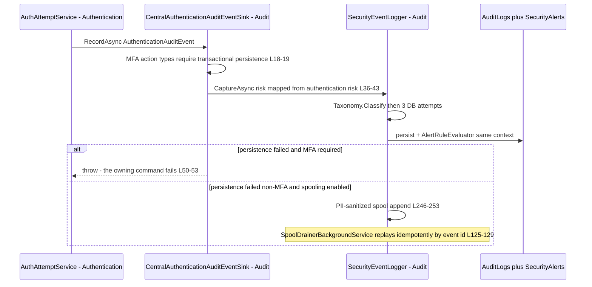
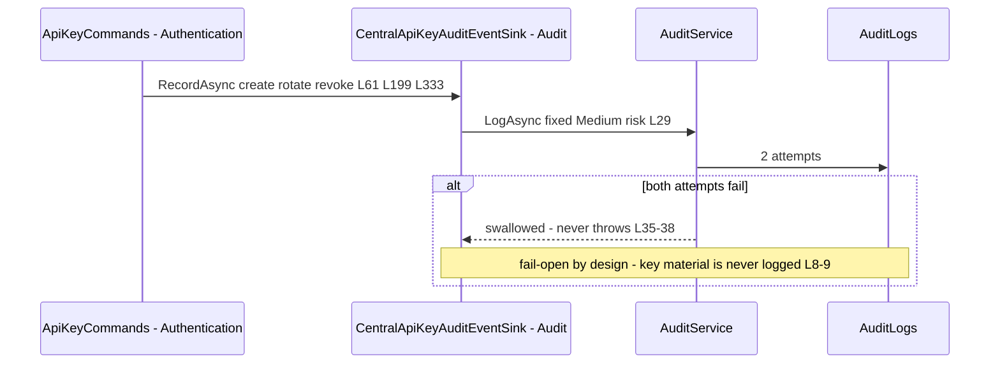
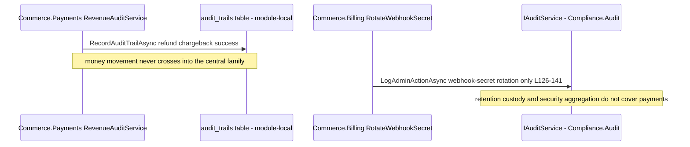
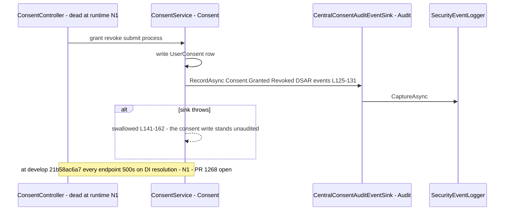
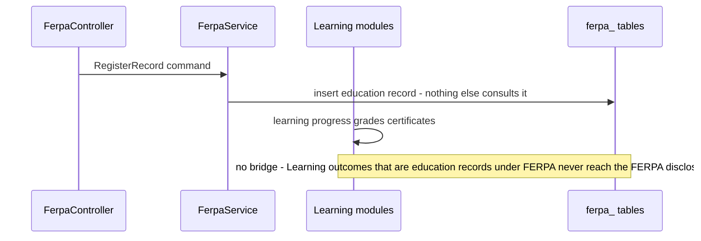
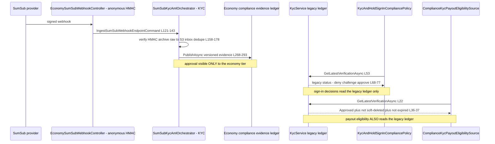
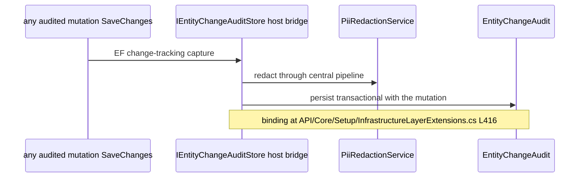

# Compliance Cross-Module Sequences — who feeds the evidence store, who consumes the gates

Status: living document, current as of 2026-11-04 against `origin/develop` (21b58ac6a7). This is the package's fifth functional artifact (the tracker's *Sequências* column).

Citation shorthand as in [`README.md`](README.md). Mermaid `sequenceDiagram` labels carry file:line as `L###`; no parentheses or colons inside message text beyond the `file Lnnn` form.

## 1. AuthenticationAuditEvent — producer to central store (transactional for MFA)

Citations: sink binding `Audit:/Extensions/AuditModule.cs:135-147`; producer-side usage `Identity.Authentication/Services/AuthAttemptService.cs`, `MfaAttemptTrackingService.cs`; interface `Identity.Authentication/Abstractions/IAuthenticationAuditEventSink.cs:7`.

## 2. ApiKeyAuditEvent — best-effort lifecycle trail

## 3. Payment events — the stream that does not arrive (K2)

The only payment-family signal that reaches this module is Billing webhook-secret rotation (`Billing:/Commands/RotateWebhookSecret/RotateWebhookSecretCommand.cs:126-141`); everything money-shaped stays module-local (`docs/commerce/payments/06-gaps.md` N15). Any regulator asking for a unified money-movement trail across Commerce and Compliance cannot be served today.

## 4. Consent bridge — audit rides, consent writes proceed on audit failure

## 5. FERPA ↔ Learning — the handoff that does not exist

Verified by search at 21b58ac6a7: **no module under `Modules/GameGuild.Learning*` references FERPA**, and nothing outside `Modules/GameGuild.Compliance.FERPA/` references it either. The only education-record ingress is FERPA's own command:

Consequence for the regulatory lens: disclosures logged by FERPA cover only records someone manually registered; the platform's actual education data (Learning) is invisible to the FERPA machinery. This is a structural finding for any FERPA audit — registered as a companion to N5/N6, tracked nowhere yet.

## 6. KYC — two ledgers, two gates, zero bridges (N7)

The divergence points, exactly:

Divergence points, stated plainly:

1. A user approved by SumSub has a compliant evidence envelope in the economy tier — and is `VerificationMissing` to the sign-in gate (challenge) and `missing` to payout eligibility (unavailable).
2. A user approved in the legacy ledger satisfies both gates — with no signed evidence, no transition control (N9) and a stubbed document rail (N11).
3. The sign-in gate is disabled by default (K8, `API:/Core/Setup/ApiProductComposition.cs:120-125` region), so today the divergence's live blast radius is the payout gate only — which reads the WEAKER ledger while the stronger tier sits idle. `ComplianceKycPayoutEligibilitySource.cs:22` calling `KycService` (not the evidence store) is the exact line where the strong tier is bypassed.

## 7. Entity-change capture — the silent fourth stream

## 8. Sequence-level verdict

| Sequence | Delivery contract | Regulatory gap |
|----------|-------------------|----------------|
| 1 authentication | fail-closed for MFA subset, spool-degraded otherwise | N13 terminal loss |
| 2 API keys | fail-open best-effort | none material |
| 3 payments | **does not exist** | K2 — no unified money trail |
| 4 consent | fail-open audit, dead wiring | N1 live, N2, N4 |
| 5 FERPA↔Learning | **does not exist** | education records unregistered |
| 6 KYC gates | split-brain reads | N7, N9, N11 |
| 7 entity-change | transactional, redacted | none material |
