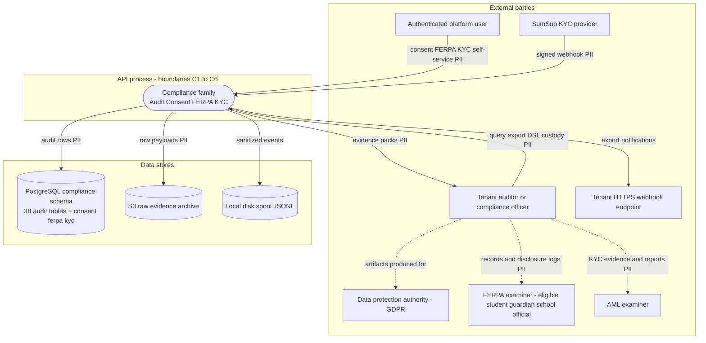
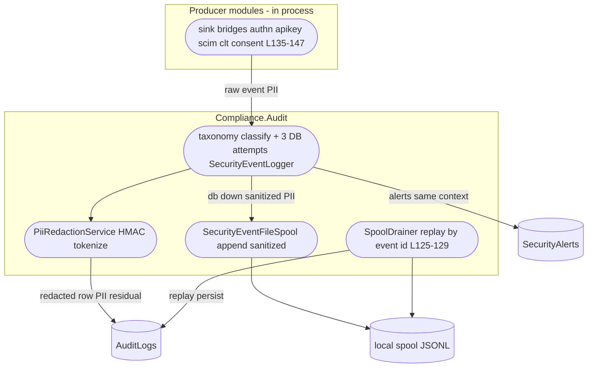
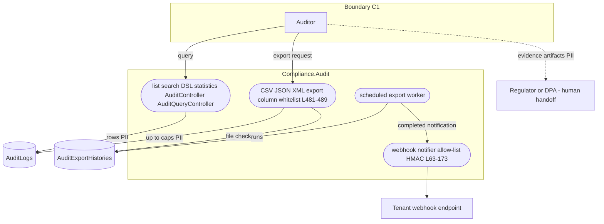
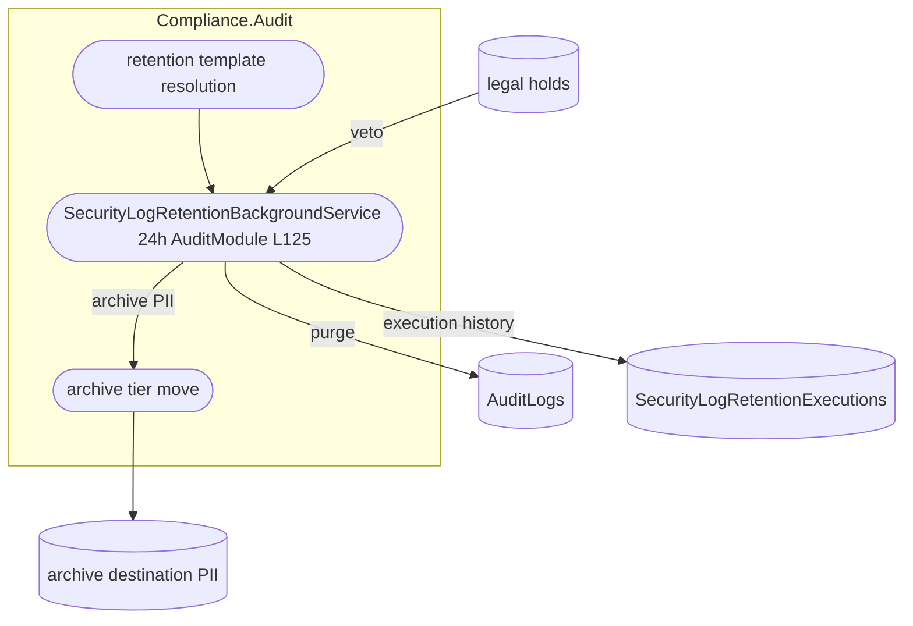
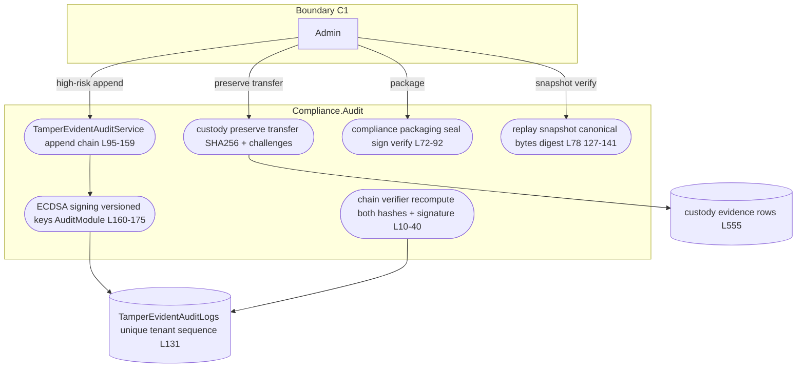
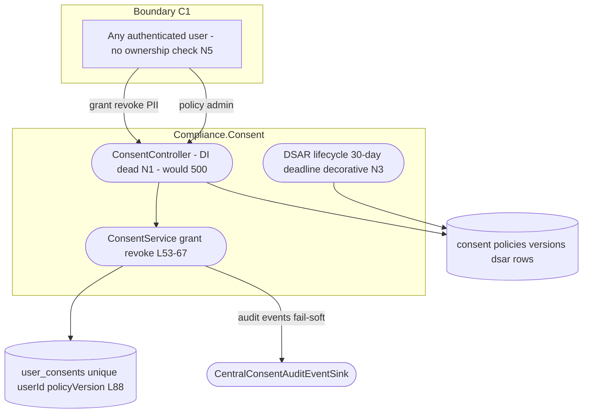
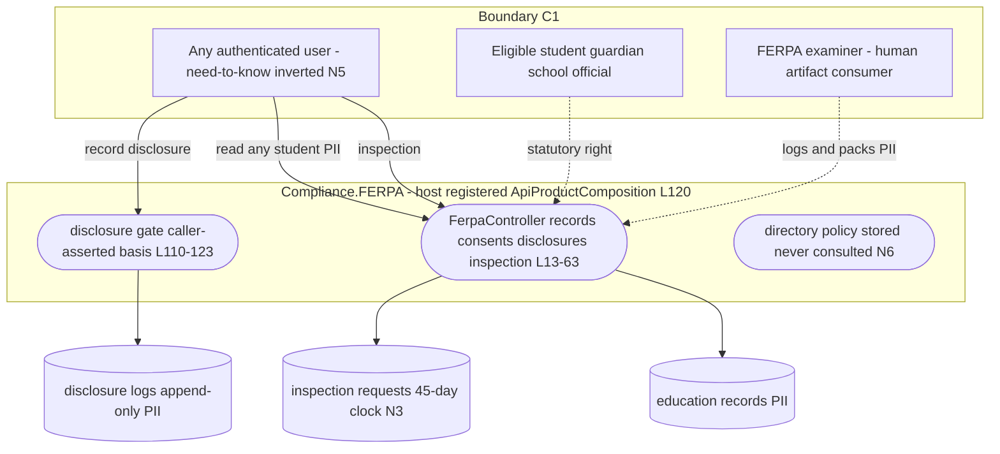
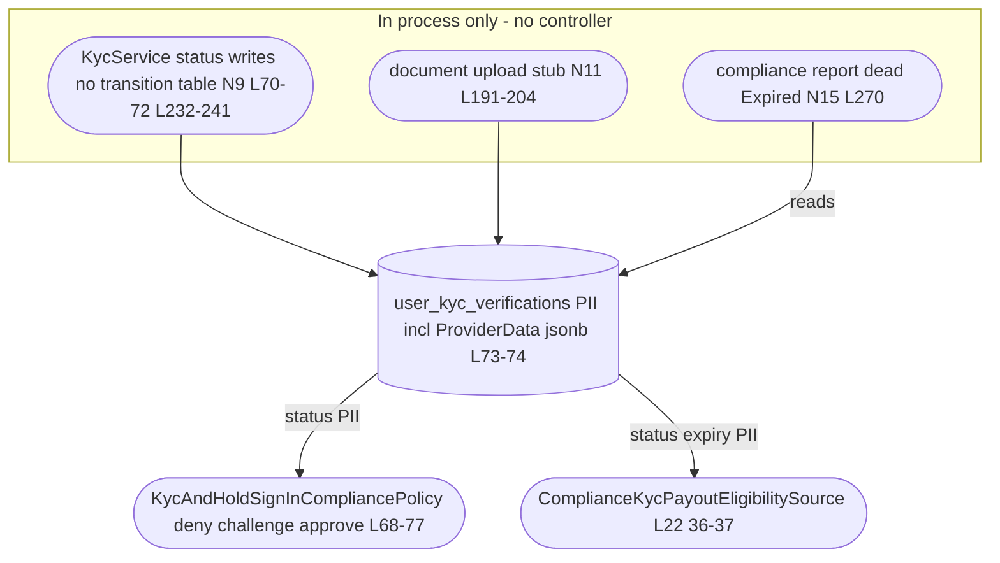
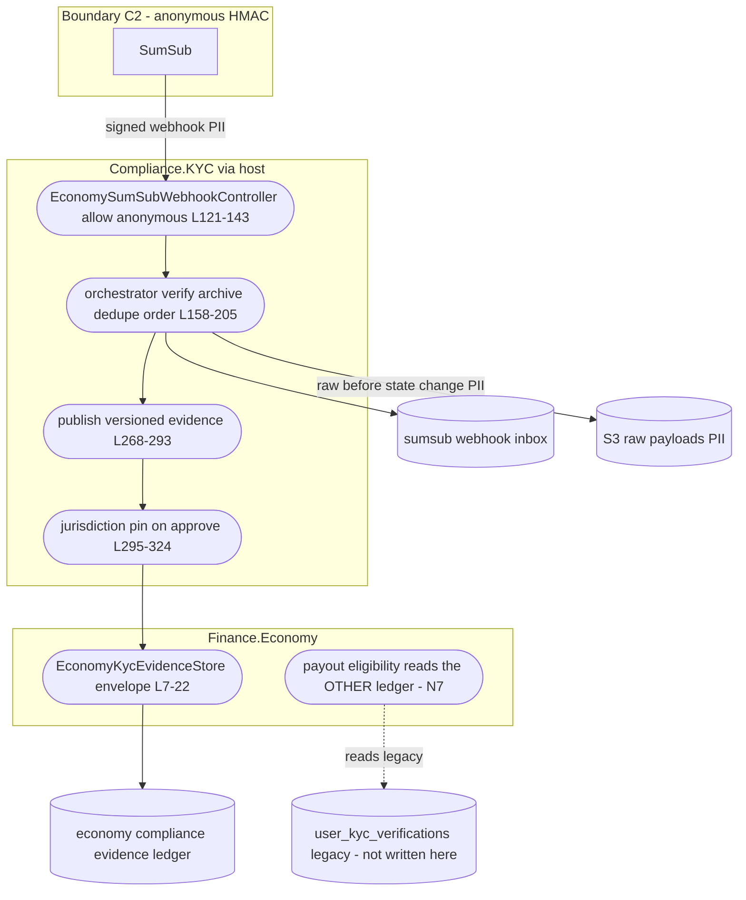

# Compliance Data Flow Diagrams — level 0 and level 1 per family

Status: living document, current as of 2026-11-04 against `origin/develop` (21b58ac6a7).

Companion documents: [`08-stride-threat-model.md`](08-stride-threat-model.md) (families F1-F8), [`09-security-architecture.md`](09-security-architecture.md) (trust boundaries C1-C7). Citation shorthand as in [`README.md`](README.md).

## 1. Notation

Mermaid `flowchart TD` with DFD shapes — external party rectangle, process stadium, data store cylinder. **PII-bearing flows are marked `PII` in the edge label.** Regulators and data-subject authorities appear as external parties where the family's evidence is ultimately aimed (FERPA examiner, data-protection authority, AML examiner). Trust boundary subgraphs match C1-C7 of the architecture document. No parentheses or colons appear inside node labels; `L###` is file:line shorthand.

## 2. Level 0 — the compliance family as one process

The regulator parties are dashed because no automated egress targets them — they consume artifacts humans produce from the export/packaging surfaces (boundary C7).

## 3. F1 — audit event ingestion, level 1

## 4. F2 — query and export, level 1

## 5. F3 — retention and purge, level 1

## 6. F4 — tamper evidence custody packaging replay, level 1

## 7. F5 — consent lifecycle, level 1 (dead at runtime — N1)

## 8. F6 — FERPA, level 1

## 9. F7 — KYC legacy ledger and sign-in gate, level 1

## 10. F8 — SumSub pipeline and economy evidence, level 1

## 11. PII flow summary

| DFD | PII crossing a boundary | Boundary | Control at the crossing |
|-----|------------------------|----------|------------------------|
| F1 | raw event fields → disk spool | C4 | sanitize fail-closed before write |
| F2 | up-to-cap row sets → operator + webhook | C1/C6 | column whitelist, tenant clamp, HMAC egress |
| F3 | archived rows → archive store | C3 | execution history; no extra at-rest redaction |
| F5 | consent attributes IP UA method | C1 | **none beyond authentication — N5** |
| F6 | education records to any authenticated user | C1 | **none — N5** |
| F7 | provider jsonb to internal readers | C3 | none documented |
| F8 | subject PII to anonymous-signed ingress + S3 | C2/C5 | HMAC fail-closed; S3 pre-state archival |
