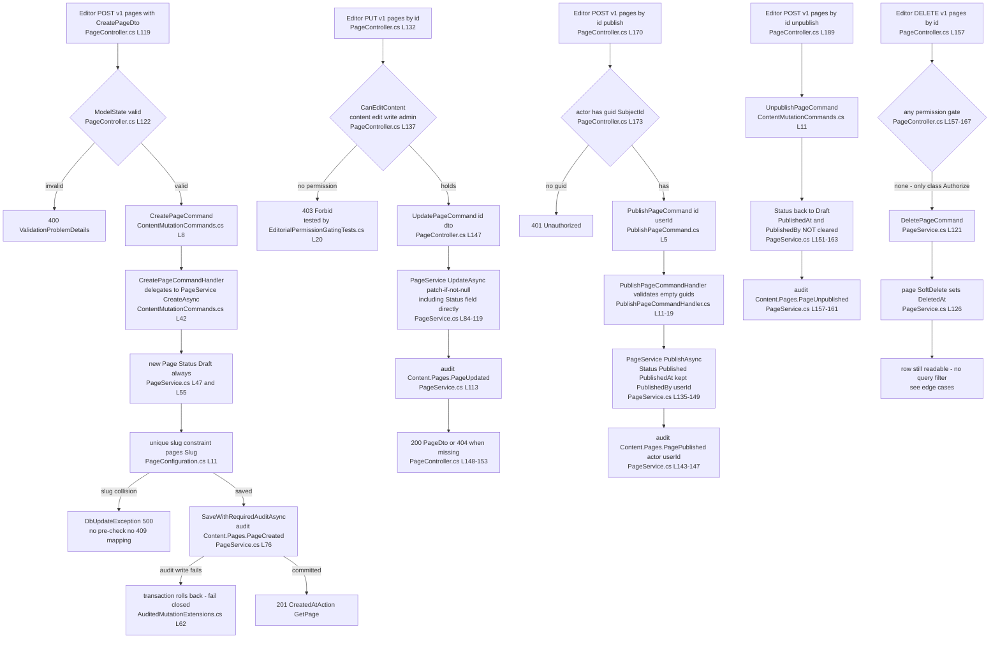
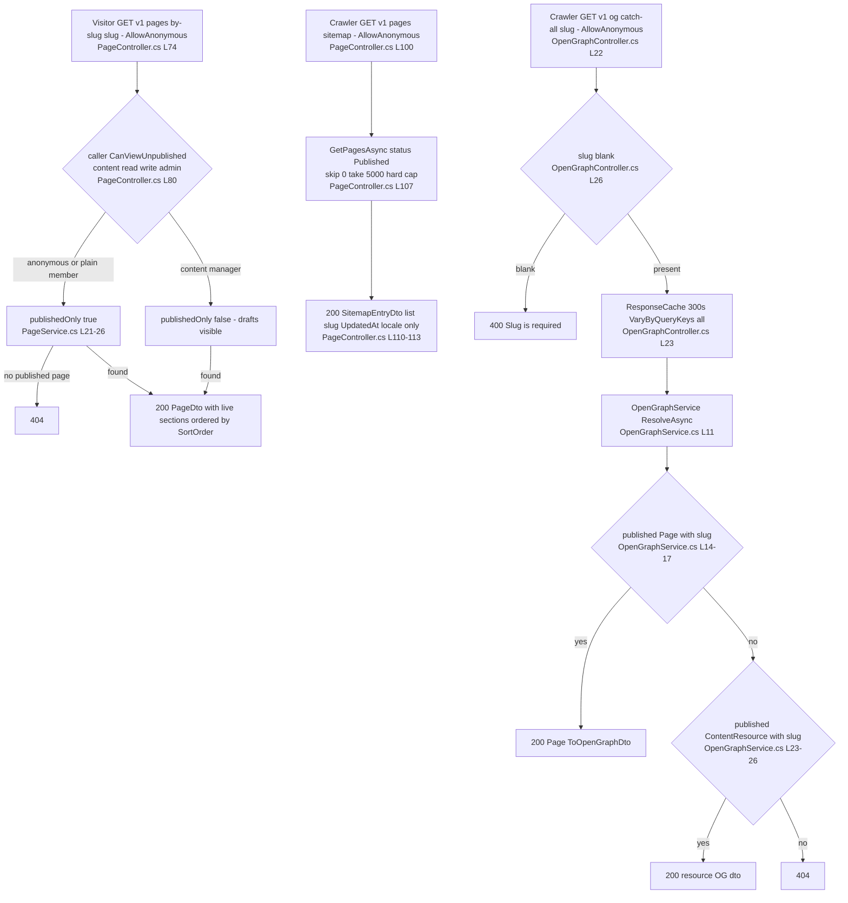
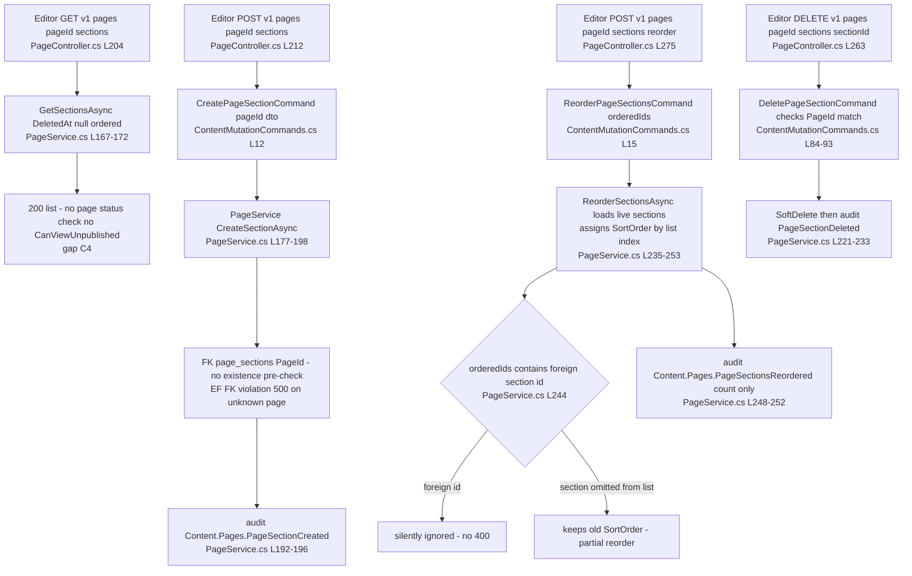
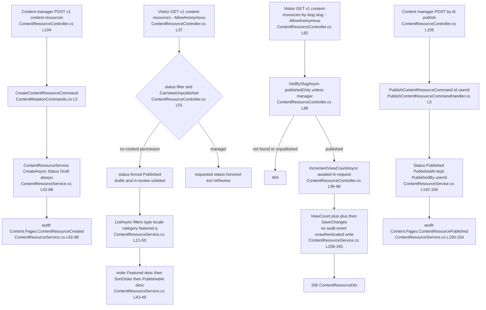
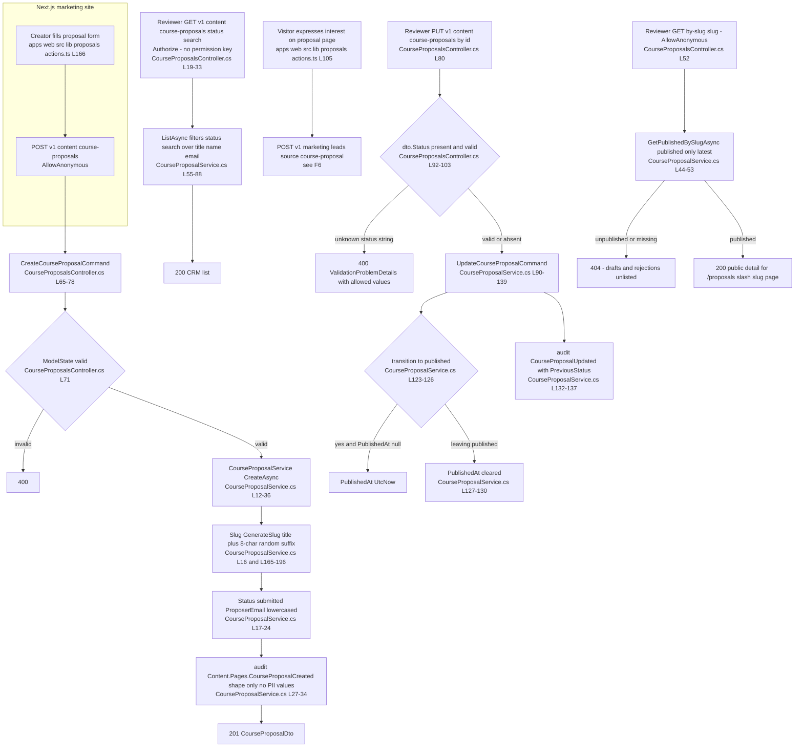
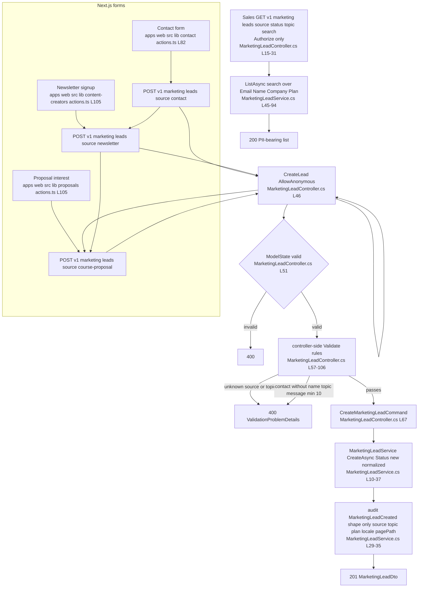

# Content.Pages — User Flows

> Module `GameGuild.Content.Pages` · `develop` @ `ce31d5850c`. Shorthand `Pages:` = `apps/api/Source/Modules/GameGuild.Content.Pages/`. Actors: **Editor** (holds `content:draft`/`content:edit` family), **Content manager** (`content:write`/`content:admin`), **Member** (authenticated, no content permission), **Visitor** (anonymous), **Crawler** (SEO bot).
> Permission keys are defined in `Authz:/Models/TypedPermissions.cs:202-226` (`content:read`, `content:write`, `content:admin`, `content:edit`, `content:draft`, `content:schedule`, `content:edit-metadata`). This module uses read/write/admin/edit only — `content:draft` and `content:schedule` belong to `Resources.Contents`, and `content:edit-metadata` (#333) is used by neither.

## F1 — Page lifecycle (editor creates, edits, publishes, unpublishes, archives)

### F1 edge-case matrix

| Case | Behavior | Citation |
|---|---|---|
| Create with duplicate slug | `pages.Slug` unique index → `DbUpdateException` → 500 (no 409 mapping, no pre-check) | `Pages:/Configuration/PageConfiguration.cs:11`; `Services/PageService.cs:75-81` |
| Create enforces Draft | `Status = PageStatus.Draft` regardless of payload (CreatePageDto has no status field) | `Services/PageService.cs:55`; `Dtos/Dtos.cs` (CreatePageDto) |
| Update can set `Status` directly | `UpdatePageDto.Status` patch bypasses publish/unpublish endpoints — an editor can flip Draft→Archived→Published in one PUT without audit wording "published" | `Services/PageService.cs:93`; gap C1-adjacent, see `06-gaps.md` C5 |
| Publish of missing page | 404 (`page is null`) | `Controllers/PageController.cs:180-184` |
| Publish keeps original `PublishedAt` | `PublishedAt ??= UtcNow` — republish keeps first-publish timestamp | `Services/PageService.cs:141` |
| Unpublish does not clear publish stamps | `PublishedAt`/`PublishedBy` survive unpublish; sitemap/OG stop serving (status-gated) but stale metadata remains | `Services/PageService.cs:151-163` |
| Delete of missing page | 404 | `Controllers/PageController.cs:160-164` |
| Deleted page still resolvable | `GetByIdAsync`/`GetBySlugAsync`/`GetPagesAsync` have no `DeletedAt` predicate and `PageConfiguration` installs no query filter | `Services/PageService.cs:15-45`; `Configuration/PageConfiguration.cs` (absent filter); gap C2 |
| Self-parenting / cycles | `ParentPageId` is not validated — a page can parent itself or form a cycle (FK only ensures existence, `DeleteBehavior.Restrict`) | `Services/PageService.cs:71,109`; `Configuration/PageConfiguration.cs:26-29` |
| Scheduled publish | `ScheduledPublishAt` settable via create/update but never consumed — see C3 | `Entities/Page.cs:166`; `Services/PageService.cs:111` |

## F2 — Public page consumption (marketing site, visitors, crawlers)

### F2 edge-case matrix

| Case | Behavior | Citation |
|---|---|---|
| Anonymous slug probe of a draft | 404 — slugs of unpublished pages do not confirm existence | `Controllers/PageController.cs:80-86` |
| Member (no content permission) by-id probe of a draft | 404, not 403 — draft existence is not disclosed | `Controllers/PageController.cs:65-68` |
| Member listing non-published | requested `status` silently forced to `Published` (no error) | `Controllers/PageController.cs:45-48` |
| Sitemap size | capped at `take: 5000`; larger sites silently truncate | `Controllers/PageController.cs:107` |
| Sitemap of soft-deleted pages | deleted-but-published pages still appear (C2) | `Services/PageService.cs:28-45` |
| OG cache | 5-minute output cache keyed by all query strings — draft→publish flips lag up to 5 min | `Controllers/OpenGraphController.cs:23` |
| OG lookup order | pages shadow content resources with the same slug (unique only per table) | `Services/OpenGraphService.cs:13-28` |
| Catch-all slug | `{*slug}` allows slashes — `GET v1/og/blog/my-post` works | `Controllers/OpenGraphController.cs:22` |

## F3 — Section authoring (page blocks)

### F3 edge-case matrix

| Case | Behavior | Citation |
|---|---|---|
| Sections of an unpublished page | returned to any authenticated caller — no status gate (C4) | `Controllers/PageController.cs:204-209` |
| Create section on unknown page | no pre-check; FK `page_sections.PageId` violation → 500 | `Services/PageService.cs:191`; `Configuration/PageSectionConfiguration.cs`; migration FK `20260210113401_AddContentPagesModule.cs:129` |
| Update section route guard | `CanEditContent` checked, then `UpdateSectionAsync` re-checks `section.PageId == route pageId` → 404 on mismatch | `Controllers/PageController.cs:243`; `Commands/ContentMutationCommands.cs:76-81` |
| Reorder with foreign/missing ids | foreign ids ignored silently; omitted sections keep old order (partial state) | `Services/PageService.cs:242-246` |
| Cascade delete of page | DB-level `DeleteBehavior.Cascade` on sections — but pages soft-delete, so cascade never fires from the API | `Configuration/PageConfiguration.cs:32-35` |
| Hide vs delete | `IsVisible` toggle available via update only; `GetBySlugAsync` include does not filter `IsVisible` — hiding is a frontend concern | `Entities/PageSection.cs:99`; `Services/PageService.cs:23` |

## F4 — Content resource lifecycle + public catalog

### F4 edge-case matrix

| Case | Behavior | Citation |
|---|---|---|
| Catalog search `q` | server-side `ToLower().Contains` over Title/Summary/Tags — no index, full scan | `Services/ContentResourceService.cs:34-41` |
| In-review visibility | `InReview` exists only for ContentResource (Pages have no review state); only content managers can list it | `Entities/ContentResource.cs:40-46`; `Controllers/ContentResourceController.cs:51-54` |
| View-count inflation | anonymous, unthrottled-per-route (global policy only), write-on-read — every crawl increments; two SaveChanges per GET | `Controllers/ContentResourceController.cs:98`; `Services/ContentResourceService.cs:158-165`; STRIDE T4 |
| By-id draft probe | 404 for non-managers (existence not disclosed) | `Controllers/ContentResourceController.cs:73-77` |
| Delete | soft, same read-visibility caveat as pages (C2) | `Services/ContentResourceService.cs:128-140` |
| Course cross-link | `LinkedEntityId`/`LinkedEntityType` are free-form GUID+string; no integrity link to Learning.Courses | `Entities/ContentResource.cs:129-136` |

## F5 — Course-proposal pipeline (public submit → review → publish → detail page)

### F5 edge-case matrix

| Case | Behavior | Citation |
|---|---|---|
| Any-status transition | `UpdateAsync` accepts any valid status string from any valid one — no guarded transition table (submitted→published legal, rejected→published legal) | `Services/CourseProposalService.cs:102-105`; `03-state-machines.md` |
| Slug uniqueness | random suffix makes collisions practically impossible; DB index is non-unique | `Services/CourseProposalService.cs:194`; `Configuration/CourseProposalConfiguration.cs:30` |
| Anonymous CRM surface? | list/get-by-id are `[Authorize]` but with no content permission — any member can read proposals incl. proposer name/email | `Controllers/CourseProposalsController.cs:19-46`; STRIDE I2 |
| Delete | **hard** `Remove` (audit records it) — contrast with soft-delete elsewhere in the module | `Services/CourseProposalService.cs:141-159` |
| Duplicate submissions | no dedupe/rate policy per route (global only); proposal spam lands in `course_proposals` with PII | `Controllers/CourseProposalsController.cs:65-78` |
| Metadata payload | free-form JSON up to 4000 chars, documented "never secrets", stored as text not jsonb | `Entities/CourseProposal.cs:63-65` |

## F6 — Marketing-lead capture (contact form / newsletter / proposal interest)

### F6 edge-case matrix

| Case | Behavior | Citation |
|---|---|---|
| Source vocabulary | `contact | newsletter | course-proposal` only; anything else 400 | `Entities/MarketingLead.cs:7-18`; `Controllers/MarketingLeadController.cs:77-80` |
| Topic vocabulary | `sales | support | partnership | other`; required for contact source | `Entities/MarketingLead.cs:33-45`; `Controllers/MarketingLeadController.cs:82-102` |
| Status mutation | **no route exists** — `new` is terminal via API; `reviewed`/`archived` unreachable (C6) | `Controllers/MarketingLeadController.cs` (absent); `03-state-machines.md` |
| Delete / erasure | no DELETE route; PII (name/email/company/message) retained indefinitely | gap C6 |
| Search on Email | CRM search substring-matches PII with `[Authorize]` only — no permission key | `Services/MarketingLeadService.cs:81-86`; STRIDE I3 |
| Duplicate newsletter signups | no dedupe — every submit inserts a row (`Email` index is non-unique) | `Configuration/MarketingLeadConfiguration.cs:31` |
