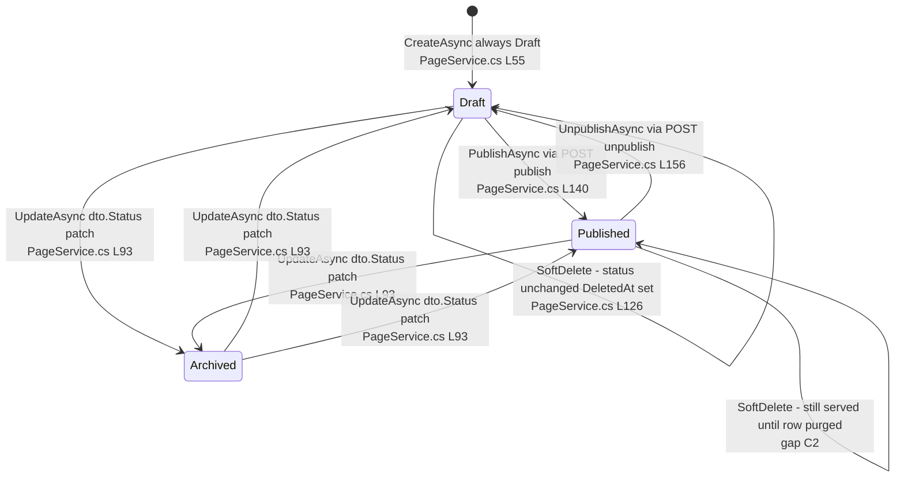
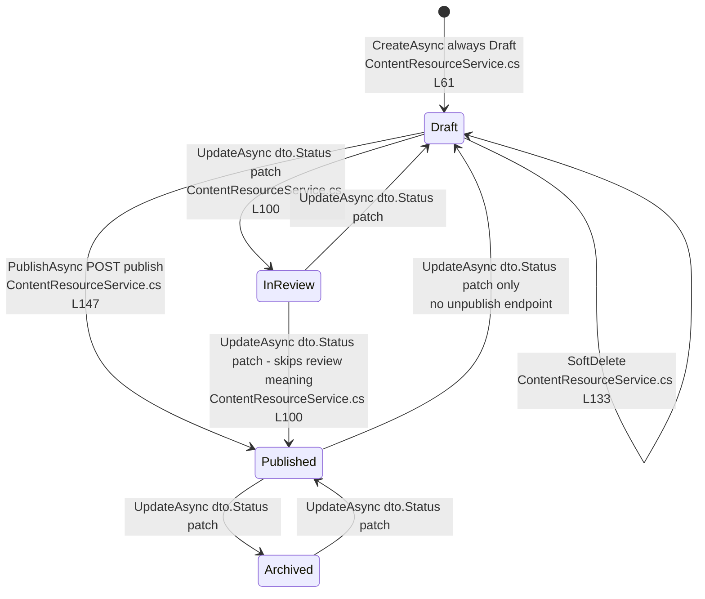
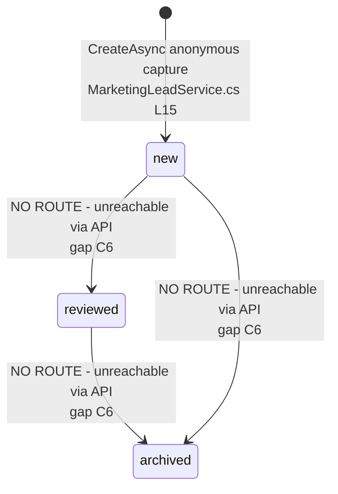

# Content.Pages — State Machines

> Module `GameGuild.Content.Pages` · `develop` @ `ce31d5850c`. All transitions are **service-mediated writes with no guarded transition table** — every arrow below is "set the column" unless a guard is noted. Audit events accompany each mutation (see `04-event-inventory.md`).

## 1. `Page.Status` (`Entities/Page.cs:31-36`, enum Draft/Published/Archived)



Notes and missing guards:
- The dedicated publish/unpublish endpoints coexist with the raw `UpdatePageDto.Status` patch (`Services/PageService.cs:93`) — the PUT can perform **any** transition, including Archived→Published, without the `PublishedBy`/`PublishedAt` bookkeeping the publish endpoint does. No transition is rejected anywhere.
- `PublishedAt` is first-publish-sticky (`??=`, `Services/PageService.cs:141`) and survives unpublish/patching.
- There is no terminal state: soft-deleted rows keep their status and remain query-visible (C2).

## 2. `ContentResource.Status` (`Entities/ContentResource.cs:40-46`, enum Draft/InReview/Published/Archived)



Notes:
- `InReview` is reachable **only** through the raw status patch; there is no submit-for-review endpoint in this module (the review workflow lives in `Resources.Contents` for versioned content — different aggregate). `InReview` only filters visibility (`Controllers/ContentResourceController.cs:51`); nothing consumes it operationally.
- There is no `unpublish` route for resources — unpublishing is a PUT status patch back to Draft.

## 3. `CourseProposal.Status` (string, `Entities/CourseProposal.cs:7-21`)

```mermaid
stateDiagram-v2
    [*] --> submitted : CreateAsync anonymous submit<br/>CourseProposalService.cs L17
    submitted --> in-review : UpdateAsync any valid string
    in-review --> approved : UpdateAsync
    approved --> rejected : UpdateAsync
    rejected --> published : UpdateAsync - no guard blocks it
    submitted --> published : UpdateAsync - direct publish legal
    published --> archived : UpdateAsync clears PublishedAt<br/>CourseProposalService.cs L127-130
    archived --> submitted : UpdateAsync re-activates - PublishedAt null until re-publish
    published --> published : republish keeps original PublishedAt<br/>CourseProposalService.cs L123-126
    submitted --> [*] : DeleteAsync hard Remove<br/>CourseProposalService.cs L151
```

Notes:
- Valid vocabulary enforced at the controller (`Controllers/CourseProposalsController.cs:92-103`): `submitted | in-review | approved | rejected | published | archived`. Anything else → 400.
- **No transition constraints** — any status to any status is legal in one PUT; `PublishedAt` set/clear logic (`Services/CourseProposalService.cs:123-130`) is the only side-effect discipline.
- Delete is **hard** (`Remove`, `Services/CourseProposalService.cs:151`) — the only hard delete in the module.

## 4. `MarketingLead.Status` (string, `Entities/MarketingLead.cs:20-31`)



- The state machine is vestigial: `MarketingLeadStatuses` declares three states and a validator, but no controller action mutates `Status` after creation (`Controllers/MarketingLeadController.cs` has GET/GET/POST only). CRM triage (`reviewed`/`archived`) exists in the vocabulary, the column default, and the filter of the list endpoint (`Services/MarketingLeadService.cs:69-71`) — never in the data.

## 5. `PageSection` (no status enum)

- Lifecycle is presence-based: created (`Services/PageService.cs:177-198`) → patched (`:200-219`) → reordered (`:235-253`) → soft-deleted (`:221-233`). `IsVisible` (`Entities/PageSection.cs:99`) is a display flag, not a state — reads include hidden sections and leave filtering to the frontend (`Services/PageService.cs:23`).
