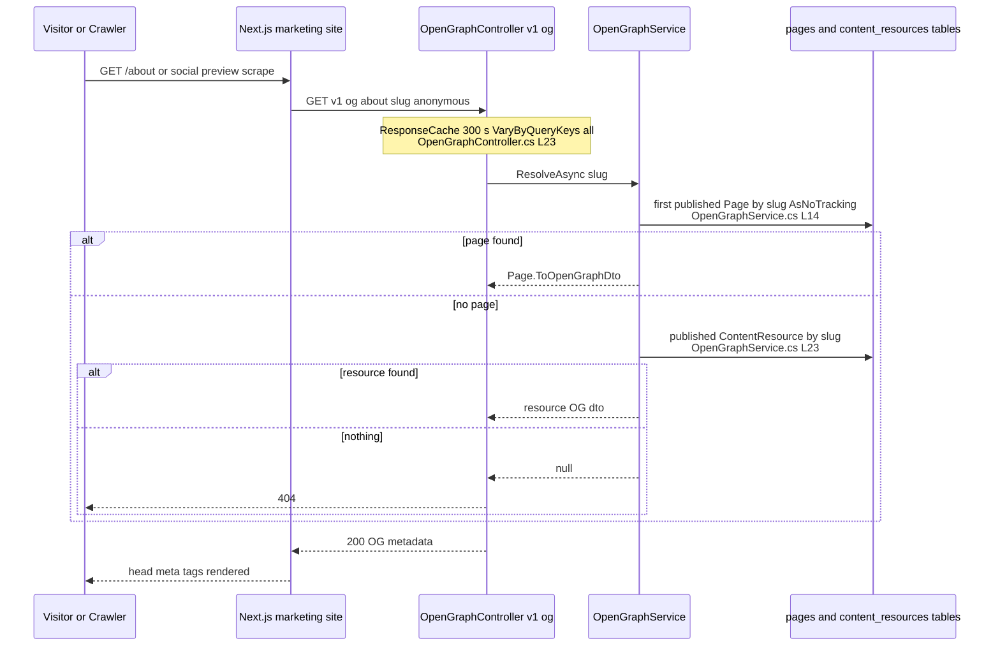
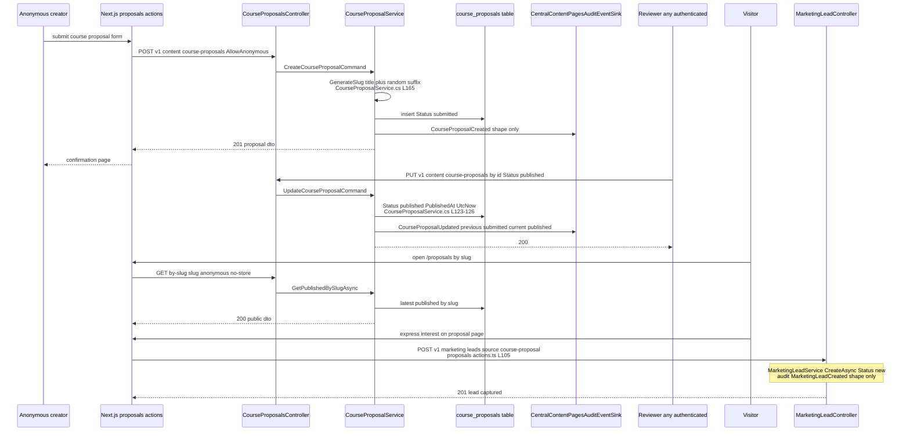

# Content.Pages — Cross-Module Sequences

> Module `GameGuild.Content.Pages` · `develop` @ `ce31d5850c`. All cross-module interaction is synchronous in-request (no integration events — see `04-event-inventory.md` §3).

## 1. Mutation → compliance audit log (fail-closed, same transaction)

Applies to all 17 mutation routes of `02-cqrs-wiring-matrix.md`.

```mermaid
sequenceDiagram
    participant Editor as Editor or Member
    participant PC as PageController
    participant Sender as ISender CQRS pipeline
    participant PS as PageService
    participant DB as ApplicationDbContext pages table
    participant Sink as CentralContentPagesAuditEventSink Compliance.Audit
    participant AL as AuditLog table

    Editor->>PC: POST v1 pages create
    PC->>Sender: CreatePageCommand
    Sender->>PS: CreateAsync dto
    PS->>DB: Add page Status Draft
    PS->>Sink: RecordAsync Content.Pages.PageCreated
    Sink->>Sink: require ambient transaction else throw<br/>CentralModuleAuditEventSinks.cs L35
    Sink->>AL: Add AuditLog row Risk Low Category Data
    Sink-->>PS: done
    alt audit write fails
        PS-->>Sender: exception
        Note over PS,DB: SaveWithRequiredAuditAsync rolls back<br/>page row AND audit row together
        Sender-->>PC: 500 via ExceptionHandlingMiddleware
    else committed
        PS-->>Sender: Page entity
        Sender-->>PC: entity
        PC-->>Editor: 201 CreatedAtAction GetPage
```

The same shape runs for `PUT` (PageUpdated), `DELETE` (PageDeleted), publish/unpublish, sections, resources, proposals and leads — only the ActionType and emitter site change (`04-event-inventory.md` §1).

## 2. Public render path — marketing site page vs OG resolution



Sibling read path: `GET v1/pages/by-slug/{slug}` returns the full page + ordered live sections (`Services/PageService.cs:21-26`); `GET v1/pages/sitemap` feeds `sitemap.xml` (`Controllers/PageController.cs:100-116`). Proposal detail: `GET v1/content/course-proposals/by-slug/{slug}` with `cache: 'no-store'` (`apps/web/src/lib/proposals/actions.ts:63-88`).

## 3. Course-proposal funnel — submission, publication, and downstream lead



Note the funnel's two PII stores: the proposal row keeps `ProposerName`/`ProposerEmail` (`Entities/CourseProposal.cs:58-61`, no erasure route, hard delete only) and the lead row keeps contact fields (`Entities/MarketingLead.cs:65-93`, no route at all to remove) — see gaps C6/C8.

## 4. Boundary statement — what this module is NOT

- **Not `Resources.Contents`**: Content.Pages has no versioning, no review workflow, no scheduling worker. A `Page` body edit overwrites in place; history exists only as audit log entries (`AuditLog` rows with `Content.Pages.PageUpdated`). Anything needing drafts-with-review or rollback is a `Resources.Contents` `ContentVersion` on a polymorphic entity — the two modules share no tables, no events, and no code beyond `EntityBase` and the CQRS rail (boundary contract in `docs/resources-contents/05-cross-module-sequences.md` §4).
- **Not `GameGuild.Resources`**: the Platform-family resources module (uploads/assets) is unrelated despite the similar name; its package is `docs/social-platform/`.
- **Not Learning.Courses**: `ContentResourceType.Course` + `LinkedEntityId` (`Entities/ContentResource.cs:129-136`) is a dangling cross-reference — nothing validates the linked program exists, and Learning emits nothing back.
