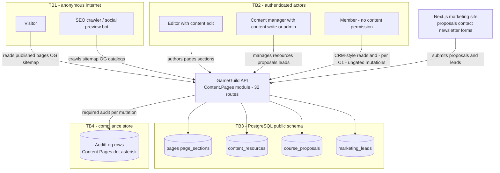
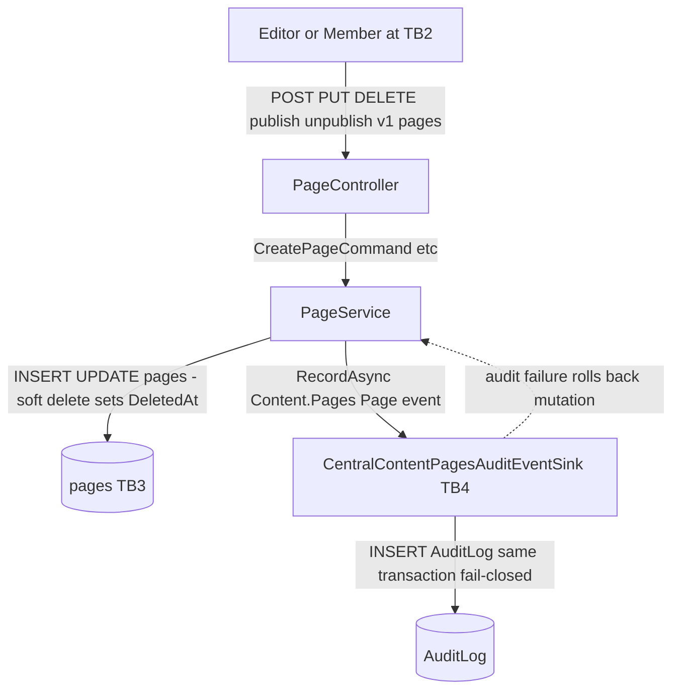
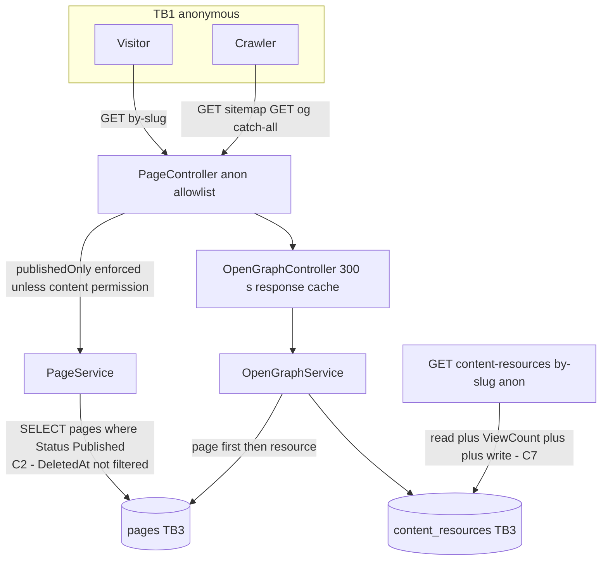
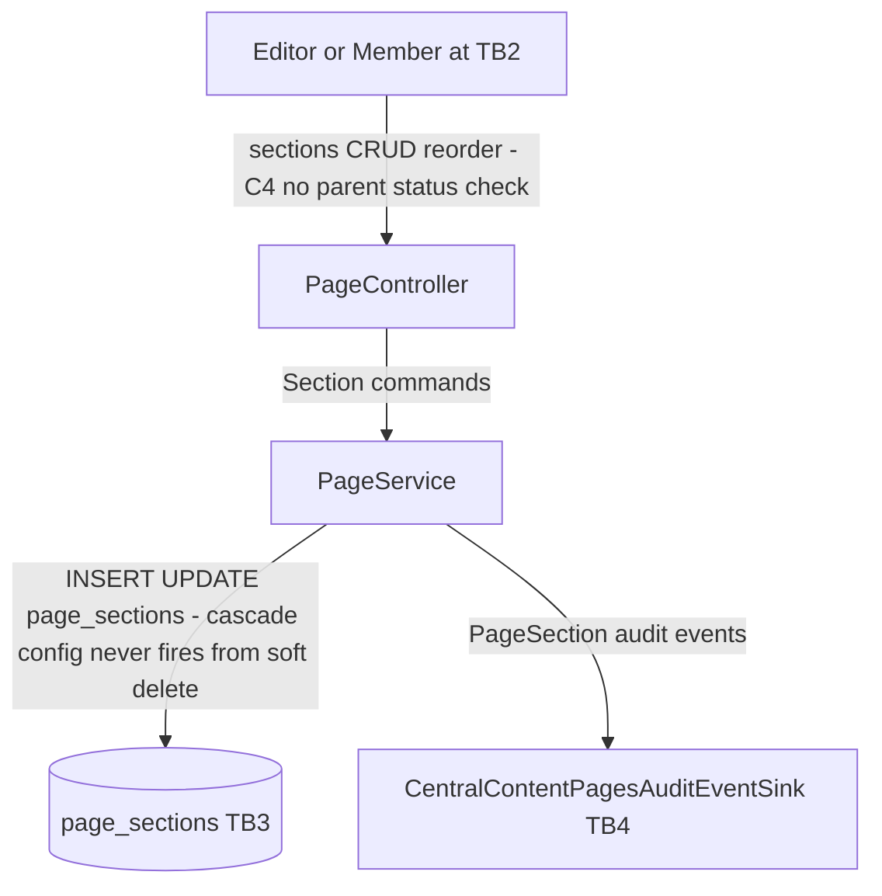
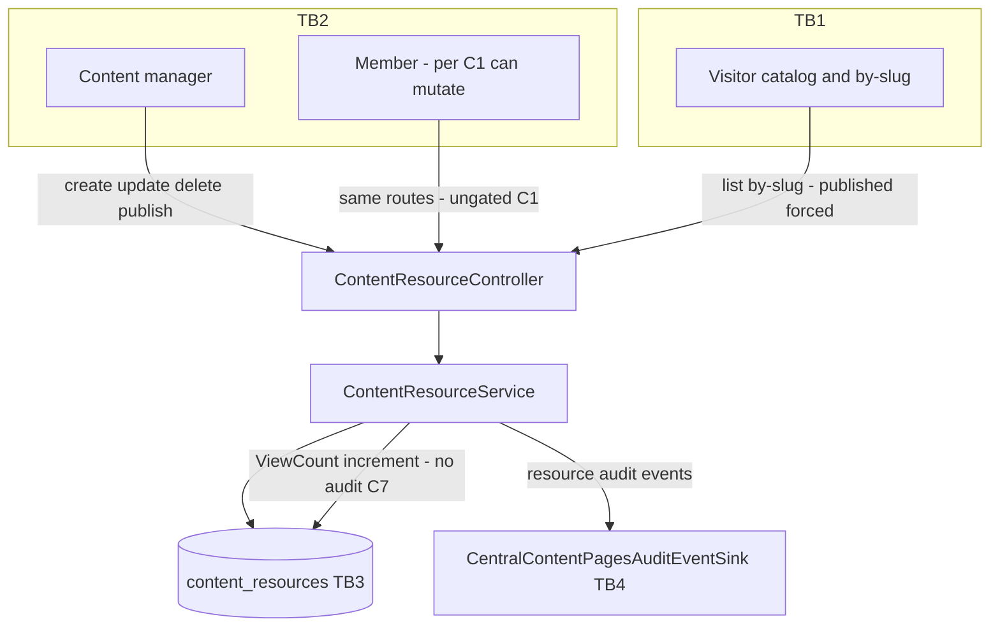
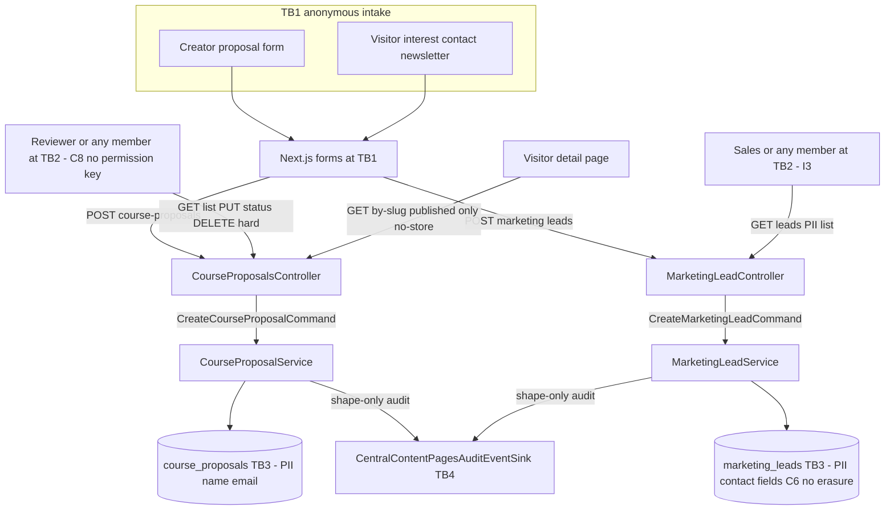

# Content.Pages — Data-Flow Diagrams

> Module `GameGuild.Content.Pages` · `develop` @ `ce31d5850c`. Trust boundaries: **TB1** anonymous internet → API gateway (global rate limit, anonymous-endpoint allowlist); **TB2** authenticated member/editor → API (JWT claims → `ActorContext`); **TB3** API services → PostgreSQL `public` schema; **TB4** mutation services → compliance `AuditLog` (same transaction, fail-closed). Flows numbered to match `01-user-flows.md`.

## L0 — Context

## L1-F1 — Page lifecycle

## L1-F2 — Public consumption

## L1-F3 — Section authoring

## L1-F4 — Content-resource lifecycle + catalog

## L1-F5+F6 — Proposal and lead intake

## Data-store sensitivity summary

| Store | Sensitivity | Notes |
|---|---|---|
| `pages` / `page_sections` / `content_resources` | platform content + free-form JSONB (`CustomData`, `Data`, `StructuredData`) | operator-trusted input; draft confidentiality depends on gates catalogued in `07-stride-threat-model.md` |
| `course_proposals` | PII (`ProposerName`, `ProposerEmail`) + free-form `Metadata` | no erasure path (hard delete only, C8) |
| `marketing_leads` | PII (name/email/company/message + `UserAgent`) | indefinite retention, no mutation surface (C6) |
| `AuditLog` rows `Content.Pages.*` | operational metadata, shape-only for intake | fail-closed in-transaction writes |
