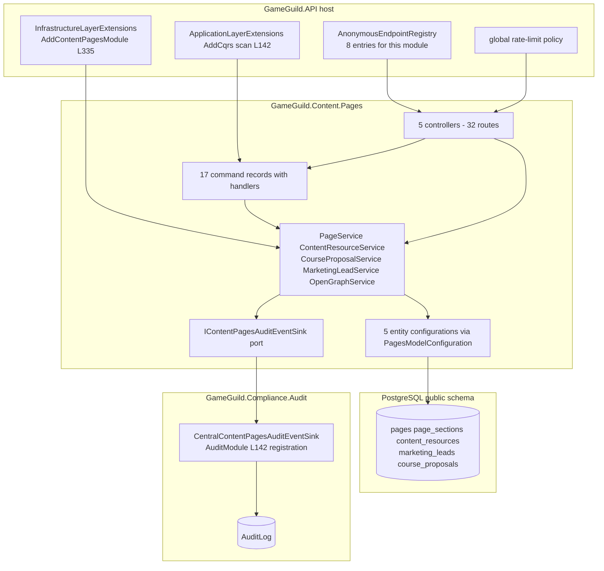

# Content.Pages — Security Architecture

> Module `GameGuild.Content.Pages` · `develop` @ `ce31d5850c`.

## 1. Component view

Wiring chain: module enabled in `CommonEnabledModules` (`API:/Core/Setup/ModuleConfiguration.cs:24`) → services DI (`API:/Core/Setup/InfrastructureLayerExtensions.cs:335` → `Pages:/Configuration/PagesModule.cs:13-22`) → handlers via CQRS scan (`API:/Core/Setup/ApplicationLayerExtensions.cs:142`) → model via `PagesModelConfiguration` assembly-scanned by `ApplicationDbContext.OnModelCreating` (`API:/Database/ApplicationDbContext.cs:866-883`) → tables from migrations `20260210113401_AddContentPagesModule` (pages/page_sections/content_resources), `20260512031314_AddMarketingLeads`, `20261015015009_AddCourseProposals`.

## 2. Permission map

| Capability | Gate | Where | Gap note |
|---|---|---|---|
| View unpublished pages/resources | `content:read` \| `content:write` \| `content:admin` (code check `CanViewUnpublished`) | `Controllers/PageController.cs:22,90-91`; `Controllers/ContentResourceController.cs:25,173-174` | visibility-only; enforces 404/forced-Published |
| Edit pages/sections/resources | `content:edit` \| `content:write` \| `content:admin` (`CanEditContent`) | `PageController.cs:31,93-94,137,243`; `ContentResourceController.cs:34,176-177,122` | **only on PUT** — C1 |
| Create / delete / publish / unpublish / sections mutations / proposal review / proposal delete | **none beyond `[Authorize]`** | `02-cqrs-wiring-matrix.md` rows 5,7,8,9,11,14,15,19,21,22,27,28 | C1 |
| CRM reads (proposals, leads) | `[Authorize]` only | `CourseProposalsController.cs:19-46`; `MarketingLeadController.cs:15-44` | C8 / I3 |
| Draft/version/schedule keys | n/a here | `content:draft`, `content:schedule` belong to `Resources.Contents` (`Authz:/Models/TypedPermissions.cs:216,219`); `content:edit-metadata` (#333) unused by both | cross-ref |
| Anonymous surface | `[AllowAnonymous]` + registry allowlist | `API:/Security/AnonymousEndpointRegistry.cs:98-102,196-198` | 8 routes, reviewed |
| Admin bypass | `ActorContext` system-admin/admin:* semantics | `Controllers/PageController.cs:29-30` comment | tested `EditorialPermissionGatingTests.cs:85` |

No ASP.NET policies (`[Authorize(Policy=…)]`) are used by this module — all authorization is code-level permission-set membership evaluated per request. Rate limiting: `global` policy for every route (no `[EnableRateLimiting]`).

## 3. Integrity properties (and non-properties)

**Properties held:**

1. Mutations and their audit rows commit atomically — fail-closed sink, rollback coupling tested (`SharedKernel/Abstractions/AuditedMutationExtensions.cs:62`; `Audit:/Services/CentralModuleAuditEventSinks.cs:35-41`; `ContentPagesMutationAuditTests.cs:112,125`).
2. Draft confidentiality on the primary read paths — by-id 404, by-slug published-only, list forced-Published (`Controllers/PageController.cs:45-48,65-68,80`; `ContentResourceController.cs:51-54,73-77,88`).
3. Slug uniqueness per table (unique indexes, `Configuration/PageConfiguration.cs:11`, `ContentResourceConfiguration.cs` index) and proposal slug non-collision by random suffix (`Services/CourseProposalService.cs:194`).
4. Intake validation — lead source/topic/contact rules at the controller (`Controllers/MarketingLeadController.cs:71-106`); proposal status vocabulary (`Controllers/CourseProposalsController.cs:92-103`).
5. Audit hygiene — intake events carry shape, never submitted PII (`Services/MarketingLeadService.cs:29-35`; `Services/CourseProposalService.cs:27-34`).

**Non-properties (do not rely on):**

1. Soft-delete is not a read barrier (C2) — deleted content still serves.
2. The editorial permission model is not a mutation barrier (C1) — only PUTs are gated.
3. No content versioning — updates overwrite in place; history exists only as audit rows.
4. Scheduled publishing does not execute (C3).
5. View counts are not integrity-protected (C7).
6. Platform-global data — no tenant scoping on any query; any member's reads/mutations span the whole platform (by design for website content, per `Controllers/PageController.cs:18-20`).

## 4. Fail verdicts (guards)

- **E9 route smoke**: clean — no `E9|` baseline entries for this module's 32 routes; anonymous and synthetic-principal passes answered without 5xx (`apps/api/tests/GameGuild.API.UnitTests/Architecture/wiring-gap-baseline.txt`, round 2 of 2026-11-04).
- **G1 (handler DI)**: clean (no `G1|` entries; all 17 handlers resolve via the scan).
- **G2 (table materialization)**: clean — all five entities materialized in migrations (chain above).
- **G4 (dead domain events)**: clean — none declared.
- **G7/G8**: clean — see `02-cqrs-wiring-matrix.md` §6.
- **Anonymous-surface guard** (`ControllerAuthorizationArchitectureTests`): the 8 anonymous actions match registry entries (keys `Controller.Action`, allowlist at `AnonymousEndpointRegistry.cs:98-102,196-198`).

## 5. Deployment invariants

1. `Resources.Contents`-independent: this module needs no other module except Compliance.Audit's sink registration (`Audit:/Extensions/AuditModule.cs:142`) — if the audit module were disabled, every Content.Pages mutation would fail closed (N/A risk today: audit module is always on).
2. Migrations `20260210113401`, `20260512031314`, `20261015015009` must precede first deployment of the module's routes (tables + indexes incl. unique slugs).
3. The anonymous allowlist entries must move with any new public route (guard enforces the match).
4. SEO posture depends on the 300 s OG cache and `no-store` proposal fetches — TTL changes alter staleness, not correctness.
5. The OpenAPI surface (tags `content/pages`, `content/pages/resources`, `content/course-proposals`, `content/marketing-leads`, `content/pages/open-graph`) is versioned `v1` via `[ApiVersion("1.0")]` on four controllers; `OpenGraphController` carries no explicit version (rides the default) — surface groups in `API:/Core/Extensions/OpenApiExtensions.cs`.
