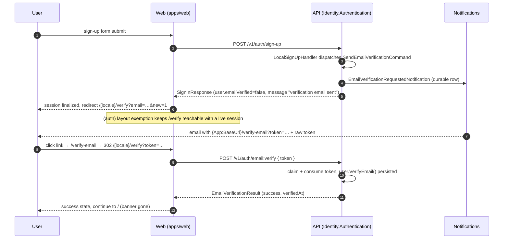

# J1 — Email Verification: Design Proposal

Status: proposed (docs-only; no code in this PR).
Issue: #1298 item J1. Companions: [#1197](https://github.com/gameguild-gg/gameguild/issues/1197)
(API-side resend cooldown), #1124 (account-recovery guard for never-verified addresses),
[Journey 1](../ui/journeys/01-sign-up-email-verification-first-sign-in.md) (the audit that
found the gaps).
Audited against `develop` (`7e8e63f82e`). Every code reference is `file:line`; API paths are
under `apps/api/Source`, web paths under `apps/web/src` unless a `packages/` path is given.

## Summary

The verification API surface is complete and hardened — token generation, single-use
consumption, a shared resend cooldown, enumeration-safe dispatch, a persisted verified flag
and a tenant-scoped sign-in gate all exist. The web journey is orphaned at **four** separate
points, so no user can ever complete a verification through the UI, and nothing asks them to:

1. the emailed link points at `/verify-email?token=…` — a route that does not exist anywhere
   in `apps/web` (404);
2. the only verification page, `/[locale]/(auth)/verify`, collects a **6-digit OTP** but the
   API's verification artifact is a **32-hex-char token** — the form can never succeed even if
   reached;
3. sign-up finalizes a session and redirects straight to the authenticated home page — it
   never routes through verification and ignores the API's "verification email sent" message;
4. nothing anywhere — sign-in, session, or app shell — checks a verified flag, so
   unverified-email sessions are indistinguishable from verified ones in the product.

This proposal makes the link the primary artifact, repairs the route chain, routes sign-up
through a verification interstitial, surfaces `emailVerified` in the session with a
non-blocking banner, and defines the sign-in interrupt that turns the existing (currently
disabled) `Authentication:LocalSignIn:RequireEmailVerification` policy into a shippable,
staged enforcement path. The one deliberate API addition is an
`emailVerificationRequired` flag on the sign-in response, mirroring the existing
`requiresMfa` interrupt, so the enforcement gate can be user-friendly without becoming an
account-existence oracle.

## Current state

### API side — complete

| Concern | Where | Behavior |
| --- | --- | --- |
| Send verification email | `POST /v1/auth/email:send-verification` (`Controllers/AuthController.cs:926-942`) | `SendEmailVerificationCommand` → handler |
| Verify email | `POST /v1/auth/email:verify` (`Controllers/AuthController.cs:947-976`) | `VerifyEmailCommand` → handler |
| Token generation | `Services/EmailVerificationService.cs:55-58,75-108` | 16 crypto-random bytes as 32-hex string, **24 h TTL**, stored in `IDistributedCache` (Redis in prod) keyed by SHA-256 of the token |
| Single-use consumption | `Services/EmailVerificationService.cs:193-299` | striped in-process claim locks + a non-JSON consumed sentinel in the cache; cross-instance races bounded by the sentinel protocol |
| Verified persistence | `Handlers/PasswordCommandHandlers.cs:8-53` | `VerifyEmailCommandHandler` calls `user.VerifyEmail()` and saves; `User.IsEmailVerified` is the durable flag; a cache marker `emailverify:verified:{userId}` outlives the token (`EmailVerificationService.cs:280-285`) |
| Sign-up dispatches the email automatically | `Handlers/LocalSignUpHandler.cs:55-71` | sign-up success sends `SendEmailVerificationCommand`; response message states the email was sent (or that queueing failed, with a pointer to resend) |
| Resend cooldown (issue #1197) | `Services/EmailVerificationService.cs:48,360-411` | 2-minute per-(user, normalized address) window shared by every dispatch path; cooldown-store outage fails open for dispatch, closed for resend |
| Enumeration safety | `Handlers/SendEmailVerificationCommandHandler.cs` | known and unknown accounts get an identical generic response; delivery failures (2 attempts) surface only via critical log + `Authentication.EmailVerificationDeliveryFailed` audit event |
| Email rendering | `GameGuild.Notifications/Services/Email/Renderers/IdentityEmailRenderers.cs:72-129` | renders `{App:BaseUrl}/verify-email?token={token}` link (defaults to `http://localhost:3000`), TRANSACTIONAL (no unsubscribe footer) |
| Delivery pipeline | `GameGuild.Notifications/Services/Email/EmailDispatcherService.cs` | durable notification rows, sweep reclaim, transactional staleness TTL |
| Bounce/complaint ingestion | `POST /v1/notifications/email-events` (`GameGuild.Notifications/Controllers/EmailEventsController.cs:35`, `Commands/ReceiveEmailEventsCommand.cs`) | SES bounce/complaint events persist event + suppression atomically |
| Sign-in verified gate (OFF by default) | `Models/Configuration/LocalSignInPolicyOptions.cs`, `Services/LocalAuthService.cs:301-303` | `Authentication:LocalSignIn:RequireEmailVerification` (global) + `RequireEmailVerificationForTenants` (per-tenant, cannot weaken the global flag); when enabled, unverified sign-in fails with the generic enumeration-safe login error |
| Sign-in response carries the flag | `Mappings/AuthenticationMappings.cs:91` | `SignInResponse.User.EmailVerified` (from `user.IsEmailVerified`) — sent today, ignored by the web |
| Recovery guard (issue #1124) | `Handlers/PasswordCommandHandlers.cs:63-80` | password reset refuses never-verified addresses with a response identical to the known-account path (ownership never proven) |

Related but **separate** flows that must not be conflated with verification: magic-link
sign-in (`/v1/auth/magic-link:*`, DB-backed token store) and 6-digit email sign-in codes
(`/v1/auth/email-code:*`, `Services/EmailCodeService.cs` — six digits, 10 min, 5 attempts).
The 6-digit artifact on the verify page resembles the latter, but no verification endpoint
issues such a code.

### Web side — orphaned

| Surface | Where | Gap |
| --- | --- | --- |
| Verification page | `app/[locale]/(auth)/verify/page.tsx`, `components/auth/verify-page-content.tsx:7-33` | requires `?email=`, else bounces to `/sign-in`; renders `InputOTPForm` (6 slots, `components/input-otp-form.tsx:37`) |
| Verify submit | `lib/auth/password-actions.ts:109-123` | posts the typed code as `token` to `POST /v1/auth/email:verify` (raw fetch from `@game-guild/client`, F3) — a 6-digit string can never match the 32-hex token |
| Resend | `lib/auth/password-actions.ts:125-139` | `POST /v1/auth/email:send-verification`; button disabled only while the request is in flight (`components/input-otp-form.tsx:99-109`) — the 2-minute server cooldown is invisible |
| Emailed link target | — | `/verify-email` appears **only** in the API renderer; no route, redirect, or rewrite exists in `apps/web` (`next.config.ts` redirects at `apps/web/next.config.ts:130-152` do not mention it) |
| Sign-up success | `packages/infrastructure/client/src/integrations/next/actions.ts:307-318` | `finalizeServerAction` mints the session, then redirects to `redirectTo ?? config.pages.newUser ?? '/'`; `pages.newUser` is unset in `apps/web/src/auth.ts:67-70` |
| Auth layout bounce | `app/[locale]/(auth)/layout.tsx:24-46` | authenticated users are bounced off all `(auth)` pages (only `/sign-in/2fa` completion is exempt, `:26-28`) — so even a post-sign-up redirect to `/verify` would immediately bounce home |
| Sign-in handling | `packages/infrastructure/client/src/runtime/auth/providers/credentials.ts:128-166` | `requiresMfa` → interrupt; unverified sign-in under an enabled policy would surface as the generic invalid-credentials `FieldError`, with no path to `/verify` |
| Session | — | web session does not carry `emailVerified`; no banner or badge anywhere references it |

### Why the current policy gate alone is not enough

`Authentication:LocalSignIn:RequireEmailVerification` exists but fails closed with the
generic login error (`LocalAuthService.cs:301-303`) — correct for enumeration safety, but a
user with the right password and an unverified address would see "invalid credentials" with
no hint to check their inbox. Enabling the policy before the verify journey works would lock
every new user out. The UI repair and the response-shape change below are prerequisites for
any rollout of the policy.

## Proposed flow

### Artifact decision: link-primary, paste-token fallback

The API issues one artifact: a 32-hex token inside a deep link. The design adopts it instead
of inventing a second one.

- **Email content** (`IdentityEmailRenderers.cs:72-129`, small copy change): keep the
  "Verify your email address" button; add the raw token on its own line with copy guidance
  for clients that strip links. No second code system (see open questions).
- **Route**: add a root-level `/verify-email` redirect shim (same pattern as the legacy
  `/login` shim, `app/[locale]/(auth)/login/page.tsx:11`) that 302s to
  `/{detected-locale}/verify?token=…`. The API renderer keeps building
  `{App:BaseUrl}/verify-email?token={token}`; locale stays a web concern.
- **`/verify` page** becomes token-capable:
  - `?token=…` → server-side verification attempt on load (no typing); success → success
    state + continue to `/`; failure → error state with **Resend** (and the email pre-filled
    from the response when the API returns it).
  - `?email=…` (no token) → "check your inbox" state: Resend button (cooldown-aware) plus a
    single **paste-token input** replacing the 6-digit OTP form.
  - neither param → today's bounce to `/sign-in`.
  - The 6-digit `InputOTPForm` is removed from this page; the component is retired with it
    (its only consumer is this page — `components/auth/verify-page-content.tsx:9`).

### Sequence

### Sign-up interstitial

- `SignupForm` passes `redirectTo: '/verify?email=' + encodeURIComponent(email) + '&new=1'`
  on success (the server action already honors it, `actions.ts:309-318`); alternatively set
  `pages.newUser` in `apps/web/src/auth.ts` and keep the email param on the form path — the
  param requires the form-side route, so the form path is the primary lever.
- `(auth)/layout.tsx` gains a `/verify` exemption mirroring the 2FA one (`:26-28`): an
  authenticated session may hold the page while unverified. The exemption is scoped to the
  forwarded path only, exactly like `onMfaCompletion`.
- The interstitial explains the email, offers Resend (cooldown-aware), links "wrong address?
  sign out", and a "skip for now" exit to `redirectTo` — the session stays usable in phase 1.

### Sign-in interrupt (the one API change)

Add `emailVerificationRequired: true` to `SignInResponse` when the resolved policy requires
verification, the password was valid, and `!user.IsEmailVerified` — mirroring how
`requiresMfa` rides the same response (`Mappings/AuthenticationMappings.cs:53-85`). The
`LocalAuthService.cs:301-303` throw becomes a structured failure that maps to this flag.
Enumeration posture is unchanged in substance: the flag is only reachable **after** a valid
password proof, which already demonstrates account knowledge (the same reasoning that makes
`requiresMfa` safe).

Web handling (`credentials.ts:128-166` pattern): catch the flag like `MfaRequiredError`,
`router.replace('/sign-in')`-style navigate to `/verify?email=…&signIn=1` (preserving
`redirectTo`), never render it as a credential error.

### In-app banner (phase 1 enforcement-lite)

- Surface `user.emailVerified` into the web session (Next Auth session callback reading the
  sign-in response already stored at finalize; no new API call per render).
- A dismissible-for-the-session banner on authenticated pages for unverified users:
  "Verify your email — resend / enter token", linking `/verify?email=…`.
- Not blocking in phase 1; see rollout for when gates tighten.

## States

| State | Entry | UI treatment |
| --- | --- | --- |
| Unverified, fresh sign-up | sign-up success | interstitial `/verify?email=…&new=1` |
| Unverified, signed-in | any authenticated page | session-dismissable banner |
| Unverified, sign-in attempt (policy on) | `emailVerificationRequired` | interrupt → `/verify?email=…&signIn=1`, `redirectTo` preserved |
| Pending token issued | email sent | "check your inbox" + Resend (cooldown) + paste-token input |
| Token presented, valid | link click / paste | auto-verify, success state, continue to `/` |
| Token expired (>24 h) | verify attempt | error state + Resend (new token, new 24 h) |
| Token already consumed | replayed link | same generic "invalid or expired" error (no consumption oracle); Resend available |
| Unknown/garbage token | verify attempt | "invalid or expired" (identical copy — no enumeration) |
| Cooldown active (<2 min since last send) | Resend click | button disabled with live countdown; server remains the authority |
| Delivery failed | dispatcher/queue failure | invisible to the public response (enumeration-safe); ops sees `Authentication.EmailVerificationDeliveryFailed` audit + critical log; user's recovery path is Resend |
| Address suppressed (bounce) | SES bounce event | Resend keeps "succeeding" generically; suppression handled ops-side (`ReceiveEmailEventsCommand`); see open questions |
| Verified | successful verify | banner gone; sign-in uninterrupted |

## Failure, retry, and bounce handling

- **Resend** always goes through `POST /v1/auth/email:send-verification` — enumeration-safe,
  cooldown-gated (2 min), two delivery attempts inside the handler, then audit-only failure.
  The UI mirrors the cooldown with a disabled+countdown button but treats 4xx "try again
  later" as authoritative, not the local timer.
- **Expired/invalid/consumed tokens** render one identical error copy with a Resend action;
  the API already conflates these outcomes (`EmailVerificationService.cs:210-217,229-235,262-269`).
- **Link decay**: tokens live 24 h; the interstitial and banner make re-entry trivial, so no
  refresh-token dance is needed.
- **Bounces**: ingestion and suppression already exist (`EmailEventsController`,
  `ReceiveEmailEventsCommand`). Product behavior for a suppressed address is an open question
  (nudge to change address vs. ops outreach); the design deliberately does not leak bounce
  status to the public resend response.
- **Sign-up with queue down**: unchanged — sign-up succeeds, message says the email could
  not be queued (`LocalSignUpHandler.cs:66-70`); the interstitial's Resend is the recovery.

## Security considerations

- **Token reuse**: single-use via the claim protocol (sentinel + remove under striped locks;
  cross-instance bound by the sentinel). No change proposed.
- **Enumeration**: three oracles are intentionally kept closed — send-verification's
  identical responses, verify's conflated token errors, and the sign-in gate's
  post-password-only flag. The design adds no new account-existence signal. `user.Email`
  is returned in the verify result only on success (`PasswordCommandHandlers.cs:48`).
- **Token transport**: the token rides a URL query (`/verify-email?token=…`). Mitigations
  already in place: 24 h TTL, single use, SHA-256-keyed cache storage, redacted logging
  (`LogRedaction.MaskEmail`/`RedactId` throughout). The redirect shim must forward the token
  server-side only (302 Location) and the success page must not echo it; the doc mandates
  the token never appears in any client-side analytics or `JsonLd`.
- **Rate limits**: verify/send endpoints already sit behind the API rate-limit policy;
  Resend additionally gets the 2-minute cooldown. Optional hardening (open question):
  attach the existing Turnstile token to send-verification after repeated attempts — the
  promo-codes endpoints already accept a `CaptchaToken` for exactly this shape
  (`PromoCodesController.cs:327-350`).
- **Account-recovery interplay**: unverified accounts cannot reset passwords (#1124 guard).
  The banner copy should say "verify to enable password recovery" — a real user-facing
  consequence that motivates the click.

## Config surface

| Setting | Owner | Today | Role here |
| --- | --- | --- | --- |
| `App:BaseUrl` | API | default `http://localhost:3000` (`IdentityEmailRenderers.cs:102-106`) | **must be the public web origin in every non-dev environment**, else every emailed link 404s — call out in rollout checklist |
| `Authentication:LocalSignIn:RequireEmailVerification` | API | false | phase 3 global gate |
| `Authentication:LocalSignIn:RequireEmailVerificationForTenants` | API | empty | phase 2 pilot tenants |
| `AUTH_SECRET`, Turnstile keys, cookie config | web | existing | unchanged |
| *(new web env)* | web | — | none introduced; the web learns policy via the sign-in response and session flag, never by guessing |

## Migration / compatibility notes

- Routes: `/[locale]/verify` changes shape (token support, OTP form removed) — its only
  current callers are itself and test fixtures, so no inbound links break; `/verify-email`
  is net-new and only appears in emails.
- API: `SignInResponse` gains an optional boolean — additive; existing clients ignore it.
  The `LocalAuthService` gate behavior change (throw → structured flag) is behind the same
  disabled-by-default policy, so no behavior change ships until the policy is enabled.
- Generated client: the raw-fetch `verifyEmail`/`resendVerificationEmail` wrappers
  (`password-actions.ts:115/131`) migrate to the generated `postAuthEmailVerify` /
  `postAuthEmailSendVerification` as part of the F3/F4 cleanup already tracked in the
  [api-contract-matrix](../architecture/api-contract-matrix.md) — not a prerequisite.
- Existing users: `IsEmailVerified=false` population exists today (nothing ever set it via
  UI). Rollout must decide grandfathering before phase 3 (see open questions).
- Tests referencing the OTP form (`components/__tests__/verify-page-content.test.tsx`,
  `input-otp-form.test.tsx`) are rewritten with the page.

## Test plan

- **Web unit/component**: `/verify` param matrix (token success/failure, email-only, empty);
  interstitial copy and skip path; banner render/dismiss with `emailVerified` true/false;
  resend countdown respects server error over local timer.
- **Web e2e** (Playwright, existing journeys in `apps/web/src/lib/__tests__/e2e/`): sign-up →
  interstitial → (mailhog/dev inbox) link click → verified → banner absent; resend cooldown
  UX; policy-on sign-in interrupt routes to `/verify` with `redirectTo` preserved;
  `(auth)` layout does not bounce an authenticated unverified user off `/verify`.
- **API**: `SignInResponse.emailVerificationRequired` set only when password valid + policy
  on + unverified; never set on password failure (anti-oracle regression test); gate
  per-tenant semantics (global flag cannot be weakened per tenant — already encoded in
  `LocalSignInPolicyOptions.IsValid`).
- **A11y**: token paste input labeled + `aria-invalid` on failure; countdown announced
  politely; success/failure by text not color (house convention).

## Rollout plan

1. **Phase 1 — reachable (web only)**: routes, interstitial, banner, session flag. No API
   change beyond the additive response field. Verification becomes *possible*; nothing is
   required. Verify `App:BaseUrl` per environment first (links are already being emailed).
2. **Phase 2 — surfaced + pilot gate**: enable
   `RequireEmailVerificationForTenants` for one internal tenant; monitor verify completion,
   resend/cooldown metrics, and `EmailVerificationDeliveryFailed` audit volume.
3. **Phase 3 — global gate**: after grandfathering decision and completion-metric review,
   set `RequireEmailVerification: true`. Sign-up continues to finalize sessions (verification
   is post-sign-up), so the gate only bites at next sign-in — deliberately gentle.
4. **Phase 4 (optional)** — OTP parity: only if the owner wants 6-digit codes (see open
   questions); would reuse `EmailCodeService` mechanics against the verification token type.

## Open questions for the owner

1. **Enforcement posture** — banner-only, or gate at sign-in (phases 2–3), or gate at
   *sign-up session* (hardest: no session until verified; would change
   `finalizeServerAction` ordering)? This doc recommends the staged path above.
2. **Grandfathering** — when phase 3 flips on, are existing unverified accounts (a) bulk
   grandfathered as verified (migration script on last-login recency), (b) forced to verify
   at next sign-in, or (c) exempted by a date cutoff?
3. **OTP vs link** — keep single 32-hex token artifact (recommended; email-code sign-in
   already owns the 6-digit mental model for a different purpose) or add a 6-digit
   verification code for mobile-mail-client ergonomics?
4. **Bounced addresses** — product behavior when the verification email hard-bounces:
   surface "email undeliverable, change address" in-app (requires exposing suppression
   status safely) or keep it ops-only?
5. **Turnstile on resend** — worth wiring the existing challenge to send-verification after
   N unauthenticated attempts?
6. **`App:BaseUrl` provenance** — confirm each environment's value today; if unset anywhere
   non-dev, every mailed link 404s (silent today because nobody clicks a link that is the
   only path to a page nobody reaches).
