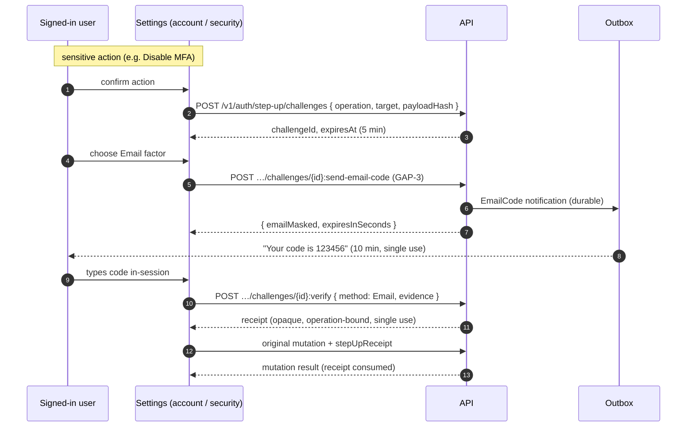

# J2 — Email-MFA Settings + MFA Account Recovery UI: Design Proposal

Status: proposed (docs-only; no code in this PR).
Issue: #1298 item J2. Implementation tracker for the email-code repurpose: [#1380](https://github.com/gameguild-gg/gameguild/issues/1380)
(owner decision on #1236 — email-code retired as a sign-in method by PR #1379, repurposed as
the step-up channel; this design absorbs that decision as its Part D). Companions:
#1152 (email-MFA factor), #1168 (endpoints shipped), #1153 (password re-verification),
#1195 (empty backup codes), [#1197](https://github.com/gameguild-gg/gameguild/issues/1197)
(cooldowns / anti-enumeration), #1191 (step-up machinery), #1349 (step-up adoption for
credential mutations), PR #1172 / #1155 (MFA recovery emails through the durable outbox),
[Journey 2](../ui/journeys/02-mfa-enrollment-and-recovery.md) (the audit that found the gaps),
[J1 — Email Verification](./j1-email-verification.md) (sibling design, merged #1367).
Audited against `develop` (`a0fc54fc01`). API paths are under `apps/api/Source/Modules`,
web paths under `apps/web/src`, generated client under
`packages/infrastructure/client/src/generated`.

## Summary

The backend story is finished and hardened. The email MFA factor has a full lifecycle
(six-digit crypto-random codes, digest-only storage, constant-time comparison, single use,
five-attempt ceiling, sixty-second resend throttle, durable-outbox delivery). Lost-MFA-device
recovery has a three-stage anonymous token ceremony (request → 7-day cooling-off → confirm)
with enumeration-safe responses, per-email rate limiting, hash-matched single-use tokens and
durable-outbox emails. The step-up machinery from #1191 issues operation-bound challenges and
opaque receipts for TOTP, backup codes and WebAuthn. None of it is reachable from the web:

1. **Email-MFA settings**: the security page renders the Email row from
   `GET /v1/auth/mfa/methods` (which advertises Email as available) but implements only the
   TOTP and SMS branches — an email row shows up looking enrollable with **no button**.
2. **Sign-in**: a user whose only enrolled factor is Email cannot sign in at all — the web
   challenge form offers a Totp/BackupCode select, the client drops the `userId` the API
   returns, and (a real API gap) the sign-in completion path rejects the Email method
   outright.
3. **Backup codes**: the settings surface discards the initial code set the setup endpoint
   returns (the #1195 fix's settings-side symptom) and renders an empty grid with a success
   toast if regeneration ever returns an empty array.
4. **MFA account recovery**: the recovery emails link to `/auth/mfa-recovery` — a route that
   does not exist anywhere in `apps/web` (404, same shape as J1's `/verify-email`); there is
   no page, no entry link from the 2FA or sign-in screens, and no cancel affordance for a
   signed-in owner.
5. **The email code's second life** (#1380): #1379 retires `/email-code` as a sign-in entry
   and deliberately preserves the `EmailCodeFlow` component; the owner has decided its next
   life is the **step-up verification channel for sensitive actions** (typed code in the live
   session, not a link) plus the **email-address-change confirmation** leg. The step-up
   machinery has no email channel today.

This proposal closes all five with settings surfaces that extend the existing
`MfaMethodsManager` / server-action patterns, a recovery journey that consumes the existing
three-stage API verbatim, and an email step-up channel wired into the existing challenge →
verify → receipt pipeline — reusing `EmailCodeFlow`'s request/consume shape as the
verification UI substrate. Every screen maps 1:1 onto the already-generated client; the
genuine API gaps (Email at sign-in completion, the email step-up channel, the email-change
leg) are flagged explicitly as proposals under #1380 rather than smuggled in.

## Scope

**In scope (this design):** email-MFA enrollment/verify/disable in settings; backup-code
display/regeneration completion (#1195 residual); the lost-MFA-device recovery journey
(`POST /v1/auth/mfa/recovery:*`); the email step-up channel and email-change confirmation
(#1380 legs A and C).

**Out of scope, deliberately:** delegated account recovery with trusted contacts / passkeys
(`POST /v1/auth/account-recovery/*`, issue #209 — the "lost password *and* MFA" journey;
recommended as its own design, see open questions); push MFA UI (`mfa/push:*`, also dead in
the matrix); re-adding the SMS challenge button to the sign-in 2FA form (the
`mfaToken`-bound `POST /v1/auth/mfa/sms:challenge` exists with no web caller on `develop`;
the email leg below defines the pattern to copy); admin-assisted MFA reset
(`POST /v1/admin/users/{id}/mfa:reset`, support-console surface).

## Current state

### API side — complete

| Concern | Where | Behavior |
| --- | --- | --- |
| Email factor: enroll | `POST /v1/auth/mfa/email:setup` (`Controllers/MfaController.cs:301-328`) | `StartEmailMfaEnrollmentCommand` → code to the account's own address; response carries masked address + `expiresInSeconds` |
| Email factor: verify | `POST /v1/auth/mfa/email:complete` (`Controllers/MfaController.cs:331-356`) | `CompleteEmailMfaEnrollmentCommand`; persists `EmailMfaAddress` + `IsEnabled` only after the code is confirmed |
| Email factor: challenge | `POST /v1/auth/mfa/email:challenge` (`Controllers/MfaController.cs:358-384`, anonymous, body `UserId`) | fresh sign-in code to the enrolled address; generic failure payload; throttled |
| Email code mechanics | `Services/EmailMfaService.cs:27-33` | six crypto-random digits (`:146`), SHA-256 digest storage (`:150`), 10-min TTL, single use, 5-attempt ceiling, **60 s resend throttle** (`:30`); constant-time compare incl. dummy digest (`:204-206`) |
| Delivery | `Handlers/SendEmailMfaCodeRequestedHandler.cs:29-42` | durable notification row (`NotificationType.EmailCode`, high priority); a failed enqueue **throws** — a code is never live unless its email was durably queued (mirrors #1155) |
| Generic verify | `POST /v1/auth/mfa/verify` (`Controllers/MfaController.cs:121-138`) | accepts `Email` method (`Services/MfaService.cs:189-192`); lockout-tracked via `MfaAttemptTrackingService` |
| Method catalog | `GET /v1/auth/mfa/methods` (`Controllers/MfaController.cs:474-552`) | Email entry `IsAvailable: true`, priority 3 (`:511-519`); BackupCode entry reflects remaining codes |
| Backup codes: status | `GET /v1/auth/mfa/backup-codes` (`Controllers/MfaController.cs:148-167`) | counts only; codes never returned (`BackupCodesStatusResponse`) |
| Backup codes: initial set | `POST /v1/auth/mfa/totp:setup` response (`Controllers/MfaController.cs:78-81`) | #1195 fix: the setup response now carries the generated initial set (`Services/MfaService.cs:75-94`, count from `MfaOptions.BackupCodesCount`, default 10 at `MfaOptions.cs:28`) |
| Backup codes: regenerate | `POST /v1/auth/mfa/backup-codes:regenerate` (`Controllers/MfaController.cs:175-204`) | #1153: password re-verification (`RegenerateMfaBackupCodesCommand`); invalidates the old set; empty array ⇒ refused (400) |
| Disable MFA | `POST /v1/auth/mfa:disable` (`Controllers/MfaController.cs:560-584`) | #244/#1153: password proof; clears all factors incl. `EmailMfaAddress` (`Services/MfaAttemptTrackingService.cs:166`) |
| Recovery: stage 1 | `POST /v1/auth/mfa/recovery:request` (`Controllers/MfaRecoveryController.cs:27-37`, anonymous) | enumeration-safe identical response (`Handlers/MfaRecoveryCommandHandlers.cs:32-39,119-121`); opens a request with a **7-day cooling-off** (`:18`), **10-min per-email rate limit** (`:21`); email via durable outbox (`:128-153`) |
| Recovery: stage 2 | `POST /v1/auth/mfa/recovery:continue` (`Controllers/MfaRecoveryController.cs:46-60`, anonymous) | exchanges the request token after cooldown; **425 + `RetryAfterSeconds`** while cooling off (`Handlers/MfaRecoveryCommandHandlers.cs:192-201`); confirmation email (1 h token TTL, `:19`) |
| Recovery: stage 3 | `POST /v1/auth/mfa/recovery:confirm` (`Controllers/MfaRecoveryController.cs:69-79`, anonymous) | single-use confirmation token → conditional update → `DisableMfaAsync` (`Handlers/MfaRecoveryCommandHandlers.cs:298-308`); generic denials |
| Recovery: cancel | `POST /v1/auth/mfa/recovery:cancel` (`Controllers/MfaRecoveryController.cs:81-90`, authorized) | owner-only; invalidates both tokens |
| Recovery emails | `Notifications/Services/Email/Renderers/IdentityEmailRenderers.cs:340-413,416-470` | link **`{App:BaseUrl}/auth/mfa-recovery?token=…`** (`:357`) and **`?confirm=…`** (`:433`); TRANSACTIONAL; cooldown end stated in the mail |
| Step-up machinery (#1191) | `Controllers/StepUpController.cs:23,52,73`; `StepUp/StepUpReceiptService.cs` | `challenges` (operation-bound: `StepUpContracts.cs:9-30` — operationType/targetReference/SHA-256 payloadHash, 5-min TTL `StepUpReceiptService.cs:15`), WebAuthn options, verify → opaque receipt; **method allowlist is Totp/BackupCode/WebAuthn only (`StepUpReceiptService.cs:75-78`)** — no email channel |
| Step-up 423 convention | `StepUp/StepUpRequiredResponder.cs:76-99`; `GameGuild.API/Core/Authorization/StepUpRequiredHttpResponses.cs:14-19`; `EconomyStepUpExecutor.cs` | structured 423 whose `AvailableMethods` derive from real enrollment — TOTP secret (`:85-89`), remaining backup codes (`:89-92`), active WebAuthn credentials (`:93-97`); **no `EmailMfaAddress` branch — an enrolled email factor is invisible to step-up interrupts** |
| Email sign-in codes (preserved) | `POST /v1/auth/email-code:request|consume` (`Controllers/AuthController.cs:249,277`); `Services/EmailCodeService.cs:19-40` | six digits, 10 min, 5 attempts, 60 s throttle, `IDistributedCache` (#1272), constant-time unknown-email path; **#1379 (open) retires these as sign-in and preserves the flow for repurpose** |
| Password change | `POST /v1/auth/password:change` (`Controllers/AuthController.cs:1043`) | current-password proof; no step-up receipt today |
| Email change | — | **no endpoint exists** (see GAP-4) |
| Delegated account recovery (out of scope) | `Controllers/AccountRecoveryController.cs:18-187`; `Configuration/AccountRecoveryOptions.cs` | K-of-N trusted-contact/passkey approvals → forced credential reset; 6 endpoints, 0 callers (matrix `docs/architecture/api-contract-matrix.md:134-143`) |

### Web side — zero UI for everything above

| Surface | Where | Gap |
| --- | --- | --- |
| Security settings page | `app/[locale]/(dashboards)/workspace/settings/security/page.tsx:22-37` | loads config/methods/backup-codes; delegates to `MfaMethodsManager` |
| MFA methods manager | `components/settings/mfa-methods-manager.tsx:76-140` | only TOTP (`handleStartTotp`/`handleCompleteTotp`) and SMS handlers exist; the Email catalog row renders with no enroll action (zero `email` references in the file) |
| MFA server actions | `lib/auth/mfa-actions.ts:118-197` | totp setup/complete, sms setup/complete, backup-codes regenerate, disable — no email actions; all through the generated `AuthMultiFactorModule` |
| Initial backup codes (settings) | `lib/auth/mfa-actions.ts:118-127` (action returns the full setup, including `backupCodes`); `components/settings/mfa-methods-manager.tsx:76-90` (handler keeps only `secretKey`/`qrCodeUri`, `:82`) | `MfaSetupOutput.backupCodes` is **discarded** by the manager — the #1195 symptom in settings shape; first codes visible only via password-verified regenerate |
| Empty-regenerate guard | `lib/auth/mfa-actions.ts:184` | `codes ?? []` returns success with an empty grid (journey doc edge case) |
| Sign-in 2FA form | `components/auth/mfa-challenge-form.tsx:276-294` | method `<select>` offers Totp/BackupCode only (and only when BackupCode ∈ availableMethods); no Email, no challenge trigger |
| Sign-in MFA context | `packages/infrastructure/client/src/runtime/auth/errors.ts:103-131`; `providers/credentials.ts:166-183` | `MfaRequiredError` carries mfaToken/availableMethods/mfaEnrollment — **drops the `userId`/`email` the API returns** (`SignInMfaService.cs:335-336`), which `email:challenge` needs |
| Sign-in-bound actions | `lib/auth/mfa-sign-in-actions.ts:16-25` | only `completeMfaEnrollmentAction` on `develop` |
| Recovery route | — | `/auth/mfa-recovery` appears **only** in the API email renderer; no route/redirect in `apps/web` (J1's `/verify-email` pattern exactly) |
| Recovery entry points | sign-in / 2FA / forgot-password | no "lost your second factor?" link anywhere |
| Recovery cancel | — | `POST /v1/auth/mfa/recovery:cancel` has no caller |
| Step-up UI (economy only) | `components/economy/economy-console-actions.tsx:107-125`; `lib/economy/console-actions.ts:150-166,181-206`; `lib/economy/console-step-up-binding.ts:34-80` | the one live step-up consumer: challenge → TOTP code → receipt rides the mutation; method hardcoded `Totp` |
| Email-code flow (preserved) | `components/email-code-flow.tsx:52-80,191-317`; `lib/auth/email-code-request.ts:9-26` | two-stage request/consume, `EmailCodeMessages` i18n parameterization, 6-digit one-time-code input; currently the sign-in page's engine (`app/[locale]/(auth)/email-code/page.tsx`); #1379 keeps it, retires the route |
| Email change | `app/[locale]/(dashboards)/workspace/settings/account/page.tsx:132-141` | account settings has ConnectedAccounts + SessionState + Password cards; no email card |

The contract matrix already carries all of this as dead clusters: `mfa/email:*` (3),
`mfa/recovery:*` (3 + the unlisted `:cancel` — see GAP-5), `account-recovery` (6, A2)
(`docs/architecture/api-contract-matrix.md:169-178,134-143,304`). Every method below already
exists in the generated client (`modules/auth-multi-factor.gen.ts`,
`modules/auth-account-recovery.gen.ts`).

## Proposed design

### A. Email-MFA settings surface (enroll → verify → disable)

Extend `MfaMethodsManager` with an Email branch mirroring the SMS panel
(`mfa-methods-manager.tsx:281-331`), and `lib/auth/mfa-actions.ts` with two actions —
no new endpoints:

| Step | UI | Action (new) | Generated client call |
| --- | --- | --- | --- |
| Start | "Add email codes" button when `method('Email').isAvailable && !isEnabled` | `startEmailEnrollmentAction()` | `postAuthMfaEmailSetup()` — no body; the server resolves the account's address |
| Confirm | panel: masked address from the response, 10-min expiry note, **Resend (cooldown-aware)**, 6-digit input | `completeEmailEnrollmentAction(code)` | `postAuthMfaEmailComplete({ code })` + `revalidatePath('/workspace/settings/security')` |
| Resend | same button re-invoked | `startEmailEnrollmentAction()` | same `postAuthMfaEmailSetup()` — the server's 60 s throttle is the authority |

- **Cooldown-aware UX** (J1's rule): the Resend button disables with a live 60 s countdown
  seeded from the action's own request time; a 400 "sent recently" response resets the
  countdown to the server's truth — the local timer never overrides the server. Copy never
  distinguishes "throttled" from "sent" beyond the countdown (no oracle).
- **States**: wrong code (≤5, inline `FieldError`, attempt budget surfaced as "attempts
  remaining"); 5th failure → code invalidated → panel auto-offers Resend after the throttle;
  expired (10 min) → same treatment; delivery failure (the enqueue throws, the code is
  dropped server-side) → the setup call returns a generic failure → toast + retry.
- **Disable**: there is no per-method disable in the API — the existing password-verified
  global `mfa:disable` removes every factor including Email (`MfaAttemptTrackingService.cs:166`).
  The Email row's "remove" affordance is the existing disable dialog with copy that names the
  consequences; per-method removal is an open question, not a smuggled endpoint.
- **Placement copy**: the Email row renders below TOTP/SMS (catalog priority 3) with guidance
  ("an email factor is only as strong as your mailbox — prefer an authenticator app") — the
  catalog already orders it (`MfaController.cs:511-519`).
- **Enrollment prerequisite**: `email:setup` fails when the account has no usable address
  (`EmailMfaService.cs:44-47,51-53`). The panel surfaces that failure as "add an email
  address first" linking to account settings (Part D's email card once it exists).

### B. Backup codes: show the first set, never a lying empty grid (#1195 residual)

- The settings flow stops discarding the initial set: `startTotpEnrollmentAction` already
  returns the full setup (including `backupCodes`, `mfa-actions.ts:118-127`); the manager's
  handler keeps only `secretKey`/`qrCodeUri` today (`mfa-methods-manager.tsx:79-82`) — a
  non-empty initial set instead renders the **one-time codes reveal**
  after `completeTotpEnrollmentAction` succeeds (same "shown exactly once" contract as the
  sign-in enrollment screen, `mfa-challenge-form.tsx:100-104,127-181`). Extract the reveal
  into a shared `<BackupCodesReveal>` used by the sign-in form, the settings panel and the
  regenerate result (`mfa-methods-manager.tsx:350-366`) so the grid/copy/copy-to-clipboard
  behavior exists once.
- Empty-array guard: `regenerateBackupCodesAction` returning `codes: []` becomes a **failure
  state** ("codes were not regenerated — verify your password / MFA enabled") instead of a
  success toast over an empty grid. The controller already refuses empty sets with 400
  (`MfaController.cs:189-192`); the client-side `?? []` default (`mfa-actions.ts:184`) is
  the remaining hole.
- The status line stays authoritative from `GET /v1/auth/mfa/backup-codes`
  (`remaining`/`total`, `AreUsageCountsKnown` for legacy sets — `BackupCodesStatusResponse`,
  `MfaController.cs:608-632`).

### C. MFA account-recovery journey (locked-out user)

One route, three stages, driven entirely by the existing API:

- **Route**: `app/[locale]/(auth)/auth/mfa-recovery/page.tsx` — the literal path the emails
  already build (`/auth/mfa-recovery`, `IdentityEmailRenderers.cs:357,433`). Under the
  next-intl proxy (`src/i18n/routing.ts:5-8`, `as-needed`, default `en-US`) the unprefixed
  link resolves to the default-locale route and non-default locales get their prefix; no
  API copy change and no redirect shim needed (J1 chose a shim for `/verify-email`; here the
  route is new, so mounting it where the link points is the smaller move). `?token=` prefills
  stage 2, `?confirm=` prefills stage 3 directly.
- **`(auth)` layout exemption**: the bounce (`app/[locale]/(auth)/layout.tsx:33-46`) would
  kick an authenticated owner (signed in on a surviving device, phone lost) off the page.
  Add the recovery path to the exemption beside `/sign-in/2fa` (`:26-28`) — an owner must be
  able to reach **Cancel** while signed in.
- **Entry links**: "Lost your second factor?" on `/sign-in/2fa` (below "start again",
  `mfa-challenge-form.tsx:326-331`) and on `/sign-in` next to forgot-password; a subtle link
  on the settings recovery card ("Lost access to all your factors? Recover your account").
- **Stage machine** (single component, `searchParams`-seeded):

| Stage | Trigger | Call | UI contract |
| --- | --- | --- | --- |
| 1 — request | email form | `postAuthMfaRecoveryRequest({ email })` | always the identical generic confirmation (anti-enumeration copy, #1197 rules); no feedback distinguishing known/unknown/MFA-off accounts; 10-min per-email rate limit is invisible (generic response either way) |
| 2 — continue | email link (`?token=`) or pasted request token | `postAuthMfaRecoveryContinue({ requestToken })` | **425 + `RetryAfterSeconds`** renders a live cooling-off countdown ("for your security, this becomes actionable in X") with the submit disabled; generic denial for unknown/expired/consumed tokens |
| 3 — confirm | confirmation email link (`?confirm=`) or pasted token | `postAuthMfaRecoveryConfirm({ confirmationToken })` | success: "MFA is disabled — sign in and set it up again" + link to `/sign-in`; generic denial otherwise |
| cancel | authenticated owner on the same route | `postAuthMfaRecoveryCancel()` | visible only with a live session (the endpoint is authorized, `MfaRecoveryController.cs:81-90`); success copy explains both tokens died |

- **Signed-in owner awareness**: without a "my recovery status" read (no endpoint — open
  question), the cancel affordance lives on the recovery page itself; the recovery-started
  email is the owner's notification (its copy already says "if you did not request this,
  you can ignore this email" — upgraded during #1380's copy pass to point at the cancel
  route; copy-only API change, flagged with GAP-5).
- **Post-recovery**: confirmation disables MFA and clears every factor
  (`MfaRecoveryCommandHandlers.cs:306-308`); the success screen links to sign-in and, after
  J1/J2 land, the natural next step is re-enrollment + fresh backup codes.

```mermaid
sequenceDiagram
    autonumber
    participant U as User (locked out)
    participant W as Web /auth/mfa-recovery
    participant A as API (Identity.Authentication)
    participant N as Notifications outbox

    U->>W: "Lost your second factor?" → email
    W->>A: POST /v1/auth/mfa/recovery:request { email }
    A->>A: rate-limit 10 min/email; open request, cooldown = +7 days
    A->>N: MfaRecovery email (durable row, #1155)
    A-->>W: identical generic success (known/unknown/MFA-off)
    N-->>U: email: cooldown ends {UTC}; link /auth/mfa-recovery?token=…
    U->>W: link (after cooldown)
    W->>A: POST /v1/auth/mfa/recovery:continue { requestToken }
    A-->>W: 200 generic "confirmation email sent" (425 + RetryAfterSeconds if early)
    A->>N: MfaRecoveryConfirmation email (1 h token)
    N-->>U: email: link /auth/mfa-recovery?confirm=…
    U->>W: confirmation link
    W->>A: POST /v1/auth/mfa/recovery:confirm { confirmationToken }
    A->>A: single-use consume → DisableMfaAsync → audit
    A-->>W: generic success
    W-->>U: "MFA disabled — sign in and re-enroll"
```

### D. The email code's second life: step-up channel + email-change confirmation (#1380)

**Why a typed code and not a link for step-up** (owner ruling, restated as the design
principle): a magic link can be clicked from any device at any time; a code typed into the
live session binds the proof to **this session and this explicit intent**. And the rejected
inverse — offering the code as a fallback when a link fails — stays rejected: same channel,
same delivery failure. The code is not a delivery workaround; it is a *different proof shape*.

#### D.1 Email as a step-up factor (leg A)

The existing pipeline gains a fourth factor; nothing about receipts changes:

1. **Challenge creation** unchanged: `POST /v1/auth/step-up/challenges` with the operation
   binding (`StepUpContracts.cs:9-30`) — same call the economy console makes
   (`lib/economy/console-actions.ts:150-166`).
2. **New (proposal, GAP-3)**: `POST /v1/auth/step-up/challenges/{id}:send-email-code`
   (authorized) — mirrors `BeginWebAuthnAsync`'s challenge-bound shape
   (`StepUpReceiptService.cs:44-68`): issues a six-digit code to the address on file,
   **bound to (challenge, subject, session)**, mechanics cloned from `EmailMfaService`
   (crypto-random digits, SHA-256 digest, 10-min TTL, 5 attempts, 60 s throttle,
   constant-time compare) but keyed by challenge, in `IDistributedCache` (the #1272 lesson:
   process-local caches reset throttles per node). Delivery through the same durable-outbox
   handler pattern (`SendEmailMfaCodeRequestedHandler.cs`). Response: masked address +
   `expiresInSeconds` — the same shape `email:setup` returns, so the UI substrate is reused.
3. **Verify**: `StepUpVerification.Method` allowlist gains `Email`
   (`StepUpReceiptService.cs:75-78`); evidence = the typed code; the existing attempt
   reservation, 5-minute challenge TTL and receipt minting apply verbatim.
4. **423 advertisement**: `StepUpRequiredResponder.cs:85-97` gains an
   `EmailMfaAddress`-driven `Email` branch (only when enrolled with an address on file), so
   interrupts offer it.
5. **Sensitive-action wiring (web)**: a shared `<StepUpGate>` dialog — create challenge →
   method picker (enrolled methods) → factor panel (TOTP input / backup code / **email:
   send-code + 6-digit input**) → `postAuthStepUpChallengesVerify` → receipt → re-issue the
   mutation with `stepUpReceipt` (the economy pattern, `console-actions.ts:181-206`).
   First consumers: MFA disable (today password-only), password change
   (`AuthController.cs:1043`, today current-password-only — #1349's "fresh verification for
   credential mutations"), account deletion and wallet operations (the economy console's
   method picker simply gains Email). Whether the receipt **replaces** or **accompanies**
   the current-password proof is an open question (#1349 semantics).

#### D.2 The verification UI substrate: repurposed `EmailCodeFlow`

`EmailCodeFlow` (`components/email-code-flow.tsx`) is two stages around a messages object:
`request` (send to an address) and `consume` (type the 6-digit code, `one-time-code`
autocomplete, failure panel with retry) (`:52-80,191-317`). The repurpose:

- Extract the consume half as `<EmailCodeVerifyPanel>` (props: masked destination, resend
  handler, cooldown state, submit handler). `EmailCodeFlow` keeps composing it for the
  legacy sign-in page until #1379 lands, then is retired with the route.
- The step-up gate and the email-change card compose the same panel with:
  - the request stage collapsed to **"send a code to a•••@domain"** (one button — the
    address is server-resolved and masked back; no email input in an authenticated context);
  - #1197 copy rules: the generic "code sent" confirmation, the 60 s resend countdown
    (server-authoritative), never revealing whether a previous code exists.

#### D.3 Email-address-change confirmation (leg C)

Today there is **no** email-change endpoint (GAP-4). Proposal under #1380:

- `POST /v1/auth/email:change { newEmail, currentPassword }` — authenticated; sends a
  six-digit code to the **new** address (same mechanics, keyed by the pending change;
  #1197 cooldown per new address), and queues a courtesy notice to the **old** address
  ("your sign-in email is being changed — if this wasn't you, …" with the account-security
  escape hatch). The change is not committed yet.
- `POST /v1/auth/email:change:confirm { code }` — commits the address change in-session;
  resets `IsEmailVerified` so J1's verification banner re-arms for the new address (cross-ref
  [J1](./j1-email-verification.md) — verification of the *new* address rides J1's resend
  flow); MFA email factor (Part A) keeps its separately verified `EmailMfaAddress` — the
  settings panel states this explicitly so users don't expect the factor to follow the
  login address automatically (open question 7).
- UI: an **EmailCard** on account settings (`account/page.tsx`, beside `PasswordCard`)
  composed from the same `<EmailCodeVerifyPanel>`; address input → "send code to new
  address" → typed code → success. Failure states per the standard table below.



## States

Email-MFA enrollment (settings) / email step-up / email-change — one shared table:

| State | Entry | UI treatment |
| --- | --- | --- |
| Idle | panel closed | action button (Enroll / Send code) |
| Code sent | setup or send-code 200 | masked destination, expiry note, 6-digit input, Resend disabled with 60 s countdown |
| Cooldown (server-authoritative) | resend during 60 s throttle | countdown reset to server's signal; identical copy (no oracle) |
| Wrong code (attempts 1–4) | verify 400 | inline error, attempts remaining surfaced |
| Code exhausted (5 wrong) | verify 400 | code dead — panel returns to Resend (after throttle); never auto-locks the account (enrollment/step-up codes cap per code, not per account) |
| Code expired (10 min) | verify 400 | same generic "invalid or expired" copy + Resend |
| Delivery failed | enqueue threw (code dropped server-side) | generic failure toast + retry; never claims a code was sent |
| Verified | complete/verify 200 | success → `revalidatePath` (settings) / receipt → mutation retry (step-up) / change committed + old-address notice (email change) |
| Not enrolled / no address | setup 400 | "add an email address first" → account settings link |

MFA recovery (Part C):

| State | Entry | UI treatment |
| --- | --- | --- |
| Requested | stage 1 200 (always) | identical generic confirmation; rate limit (10 min/email) invisible |
| Cooling off | stage 2 → 425 `RetryAfterSeconds` | live countdown, submit disabled, "for your security" copy |
| Confirmation sent | stage 2 200 | generic "check the account's email" |
| Confirmed | stage 3 200 | "MFA disabled — sign in and re-enroll" + `/sign-in` link |
| Invalid/expired/consumed token | stages 2/3 denial | one identical generic denial copy + restart affordance (no token-state oracle) |
| Owner cancel | authenticated visit | Cancel control → both tokens invalidated |
| Authenticated bounce | owner opens link while signed in | **exempted** — page reachable (layout exemption) |

## Failure, retry, and delivery handling

- **Resend** always re-calls the same send endpoint; the server's 60 s throttle (email-MFA,
  email-code) and 10-min recovery rate limit are authoritative; local countdowns are hints.
- **Enumeration posture**: stage-1 recovery responses are byte-identical for known/unknown/
  MFA-off/rate-limited (`MfaRecoveryCommandHandlers.cs:59-79,119-121`); token denials are
  conflated (`:167-171,267-271`); the web renders the server's generic copy verbatim and adds
  no distinguishing timing or wording. The email step-up channel is authenticated — no
  account oracle — but its send-code responses stay generic about *code existence*.
- **Delivery**: all emails ride the durable outbox (#1155 / PR #1172); a failed enqueue
  aborts the command rather than acknowledging a lost mail
  (`MfaRecoveryCommandHandlers.cs:149-152`; `SendEmailMfaCodeRequestedHandler.cs:42`). A
  pending email-MFA code whose notification fails is dropped server-side
  (`EmailMfaService.cs:183-187`) — the UI's only honest recovery is Resend.
- **Link decay**: recovery request tokens live 7 days (cooldown) with 30-day retention;
  confirmation tokens 1 hour; step-up challenges 5 minutes. Expired ⇒ generic denial ⇒
  restart from the surviving stage (the request survives cooldown-expiry for re-continue).
- **`App:BaseUrl`**: recovery and confirmation links are built from it
  (`IdentityEmailRenderers.cs:357,433`, default `http://localhost:3000`) — the same
  environment trap J1 flagged; the rollout checklist repeats it for this flow.

## Security considerations

- **Code-not-link for step-up** (Part D's principle): receipts must attest *in-session
  intent*; a link click is device- and time-decoupled. The rejected link-fallback stays
  rejected — same channel, same failure.
- **Session binding**: step-up email codes bind to the challenge (subject + session +
  operation + payload hash), not to a bare user id — a code phished from the mailbox cannot
  authorize a different operation; the receipt consumption already re-checks the binding
  (`StepUpReceiptService` consume path, `ApiKeyCommands.cs:114-125` shows the pattern).
- **Lockout interplay (#1197 / MFA lockout)**: wrong typed codes cap at 5 *per code* (code
  death, not account lockout); the account-level MFA lockout (15 min,
  `MfaOptions.cs:22`) is driven by the lockout-tracked verify paths (`mfa/verify`,
  sign-in completion) — enrollment/step-up verifications must keep recording denials into
  the tracking service exactly like the TOTP step-up branch does, so the email channel does
  not become a lockout-free brute-force lane. Recovery stage-1 carries the 10-min per-email
  rate limit on top of endpoint rate limiting.
- **Token transport**: recovery tokens ride email links (32-byte hex, SHA-256 stored,
  constant-time compared — `Handlers/MfaRecoveryCommandHandlers.cs:14-35`); the web forwards them via
  `searchParams` only, never echoes them in success copy or analytics; codes (6 digits)
  never appear in URLs at all.
- **Backup codes**: shown exactly once, over the action result only — never URLs, cookies,
  or JWT claims (the established contract, `lib/auth/mfa-sign-in-actions.ts:7-13`);
  regeneration requires password proof (#1153).
- **Email-change takeover**: code to the new address proves the *new* mailbox; the courtesy
  notice to the old address + `IsEmailVerified` reset (J1 banner) are the victim's escape
  hatches; password proof on `email:change` remains mandatory.

## Config surface

| Setting | Owner | Today | Role here |
| --- | --- | --- | --- |
| `App:BaseUrl` | API | default `http://localhost:3000` | recovery/confirmation link base — must be the public web origin in every non-dev environment (J1's checklist item, now load-bearing twice) |
| `Mfa:LockoutDurationMinutes` / `BackupCodesCount` | API | 15 / 10 (`MfaOptions.cs:22,28`) | unchanged; documented because the states tables cite them |
| Email-MFA TTL/throttle/attempt constants | API | code constants (`EmailMfaService.cs:27-33`) | open question 8: promote to options when the step-up channel clones them (one knob-set, two consumers) |
| `Authentication:AccountRecovery:*` | API | `AccountRecoveryOptions.cs` | delegated recovery only — untouched (out of scope) |
| *(new web env)* | web | — | none introduced |

## Client-surface mapping (and the genuine gaps)

Everything in Parts A–C maps 1:1 onto the generated client with no new endpoints:

| UI action | Generated method (`auth-multi-factor.gen.ts`) |
| --- | --- |
| Email enroll / resend | `postAuthMfaEmailSetup` |
| Email verify | `postAuthMfaEmailComplete` |
| Backup-code status / regenerate / disable | `getAuthMfaBackupCodes` / `postAuthMfaBackupCodesRegenerate` / `postAuthMfaDisable` (already wired, `mfa-actions.ts:171-197`) |
| Recovery stages / cancel | `postAuthMfaRecoveryRequest` / `…Continue` / `…Confirm` / `…Cancel` |
| Step-up create / verify | `postAuthStepUpChallenges` / `postAuthStepUpChallengesVerify` (`auth-step-up.gen.ts`) |

Explicit gap proposals (each lands under #1380 / follow-ups, none smuggled into web code):

- **GAP-1 (API, correctness)** — `SignInMfaService.CompleteCodeAsync` accepts only
  `Totp | BackupCode | Sms` (`SignInMfaService.cs:138`): an Email-only user cannot complete
  sign-in even though the challenge lists Email (`:329-331`). Proposal: an Email branch
  mirroring the SMS branch (enrolled check, attempt-serialization, verify via the email
  service, lockout recording). Until it lands, the settings panel (Part A) should warn when
  Email would be the *only* factor ("you will not be able to sign in with email alone").
- **GAP-2 (client runtime, no API change)** — `MfaRequiredError` drops the `userId`/`email`
  the pending response carries (`SignInMfaService.cs:335-336` → `errors.ts:103-131`):
  surface them so the 2FA page can call `postAuthMfaEmailChallenge({ userId })`
  (`EmailMfaChallengeRequest`, `MfaController.cs:669-673`). Post-password-proof data only —
  the same safety reasoning as J1's `emailVerificationRequired`.
- **GAP-3 (API, #1380 leg A)** — the email step-up channel: challenge-bound send-code
  endpoint + `Email` in the step-up allowlist (`StepUpReceiptService.cs:75-78`) and the 423
  method derivation (`StepUpRequiredResponder.cs:85-97`).
- **GAP-4 (API, #1380 leg C)** — `email:change` / `email:change:confirm` (no email-change
  surface exists anywhere in the API).
- **GAP-5 (docs)** — the contract matrix omits `mfa/recovery:cancel` from the A2 cluster
  (`api-contract-matrix.md:169-178`); re-run the matrix when these callers land (also
  resolves #1298 J5's stale-matrix complaint for this cluster).

## i18n and accessibility

- **Namespaces**: `settings.security.mfa.email.*` (enroll panel, cooldown, attempts),
  `settings.security.mfa.recovery.lostFactors` (link copy), `auth.mfaRecovery.*` (three
  stages + countdown + cancel), `settings.account.emailCard.*`, `settings.stepUp.*`
  (gate/method picker/email panel). Both `en-US` and `pt-BR` ship together
  (`src/i18n/messages/`); the recovery page's generic copy is **identical strings** for
  every outcome branch (translators must not "improve" them apart — note in the message
  files' comment convention).
- **A11y**: code inputs use `autoComplete="one-time-code"` + `inputMode="numeric"`
  (house pattern, `email-code-flow.tsx:271-278`); countdowns announce via `aria-live="polite"`
  (`role="status"`); masked destinations are plain text (not color/badge-only); dialogs are
  focus-trapping Radix with submit disabled until input (`mfa-methods-manager.tsx:370-414`
  pattern); the one-time code grid is a text list with a real Copy button that never claims
  success on clipboard denial (`mfa-challenge-form.tsx:62-72`); recovery stage transitions
  move focus to the new stage's heading. Failure states are text, never color-only.

## Test plan

- **Web unit/component**: email-panel state machine (sent/cooldown/exhausted/expired/
  delivery-failed); server-authoritative cooldown override; recovery stage machine incl.
  425 countdown and generic-denial copy equality (snapshot the string across branches);
  `<BackupCodesReveal>` one-time contract (dismiss ⇒ never re-showable from state);
  empty-regenerate failure state; step-up gate happy/failed/expired; email card change flow.
- **Web e2e** (Playwright, dev inbox): enroll email factor end-to-end; locked-out journey
  (request → outbox email → link → 425 countdown (short cooldown fixture) → confirm →
  sign-in works password-only); authenticated owner cancel; backup codes shown once at
  settings enrollment.
- **API** (with GAP-1/3/4): Email accepted at sign-in completion only when enrolled +
  lockout recorded; step-up email code bound to challenge (cross-challenge code rejected);
  5-attempt/10-min/60-s constants pinned; `email:change` commits only after new-address
  code + old-address notice queued; anti-enumeration regression (byte-identical stage-1
  payloads, conflated token denials).
- **A11y**: axe on the new panels; keyboard-only walk of every stage.

## Rollout plan

1. **Phase 1 — settings + codes (web only)**: Part A + Part B. Email factor becomes
   enrollable and manageable; first backup-code set visible; no API change. Ship the Part A
   "Email-only" warning until GAP-1 lands.
2. **Phase 2 — recovery screens (web only)**: Part C. The emails that already flow today
   stop landing on a 404; `App:BaseUrl` verified per environment first (J1's checklist).
3. **Phase 3 — email step-up channel (API + web, #1380 leg A)**: GAP-3 + `<StepUpGate>` on
   MFA disable, then password change (#1349), then economy console method picker. GAP-1 and
   GAP-2 land here too (sign-in email completion + challenge context), unlocking Email at
   the 2FA page.
4. **Phase 4 — email change (API + web, #1380 leg C)**: GAP-4 + EmailCard; J1 banner
   interplay verified.
5. **Matrix refresh** at each phase boundary (GAP-5) so the A2 cluster shrinks visibly.

## Open questions for the owner

1. **Per-method factor removal** — should Email (or SMS) be individually removable from
   settings, or does global disable-with-password remain the only off-ramp? (API change
   either way; today only global disable exists.)
2. **Step-up vs password proof** — for password change and MFA disable, does an email-code
   receipt *replace* the current-password field (#1349's strict reading) or accompany it?
   Replacement is smoother; accompaniment is strictly stronger.
3. **Recovery status read** — add `GET /v1/auth/mfa/recovery:status` (authorized) so a
   signed-in owner sees "a recovery request is open since …" in settings, or keep the email
   as the only notice? (This design keeps the email-only stance.)
4. **Recovery email copy** — may the recovery-started email add "signed in? cancel here"
   with a link to `/auth/mfa-recovery` (authenticated) — a copy-only API touch — or stay
   ignore-only?
5. **Route alias** — also register `/[locale]/mfa-recovery` (no `auth` segment) as a
   human-friendly alias, or keep exactly the emailed path?
6. **Delegated account recovery UI** (#209 trusted contacts / passkeys, 6 dead endpoints) —
   confirm it becomes its own design (recommended: it involves *other humans*, invites and
   K-of-N thresholds — a different product surface) rather than a J2 phase.
7. **Email change vs email factor** — when the login email changes, should the enrolled MFA
   `EmailMfaAddress` follow automatically (re-verify to the new address) or stay until
   re-enrolled? This design keeps them separate and says so in copy.
8. **Promote code constants to options** — when the step-up channel clones the email-MFA
   constants, move TTL/throttle/attempts into `MfaOptions`-style configuration so the two
   consumers share one knob-set?
