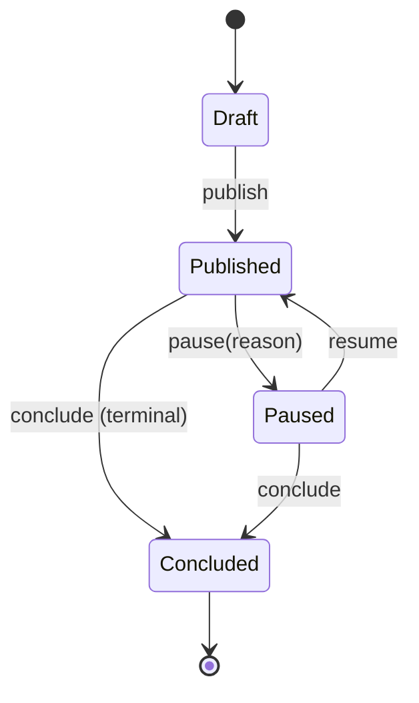
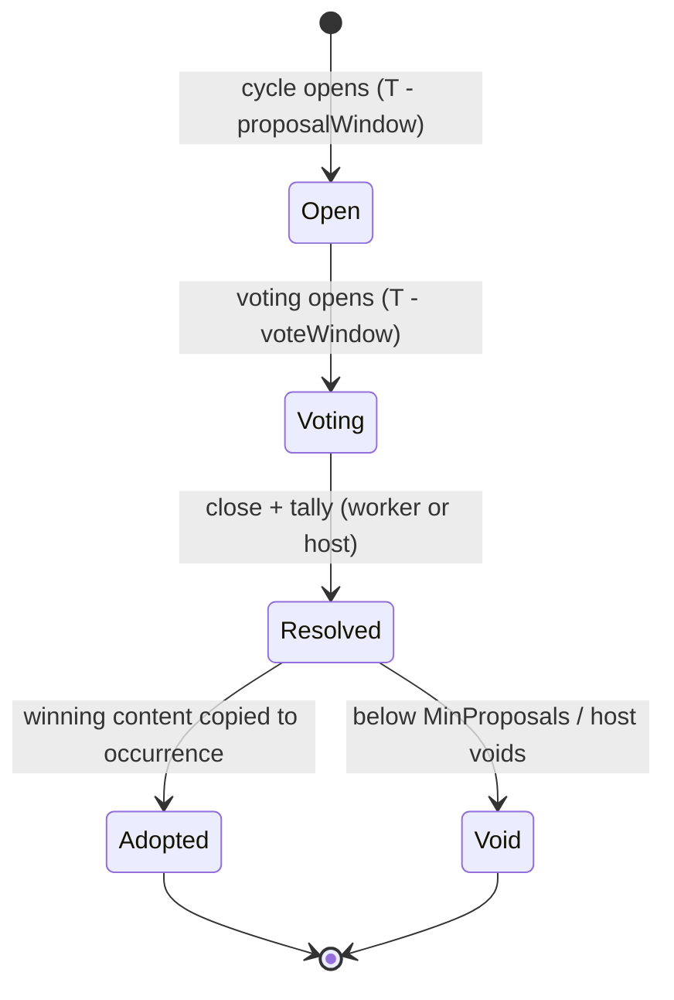

# Design: Recurrent Community Events — Choice Cast (issue #5)

Status: Proposed (design document — no implementation yet)
Date: 2026-11-11
References: issue #5 (recurrent events / choice cast), issue #47 (web3 variant — postponed, out of
scope), issue #52 (course enrollment, adjacent but separate)
Target branch: `develop`

> Purpose: propose the domain model, recurrence strategy, and integration design for weekly
> recurring community events whose content is chosen by community vote ("choice cast"). The
> document maps every decision onto the patterns already proven in this codebase (TestingLab
> recurrence, Learning.Cohorts schedule generation, billing cycles, outbox dispatch) so
> implementation is additive, not exploratory.

## 1. Problem statement

From the issue and its clarifying comments:

- GameGuild wants **an event every week** ("week flush" cadence, per the issue author).
- The community is offered **several options** and **chooses the event of collective interest**
  for the week — the "choice cast".
- The feature is a **guide to control the weekly event**: which proposal wins, when it happens,
  who attends.
- The author explicitly stated this is **simple back-end logic**, not a DAO/web3 mechanism
  (comment 2024-07-12), and envisioned "every week workshop with different proposals and people
  that want some space to talk about something".

The 2026-10-28 audit reopening requires validating the equivalent in the current architecture:
**recurring event options, community choice, and the weekly flow**.

## 2. Current state (what exists on `develop`)

There is **no community-events module** today. Three existing surfaces are event-like and one
module family already solves recurrence; the design below reuses them rather than inventing new
mechanics.

### 2.1 TestingLab already materializes recurring events (eager expansion)

`GameGuild.TestingLab` is the strongest precedent:

- `TestingEvent` carries denormalized recurrence metadata on every row:
  `RecurrenceSeriesId`, `RecurrenceOccurrence`, `RecurrenceFrequency`, `RecurrenceInterval`,
  `RecurrenceDaysOfWeek`, `RecurrenceEndsAt`, `RecurrenceOccurrenceCount`, plus IANA
  `TimeZoneId` —
  `apps/api/Source/Modules/GameGuild.TestingLab/Entities/TestingEvent.cs`.
- `TestingEventRecurrenceSchedule.Expand`
  (`apps/api/Source/Modules/GameGuild.TestingLab/EventsWorkflow/TestingEventRecurrenceSchedule.cs`)
  is a pure expansion function: Daily/Weekly/Monthly frequency, `Interval` 1–52, day-of-week set
  for weekly, terminated by `OccurrenceCount` **or** `EndsAt` (one required), hard cap
  `MaxOccurrences = 104`, per-occurrence local→UTC conversion with `TimeZoneInfo`, and an
  explicit rejection of DST spring-forward gaps (`IsInvalidTime`).
- The create handler **eagerly materializes one `TestingEvent` row per occurrence** at creation
  time, offsetting `ApplicationsOpenAt` / `ApplicationsCloseAt` / `EndsAt` by the same offset —
  `apps/api/Source/Modules/GameGuild.TestingLab/EventsWorkflow/TestingEventHandlers.cs`
  (the `Expand` call and per-occurrence `TestingEvent.Create` loop).
- Series identity is indexed:
  `builder.HasIndex(e => new { e.RecurrenceSeriesId, e.RecurrenceOccurrence })` —
  `apps/api/Source/Modules/GameGuild.TestingLab/Configuration/TestingLabModelConfiguration.cs`
  (line 430).
- Reminder dispatch is an hourly `BackgroundService` scanning upcoming events, deduplicated by
  `SentReminderDays` / `ReminderDaysBeforeOverride`, delivered through `INotificationService` —
  `apps/api/Source/Modules/GameGuild.TestingLab/Services/TestingEventReminderService.cs`.
- Capacity/attendance primitives exist at session level: `TestingSession`, `TestingEventSlot`,
  `SessionRegistration`, `SessionWaitlist`, `AttendanceStatus` —
  `apps/api/Source/Modules/GameGuild.TestingLab/Entities/`.
- A voting entity exists (`TestingApplicationVote`) but it is **committee review voting on
  project applications**, not community choice — the "choice cast" itself does not exist.

Limitation for issue #5: TestingLab events are playtests with questionnaire schemas, approval
modes, and feedback obligations. Community workshops are a different product; forcing them into
`TestingEvent` would drag playtest machinery along. Also, eager expansion requires an explicit
end (count or date) and generates up to 104 rows up front — an evergreen weekly community series
has no natural end.

### 2.2 Learning.Cohorts solves rule + materialized items + fork semantics

`GameGuild.Learning.Cohorts` is the pattern for "rule row + generated item rows":

- `CohortSchedule` is the rule entity: IANA `TimezoneId` (validated), `MeetingDays`
  (`DayOfWeek[]`), `MeetingStartTime` (`TimeOnly`), `MeetingDurationMinutes`, pacing/release
  enums, and a `Version` for optimistic concurrency —
  `apps/api/Source/Modules/GameGuild.Learning.Cohorts/Entities/CohortSchedule.cs`.
- `CohortScheduleItem` is the materialized occurrence row: concrete UTC timestamps, status
  (`Draft/Scheduled/Published/Completed/Cancelled`), visibility override, `Shift(TimeSpan)` —
  `apps/api/Source/Modules/GameGuild.Learning.Cohorts/Entities/CohortScheduleItem.cs`.
- `CohortScheduleGenerator` is a pure generator: skipped dates, per-day local→UTC conversion,
  instructional-week arithmetic —
  `apps/api/Source/Modules/GameGuild.Learning.Cohorts/Scheduling/CohortScheduleGenerator.cs`.
- The preview → apply flow is exactly the safety pattern to reuse: `PreviewCohortScheduleQuery`
  renders the outcome without persisting; `ApplyCohortScheduleCommand` checks
  `ExpectedVersion`, throws `CohortScheduleVersionConflictException` on drift, then
  **delete-and-regenerates** items —
  `apps/api/Source/Modules/GameGuild.Learning.Cohorts/Commands/Schedules/ApplyCohortScheduleCommand.cs`.
- **Edit-scope semantics already exist as an enum**: `ScheduleShiftScope { Single, Following }`
  — `apps/api/Source/Modules/GameGuild.Learning.Cohorts/Entities/SchedulingEnums.cs`, used by
  `ShiftCohortScheduleItemsCommand`. This is the codebase's precedent for the classic
  "edit one vs edit the series" fork problem.
- A JSON calendar read exists: `GetCourseCohortCalendarQuery` (from/to window over schedule
  items) — `apps/api/Source/Modules/GameGuild.Learning.Cohorts/Queries/Schedules/GetCourseCohortCalendarQuery.cs`.
  There is **no iCal/RFC 5545 export anywhere in the API today**.

### 2.3 Other event-like surfaces (why they are not the home)

- `GameGuild.GameJams` — one-off jams (`StartDate/EndDate/VotingEndDate`, participant caps)
  with a lifecycle state machine; no recurrence —
  `apps/api/Source/Modules/GameGuild.GameJams/Models/Jam.cs`.
- `GameGuild.LaunchPad` — launch-pipeline events (application/review workflow for projects
  going to launch), not community programming —
  `apps/api/Source/Modules/GameGuild.LaunchPad/LaunchPadEvents.cs`.
- `GameGuild.Social.Groups` — community groups (membership), no scheduling —
  `apps/api/Source/Modules/GameGuild.Social.Groups/Entities/SocialGroup.cs`.

### 2.4 Billing recurrence (next-date + idempotency)

`Subscription` stores `CurrentPeriodStart/End` + `NextBillingDate` (indexed), advances via
`CalculateBillingDates`, and uses idempotency keys shaped
`"{subscriptionId}:{billingCycle}:{periodStart}"` —
`apps/api/Source/Modules/GameGuild.Commerce.Subscriptions/Entities/Subscription.cs`. Relevant
later for cycle-resolution idempotency, not for wall-clock expansion.

### 2.5 Infrastructure facts the design depends on

- **Domain + durable integration events** on every entity (`EntityBase` carries
  `IDomainEvent` and `IDurableIntegrationEvent` lists) —
  `apps/api/Source/Modules/GameGuild.SharedKernel/Entities/EntityBase.cs`.
- **Outbox dispatch is multi-host safe**: the dispatcher claims pending rows with
  `FOR UPDATE SKIP LOCKED` plus a `ClaimedUntilUtc` lease —
  `apps/api/Source/GameGuild.API/Core/Eventing/OutboxDispatcher.cs` (claim SQL around line 91),
  driven by `OutboxBackgroundService` in the same folder. This is the canonical concurrency
  pattern for any background worker that must not double-work across hosts.
- PostgreSQL advisory locks are also available in-process —
  `apps/api/Source/GameGuild.API/Core/Filters/PasswordSignInAdmissionService.cs`
  (`pg_advisory_lock` usage).
- Module-level workers are ordinary `BackgroundService`s registered in the module class
  (e.g. `services.AddHostedService<TestingEventReminderService>()` in
  `apps/api/Source/Modules/GameGuild.TestingLab/TestingLabModule.cs`), with opt-in switches in
  options when needed (`EconomyDurableWorkerOptions` in
  `apps/api/Source/GameGuild.API/Core/HostedServices/EconomyDurableWorker.cs`).
- **Notifications**: `INotificationService` (`SendAsync`, `ScheduleAsync`, bulk, preferences,
  quiet hours) — `apps/api/Source/Modules/GameGuild.Notifications/Services/INotificationService.cs`.
  `NotificationType` is an enum; new types must be added both to the enum and to the category
  map, whose doc comment warns to keep both in sync —
  `apps/api/Source/Modules/GameGuild.Notifications/NotificationCategories.cs`.
- **Announcements bridge**: modules announce publications through the mediator command
  `AnnouncePublicationCommand` (`PublicationKind` already includes `TestingEventCreated`),
  handled by `GameGuild.Social.Announcements` (community post + notifications) —
  `apps/api/Source/Modules/GameGuild.Announcements.Contracts/AnnouncePublicationCommand.cs`.
- **Module registration**: enabled modules are listed in
  `apps/api/Source/GameGuild.API/Core/Setup/ApiProductComposition.cs` (Social family around
  lines 81–109) with the common list in `Core/Setup/ModuleConfiguration.cs`.
- **Web**: Next.js routes exist for testing-lab and launch-pad events under
  `apps/web/src/app/[locale]/(dashboards)/workspace/testing-lab/events` and
  `.../console/community/launch-pad/events`; no community-events surface exists.
- **Docs/CI conventions**: docs use Mermaid (`docs/social-platform/01-user-flows.md`), a CI
  wiring-gap guard cross-checks controller→handler wiring
  (`docs/social-platform/02-cqrs-wiring-matrix.md`), and API surface changes must regenerate
  the OpenAPI client through `scripts/ci/verify-openapi-surface.sh` (never hand-spliced).

## 3. Goals and non-goals

Goals:

1. Evergreen weekly (or biweekly/etc.) community event series with no mandatory end date.
2. Choice cast: members submit event proposals for the upcoming week and vote; the winning
   proposal becomes that week's event.
3. Deterministic, auditable weekly flush (cycle open → vote → resolve → occurrence content).
4. Occurrence-level operations: edit one, cancel one, capacity, RSVP, attendance.
5. Reuse the proven patterns (§2) verbatim where possible.

Non-goals (v1):

- Web3/DAO voting (issue #47 explicitly postponed; token-weighted voting rejected).
- Migrating TestingLab to this model (convergence reviewed in phase 4, §13).
- In-person venue logistics (locations stay a `Location` string; TestingLab's
  `TestingLocation` machinery is out of scope).
- Paid events (Commerce integration deliberately deferred).

## 4. Module placement decision

**Decision: new module `GameGuild.Social.Events`** in the Social family.

- The Social family is the community-interaction home (`Social.Posts`, `Social.Groups`,
  `Social.Announcements`, …) and is enabled via `ApiProductComposition.cs`.
- Community events are cross-cutting community programming, not playtesting (TestingLab) and
  not project launches (LaunchPad).
- Alternatives rejected:
  - *Extend TestingLab*: drags questionnaire/approval/feedback machinery into a product that
    does not need it; TestingLab's eager expansion cannot express an endless series.
  - *Extend GameJams*: jams are competitions with submissions and judging; wrong lifecycle.
  - *New top-level `GameGuild.Community.*` family*: invents a fourth naming level for one
    module; the Social family already covers "community" semantics in docs
    (`docs/social-platform/README.md`).

## 5. Proposed domain model

### 5.1 Aggregate: `EventSeries` (root)

```text
EventSeries
├── RecurrenceRule        (value object, serialized columns)
├── CapacityPolicy        (value object: DefaultCapacity int?, WaitlistEnabled bool)
├── ChoiceCastSettings    (value object: ProposalWindowDays, VoteWindowDays,
│                          MinProposals, MaxProposals, RequireHostConfirmation)
├── GeneratedUntilUtc     (hydration watermark)
├── SeriesVersion         (optimistic concurrency, CohortSchedule.Version precedent)
└── EventOccurrences[]    (entities, materialized rows)
```

Fields (essential): `Id`, `TenantId`, `Slug`, `Title`, `Description`, `HostUserId`,
`TimeZoneId` (IANA, validated exactly like `CohortSchedule.ValidateTimezone`),
`RecurrenceRule`, `Status`, `SeriesVersion`, `GeneratedUntilUtc`, timestamps via `EntityBase`
(soft delete included).

State machine (`stateDiagram-v2`, mirroring the jam/testing-event style documented in
`docs/social-platform/03-state-machines.md`):



- `Pause` stops hydration and cycle creation; existing future occurrences are kept and marked
  `Cancelled` only if the host chooses "pause-and-cancel".
- `Conclude` is terminal (monotonic guard, same style as `Subscription.ValidTransitions`).

### 5.2 Value object: `RecurrenceRule` — deliberately simpler than RRULE

Serialized columns on the series (not JSON), following the shape TestingLab already ships:

| Column | Type | Constraint |
|---|---|---|
| `Frequency` | enum `Daily / Weekly / Monthly` | required |
| `Interval` | int | 1–52 ( TestingLab bound, reused) |
| `DaysOfWeek` | text (csv) | weekly only, ≥1 day, mirrors `TestingEvent.RecurrenceDaysOfWeek` storage |
| `StartsAtLocalTime` | `TimeOnly` | local wall time in `TimeZoneId` |
| `DurationMinutes` | int | > 0 |
| `FirstStartsAt` | `DateTime` (UTC) | anchors occurrence #1 |
| `EndsAt` / `OccurrenceCount` | nullable | **both optional** (evergreen); mutually exclusive if set |
| `SkippedDates` | `DateOnly[]` (csv/jsonb) | known one-off gaps (holidays) — `CohortScheduleGenerator` precedent |

**Why not RFC 5545 RRULE:** the product needs weekly/biweekly cadence with day-of-week sets —
exactly the envelope `TestingEventRecurrenceSchedule` already validates. RRULE would add a
parser, timezone-unsafe `UNTIL` semantics, BYSETPOS/BYMONTHDAY edge cases, and a second
expansion implementation to test against the existing one, with no requirement behind it.
RRULE appears only at the **export boundary** (phase 4, §10.3), where a small
rule→`RRULE:`-string mapper is trivial for this subset (`FREQ=WEEKLY;INTERVAL=n;BYDAY=…;UNTIL=…`).

**Validation** copies `TestingEventRecurrenceSchedule.Validate` (interval bounds, day-of-week
defined, count bounds when present) with one relaxation: evergreen series (neither `EndsAt` nor
`OccurrenceCount`) is legal because the rolling horizon (§6) bounds row count.

### 5.3 Entity: `EventOccurrence` (materialized row)

| Column | Notes |
|---|---|
| `Id`, `SeriesId`, `OccurrenceNo` | unique `(SeriesId, OccurrenceNo)` — index precedent `TestingLabModelConfiguration.cs:430` |
| `StartsAtUtc`, `EndsAtUtc` | computed at hydration, immutable once past |
| `LocalStartDate` (`DateOnly`) | audit snapshot; detects DST-policy drift on recompute |
| `Status` | `Scheduled / Cancelled / Completed` |
| `Deviation` | `None / Modified / Exception` (fork marker, §8) |
| Override fields | `TitleOverride`, `DescriptionOverride`, `StartsAtOverrideUtc`, `LocationOverride`, `CapacityOverride` — nullable, `null` = inherit from series |
| `AdoptedProposalId` | set by choice-cast resolution (§5.5) |
| `CancellationReason`, `CancelledAt` | mirrors `TestingEvent` cancellation columns |

Occurrences never change `StartsAtUtc` after the event has started; historical rows are
immutable (audit truth).

### 5.4 Entity: `EventRsvp` + attendance

- `EventRsvp`: `(OccurrenceId, UserId)` unique; `Status: Going / Waitlisted / Cancelled`;
  `CheckedInAt` (nullable), `AttendanceOutcome: Attended / NoShow` (nullable).
- Capacity check happens inside the RSVP transaction (§12). Waitlist semantics reuse the
  ideas of `SessionWaitlist` (`TestingLab/Entities/SessionWaitlist.cs`): waitlisted RSVPs
  auto-promote on cancellation, FIFO by `CreatedAt`.

### 5.5 Choice cast: `ChoiceCycle`, `EventProposal`, `ProposalVote`

The "week flush" is modeled as a **cycle per occurrence** — the occurrence is the anchor the
community is choosing content for.



- `ChoiceCycle`: `SeriesId`, `OccurrenceId` (unique), `ProposalsOpenAt`, `VotingOpensAt`,
  `VotingClosesAt`, `Status`, `WinningProposalId`, resolution audit fields. Windows derive
  from `ChoiceCastSettings` at cycle creation: e.g. proposals open 10 days before the
  occurrence, voting opens 7 days before, voting closes 72 hours before.
- `EventProposal`: `CycleId`, `AuthorUserId`, `Title`, `Description`, `Format`
  (talk/workshop/panel/…), `EstimatedMinutes`, `Status: Active / Withdrawn / Merged / Won / Lost`.
- `ProposalVote`: `(CycleId, UserId)` unique, `ProposalId`, `CreatedAt`. One vote per member
  per cycle, changeable until `VotingClosesAt` (upsert guarded by cycle status).
- **Tally rule (deterministic)**: most votes wins; tie-break = earliest proposal submission;
  still tied = lower proposal Id (total order, safe across hosts). A cycle with fewer than
  `MinProposals` distinct proposals or zero votes resolves to `Void` and the occurrence keeps
  a generic series title (the week still happens — a void cast never cancels an event; that
  stays a host decision).

## 6. Occurrence generation strategy

**Decision: materialized rows with a rolling hydration window** — not virtual occurrences, not
TestingLab-style eager full expansion.

| Option | Verdict | Reason |
|---|---|---|
| Virtual (compute on read) | rejected | RSVPs, attendance, adopted proposals, cancellation and reminders all need a stable row to attach to; every downstream feature would re-derive identity |
| Eager full expansion (TestingLab today) | rejected here | requires an end (count/until); evergreen weekly series would pre-create ~2 years of shell rows that all churn on every rule edit |
| **Materialized + rolling horizon** | **chosen** | bounded row count, stable ids, fork-friendly (§8), same read model as TestingLab |

Mechanics:

- Series carries `HorizonWeeks` (default 8, clamp 1–26) and a watermark `GeneratedUntilUtc`.
- **Hydration paths**:
  1. Background: `EventSeriesHydrationWorker` (`BackgroundService`, hourly, mirroring
     `TestingEventReminderService` registration in the module class) selects series where
     `GeneratedUntilUtc < now + HorizonWeeks` and `Status = Published`, claims them
     `FOR UPDATE SKIP LOCKED` (outbox pattern, §12), expands the missing occurrences through
     the shared generator, inserts, advances the watermark in the same transaction.
  2. On-demand: any read of a series window calls `EnsureHydratedAsync(seriesId)` first; under
     the same claim discipline, so a cold series hydrates on first view even if the worker has
     not fired.
- The expansion function is a **pure static generator** (`EventRecurrenceExpander`), the direct
  sibling of `CohortScheduleGenerator` / `TestingEventRecurrenceSchedule.Expand`, taking
  `(rule, watermarkUtc, horizon)` and returning occurrence tuples `(occurrenceNo, startsAtUtc,
  endsAtUtc, localStartDate)`. Pure function → exhaustively unit-testable (§14).
- Choice cycles are created in the same hydration transaction as their occurrence
  (`ProposalsOpenAt` derived from `ChoiceCastSettings`) so a hydrated week is immediately
  votable; idempotent on the `(SeriesId, OccurrenceId)` unique index.

## 7. Timezone and DST handling

Rules live in **local wall time + IANA zone**; storage and all comparisons are **UTC** — the
exact doctrine of `CohortSchedule` (`TimezoneId` + `MeetingStartTime` + `MeetingDays`) and
`TestingEventRecurrenceSchedule` (local expand → `ConvertTimeToUtc` per occurrence).

- `TimeZoneId` is validated at write time with `TimeZoneInfo.FindSystemTimeZoneById` (throwing
  the same `ArgumentException` envelope as `CohortSchedule.ValidateTimezone`).
- Each occurrence is computed as local `(date, StartsAtLocalTime)` →
  `TimeZoneInfo.ConvertTimeToUtc(local, zone)` — per-occurrence conversion, so DST offsets are
  applied per day, never a fixed offset multiplication (the `AddWeeklyOccurrences`/`ToUtc`
  approach in `TestingEventRecurrenceSchedule.cs`).
- **Spring-forward gap** (`IsInvalidTime`): TestingLab rejects the request. For an evergreen
  series a single 02:30 occurrence would otherwise poison the whole series, so this design
  **shifts the occurrence forward by the gap (typically +1h) and records a warning field**
  (`DstAdjusted: true` on the occurrence row) instead of failing hydration.
- **Fall-back ambiguity**: .NET resolves ambiguous local times to the first (earlier) offset —
  accepted and documented; `DstAdjusted` is not set for ambiguity.
- **Policy drift** (a zone changes its rules between hydration and now): recomputation of
  future, non-forked, RSVP-less occurrences may shift them; occurrences with RSVPs, an adopted
  proposal, or `Deviation ≠ None` keep their stored UTC times (they are facts now). The
  `LocalStartDate` snapshot makes any drift visible in support queries.
- Occurrence windows crossing a DST boundary: duration is preserved in wall-clock minutes
  (`EndsAt = startsAtLocal + DurationMinutes` converted back to UTC), matching user intent for
  "90-minute workshop".

## 8. Mutation semantics — the fork problem

Two edit axes, reusing `ScheduleShiftScope { Single, Following }` semantics
(`SchedulingEnums.cs` precedent):

### 8.1 Edit the series (`scope = All | Following`, `asOfOccurrenceNo`)

Flow (preview-first, exactly like Cohorts):

1. `PreviewSeriesRulesQuery` renders the regenerated calendar **side by side** with current
   occurrences (kept / regenerated / removed) — no persistence.
2. `ApplySeriesRulesCommand(ExpectedVersion, scope, asOf)`:
   - version check → `EventSeriesVersionConflictException` (clone of
     `CohortScheduleVersionConflictException`, `ApplyCohortScheduleCommand.cs:124`);
   - `SeriesVersion++`;
   - future occurrences with `Deviation = None` **and** no RSVPs **and** no adopted proposal
     are deleted and regenerated from the new rule (delete-and-regenerate, Cohorts precedent);
   - occurrences with RSVPs / adopted content / deviations are **auto-forked**
     (`Deviation = Modified`) and kept as-is — people already registered to a fact;
   - past occurrences untouched, always.

### 8.2 Edit a single occurrence

`UpdateOccurrenceCommand(occurrenceId, title?, startsAt?, location?, capacity?, …)` writes the
override fields and sets `Deviation = Modified`. The row thereafter is immune to series
regeneration. `null` override re-inherits on the next regeneration that would recreate it.

### 8.3 Cancel / skip

- `CancelOccurrence(occurrenceId, reason)`: `Status = Cancelled` + reason/timestamp columns
  (mirrors `TestingEvent.CancellationReason/CancelledAt`); RSVPs bulk-notified (§10.1) and
  flipped to `Cancelled` with refund-free semantics; waitlist dissolved.
- `CancelSeries(reason)`: cancels all **future** occurrences without RSVPs immediately;
  future occurrences **with** RSVPs require an explicit `ForceCancel` confirmation (preview
  shows affected members) — the same confirm-advisories dance as
  `ApplyCohortScheduleCommand`'s `ConfirmAdvisories`.
- Rule-level `SkippedDates`: known gaps (holidays) never generate at all — regeneration
  re-applies them (Cohorts `SkippedDates` behavior).

## 9. Capacity and attendance propagation

- Effective capacity of an occurrence = `CapacityOverride ?? Series.DefaultCapacity`
  (`null` = uncapped). Snapshot at RSVP time is **not** taken: the effective value is always
  derived, so a series-level raise instantly applies; a **lower** value below the committed
  count is rejected unless `AllowOverbook = true` (preview states the overbook count).
- RSVP transitions: `Going → Cancelled` (frees a seat; first waitlisted RSVP auto-promotes,
  FIFO); check-in sets `CheckedInAt`; post-event sweep marks no-shows (`AttendanceOutcome`).
- Attendance completion (`Completed` occurrences) raises
  `EventOccurrenceCompletedEvent` as both domain and durable integration event (via `EntityBase`
  event lists) — the hook for future gamification (§10.4).
- The reminder worker extends the TestingLab pattern: scan upcoming occurrences of published
  series, dedupe with a `SentReminderDays` CSV per occurrence (column copied verbatim from
  `TestingEvent`), thresholds from series settings with override.

## 10. Integration points

### 10.1 Notifications

- New `NotificationType` members: `CommunityEventReminder`, `ChoiceCycleOpened`,
 `ChoiceCycleResolved`, `EventCancelled`, `RsvpConfirmed`, `WaitlistPromoted`. Each must be
 added to the **enum and the category map** in `NotificationCategories` (the sync rule is
 documented in that file's doc comment) — all map to the `Social` toggle category except
 reminders, which follow the user's preference system and quiet hours
 (`INotificationPreferenceService` / `DecideDeliveryAsync`).
- Scheduling uses `INotificationService.ScheduleAsync` for reminder fan-out, identical to the
  delivery path `TestingEventReminderService` already exercises.

### 10.2 Announcements (community feed)

Extend `PublicationKind` in `GameGuild.Announcements.Contracts` with
`CommunityEventScheduled` (and optionally `CommunityEventVotingOpen`). The
`Social.Announcements` handler then produces the community post + notifications with zero new
plumbing — this is exactly how TestingLab announces events today
(`AnnouncePublicationCommand` with `StartsAt` already in the contract).

### 10.3 Calendar export

- v1: JSON windowed calendar read model, the shape of `GetCourseCohortCalendarQuery`
  (from/to over occurrences).
- Phase 4: read-only `.ics` projection per series and per user (RSVP'd set). The subset
  mapper is small because the internal rule is deliberately narrow (§5.2):
  `Weekly(n, BYDAY) → "FREQ=WEEKLY;INTERVAL=n;BYDAY=MO,WE;UNTIL=…"` with `VTIMEZONE` omitted
  (UTC times exported). Cancelled occurrences export as `STATUS:CANCELLED` **exceptions**
  against the series RRULE — which is precisely why occurrences carry `OccurrenceNo` and
  deviation markers.

### 10.4 Gamification / achievements

`EventOccurrenceCompletedEvent` (and optionally `ProposalWonEvent`) flow through the durable
outbox (`OutboxBackgroundService` → consumers). `GameGuild.Gamification.Achievements` can add a
consumer later without touching this module — no achievement logic lives here.

### 10.5 Social.Groups (optional association)

`EventSeries.GroupId (nullable)` — a series may belong to a `SocialGroup`; null = platform-wide
community series. Membership can gate proposal/vote eligibility (open question Q1). This is a
plain FK reference; no cross-aggregate invariants.

## 11. Persistence schema sketch

EF Core configuration via an `IModelConfiguration` class in the module
(`CohortsModelConfiguration` pattern), snake_case tables (as `testing_events`,
`learning_cohort_schedules`). Migration is timestamped, snapshot hand-checked, and
`docs/schema.dbml` regenerated with `node scripts/devops/generate-dbml.mjs` (repo rules).

```text
social_event_series
  id PK, tenant_id, slug, title, description, host_user_id, group_id NULL FK,
  time_zone_id, frequency, interval, days_of_week, starts_at_local_time,
  duration_minutes, first_starts_at, ends_at NULL, occurrence_count NULL,
  skipped_dates, horizon_weeks, generated_until_utc,
  default_capacity NULL, waitlist_enabled,
  proposal_window_days, vote_window_days, min_proposals, max_proposals,
  require_host_confirmation, reminder_days_override NULL,
  status, series_version, created_at/updated_at/deleted_at
  UNIQUE (tenant_id, slug)
  INDEX (status, generated_until_utc)          -- hydration scan
  INDEX (tenant_id, status)

social_event_occurrences
  id PK, series_id FK, occurrence_no,
  starts_at_utc, ends_at_utc, local_start_date, dst_adjusted,
  status, deviation, title_override NULL, description_override NULL,
  starts_at_override_utc NULL, location_override NULL, capacity_override NULL,
  adopted_proposal_id NULL, sent_reminder_days, cancellation_reason NULL, cancelled_at NULL,
  created_at/updated_at
  UNIQUE (series_id, occurrence_no)             -- TestingLab index precedent
  INDEX (series_id, starts_at_utc)              -- windowed reads / reminders
  INDEX (starts_at_utc, status)                 -- reminder worker scan

social_event_choice_cycles
  id PK, series_id FK, occurrence_id FK UNIQUE, status,
  proposals_open_at, voting_opens_at, voting_closes_at,
  winning_proposal_id NULL, resolved_at NULL, resolution_note NULL,
  created_at/updated_at
  INDEX (status, voting_closes_at)              -- resolution worker scan

social_event_proposals
  id PK, cycle_id FK, author_user_id, title, description, format,
  estimated_minutes, status, submitted_at, created_at/updated_at
  INDEX (cycle_id, status)

social_event_proposal_votes
  id PK, cycle_id FK, user_id, proposal_id FK, created_at
  UNIQUE (cycle_id, user_id)
  INDEX (proposal_id)

social_event_rsvps
  id PK, occurrence_id FK, user_id, status, checked_in_at NULL,
  attendance_outcome NULL, created_at/updated_at
  UNIQUE (occurrence_id, user_id)
  INDEX (occurrence_id, status, created_at)     -- waitlist FIFO promotion
```

## 12. Concurrency and idempotency (two hosts, one database)

| Race | Mechanism | Precedent |
|---|---|---|
| Two hosts hydrating the same series | claim batch `FOR UPDATE SKIP LOCKED` + lease column; loser skips the series this pass | `OutboxDispatcher.cs` claim (`FOR UPDATE SKIP LOCKED`, ~line 91) |
| Duplicate occurrence insert despite claim | `UNIQUE (series_id, occurrence_no)` backstop; conflicting insert aborts that series' transaction only | index on `(RecurrenceSeriesId, RecurrenceOccurrence)` |
| Concurrent rule edits | `ExpectedVersion` optimistic check → typed conflict exception; client reloads and re-previews | `ApplyCohortScheduleCommand` / `CohortScheduleVersionConflictException` |
| Double vote / vote change race | `UNIQUE (cycle_id, user_id)`; update path guarded by cycle `Status = Voting` check inside the transaction | standard upsert-guard pattern |
| Two workers resolving the same cycle | resolution is a status transition `Voting → Resolved` executed under the row claim; the second worker sees `Resolved` and no-ops (idempotent tally) | monotonic state guards à la `Subscription.ValidTransitions` |
| RSVP overselling capacity | count check + insert in one transaction on the occurrence row lock; waitlisted otherwise | capacity counters pattern in Commerce order flows |
| Reminder double-send | `SentReminderDays` CSV per occurrence, updated in the same transaction as the send dispatch | `TestingEvent.SentReminderDays` + `TestingEventReminderService` |

If profiling ever shows contention, per-series PostgreSQL advisory locks are the documented
escalation path (in-repo precedent: `PasswordSignInAdmissionService`). The claim protocol
should suffice at community scale.

## 13. API surface sketch (v1)

Controllers follow the module-API controller convention (`GroupsModuleApi.cs` style); every
endpoint lands in the OpenAPI surface via the standard regeneration pipeline
(`scripts/ci/verify-openapi-surface.sh`) — never hand-spliced (repo rule).

```text
POST   /api/social-events/series                      create series (rule + settings)
GET    /api/social-events/series                      list (tenant, status filter)
GET    /api/social-events/series/{id}                 detail incl. horizon preview
POST   /api/social-events/series/{id}/rules:preview   dry-run regeneration diff
PUT    /api/social-events/series/{id}/rules           apply (ExpectedVersion, scope, asOf)
POST   /api/social-events/series/{id}/lifecycle       publish / pause / resume / conclude
GET    /api/social-events/series/{id}/occurrences     windowed read (from, to)
GET    /api/social-events/series/{id}/calendar        JSON calendar (phase 4: .ics)
POST   /api/social-events/occurrences/{id}/update     single-occurrence overrides (fork)
POST   /api/social-events/occurrences/{id}/cancel     cancel one (reason)
POST   /api/social-events/occurrences/{id}/rsvp       join / waitlist / cancel
POST   /api/social-events/occurrences/{id}/check-in   host check-in
GET    /api/social-events/cycles/{id}                 cycle detail + live tally
POST   /api/social-events/cycles/{id}/proposals       submit proposal
POST   /api/social-events/cycles/{id}/votes           cast / change vote
POST   /api/social-events/cycles/{id}/resolve         host-forced resolve (optional)
```

Authorization: host-scoped writes via the existing DAC permission system
(`docs/architecture/permissions-dac.md`); vote/proposal/Rsvp are member-level. Rate limiting
follows the per-route buckets convention (`docs/operations/cloudflare-bot-defense.md`).

## 14. Test plan

- **Generator (pure function, exhaustive)**: golden-date suites across `UTC`,
  `America/Sao_Paulo` (no DST today — policy-drift fixture), `Europe/Berlin` (spring gap +
  fall ambiguity), `Pacific/Kiritimati` (UTC+14 week-boundary); interval arithmetic
  (biweekly `Interval=2` across month/year boundaries); `SkippedDates` compaction; horizon
  watermark math (hydrate-to boundary, idempotent second pass yields zero rows);
  `MaxOccurrenceNo` monotonicity across regenerations.
- **Aggregate invariants**: series state machine transitions; occurrence fork immutability
  after RSVP; cancel-with-RSVS confirmation gate; capacity floor rejection; cycle windows
  ordering (`ProposalsOpenAt < VotingOpensAt < VotingClosesAt < StartsAtUtc`).
- **Handlers**: preview/apply diff correctness; version-conflict path (typed exception);
  auto-fork on rule change; cycle resolve determinism (tie-break ladder) and idempotency
  (second resolve no-ops); waitlist FIFO promotion.
- **Concurrency integration tests**: two contexts racing hydration (one claims, one skips);
  two workers resolving one cycle; RSVP capacity race at N+1. These run in CI (local
  `dotnet test` is compile-gated per the agent brief; CI executes suites).
- **CI wiring**: the wiring-gap guard picks up the new controllers/handler pairs
  (`docs/social-platform/02-cqrs-wiring-matrix.md` convention); OpenAPI lane validates the
  generated surface; dbml/schema lane validates the regenerated `docs/schema.dbml`.

## 15. Rollout plan

Phases are independently shippable, each behind the feature flag of the `GameGuild.Features`
module (`CommunityEvents`, default off — the same capability-gating pattern Features already
provides):

1. **Phase 1 — series + hydration**: module skeleton, `EventSeries`/`EventOccurrence`, pure
   expander, hydration worker + lazy hydration, windowed reads, lifecycle + rule preview/apply.
   No user-facing web surface yet beyond admin console scaffolding.
2. **Phase 2 — choice cast**: cycles, proposals, votes, resolution worker, adopt-onto-
   occurrence, announcements bridge (`CommunityEventScheduled`), notifications
   (`ChoiceCycleOpened/Resolved`).
3. **Phase 3 — participation**: RSVP/waitlist/check-in/no-show sweep, reminders
   (`CommunityEventReminder`, `RsvpConfirmed`, `WaitlistPromoted`, `EventCancelled`), web
   surfaces (community events page + per-series detail under
   `apps/web/src/app/[locale]/(social)/…`).
4. **Phase 4 — ecosystem**: iCal export, `EventOccurrenceCompletedEvent` achievements
   consumer, TestingLab convergence review (extract the shared expander into a contract
   package if TestingLab wants rolling horizons too — decision deferred, Q5).

Each phase: timestamped migration + snapshot hand-check + dbml regen + OpenAPI client regen
via the real pipeline.

## 16. Open questions for the owner

1. **Vote eligibility**: any tenant member, group members only (when `GroupId` set), or
   reputation-gated? (v1 proposal: group members when scoped, tenant members otherwise).
2. **Tie-break**: earliest submission proposed — acceptable, or prefer host coin-flip?
3. **Host confirmation**: auto-adopt winner (default) vs mandatory confirmation window —
   which is the product default?
4. **Losing proposals**: auto-resubmit to the next cycle, archive, or author's choice?
5. **TestingLab convergence**: should phases 1–4 ship the expander as a shared contracts
   package immediately (used by both modules), or keep it module-private until TestingLab
   asks for rolling horizons?
6. **iCal priority**: is external-calendar sync (Google/Outlook subscription URLs) a launch
   requirement or a phase-4 nice-to-have?
7. **Horizon length**: 8 weeks proposed (configurable 1–26) — right default for community
   planning?
8. **Quorum**: minimum votes for a valid resolution (proposed: any vote > 0; `MinProposals`
   default 2) — or explicit quorum percentage?
9. **Series naming**: `GameGuild.Social.Events` proposed over `GameGuild.Community.Events` —
   confirm family placement.

## 17. Alternatives considered (summary)

- **Full RRULE engine** — rejected: no requirement beyond weekly-family cadence; export-time
  subset mapper covers interop (§5.2, §10.3).
- **Virtual occurrences** — rejected: no stable identity for RSVP/attendance/choice-cast
  attachment (§6 table).
- **Eager 104-row expansion as in TestingLab** — kept as the TestingLab behavior; not adopted
  here because evergreen series and choice-cast make future rows both unbounded in principle
  and meaningless before their cycle (§6).
- **Extend TestingLab / GameJams / LaunchPad** — rejected as home (§4); TestingLab remains the
  pattern donor and a future convergence partner.
- **Event-sourced series stream** — rejected: the codebase is CRUD+CQRS with domain events,
  not ES; a `SeriesVersion` + materialized rows gives the same safety with far less novelty.
