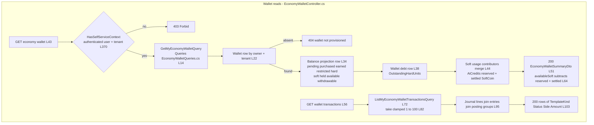

# Economy User Flows — happy path and every edge case

> Economy family `GameGuild.Finance.Economy*` · Documented against `develop` commit `ac959fd8f`.
> Citation shorthand: see [`README.md`](README.md). `Migration:` = `API:/Database/Migrations/20260824180312_AddEconomyProductionPlatform.cs` (SQL bodies are single-line strings; anchor by function name).

## 1. Wallet read paths — summary and transaction list (the double-entry view)

The wallet API never reads balances from the journal on the hot path: `GET api/v1/economy/wallet` (`API:/Core/Controllers/EconomyWalletController.cs:43-54`) sends `GetMyEconomyWalletQuery` whose handler (`Core:/Queries/EconomyWalletQueries.cs:14-69`) reads the 1:1 projection row `economy_wallet_balance_projections`, the wallet-debt row, and merges every registered `IEconomyWalletSoftUsageContributor` (the AI-credits module registers one — reserved/settled SoftCoin held outside the journal, `EconomyWalletQueries.cs:44-49,120-133`). `GET wallet/transactions` (`EconomyWalletController.cs:56-65`) joins `economy_journal_lines` × `economy_journal_entries` × `economy_posting_groups` ordered by entry sequence (`EconomyWalletQueries.cs:95-116`) — a wallet "transaction" **is** a double-entry journal line.

Balances are rebuilt by the projection machinery (`economy_wallet_projection_generations`, `Core:/Projections/WalletProjectionRebuilder.cs`; writer functions call `economy_private.rebuild_wallet_projection_v1` after every posting — `Migration:` inside `post_ad_reward_issuance_v1` body). `RebuiltAt`/`SourceJournalSequence` on the summary expose projection staleness (`EconomyWalletQueries.cs:67-68`).

### 1a. Edge-case matrix — wallet reads

| # | Edge case | Code path | Outcome |
|---|-----------|-----------|---------|
| 1 | No wallet provisioned for user | `SingleOrDefaultAsync` miss (`EconomyWalletQueries.cs:22-27`) | 404 on summary; empty list on transactions (`:90-92`) |
| 2 | Wallet exists but no projection row yet | `balance?.X ?? 0` fallbacks (`:55-64`) | zeros returned with `RebuiltAt = wallet.CreatedAt` (`:67`) |
| 3 | AI-credit reservations reduce apparent Soft balance | contributor merge (`:62-64`) | `AvailableSoftToSpend − reserved − settled`, floor 0 — reservation ledger is outside the journal by design (`:120-123` doc comment) |
| 4 | `take` out of bounds on transactions | handler clamps (`:82`); controller default 50 (`EconomyWalletController.cs:59`) | silently clamped, never 400 |
| 5 | Frozen / UnderReview wallet | projection still served — state field returned (`EconomyWalletQueries.cs:53`) | reads allowed in all `WalletLifecycleState` values; only writers enforce state |

## 2. HardCoin top-up — creation, provider capture, mint (the credit core)

`POST api/v1/economy/top-ups` (`EconomyWalletController.cs:131-176`) → `CreateMyHardCoinTopUpCommand` (`Core:/Commands/HardCoinTopUpCommands.cs:11,20`, validator `HardCoinTopUpCommandValidator.cs`) → `SelfServiceHardCoinTopUpService` (`Core:/Funding/SelfServiceHardCoinTopUpService.cs`) which derives everything server-side and creates the Stripe payment intent through `StripeEconomyTopUpProvider` (`Core:/Integrations/StripeEconomyTopUpProvider.cs`), persisting the intent in `economy_top_up_intents` (`Core:/Funding/PostgreSqlEconomyTopUpIntentStore.cs:69 Prepared`). The mint itself happens **only** from the verified Stripe webhook: `StripeEconomyTopUpEventConsumer` (`Core:/Integrations/StripeEconomyTopUpEventConsumer.cs:11-126`) matches the provider identity, validates the authoritative payment amount/currency/tenant (`:154-165`), then runs the protected operation `ConfirmHardCoinFunding` + `ConfirmedTopUpMint` posting through `IEconomyTrustedProtectedOperationAuthorizer` and the registered posting capability `economy.confirm-hard-coin-funding.v1` (`:19,83-116`), finally applying `EconomyTopUpProviderStatus.Posted` with the posting id (`:107-113`). Failures mark the intent `Held` and rethrow (`:119-125`).

```mermaid
flowchart TD
    subgraph CREATE["Top-up creation - EconomyWalletController POST top-ups L131"]
        C1["CreateMyHardCoinTopUpCommand L147<br/>validator HardCoinTopUpCommandValidator"] --> C2["SelfServiceHardCoinTopUpService<br/>Funding SelfServiceHardCoinTopUpService.cs"]
        C2 --> C3{"Economy controls<br/>gate the capability"}
        C3 -- "disabled" --> C503["503 Disabled by active Economy controls L166"]
        C3 -- "enabled" --> C4["Server derives tenant wallet jurisdiction<br/>signed quote amount provider binding idempotency"]
        C4 --> C5["StripeEconomyTopUpProvider creates payment intent"]
        C5 -- "provider unavailable" --> C503b["503 ProviderUnavailable L151"]
        C5 -- "outcome unknown" --> C409a["409 Ambiguous requires reconciliation L156"]
        C5 -- "idempotency bound to another intent" --> C409b["409 ReplayConflict L161"]
        C5 -- "no active wallet" --> C409c["409 WalletUnavailable L171"]
        C5 -- "ok" --> C6["economy_top_up_intents row Prepared L69<br/>201 receipt with TopUpId"]
    end

    subgraph CONFIRM["Verified webhook mint - StripeEconomyTopUpEventConsumer.cs L21"]
        M1["Billing verified event chain<br/>see 05-cross-module-sequences"] --> M2{"MapStatus event type L128<br/>payment_intent only"}
        M2 -- "unmapped" --> M3["return false - released to other consumers"]
        M2 -- "processing requires_action failed canceled" --> M4["topUps ApplyAsync status update L50<br/>no value moves"]
        M2 -- "succeeded" --> M5{"Intent found by provider identity L40"}
        M5 -- "not found" --> M3
        M5 -- "found" --> M6{"Authoritative payment match L154<br/>amount currency tenant"}
        M6 -- "mismatch" --> M7["InvalidWebhookPayloadException"]
        M6 -- "match" --> M8{"Already Posted or Cancelled L55"}
        M8 -- "yes" --> M9["idempotent true"]
        M8 -- "no" --> M10["Protected op ConfirmHardCoinFunding<br/>ConfirmedTopUpMint L67<br/>evidence stripe-event sha256 L60"]
        M10 --> M11["Funding gateway Observe claim<br/>ConfirmDurable posting L89 L106<br/>FIFO lot minted to wallet"]
        M11 --> M12["ApplyAsync Posted + PostingGroupId L107"]
        M10 -- "any exception" --> M13["ApplyAsync Held + rethrow L119"]
    end
```

Top-up intent states: `Prepared RequiresAction Processing ProviderSucceeded Posted Failed Cancelled Ambiguous Held Reversed` (`Core:/Funding/SelfServiceHardCoinTopUpService.cs:7-19`); terminal guard — once `Posted` or `Cancelled`, no further provider event applies; `Held` only moves to `Posted` (`PostgreSqlEconomyTopUpIntentStore.cs:508-511`). The funding source stamp walks `Observed → Confirmed/Failed/Expired → Disputed/Reversed` (`Core:/Funding/HardCoinFundingLifecycle.cs:240-252`, state machine in [`03-state-machines.md`](03-state-machines.md) §2).

### 2a. Edge-case matrix — top-up

| # | Edge case | Code path | Outcome |
|---|-----------|-----------|---------|
| 1 | Duplicate webhook for an already-posted intent | status short-circuit (`StripeEconomyTopUpEventConsumer.cs:55-58`) | consumed, no double mint |
| 2 | Provider event amount/currency ≠ authoritative payment | `EnsureAuthoritativePayment` (`:154-165`) | `InvalidWebhookPayloadException` → inbox retry |
| 3 | Mint posting fails mid-flight | catch-all marks `Held` + rethrow (`:119-125`) | intent parked in `Held`; only `Posted` can leave it (`PostgreSqlEconomyTopUpIntentStore.cs:511`) |
| 4 | Refund webhook for a funded top-up | `MapStatus` has no `refund.*` arm (`:128-136`) | **released (`false`) — mint never reversed** — KNOWN gap #1202-N4, see [`07-gaps.md`](07-gaps.md) K4 |
| 5 | Replay of create command with same idempotency key, different payload | replay lookup in top-up store (`PostgreSqlEconomyTopUpIntentStore.cs:596-612`) | `EconomyTopUpReplayConflictException` → 409 |
| 6 | Provider reversal after dispute | `ProviderReversal` + templates `ProviderReversalFull/Partial/Debt/Loss` (`Core:/Funding/ProviderReversal.cs`, `PostgreSqlProviderReversalGateway.cs`, `ProviderDisputeWorkflow.cs`) | lot ranges reversed by epoch (`economy_root_reversal_states`), wallet debt recorded |

## 3. Hard-to-soft conversion

`POST api/v1/economy/conversions/hard-to-soft` (`EconomyWalletController.cs:67-82`) → `ConvertMyHardToSoftCommand` (`Core:/Commands/HardToSoftConversionCommands.cs:10,13`, validator `:1`) → `HardToSoftConversionWorkflow` (`Core:/Funding/HardToSoftConversionWorkflow.cs`) which posts **two** groups — principal (`HardToSoftConversion`, Hard debit → Soft credit at signed parity `Core:/Money/FixedParity.cs`, `Core:/Policy/EconomyParity.cs`) and fee (`HardToSoftConversionFee` into the platform treasury) — under one protected operation with a risk decision issued by `HardToSoftConversionRiskDecisionIssuer` (`Core:/Risk/HardToSoftConversionRiskDecisionIssuer.cs`). Result: `SelfServiceHardToSoftConversionReceipt` with both posting ids (`HardCoinFundingLifecycle.cs:47-50`).

Edge cases: (1) restricted/maturing Hard lots excluded by `MaturityAndRestrictions` (`Core:/Policy/MaturityAndRestrictions.cs`) — insufficient spendable funds fails the reservation; (2) replay of the same idempotency key returns the original receipt pair; (3) protected-operation denial surfaces 403/409 through the controller's `EconomyProtectedOperationException` mapping (`EconomyWalletController.cs:105-116`).

## 4. Self-service transfer (wallet debit core)

`POST api/v1/economy/transfers` (`EconomyWalletController.cs:84-129`) → `CreateMyEconomyTransferCommand` (`Core:/Commands/SelfServiceEconomyTransferCommands.cs:6,9`, validator `:1`) → `SelfServiceEconomyTransferService` (`Core:/Transfers/SelfServiceEconomyTransferService.cs:1-275`): resolves both wallets and jurisdiction, opens a `economy_self_service_transfer_intents` row, runs the protected operation (`Spend` template via `Core:/Ledger/PostgreSqlFifoTransferGateway.cs` with FIFO fragment selection `Core:/Ledger/FifoFragmentSelector.cs`), and posts the transfer atomically.

| # | Edge case | Code path | Outcome |
|---|-----------|-----------|---------|
| 1 | Sender or recipient wallet inactive/missing | `EconomyWalletUnavailableException` | 409 "active sender and recipient wallet required" (`EconomyWalletController.cs:121-124`) |
| 2 | Protected op denied / review / challenge | `EconomyProtectedOperationException` | 403 / 409 with state + review id (`:105-116`) |
| 3 | Writer rejects (concurrent fragment consumption) | `RegisteredPostingRejectedException` | 409 "could not be committed" (`:125-128`) |
| 4 | Frozen wallet / active hold on Hard | writer-function guards (wallet state, holds) | rejection surfaces as 409 via `SelfServiceEconomyTransferException` |

## 5. Payout — request, dual-control review, fenced execution, provider dispatch

Two lifecycles: a **request** (`economy_payout_requests`-backed `PayoutRequest`) and an **operation** (`economy_payout_operations`-backed `PayoutOperation`). The request never moves value; the operation exists only after dual-control approval.

```mermaid
flowchart TD
    subgraph REQ["Payout request - self service"]
        P1["POST economy payout-requests<br/>EconomyWalletController.cs L267"] --> P2["CreateMyPayoutRequestCommand<br/>Payouts Commands SelfServicePayoutRequestCommands.cs L33<br/>validator in same file"]
        P2 --> P3{"Active wallet<br/>and withdrawable funds"}
        P3 -- "no wallet" --> P409a["409 WalletUnavailable L288"]
        P3 -- "insufficient" --> P409b["409 InsufficientWithdrawableFunds L292"]
        P3 -- "replay conflict" --> P409c["409 ReplayConflict L296"]
        P3 -- "ok" --> P4["PayoutRequest Submitted v1<br/>PayoutRequestContracts.cs L28"]
        P5["POST payout-requests id cancel L321"] --> P6["CancelMyPayoutRequestCommand L100<br/>only Submitted can cancel L44"]
    end

    subgraph REVIEW["Dual control review - admin"]
        R1["GET admin economy payout-requests<br/>EconomyPayoutAdministrationController.cs L23"] --> R2["first POST id approve L62<br/>ReviewPayoutRequestCommand L12"]
        R2 --> R3["requires economy review payouts permission<br/>ReviewPayoutRequestCommands.cs L60"]
        R3 --> R4{"Reviewer is payee L67"}
        R4 -- "yes" --> R403["PayoutRequestTransitionException 409"]
        R4 -- "no" --> R5["Submitted + Approve<br/>AwaitingSecondApproval + FirstApprovalActorId L82"]
        R5 --> R6["second POST id approve<br/>different admin required L111"]
        R6 -- "same admin as first" --> R409d["409 first approver cannot complete L112"]
        R6 -- "different admin" --> R7["Approved v3 L117"]
        R6a["POST id reject L76"] --> R7a["Rejected terminal"]
    end

    subgraph EXEC["Fenced execution - admin"]
        E1["POST admin payout-requests id reserve<br/>EconomyPayoutExecutionController.cs L149"] --> E2["EconomyStepUpOperation economy.payout.reserve L168<br/>StepUpExecutor consumes receipt Serializable tx<br/>API Authorization EconomyStepUpExecutor.cs L49"]
        E2 --> E3["ReserveApprovedPayoutCommand<br/>Payouts DurablePayoutApplicationService.cs L101"]
        E3 --> E4{"Re-verify dual control audit L401<br/>exactly 2 approvals by 2 distinct admins<br/>all not payee all with reason"}
        E4 -- "fail" --> E409["409 approval audit does not prove dual control"]
        E4 -- "pass" --> E5["Fencing token allocated<br/>PostgreSqlPayoutFencingTokenAllocator.cs L22<br/>economy_private.next_payout_fencing_token_v1"]
        E5 --> E6["DurablePayoutReservationWorkflow.ReserveAsync<br/>DurablePayoutReservationWorkflow.cs L36<br/>FIFO EarnedHard fragments L59 + PayoutReservation posting<br/>Dr EarnedHardLiability Cr PayoutPayableHard L170"]
        E6 --> E7["PayoutOperation Reserved v1<br/>FencingToken KillSwitchEpoch ReserveVersion pinned"]
        E8["POST operations id dispatch L182<br/>body ExpectedVersion + StepUpReceipt"] --> E9["DispatchPayoutOperationCommand L203<br/>policy version + reserve head re-checked L229 L234<br/>destination unchanged L243"]
        E9 --> E10["DurablePayoutSettlementWorkflow.BeginDispatchAsync L53<br/>dispatch snapshot hash over version fencing epoch L88<br/>transition Reserved to Dispatching L101<br/>enqueue payout dispatch outbox row L142"]
        E11["EconomyDurableWorker dispatch cycle<br/>HostedServices EconomyDurableWorker.cs L114<br/>IPayoutDispatchOutboxProcessor"] --> E12["PostgreSqlPayoutDispatchOutbox.cs L73<br/>claim FOR UPDATE SKIP LOCKED L170<br/>provider DispatchAsync L106<br/>evidence signature verified L107"]
        E12 -- "Submitted" --> E13["BindProviderDispatch keeps Dispatching L166"]
        E12 -- "Ambiguous" --> E14["transition Dispatching to Ambiguous L134"]
        E12 -- "Succeeded or Failed terminal" --> E15["ApplyProviderEventAsync L157<br/>PayoutSuccess Cr ExternalClearingHard<br/>or PayoutFailure Cr EarnedHardLiability L259<br/>fragments Consumed or Released"]
        E16["Stripe Connect webhook<br/>integrations economy stripe-connect webhook L337<br/>signature verified StripeConnectPayoutProvider.cs L229"] --> E15
        E17["POST operations id reconcile L216"] --> E18["provider ReconcileAsync L279<br/>only Dispatching or Ambiguous L291"]
        E18 --> E15
    end
```

Dispatch cannot run ahead of approval: reserve requires `PayoutRequestState.Approved` (`DurablePayoutApplicationService.cs:107-110`); dispatch requires `Reserved` at the exact caller-supplied `ExpectedVersion` (`:209-212`) and the settlement workflow re-verifies version + fencing token + kill-switch epoch (`DurablePayoutSettlementWorkflow.cs:316-323`); the capability receipt must re-bind actor/tenant/jurisdiction/policy/reserve/destination/roots (`:386-413`). The outbox command embeds the fencing token and snapshot hash, and the processor re-verifies payload hash and receipt binding before/after the provider call (`PostgreSqlPayoutDispatchOutbox.cs:93-112,209-219`).

### 5a. Edge-case matrix — payouts

| # | Edge case | Code path | Outcome |
|---|-----------|-----------|---------|
| 1 | Reserve replay (same idempotency + request hash) | `FindReplay` short-circuit (`DurablePayoutReservationWorkflow.cs:44-48,53-57`) | original operation returned, no second reservation |
| 2 | Review audit tampered (not exactly 2 distinct approvals / missing reason) | `ValidateDualControlReview` (`DurablePayoutApplicationService.cs:401-413`) | 409 `PayoutEligibilityException` — reserve refused even though state says Approved |
| 3 | Signed payout policy changed between reserve and dispatch | policy version equality (`:229-232`) | 409 stale — reserve must be redone |
| 4 | Reserve head advanced (new authorization epoch) | `:234-239` | 409 stale |
| 5 | Provider account/destination changed after reserve | `:243-247` | 409 `PayoutProviderBindingException` |
| 6 | Kill switch activated between enqueue and worker pickup | no gate/epoch check in processor (`PostgreSqlPayoutDispatchOutbox.cs:73-160`) | **authorized dispatch still sent** — see [`07-gaps.md`](07-gaps.md) N6 |
| 7 | Provider receipt signature/binding invalid | `_evidence.Verify` + `ValidateBinding` (`:107,209-219`) | `PayoutEvidenceException`, lease released, row retried after `AvailableAt + 1 min` (`:193-207`) |
| 8 | Outcome unknown at provider | transition to `Ambiguous` (`DurablePayoutSettlementWorkflow.cs:134-137` via processor) | only terminal provider event or operator reconcile exits |
| 9 | Cancel a reserved payout | no durable endpoint produces `Cancelled` (`PayoutLifecycleContracts.cs:185` reachable only from in-memory coordinator `PayoutCoordinator.cs:255`, not composed) | **impossible in production path** — see [`07-gaps.md`](07-gaps.md) N4 |
| 10 | Worker processes a row whose operation already left Dispatching | state check in completion tx (`PostgreSqlPayoutDispatchOutbox.cs:132-144`) | stale-lease/stale-state exceptions, row completed idempotently or retried |
| 11 | Connect webhook without/invalid signature | `StripeSignature.Verify` (`StripeConnectPayoutProvider.cs:229-232`) | `PayoutEvidenceException` → 400 |

## 6. Treasury — platform-fee admin withdrawal run

`POST admin/economy/treasury/withdrawals` (propose) → approve → dispatch → reconcile (`API:/Core/Controllers/EconomyTreasuryAdministrationController.cs:93-206`; permission `economy:operate:treasury` `:263-270`; propose/approve/dispatch wrapped in `EconomyStepUpExecutor` via `API:/Core/Commands/EconomyFundsEndpointCommands.cs:101-139`). Note the ordering: **propose reserves first** — `ProposeAsync` (`Treasury:/DurableAdminWithdrawalApplicationService.cs:82-168`) validates the signed policy window/destination, checks the reserve asset can cover (`:136`, `EnsureReserveAssetCanCover :429`), allocates a fencing token (`:137`), creates the run in `PendingApproval`, and immediately runs `DurableAdminWithdrawalWorkflow.ReserveAsync` which takes FIFO fragment reservations and posts `AdminWithdrawalReservation` (`DurableAdminWithdrawalWorkflow.cs` reserve section — fragments reserved, posting `AdminWithdrawalReservation` kind 14). Approval flips `PendingApproval → Approved` with requester-≠-approver enforcement (`workflow ApproveAsync`, `:198-227` incl. `run.RequestedBy == request.ApprovedBy` guard). Dispatch re-checks policy/reserve/source-roots then transitions `Approved → Dispatching` and enqueues the admin-withdrawal dispatch outbox (`BeginDispatchAsync :245-290`); terminal provider events settle `Succeeded/Failed` (`:410`) with `AdminWithdrawalSuccess/Failure` postings and a hash-chained audit trail (`economy_admin_withdrawal_audit_events`; `Audit` view with chain verification `DurableAdminWithdrawalApplicationService.cs:312-317`).

| # | Edge case | Code path | Outcome |
|---|-----------|-----------|---------|
| 1 | Overlapping withdrawal for same period | `AdminWithdrawalOverlapException` (store, `Treasury:/AdminWithdrawalStore.cs:174` / `PostgreSqlAdminWithdrawalStore.cs:238` open-run guard) | 409 |
| 2 | Active hold on platform-fee wallet / fragments changed | `AdminWithdrawalReservationSnapshotGuard` (`AdminWithdrawalContracts.cs:178-193`) | eligibility/stale 409 |
| 3 | Requester approves own run | `ApproveAsync` guard (workflow `:210-213`) | 409 `AdminWithdrawalApprovalException` |
| 4 | Run proposed but never approved | no cancel/timeout path (only `Failed/Cancelled` runs exit the overlap guard, `PostgreSqlAdminWithdrawalStore.cs:238`) | **reserved fragments stay pinned indefinitely** — see [`07-gaps.md`](07-gaps.md) N5 |
| 5 | Amount outside signed policy window / destination not allowed | `:118-131` | eligibility 409 |

## 7. Marketplace — settlement legs and refund legs

`POST economy/marketplace/orders/{orderId}:settle` (`API:/Core/Controllers/EconomyMarketplaceController.cs:37-55`) → `DurableMarketplaceSettlementService.SettleAsync` (`Marketplace:/DurableMarketplaceSettlementService.cs:92-227`): reads the authoritative Commerce order snapshot, loads the **dual-control signed** currency policy (`DurableMarketplacePolicyReader`, `economy_marketplace_currency_policy_versions`), scales the per-unit quote by quantity and platform-fee ppm (`:257-275`), requires three distinct wallets (`:140-146`), reserves buyer FIFO fragments (`PostgreSqlMarketplaceLedgerGateway.Reserve → economy_private.reserve_marketplace_fifo_fragments_v1`, `Core:/Ledger/MarketplaceLedgerGateway.cs:101-154`), runs the protected operation, and calls the writer function `economy_private.post_marketplace_settlement_v1` (`MarketplaceLedgerGateway.cs:156-226`) which atomically: posts the `MarketplaceSettlement` journal group (buyer debit; seller credit lots with `RefundWindow` holds on proceeds; platform-fee credit), persists settlement + legs + funding fragments, and **enqueues the `marketplace.entitlement.grant.v1` outbox row** (`Migration:`, `derive_economy_uuid_v1(settlement,'entitlement-grant-outbox')`).

Refunds — `POST economy/marketplace/settlements/{id}:refund` (self-service buyer, `MarketplaceRefundAuthority.SelfService`) and the admin twin with `Operations` authority (`EconomyMarketplaceController.cs:57-77,92-125`) → `DurableMarketplaceRefundService.RefundAsync` (`Marketplace:/DurableMarketplaceRefundService.cs:95-252`): idempotency-binding check, buyer-only guard for self-service (`:134-139`), cumulative quantity guard (`:141-153`), **historical** policy version re-load (`:155-162`), per-currency proportional legs from persisted counters (`:174-191`), then writer `economy_private.post_marketplace_refund_v1` which: posts the `MarketplaceRefund` group restoring buyer lots lineage, consumes seller settlement credits (releasing their refund holds when drained — `economy_holds Status 3` + `economy_hold_events`), records `economy_marketplace_refund_debts` for any shortfall against the responsible wallet, and on full refund enqueues `marketplace.entitlement.revoke.v1` (`Migration:` refund fn body, `entitlement-revoke-outbox` values). The outbox processor then drives Commerce: `CommerceMarketplaceOutboxHandler` (`Marketplace:/PostgreSqlMarketplaceOutboxProcessor.cs:166-307`) grants/revokes entitlements and marks the order paid/fulfilled or refunded (`:236-279`).

```mermaid
flowchart TD
    subgraph SETTLE["Settlement - buyer pays with coin"]
        S1["POST orders id settle<br/>EconomyMarketplaceController.cs L37"] --> S2{"Duplicate settlement for order<br/>DurableMarketplaceSettlementService.cs L106"}
        S2 -- "same idempotency" --> S3["return existing settlement L119"]
        S2 -- "different key" --> S409a["409 IdempotencyConflict L115"]
        S2 -- "new" --> S4["Signed policy seller must match order creator L124"]
        S4 --> S5["Quote scaled by quantity + fee ppm L130<br/>legs Hard or Soft or both by mode"]
        S5 --> S6{"Buyer seller platform wallets distinct L140"}
        S6 -- "no" --> S500["MarketplaceOrderSnapshotException"]
        S6 -- "yes" --> S7["FIFO reserve buyer fragments L151"]
        S7 --> S8["Protected op MarketplaceSettlement L163"]
        S8 --> S9["Writer post_marketplace_settlement_v1<br/>MarketplaceLedgerGateway.cs L185"]
        S9 --> S10["Journal group + settlement row + legs<br/>seller credit lots with refund holds<br/>platform fee credit<br/>outbox marketplace.entitlement.grant.v1"]
        S10 --> S11["Worker EconomyDurableWorker.cs L78<br/>PostgreSqlMarketplaceOutboxProcessor.cs L67"]
        S11 --> S12["CommerceMarketplaceOutboxHandler L189<br/>GrantEntitlement + order MarkAsPaid L239<br/>MarkAsFulfilled L244"]
    end

    subgraph REFUND["Refund legs"]
        F1["POST settlements id refund<br/>self service L57 or admin L101"] --> F2{"Idempotency key already used<br/>DurableMarketplaceRefundService.cs L110"}
        F2 -- "other refund" --> F409a["409 IdempotencyConflict L121"]
        F2 -- "same" --> F3["return existing result"]
        F2 -- "new" --> F4{"SelfService and buyer<br/>L134"}
        F4 -- "no" --> F409b["409 only buyer can self refund"]
        F4 -- "yes" --> F5{"Already fully refunded<br/>or quantity overrun L141 L149"}
        F5 -- "yes" --> F409c["409 AlreadyRefunded or quantity"]
        F5 -- "no" --> F6["Historical policy version recheck L155"]
        F6 --> F7["Proportional legs from persisted counters L174"]
        F7 --> F8["Writer post_marketplace_refund_v1<br/>restore buyer lots - consume seller credits<br/>release drained refund holds<br/>record refund debts on shortfall<br/>revoke outbox when full"]
        F8 --> F9["settlement Settled to PartiallyRefunded<br/>or Refunded MarketplaceContracts.cs L194"]
        F8 --> F10["revoke path - entitlement revoked<br/>order ProcessRefund L274"]
    end
```

| # | Edge case | Code path | Outcome |
|---|-----------|-----------|---------|
| 1 | Deterministic identities | settlement/posting/entitlement ids derived from order/settlement (`DurableMarketplaceSettlementService.cs:148-150,321-325`; refund `:199-200`) | replay-safe, cross-request stable |
| 2 | Order line-item drift vs settlement snapshot | `RequireOrderAsync` re-check (`PostgreSqlMarketplaceOutboxProcessor.cs:281-296`) | outbox retries until Commerce converges |
| 3 | Entitlement grant rejected by Commerce | throw (`:230-234`) | outbox row fails, lease released, retried — no attempt cap (see [`07-gaps.md`](07-gaps.md) N3) |
| 4 | Seller already spent proceeds when refund arrives | refund function consumes credits, then records `economy_marketplace_refund_debts` rows for the shortfall | buyer restored in full; seller wallet goes liable — debt tracked, **no automated collection** |
| 5 | Zero-value refund leg computed | `.Where(leg => leg.Units > 0)` (`DurableMarketplaceRefundService.cs:186-191`) | rejected with "does not produce a positive refundable amount" |

## 8. Bounty lifecycle (escrow core)

`POST economy/bounties` (create+escrow) / `GET` / `GET {id}` / `POST {id}:claim` / `POST {id}:reclaim` (`API:/Core/Controllers/EconomyBountiesController.cs:41,67,81,95,116`); admin `GET admin/economy/bounties/expired` (`:183-189`, permission `economy:operate:bounties`). Posting goes through `BountyEscrowPostingFactory` / `BountyClaimPostingFactory` / `BountyReclaimPostingFactory` (templates `BountyEscrow` 22, `BountyClaim` 23, `BountyReclaim` 24) with eligibility gates in `BountyClaimPolicies.cs` (prerequisite, reputation, instructor verification — `BountyContracts.cs:31-56`). Escrow uses FIFO fragments (`BountyEscrowPositionFactory`, `PostgreSqlBountyEscrowStore.cs`). The background worker expires due bounties: `Open → Expired` in batches with `economy_bounty_expiration_events` audit rows (`Bounties:/DurableBountyExpirationWorkflow.cs:41-85`); reclaim of an expired bounty first flips it back `Expired → Open` under `ExpiresAt <= reclaimedAt` (`PrepareForReclaimAsync :87-100`) because the claim/reclaim workflows accept escrow only in `Open` (claim, `DurableBountyClaimWorkflow.cs:418`) or `Open/Expired` with the flip (reclaim, `:300`).

| # | Edge case | Code path | Outcome |
|---|-----------|-----------|---------|
| 1 | Claim on expired bounty | `escrow.Status != Open` guard (`DurableBountyClaimWorkflow.cs:418`) | rejection — bounty must be reclaimed by poster or re-listed |
| 2 | Reclaim after expiry | prepare-flip then reclaim posting (`DurableBountyExpirationWorkflow.cs:87-100` + `DurableBountyClaimWorkflow.cs:300`) | escrow returns to poster minus `ReclaimFeePpm` fee |
| 3 | Reclaim fee | `ReclaimFeePpm` on position (`BountyContracts.cs:91`) | fee leg to platform treasury in reclaim posting |
| 4 | Expiration worker race with claim | `FOR UPDATE SKIP LOCKED` batch (`DurableBountyExpirationWorkflow.cs:56-64`) + version bump `:71` | one writer wins; loser fails version check |
| 5 | Claimant eligibility stale | `BountyEligibilitySnapshot.ExpiresAt` (`BountyContracts.cs:50-56`) | expired snapshot rejected by claim policies |

## 9. Ad-reward session milestones

`POST economy/ad-rewards/sessions` (`API:/Core/Controllers/EconomyAdRewardsController.cs:53-90`) resolves the wallet and **server-side risk hashes** (device/IP/ASN — `AdRewardRequestRiskContextResolver`, `API:/Core/Controllers/AdRewardRequestRiskContextResolver.cs`; 503 when risk evidence is unavailable `:69-76`) then starts the durable session in state `Issued` with a KMS-protected signed token (`AdRewards:/DurableAdRewardSessionService.cs:49,143-156`; `KmsAdRewardSessionTokenProtector.cs`). `POST sessions/{id}/complete` (`:92-130`) → `DurableAdRewardCompletionService.CompleteAsync` (`AdRewards:/DurableAdRewardCompletionService.cs`): requires the session still `Issued` (`:124`), verifies ordered playback milestones (`AdPlaybackVerification`, milestones persisted at `:244`, completeness check `:556`), checks budget/cap consumptions per scope (User/Device/Ip/Asn/Network/Global — `AdRewardCapScope`, `DurableAdRewardContracts.cs:16-24`), then either posts the issuance immediately (`economy_private.post_ad_reward_issuance_v1` — SoftCoin credit lot + `AdRewardIssuance` posting 21 + `economy.posting.accepted.v1` outbox row, `Migration:` fn body at file head) or parks it `Deferred` awaiting the provider report (`:296 PendingProviderReport`), with rational-remainder accumulation when unit rounding leaves a remainder (`:155-156 AccumulatedRemainder`). Admins import provider reports for reconciliation (`POST admin/economy/ad-rewards/reports`, `EconomyAdRewardsController.cs:166-182`) and confirm deferred rewards via `DurableDeferredAdRewardService.ConfirmAsync` (`DurableDeferredAdRewardService.cs`).

| # | Edge case | Code path | Outcome |
|---|-----------|-----------|---------|
| 1 | Token bound to another session | controller compares ids (`EconomyAdRewardsController.cs:104-105,114-116`) | 400 / 409 |
| 2 | Milestones incomplete/unordered | `AdPlaybackVerificationException` (`DurableAdRewardCompletionService.cs:556`) | session stays `Issued`, client may re-submit |
| 3 | Cap exceeded (any scope) | budget/cap consumptions tables | protected-operation denial → 403/409 |
| 4 | Duplicate complete | idempotency on session PK (`AdRewardCompletionState` result carries `IsDuplicate`, `DurableAdRewardContracts.cs:67-74`) | original result returned |
| 5 | Deferred reward never confirmed by report | `Deferred` is a resting state; report import + confirm releases or reconciles | unconfirmed deferrals visible via admin report surfaces |
| 6 | Risk context unavailable at start | resolver throws (`EconomyAdRewardsController.cs:69-76`) | 503, no session created |

## 10. AI-credit consumption

Not a controller surface — the `IAiCreditWalletService` (`AiCredits:/Integrations/AiCreditWallet.cs:227-233`) is consumed by Learning authoring (`Learning.Courses/Authoring/AuthoringAiService.cs`) and Blog authoring (`Social.Blog/Authoring/BlogAuthoringAiService.cs`). Quote → Reserve (max Soft units at the effective rate card, `ai_credit_rate_cards` with default auto-create `:277-303`) → Settle (actual tokens ≤ reservation, releases the delta) or Release (`:105-165`, states Reserved → Settled/Released with idempotent re-settle/release). Balance = wallet projection `AvailableSoftToSpend − reserved − settled` (`:250-264`) — the reservation ledger lives **outside** the economy journal and is merged into the wallet view through `IEconomyWalletSoftUsageContributor` (registered by `AiCredits:/AiCreditsModule.cs`). Provider-side cost facts (`ai_provider_cost_facts`) are recorded by `AiCostAccountingCoordinator` (`Core:/Integrations/AI/AiCostAccountingCoordinator.cs:36-219`: Authorize / Complete / Fail) with risk gating via `AiCostRiskGate.cs`.

| # | Edge case | Code path | Outcome |
|---|-----------|-----------|---------|
| 1 | Reservation exceeds available Soft | `InsufficientAiCreditsException` (`AiCreditWallet.cs:19-24`) with available/required | AI run refused before provider call |
| 2 | Actual usage > reservation | `Settle` guard (`:116-119`) | rejected — run must fail/release |
| 3 | Rate card missing for model | default card auto-create + unique-race fallback (`:277-303`) | default pricing `Economy:AiCredits` options (2,000/8,000 per million) |
| 4 | Concurrent reservations on same wallet | wallet row lock in `ReserveAsync` (`:316-330` ambient-transaction join) | serialized; no overspend beyond lock window |
| 5 | Settle never called (crashed run) | rows stay `Reserved` | balance keeps subtracting them — **no reservation expiry sweep exists** (see [`07-gaps.md`](07-gaps.md) N8) |

## 11. KYC (SumSub) and compliance evidence

`POST economy/kyc/onboarding` / `access-token` / `GET status` (`API:/Core/Controllers/EconomyKycController.cs:33-80`) drive the SumSub applicant; the provider webhook `POST integrations/economy/sumsub/webhook` (`:121-125`) ingests evidence through `EconomyKycEvidenceStore` (`API:/Core/Integration/EconomyKycEvidenceStore.cs:7-27`) → `PostgreSqlComplianceEvidenceStore.IngestAsync` (`Core:/Risk/PostgreSqlComplianceEvidenceStore.cs`) which dedupes by provider event id through `economy_compliance_inbox` and writes the `economy.compliance-evidence.published.v1` outbox row (`:288`). Payout eligibility consumes this evidence through `ComplianceKycPayoutEligibilitySource` (`Payouts:/ComplianceKycPayoutEligibilitySource.cs`) feeding the `PayoutKycSnapshot` freshness check at reserve (`PayoutLifecycleContracts.cs:49-55`, `DurablePayoutApplicationService` policy/KYC path). Compliance holds with dual-control release are administered at `admin/economy/compliance/holds` (`API:/Core/Controllers/EconomyComplianceHoldAdministrationController.cs:89-117`).
