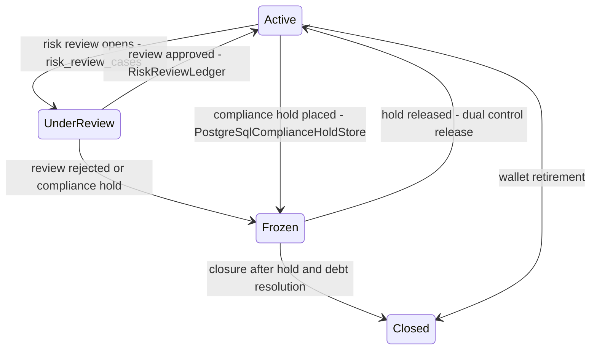
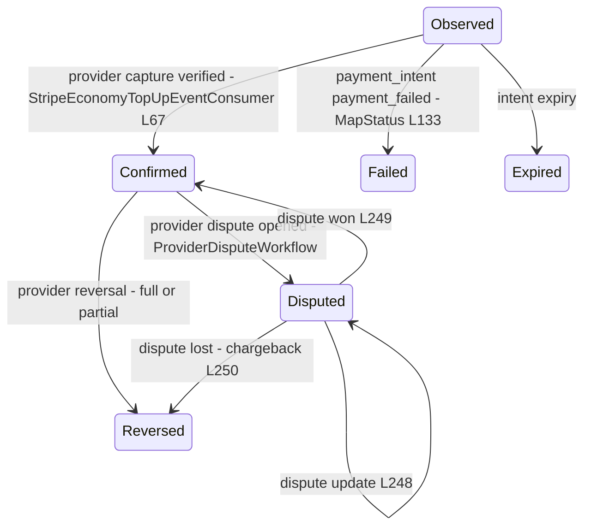
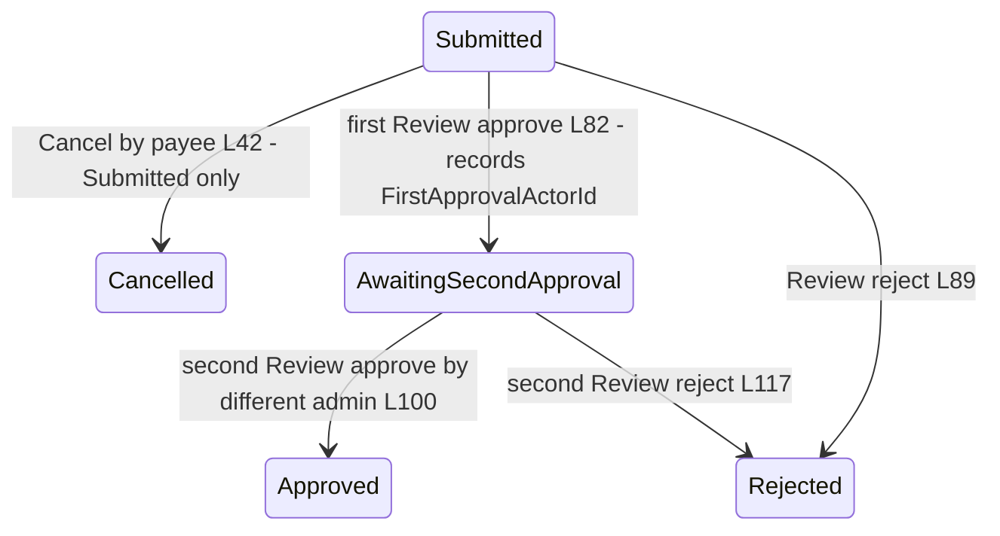
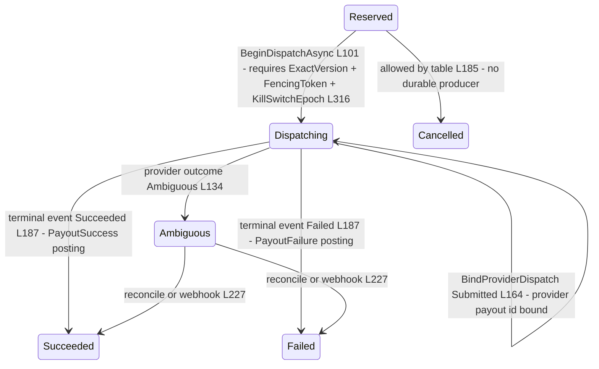
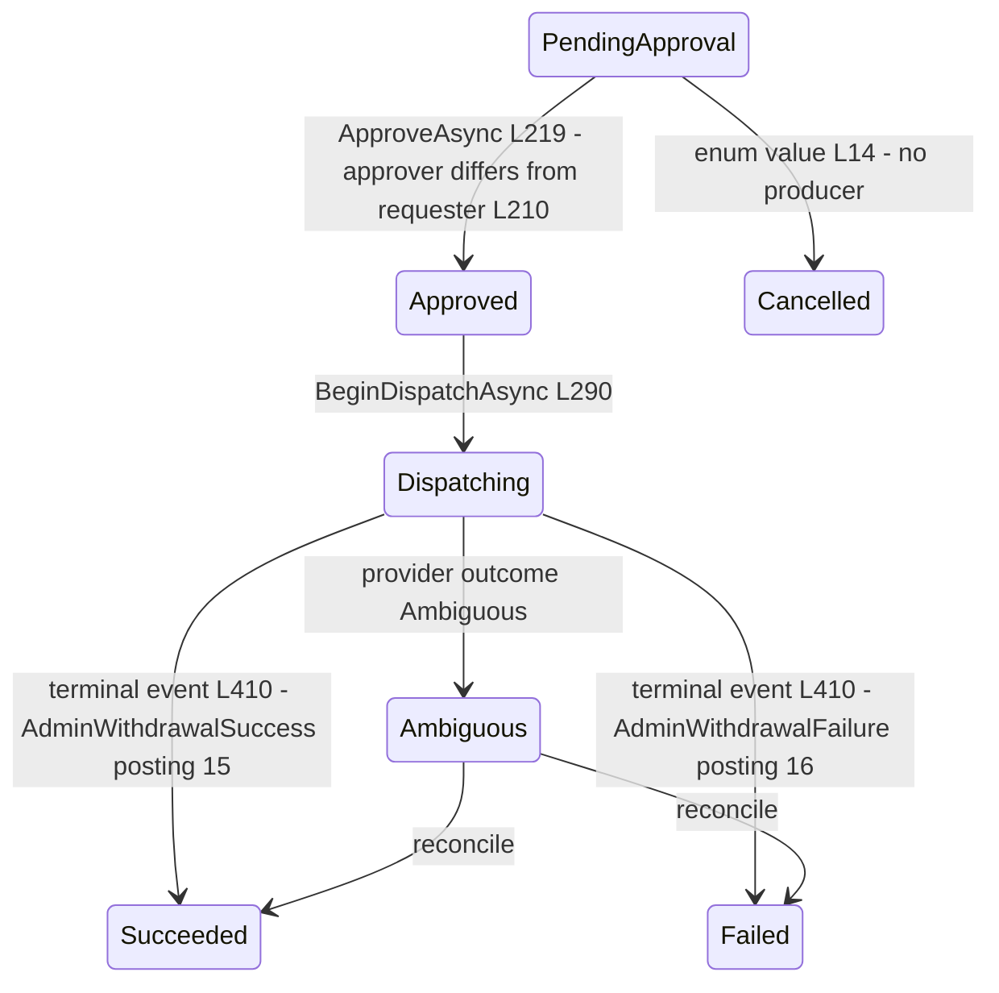
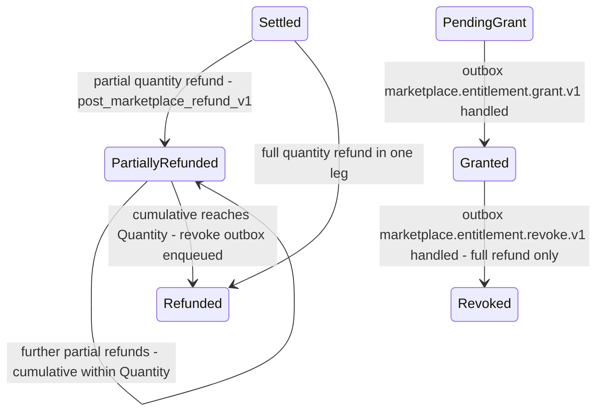
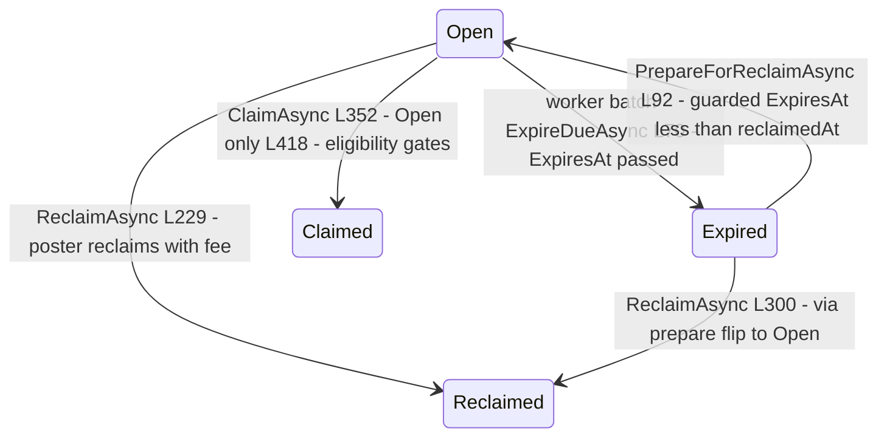
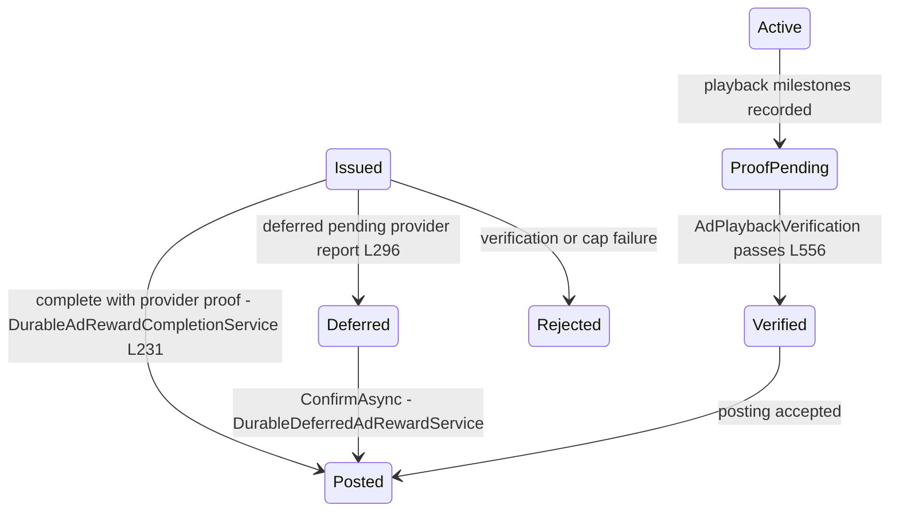
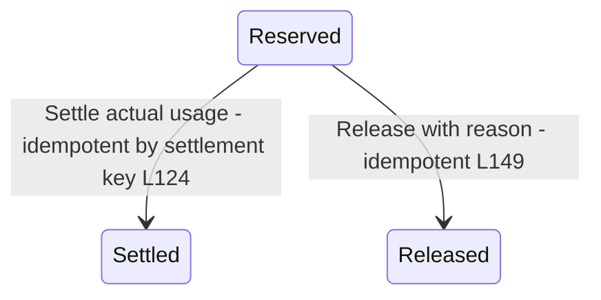

# Economy State Machines and Transitions Audit

> Economy family `GameGuild.Finance.Economy*` · Documented against `develop` commit `ac959fd8f`.
> Citation shorthand: see [`README.md`](README.md). `Migration:` = `API:/Database/Migrations/20260824180312_AddEconomyProductionPlatform.cs`.

## 1. Wallet lifecycle and posting status (the double-entry spine)

Wallets move through `WalletLifecycleState` (`Core:/Contracts/EconomyEnums.cs:124-129`); every value movement is a `PostingGroup` with `PostingStatus` (`:114-118`) accepted by the SECURITY DEFINER writer functions (`economy_private.post_registered_posting_v1` and friends, `Migration:`). Writers refuse inactive/cross-tenant wallets (`PERFORM ... wallet."State" = 1 FOR SHARE` in `post_ad_reward_issuance_v1`) and kill-switched capabilities before any row is written.

Posting status is decided at birth inside the writer transaction — there are no transitions between statuses, so it is a birth-state table rather than a diagram:

| Birth status | Producer | Meaning |
|---|---|---|
| `Accepted` | writer function commits the journal group | the posting is immutable truth (hash-chained) |
| `Duplicate` | idempotency key + request-hash replay inside the writer (`Migration:` idempotency block; `Core:/Ledger/MarketplaceLedgerGateway.cs:218-219`) | the original posting id is returned — callers treat as success |
| `Rejected` | validation guards throw before write (`RegisteredPostingRejectedException`) | nothing persisted |

Posting status is decided **inside** the writer transaction — there is no in-place transition between Accepted/Duplicate/Rejected; a group is born in its terminal status (idempotency replay returns the original posting id + `duplicate = true`, `Core:/Ledger/MarketplaceLedgerGateway.cs:218-219` pattern). Holds (`HoldStatus Active → Released/Consumed`, `EconomyEnums.cs:40-45`) are transitioned by the writer functions (refund drains release the seller refund hold: `economy_holds Status 3` + `economy_hold_events` row inside `post_marketplace_refund_v1`, `Migration:`).

## 2. Funding source confirmation (top-up / provider leg)

Source of truth: the static transition predicate `HardCoinFundingClaim.CanTransition` (`Core:/Funding/HardCoinFundingLifecycle.cs:240-252`), events appended with monotonic sequence + evidence hash chain (`:202-238`); persisted as `economy_source_stamps` + `economy_source_stamp_events`.

Terminal guard: once past `Observed`, any non-`Disputed` source throws `FundingTerminalStateConflictException` (`:209-215`); backdated evidence rejected (`:217-220`). `Reversed` is terminal. **Note:** the transition `Confirmed → Reversed` requires a provider reversal event to arrive — for Stripe top-ups no consumer maps `refund.*` events (see [`07-gaps.md`](07-gaps.md) K4), so in practice `Reversed` is reachable only through the (separate) provider-reversal operator tooling, not the webhook rail.

## 3. Payout request (dual control)

Source of truth: `PayoutRequest.Cancel` / `.Review` / `.CompleteSecondApproval` (`Payouts:/PayoutRequestContracts.cs:42-123`); persistence with optimistic version (`IPayoutRequestStore.Update/Review`, `:142-150`).

Guards: reviewer ≠ payee (`:67-70`); second approver ≠ first approver (`:111-115`); timestamps cannot move backwards (`:48-51,75-78`). The execution layer **re-derives** dual control from the audit events at reserve time — exactly two `Approved` audit rows by two distinct non-payee admins with reasons (`Payouts:/DurablePayoutApplicationService.cs:401-413`) — so a tampered audit trail blocks execution even when the row says `Approved`.

## 4. Payout operation — fencing token and reserve version states

Source of truth: `PayoutOperation.Transition` static table (`Payouts:/PayoutLifecycleContracts.cs:177-201`) + `BindProviderDispatch` (`:164-175`); durable transitions in `DurablePayoutSettlementWorkflow` (`Payouts:/DurablePayoutSettlementWorkflow.cs:53-257`) and the dispatch outbox processor (`Payouts:/PostgreSqlPayoutDispatchOutbox.cs:73-160`).

**Concurrency-control verification (the fencing tokens exist for a reason — confirmed):**

1. **Fencing token** — allocated per operation from the monotonic SQL sequence `economy_private.next_payout_fencing_token_v1` (`PostgreSqlPayoutFencingTokenAllocator.cs:22-30`) at reserve time (`DurablePayoutApplicationService.cs:152`). The dispatch command must carry the operation's exact `ExpectedVersion`, `FencingToken` and `KillSwitchEpoch`; `ValidateDispatchTransition` rejects any mismatch as stale/fenced (`DurablePayoutSettlementWorkflow.cs:316-323`). The outbox payload embeds the same fencing token + snapshot hash (`:130-140`), and the processor re-verifies the payload hash and provider-receipt binding before and after the provider call (`PostgreSqlPayoutDispatchOutbox.cs:93-112,209-219`). This closes the classic split-brain: a zombie dispatch for an operation that was concurrently transitioned cannot complete — the completion transaction re-reads the operation and throws stale unless it is still `Dispatching` at the leased version (`:132-144`).
2. **Reserve version + authorization epoch** — `ReserveVersion` and `ReserveAuthorizationEpoch` are pinned on the operation at reserve (`DurablePayoutApplicationService.cs:151,187-188`); dispatch re-reads the current reserve head and refuses if it advanced (`:234-239`), and the capability receipt must echo the same versions (`DurablePayoutSettlementWorkflow.cs:403-405`). Treasury runs carry the identical spine (`AdminWithdrawalRun.ReserveVersion/ReserveAuthorizationEpoch`, `Treasury:/AdminWithdrawalContracts.cs:97-98`) with the same dispatch re-check (`DurableAdminWithdrawalApplicationService.cs:229-236`).
3. **Kill-switch epoch** — the receipt's `KillSwitchEpoch` must equal the operation's at dispatch (`DurablePayoutSettlementWorkflow.cs:405`); active kill switches also block receipts inside the writer functions (`economy_kill_switches` check in `post_ad_reward_issuance_v1` and `post_registered_posting_v1`, `Migration:`). Caveat N6 in [`07-gaps.md`](07-gaps.md): the epoch pins the *authorization*, but the outbox worker does not re-check the gate before calling the provider.
4. **FIFO fragment reservations** — `Reserved → Dispatching → Consumed/Released` transitions are counted (`reservations.Transition` returns affected rows; `<= 0` throws stale, `DurablePayoutSettlementWorkflow.cs:119-128,239-247`) so a second dispatch cannot reuse released fragments.

**Transitions audit findings:**

1. **`Reserved → Cancelled` is unreachable in the composed (production) path.** The only producer is the in-memory `PayoutCoordinator.DispatchAsync` (`Payouts:/PayoutCoordinator.cs:252-256`, when all fragment reservations were already released), and `PayoutCoordinator`/`InMemoryPayoutOperationStore` are not registered anywhere — `API:/Core/Setup/ApiProductComposition.cs:133` composes only the durable services (`Payouts:/PayoutsModule.cs:14-31`). No controller endpoint or command produces a cancel for a payout operation. A reserved-but-never-dispatched payout pins its FIFO fragments with no operator exit (NEW gap N4).
2. **`Ambiguous` has no timeout/sweep.** Exit requires a terminal provider event via webhook or an operator `reconcile` (`DurablePayoutApplicationService.cs:279-310`); nothing scheduled drives it.
3. **`BindProviderDispatch` permits `Ambiguous → Ambiguous` version bumps** (`PayoutLifecycleContracts.cs:166-167`) — legal by design (late provider-id binding), auditable through `Version`.

## 5. Treasury admin withdrawal run

Source of truth: durable workflow transitions (`Treasury:/DurableAdminWithdrawalWorkflow.cs:198-227 approve, :245-290 dispatch, :410 terminal`); `AdminWithdrawalRunState` (`AdminWithdrawalContracts.cs:6-15`).

**Audit findings:** (1) `Cancelled` is unreachable — no cancel endpoint, no workflow branch produces it; it is only *read* by the overlap guard (`PostgreSqlAdminWithdrawalStore.cs:238` treats non-`Failed`/non-`Cancelled` runs as blocking). Combined with **reserve-at-propose** (§6 of [`01-user-flows.md`](01-user-flows.md)): a `PendingApproval` run that is never approved holds its FIFO fragment reservations and blocks overlapping withdrawals forever (NEW gap N5). (2) The run allocates its fencing token and **execution epoch** at proposal (`DurableAdminWithdrawalApplicationService.cs:137,152-153`); dispatch verifies both plus source-root hashes (`:248-255`) — the same fencing discipline as payouts, verified sound. (3) Audit events form a per-run hash chain (`PreviousHash/Hash`, `PostgreSqlAdminWithdrawalStore.cs:129-146` per #1092) verified on every `Audit` read (`DurableAdminWithdrawalApplicationService.cs:312-317`).

## 6. Marketplace settlement / entitlement

Source of truth: `MarketplaceSettlementResult.ApplyRefund` (`Marketplace:/MarketplaceContracts.cs:194-205`) and the writer functions; entitlement status `PendingGrant → Granted → Revoked` (`:36-41`).

Guards verified: cumulative quantity ≤ order quantity (`DurableMarketplaceRefundService.cs:141-153`); per-currency leg counters monotonic (`:174-191`); entitlement grant/revoke outbox rows enqueued **inside** the posting transaction (`Migration:` — settlement and refund functions), so ledger and entitlement dispatch cannot diverge. The revoke row is enqueued only on full refund (`IF` full-refund branch in `post_marketplace_refund_v1`).

## 7. Bounty

Source of truth: `BountyStatus` (`Bounties:/BountyContracts.cs:23-29`); durable transitions in the expiration workflow and claim workflow.

Findings: the `Expired → Open` flip is guarded by `ExpiresAt <= reclaimedAt` (i.e. still past due) and an `UPDATE ... WHERE Status = Expired` compare-and-set (`DurableBountyExpirationWorkflow.cs:92-99`), so a concurrent expiration worker re-flagging cannot double-transition — the version columns plus the SQL guard serialize it. `Claimed`/`Reclaimed` are terminal; `economy_bounty_expiration_events` rows record every expiry (worker `:72-79`) — the event stream #1092 Tier-2.5 folds into the unified event ledger.

## 8. Ad-reward session and completion

Source of truth: `DurableAdRewardSessionState` (`AdRewards:/DurableAdRewardContracts.cs:5-14`) with transitions in the session/completion services; `AdRewardCompletionState` (`AdRewards:/AdRewardCoordinator.cs:103-108`) rides along on the completion row.

Findings: (1) the durable completion path requires the session still be `Issued` (`DurableAdRewardCompletionService.cs:124`) — the intermediate `Active/ProofPending/Verified` states are set on the session row during milestone accumulation (`:313,349`) but a session that already left `Issued` cannot be completed again (idempotent duplicate result instead). (2) `AccumulatedRemainder` completions post the integer part and carry the rational remainder in `economy_ad_reward_accumulators` (`AdRewardRationalAccumulator.cs`) — the completion state, not the session state, distinguishes it (`:155-156`). (3) `Rejected` has no re-entry — a rejected session must be re-issued (new nonce/token).

## 9. AI-credit reservation

Source of truth: `AiCreditReservation.Create/Settle/Release` (`AiCredits:/Integrations/AiCreditWallet.cs:56-165`).

Findings: transitions are total (both exits available from `Reserved` only); settle cannot exceed the reservation (`:116-119`); idempotent re-settle/release tolerated only with the same idempotency key. **No expiry sweep exists** — an abandoned `Reserved` row subtracts from the wallet's available Soft balance forever until manually released (NEW gap N8).

## 10. Cross-cutting: protected-operation states (risk rail)

Every value movement first obtains a risk decision; denial states surface uniformly: `EconomyProtectedOperationState` (Denied / ReviewRequired / Hold / Challenge / …) mapped to 403/409/503 in every controller (e.g. `EconomyWalletController.cs:105-116`, `EconomyMarketplaceController.cs:127-148`). `ReviewRequired` opens a `risk_review_case` whose admin approve/reject (`EconomyRiskReviewAdministrationController.cs:85,105`) releases the held operation — that is the only "retry" rail for held transfers/refunds.
