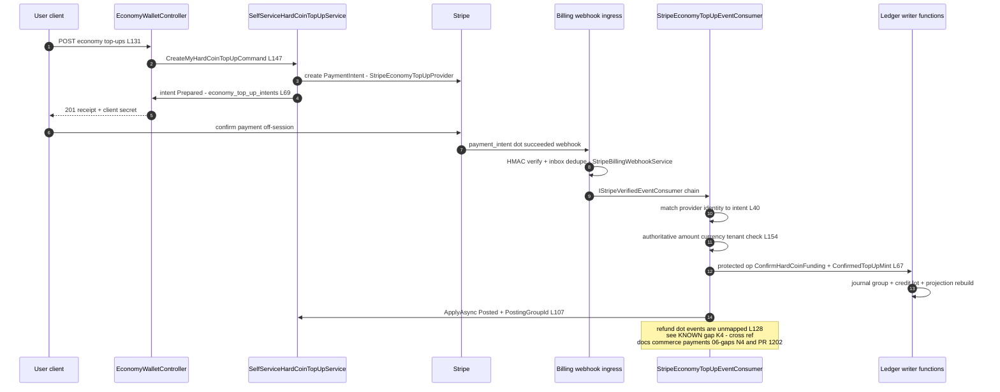
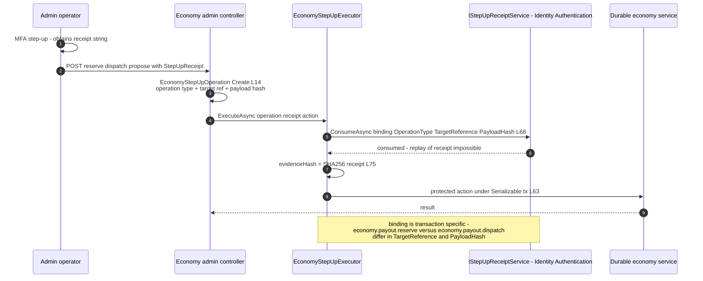
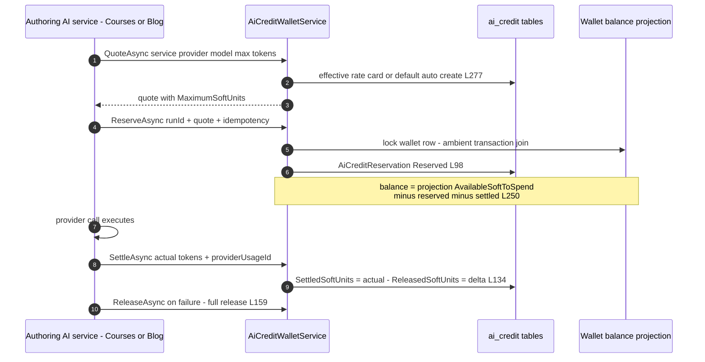
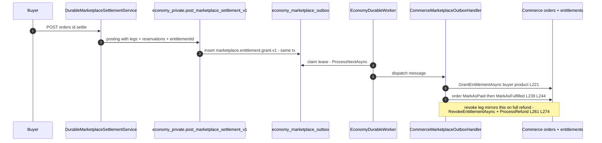
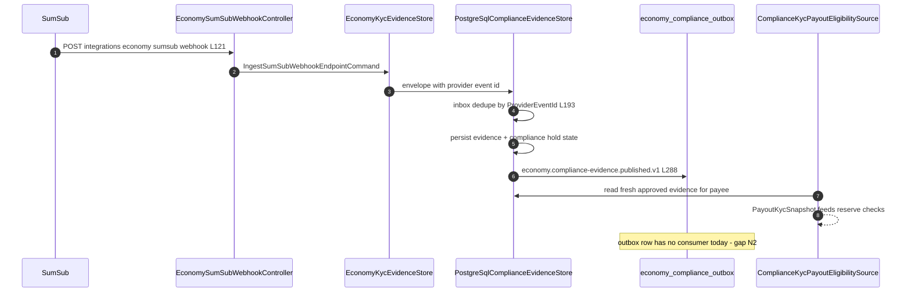
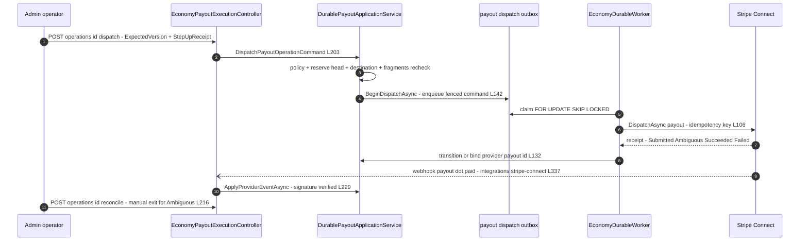

# Economy Cross-Module Sequences

> Economy family `GameGuild.Finance.Economy*` · Documented against `develop` commit `ac959fd8f`.
> Citation shorthand: see [`README.md`](README.md). `Payments:` = `apps/api/Source/Modules/GameGuild.Commerce.Payments/`, `Billing:` = `apps/api/Source/Modules/GameGuild.Commerce.Billing/`.

## 1. Economy ↔ Commerce.Payments/Billing — top-up mint (and the refund gap)

The only money ingress into the Economy ledger from fiat payments is the Stripe top-up. Commerce owns the webhook ingress and signature verification; Economy owns a consumer in that chain.

Fail-open/closed verdicts: the mint is fail-closed — any mismatch or posting failure parks the intent in `Held` (`StripeEconomyTopUpEventConsumer.cs:119-125`) rather than crediting. The reverse leg (provider refund) fails **open**: the minted HardCoin stays with the wallet (`MapStatus :128-136` has no `refund.*` arm — documented as the top-up refund gap in the Payments audit package, `docs/commerce/payments/06-gaps.md` N4, PR #1202). Economy's own reversal rail (templates `ProviderReversalFull/Partial`, `economy_root_reversal_states`, wallet debts) is reachable only through internal reversal tooling, not the webhook chain.

## 2. Economy ↔ auth step-up — EconomyStepUpExecutor

Every admin money mutation wraps its action in a Serializable transaction that first consumes a step-up receipt bound to the exact operation fingerprint.

Binding sources: payout reserve (`economy.payout.reserve`, target `payout-request:{id}`), payout dispatch (`economy.payout.dispatch`, target `payout-operation:{id}`, payload includes `ExpectedVersion` — `EconomyPayoutExecutionController.cs:168-171,199-204`), treasury propose/approve/dispatch (`EconomyTreasuryAdministrationController.cs:109-114,144-148,174-179`), legacy cutover (`EconomyLegacyMigrationAdministrationController.cs:116-155`). Receipt reuse across bindings fails in `ConsumeAsync` (receipt already consumed) — single-use proof, persisted by the auth module's step-up challenge store. The evidence hash feeds the economy's own `ReauthenticationEvidence` with 1-minute freshness (`EconomyFundsEndpointCommands.cs:226-238`).

## 3. Economy ↔ AI credits — reservation against Soft balance

Key property: the reservation ledger lives **outside** the economy journal — the wallet summary subtracts usage through `IEconomyWalletSoftUsageContributor` (`Core:/Queries/EconomyWalletQueries.cs:120-133`; registration `AiCredits:/AiCreditsModule.cs`). Settling AI usage never posts a journal group (no `PostingTemplateKind` covers it; `Burn` 7 is unused by this path) — SoftCoin is treated as unbacked utility credit, documented in the contributor interface doc comment. Provider cost facts are recorded separately (`Core:/Integrations/AI/AiCostAccountingCoordinator.cs:96`) with risk gating (`AiCostRiskGate.cs`).

## 4. Economy ↔ Commerce orders/entitlements — marketplace outbox bridge

Failure semantics: if Commerce rejects (entitlement failure, order drift), the handler throws, the lease is released and the row retries — the ledger has already settled, so the bridge is eventually-consistent by design; order-line snapshot re-verification (`PostgreSqlMarketplaceOutboxProcessor.cs:281-296`) protects against Commerce-side mutation. No attempt cap exists (gap N3).

## 5. Economy ↔ KYC (SumSub) — evidence into payout eligibility

## 6. Economy ↔ Stripe Connect — payout provider dispatch and reconciliation

Timeout/ambiguity: a provider timeout yields `Ambiguous` (`DurablePayoutSettlementWorkflow.cs:134-137`); the exit rails are the webhook and operator reconcile (`DurablePayoutApplicationService.cs:279-310`) — there is no scheduled ambiguity sweep (gap N7).
