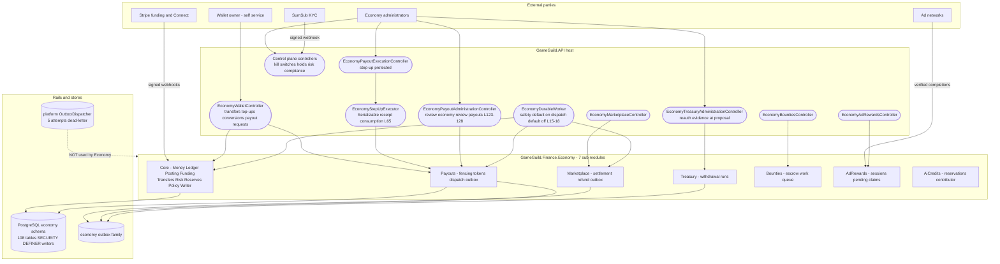
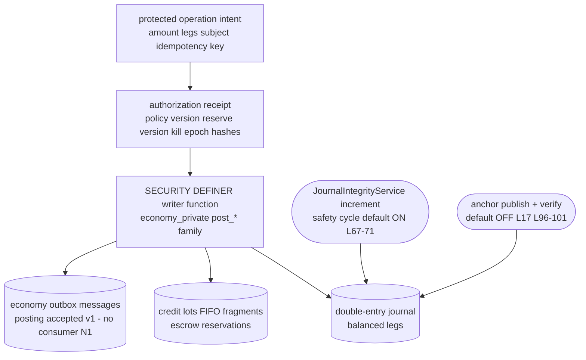

# Economy Security Architecture — value movement, trust boundaries, delivery guarantees

Status: living document, current as of 2026-11-04 against `origin/develop` (21b58ac6a7).

Companion documents: [`08-stride-threat-model.md`](08-stride-threat-model.md) (families E1-E9), [`10-dfds.md`](10-dfds.md) (data flow diagrams), [`07-gaps.md`](07-gaps.md) (gap register). Citation shorthand as in [`README.md`](README.md).

## 1. Component diagram

## 2. Trust boundaries

| # | Boundary | Crossing | Primary control |
|---|----------|----------|-----------------|
| E-B1 | Internet → API (self-service) | transfers/top-ups/conversions/payout-requests | authenticated actor; server-side wallet resolution (`EconomyWalletController.cs:86-89,257`); no rate policy (N9) |
| E-B2 | Internet → API (administration) | all admin routes | typed `economy:*` permissions (`TypedPermissions.cs:931-944`); execution surface additionally step-up (`EconomyStepUpExecutor.cs:9-65`) |
| E-B3 | Anonymous provider → API | Stripe webhooks, SumSub webhook | HMAC verification fail-closed (`StripeEconomyTopUpEventConsumer`; `EconomyKycController.cs:121-143`); SumSub unthrottled (compliance N8) |
| E-B4 | API → PostgreSQL | every writer call | SECURITY DEFINER function family `economy_private.*` (`Migration:`) — application roles cannot post journal legs directly; policies/kill switches enforced INSIDE the writers |
| E-B5 | API → Stripe (egress) | Connect payouts, funding, treasury | provider hash + destination hash bound into receipts (`DurablePayoutSettlementWorkflow.cs:407-409`) |
| E-B6 | API → internal AI providers | AiCredits reservations | in-process seam only (`AiCredits:/Integrations/AiCreditWallet.cs`) |
| E-B7 | Economy ↔ Compliance | KYC evidence, audit | evidence envelopes via `EconomyKycEvidenceStore` (`API:/Core/Integration/EconomyKycEvidenceStore.cs:7-22`); divergence documented in compliance package N7 |

## 3. Who can move money — permission map

| Action | Gate | Citation |
|--------|------|----------|
| Read own wallets, transfers, top-ups, payout ops | authenticated + self-service context | `EconomyWalletController.cs:37,257-262` |
| Create transfer / conversion / top-up / payout request | protected-operation rail — risk, policy, reserve, jurisdiction all server-resolved | `:67,84,131,267` |
| Cancel own payout REQUEST | self-service (`:321`) — canceling a reserved OPERATION has no path (N4) | `:321` |
| Review payout requests | typed `economy:review:payouts` | `EconomyPayoutAdministrationController.cs:123-128` |
| Execute payouts (dispatch) | typed `economy:operate:payouts` + fresh step-up receipt bound to operation/target/payload hash, Serializable | `EconomyStepUpExecutor.cs:65`; `DurablePayoutSettlementWorkflow.cs:400-410` |
| Treasury withdrawals | typed `economy:operate:treasury` + fresh reauth evidence at proposal | `DurableAdminWithdrawalApplicationService.cs:88-100` |
| Kill switches, policies, reserves, holds, risk | typed `economy:manage:*` / `economy:operate:*` with in-controller re-check | `TypedPermissions.cs:931-944`; `EconomyControlPlaneAdministrationController.cs:445` |
| Marketplace admin ops / bounties admin / ad-reward admin | `economy:operate:marketplace` / `-bounties` / `-ad-rewards` | same registry |
| KYC self-service + webhook | `TryActor` self-scope / anonymous HMAC | `EconomyKycController.cs:100-110,121-143` |

Fail-open/fail-closed verdicts: composition is unconditional but **value movement is fail-closed** — signed policies, provider readiness and capability receipts decide (`PayoutsModule.cs:28-31` comment); missing configuration does not silently enable flows. The dispatch workers themselves default OFF (`EconomyDurableWorker.cs:16-17`) — enabling them is an operator trust decision.

## 4. Double-entry integrity chain

Layered defenses: (1) balanced-legs invariants inside the writer functions; (2) FIFO fragments make escrow/hold states explicit rows, not flags; (3) reserve versions + kill-switch epochs fence stale commands (`DurablePayoutSettlementWorkflow.cs:400-410`); (4) integrity increments run by default; (5) anchors (externalized WORM publication) exist but default OFF — enabling them is the journal's tamper-evidence upgrade path; (6) the compliance evidence outbox rides the same transactional shape (N2: no reader).

## 5. Outbox delivery guarantees — the six queues

| Queue | Producer | Consumer | Attempt cap | Dead-letter | Replay | Evidence |
|-------|----------|----------|-------------|-------------|--------|----------|
| `economy_outbox_messages` (posting accepted) | writer functions after every accepted posting | **NONE — N1** | n/a | n/a | n/a | `Core:/Persistence/EconomyPersistenceRows.cs:356`; `EconomyModelConfiguration.cs:641-654`; no `PublishedAt` |
| `economy.compliance-evidence.published.v1` | `PostgreSqlComplianceEvidenceStore.IngestAsync` (`:288-300`) | **NONE — N2** | n/a | n/a | n/a | verified by search at 21b58ac6a7 |
| `economy_marketplace_outbox` | settlement/refund legs | marketplace processor in safety cycle (`EconomyDurableWorker.cs:76-86`, new `InternalOutboxWorkersEnabled` default true `:18`) | **none — N3** unbounded `AttemptCount` | none | none | `PostgreSqlMarketplaceOutboxProcessor.cs:96-110` |
| `economy_payout_dispatch_outbox` | payout authorization | dispatch processor (`DispatchWorkersEnabled` default OFF `:16`) | **none — N3** | none | none | `PostgreSqlPayoutDispatchOutbox.cs:193-207` — every failure +1 min forever |
| `economy_admin_withdrawal_dispatch_outbox` | treasury runs | dispatch processor (default OFF) | **none — N3** | none | none | treasury twin of the above |
| `economy_ad_reward_pending_claims` + bounties work-queue | ad completions / bounty work | module processors | lease-based | none | none | `AdRewards:`, `Bounties:` stores |

Contrast rail: the platform `OutboxDispatcher` (`API:/Core/Eventing/OutboxDispatcher.cs`) provides 5-attempt/≤900s backoff, `DeadLetteredAtUtc`, tombstones and replay — **Economy uses none of it** (sharedkernel N5). The #1092 T1.1 merge is the tracked path to converge.

## 6. Deployment invariants

1. Writer-function monopoly: never grant application roles direct DML on `economy_journal*` — every integrity property assumes postings flow through `economy_private.*`.
2. Kill-switch epochs must be bumped THROUGH the control plane so receipts carry the new epoch; the dispatch outbox does not re-check (N6) — treat "activate switch" as "stop new authorizations", not "stop in-flight sends".
3. Enabling `DispatchWorkersEnabled`/`AnchorWorkersEnabled` (`EconomyDurableWorker.cs:16-17`) changes the money-movement posture — dispatch on = provider sends live (with N3 unbounded retries); anchors on = journal tamper evidence externally verifiable.
4. Step-up receipts are single-use and Serializable (`EconomyStepUpExecutor.cs:65`) — replaying one is a correctness failure, not a vulnerability; keep the receipt TTLs short.
5. The SumSub webhook HMAC secret and the Stripe webhook secrets are distinct trust roots; rotation of either must respect the inbox replay guards before cutover.
6. `ComplianceKycPayoutEligibilitySource` reads the LEGACY KYC ledger (`:22`) — before enabling payouts in a tenant, decide the N7 two-ledger question or the gate will approve on unverified evidence.
