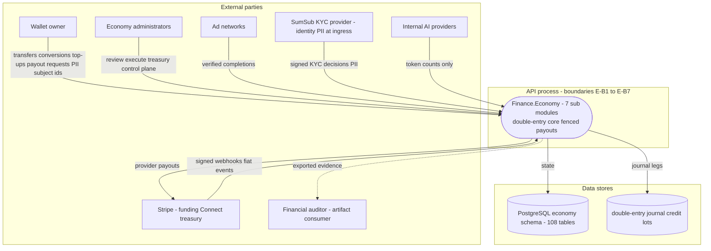
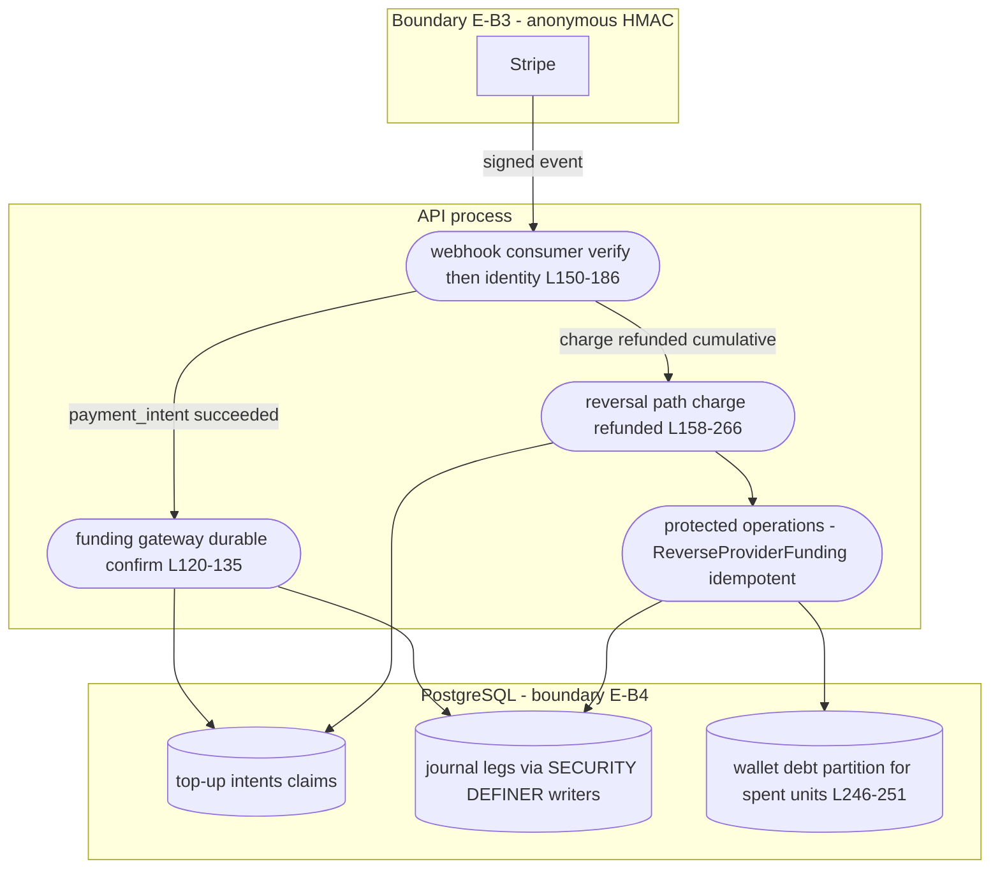
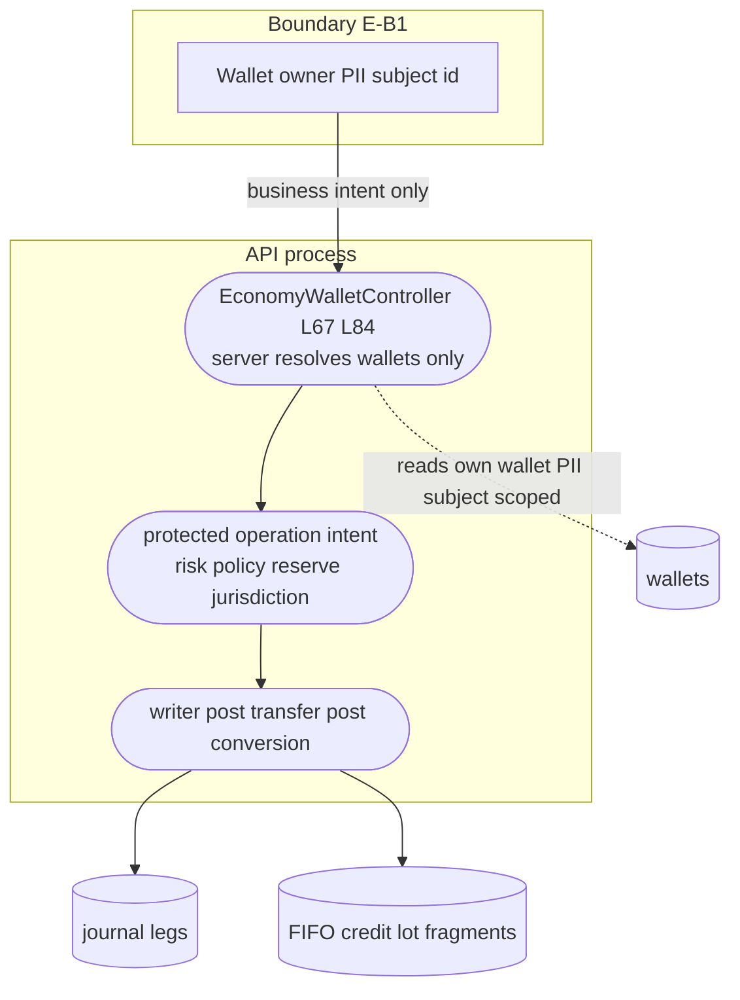
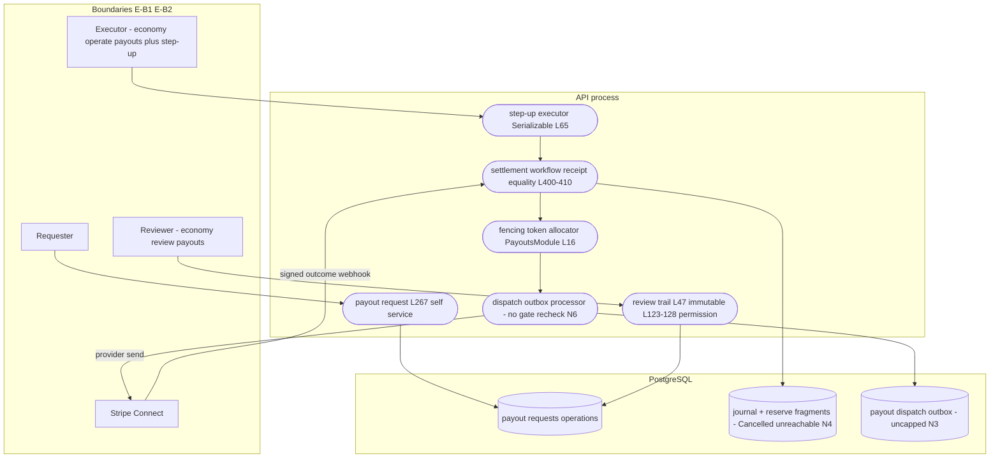
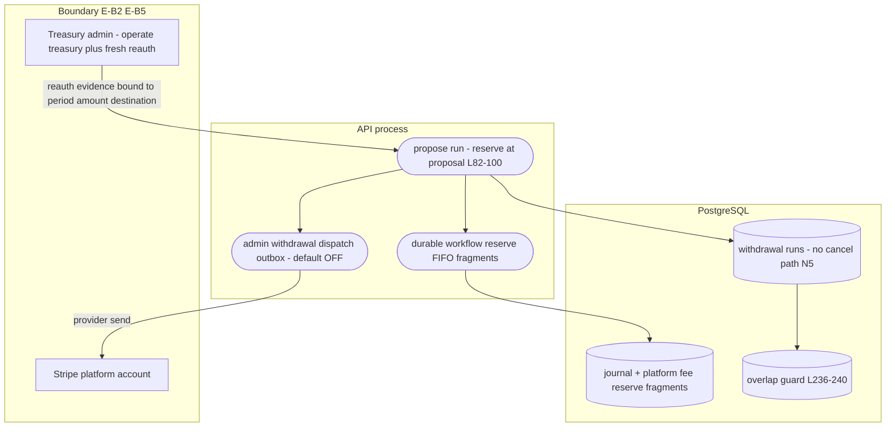
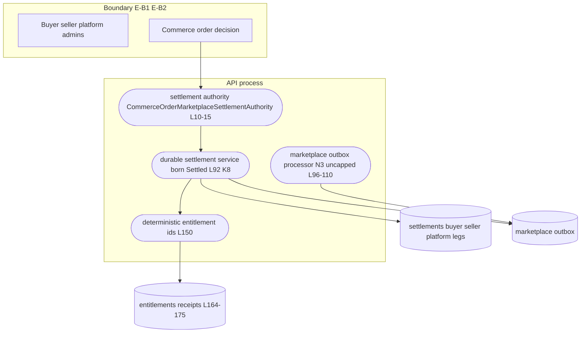
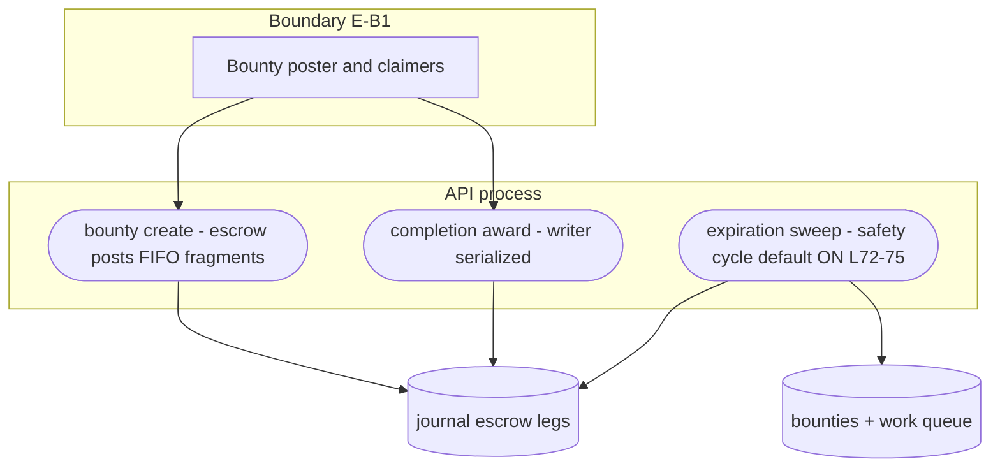
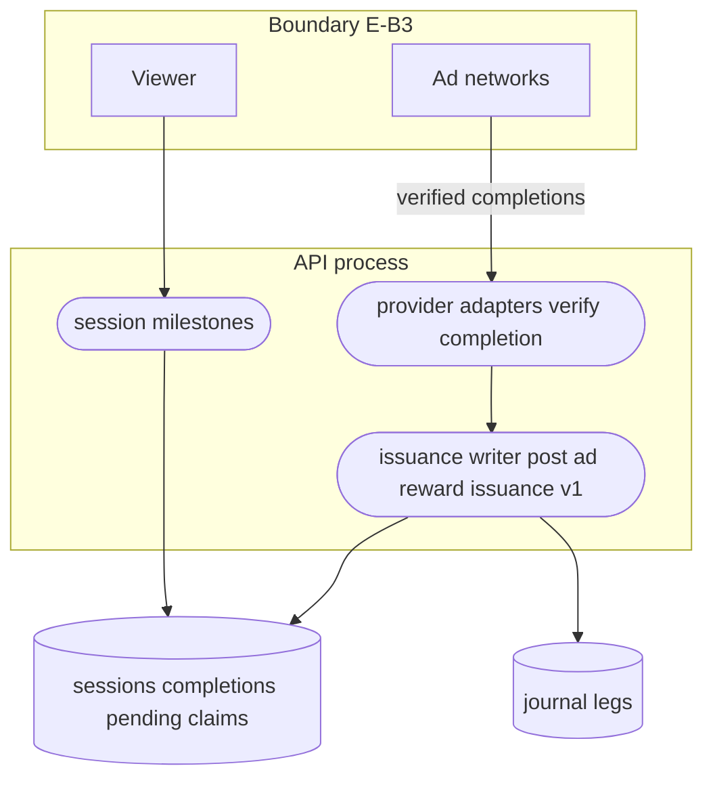
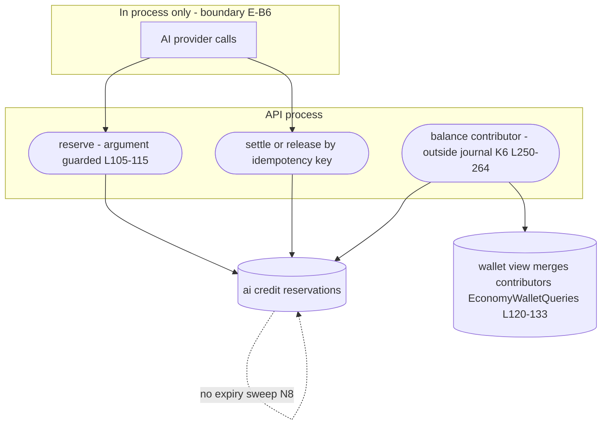
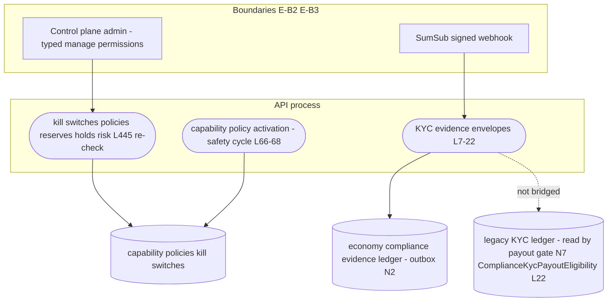

# Economy Data Flow Diagrams — level 0 and level 1 per family

Status: living document, current as of 2026-11-04 against `origin/develop` (21b58ac6a7).

Companion documents: [`08-stride-threat-model.md`](08-stride-threat-model.md) (families E1-E9), [`09-security-architecture.md`](09-security-architecture.md) (trust boundaries E-B1..E-B7). Citation shorthand as in [`README.md`](README.md). No parentheses or colons in labels; `L###` is file:line.

This family moves money, not personal data — **PII markers below flag subject identity, wallet ownership, or KYC-linked references**, the identifiers an auditor treats as personal.

## 1. Level 0 — the Economy family as one process

## 2. E1 — top-up mint and reversal, level 1

## 3. E2 — conversion and transfer, level 1

## 4. E3 — payout dual-control and fenced execution, level 1

## 5. E4 — treasury withdrawal, level 1

## 6. E5 — marketplace settlement and refund, level 1

## 7. E6 — bounty escrow, level 1

## 8. E7 — ad rewards, level 1

## 9. E8 — AI credits, level 1

## 10. E9 — control plane, level 1

## 11. Cross-boundary value summary

| DFD | Value or identity crossing | Boundary | Control |
|-----|---------------------------|----------|---------|
| E1 | fiat event → coin mint/reversal | E-B3/E-B4 | HMAC + writer monopoly + reversal idempotency |
| E2 | subject-scoped movements | E-B1 | server-resolved wallets; no client ids |
| E3 | provider money out | E-B2/E-B5 | dual-control + step-up + fencing + hash binding |
| E4 | platform fees out | E-B2/E-B5 | reauth evidence + overlap guard |
| E5 | counterparty splits | E-B4 | atomic writer; deterministic entitlement ids |
| E8 | spendable-soft reduction | E-B6 | guards + idempotency; no expiry (N8) |
| E9 | compliance decisions → money gate | E-B7 | versioned evidence; legacy-ledger divergence N7 |
