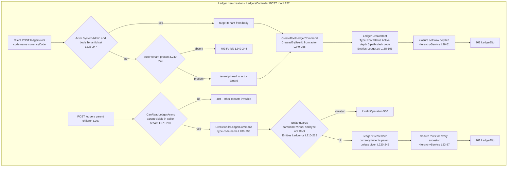
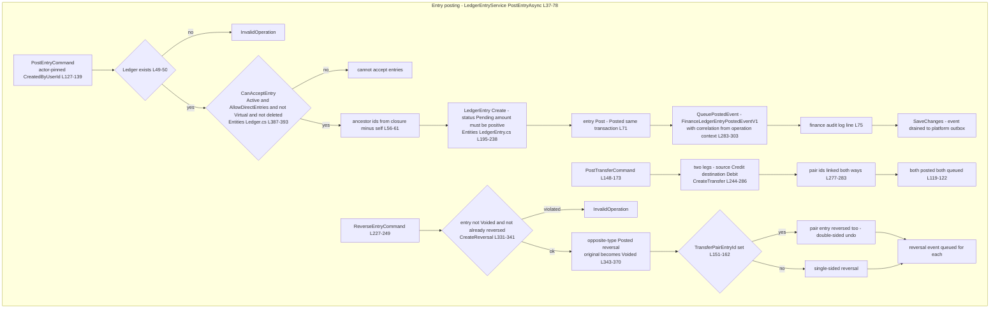
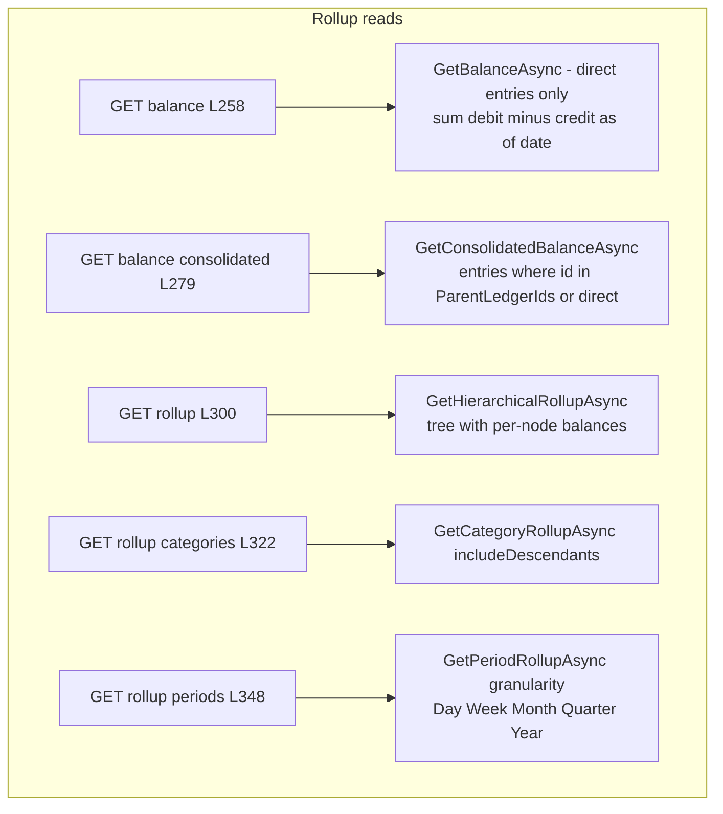

# Finance.Ledgers user flows — happy path and every edge case

> Module `GameGuild.Finance.Ledgers` · Documented against `develop` commit `60100459e6`.
> Citation shorthand: `Ledgers:` = `apps/api/Source/Modules/GameGuild.Finance.Ledgers/`.

## 1. Create root / child ledger — closure-table maintenance

`POST api/v1/ledgers/root` (`Ledgers:/Controllers/LedgersController.cs:222-262`) and `POST api/v1/ledgers/{parentLedgerId}/children` (`:267-302`) → `CreateRootLedgerCommand`/`CreateChildLedgerCommand` → handlers (`Handlers/LedgerHandlers.cs:49-84`) → `LedgerHierarchyService.CreateRootLedgerAsync/CreateChildLedgerAsync` (`Services/LedgerHierarchyService.cs:26-87`) which maintain the closure table.

### 1a. Edge-case matrix — tree creation

| # | Edge case | Code path | Outcome |
|---|-----------|-----------|---------|
| 1 | Non-admin supplies foreign `TenantId` in body | actor-tenant pinning (`LedgersController.cs:231-247`) | silently pinned to own tenant — no cross-tenant root creation |
| 2 | Actor without tenant creates root | guard (`:240-246`) | 403 |
| 3 | Duplicate code in tenant | unique index `(TenantId,Code)` (`Configuration/LedgerEntityConfigurations.cs:21-23`) | DB uniqueness violation → 500/409 mapping |
| 4 | Child under a virtual ledger | entity guard (`Entities/Ledger.cs:210-213`) | `InvalidOperationException` |
| 5 | Creating a `Root`-typed child | entity guard (`:215-218`) | `InvalidOperationException` |
| 6 | Child currency unspecified | inheritance (`:230`) | parent currency adopted |
| 7 | Moving a ledger | `MoveLedgerCommand` declared (`Commands/LedgerCommands.cs:72-75`), service `MoveLedgerAsync` implemented (`Services/LedgerHierarchyService.cs:88-128`), cycle guard `CanMoveToParentAsync` (`:188`) — **no handler, no route** (dead type D4, `02-cqrs-wiring-matrix.md` §3) |

## 2. Post entry / transfer / reverse — the double-sided surface that exists

`POST api/v1/ledgers/{ledgerId}/entries` (`Ledgers:/Controllers/LedgerEntriesController.cs:111-143`), `POST api/v1/ledgers/transfers` (`:148-173`), `POST api/v1/ledgers/entries/{entryId}/reverse` (`:227-249`) → `LedgerEntryService` (`Services/LedgerEntryService.cs:37-165`).

### 2a. Edge-case matrix — posting/transfer/reversal

| # | Edge case | Code path | Outcome |
|---|-----------|-----------|---------|
| 1 | Client-supplied `CreatedByUserId` | actor-pinned (`LedgerEntriesController.cs:126-134`) | actor identity wins |
| 2 | Zero/negative amount | `Create` guard (`Entities/LedgerEntry.cs:211-214`) | `ArgumentException` |
| 3 | Posting to virtual / archived / inactive ledger | `CanAcceptEntry` (`Entities/Ledger.cs:387-393`) | rejected |
| 4 | Cross-tenant ledger | 404 via `CanReadLedgerAsync` (`LedgerEntriesController.cs:383-392`) | invisible, not 403 |
| 5 | Transfer where only one side is postable | both ledgers checked (`Services/LedgerEntryService.cs:97-101`) | rejected before any write |
| 6 | Transfer legs atomicity | `AddRangeAsync([source,dest])` single save (`:124`) | both or neither |
| 7 | Reversing one leg of a transfer | pair-chasing (`:151-162`) | both legs reversed — paired integrity holds |
| 8 | Double reversal | `ReversedByEntryId` guard (`Entities/LedgerEntry.cs:338-341`) | rejected |
| 9 | Deleting a posted (non-reconciled, non-transfer) entry | `EnsureCanDelete` (`:422-443`) | allowed — posted history can vanish from the book (STRIDE 2.4) |
| 10 | Batch posting | `PostBatchEntriesCommand` declared, service `PostBatchAsync` implemented (`:200-265`) — **no handler, no route** (dead type D7) |
| 11 | Reconciliation against external refs | `ReconcileEntryCommand` declared, service `ReconcileEntryAsync` + entity `Reconcile` implemented (`:268-281`, `Entities/LedgerEntry.cs:311-326`) — **no handler, no route** (dead type D8) |

## 3. Balance / consolidated / rollup reads

`GET {ledgerId}/balance`, `/balance/consolidated`, `/rollup`, `/rollup/categories`, `/rollup/periods` (`Ledgers:/Controllers/LedgerEntriesController.cs:258-370`) → `LedgerRollupService` (`Services/LedgerRollupService.cs`).

### 3a. Edge-case matrix — rollups

| # | Edge case | Code path | Outcome |
|---|-----------|-----------|---------|
| 1 | Ledger with no entries | balance zero record returned | deterministic zero, not 404 |
| 2 | `asOfDate` boundary | end-of-day conversion (`Services/LedgerRollupService.cs:33-40`) | inclusive-to-end-of-day semantics |
| 3 | Deep hierarchies | closure-table `ParentLedgerIds` denormalized on entries (`Entities/LedgerEntry.cs:53-57`) | subtree aggregation without recursive CTE |
| 4 | Cached stats used? | `CachedNetBalance` etc. (`Entities/Ledger.cs:119-135`) | **never read by the rollup paths — recomputed every time; the caches are write-orphaned (L4)** |
| 5 | Virtual-ledger balance | `GetVirtualLedgerBalanceQuery` — **no handler** (dead type D20); service `GetVirtualBalanceAsync` implemented (`Services/VirtualLedgerService.cs:161`) — unreachable |
| 6 | Searching ledgers/entries | `SearchLedgersQuery`/`SearchEntriesQuery` — **no handlers** (dead types D15/D19 in §3) |
