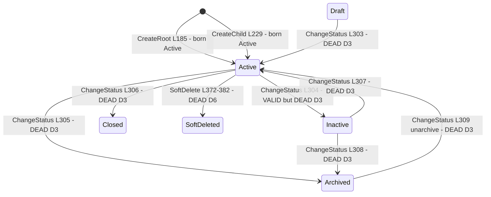
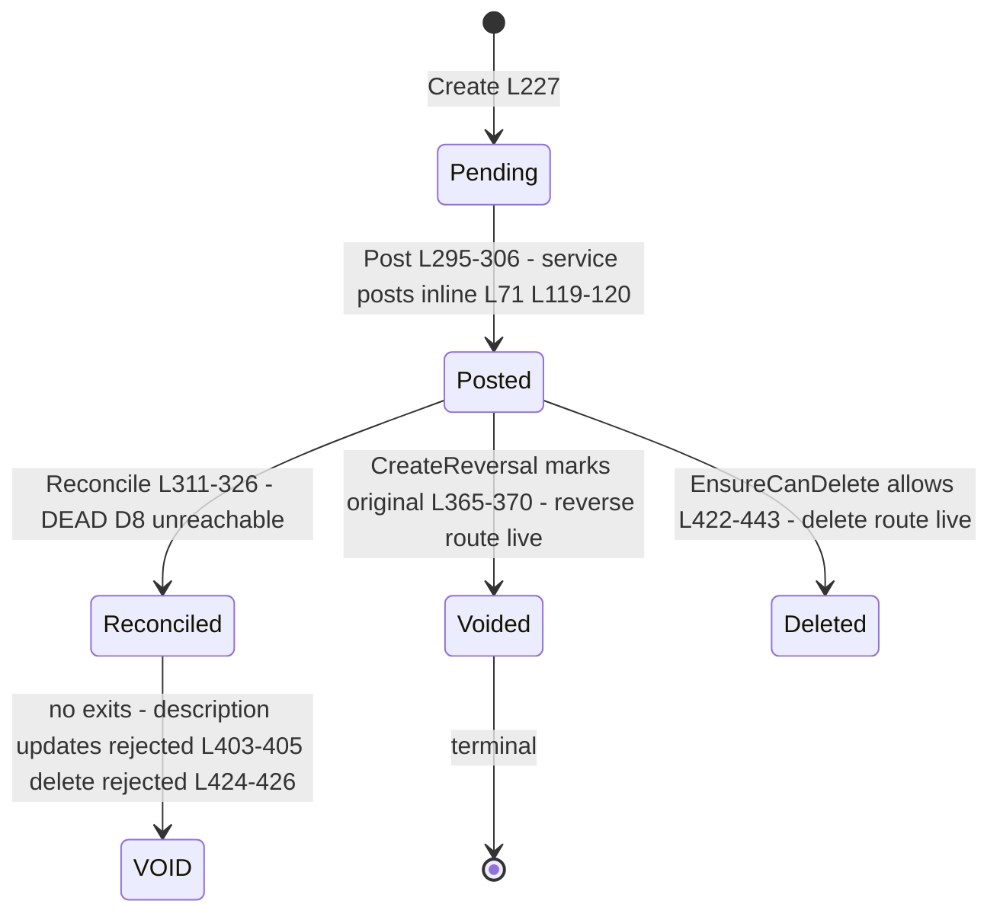

# Finance.Ledgers — state machines

> Module `GameGuild.Finance.Ledgers` · Documented against `develop` commit `60100459e6`.
> Citation shorthand: `Ledgers:` = `apps/api/Source/Modules/GameGuild.Finance.Ledgers/`.

## 1. Ledger lifecycle (`LedgerStatus`)

States (`Enums/LedgerEnums.cs:49-65`): `Draft = 0`, `Active = 1`, `Inactive = 2`, `Archived = 3`, `Closed = 4`. Transition table in `Entities/Ledger.ChangeStatus` (`:298-321`).

Transitions audit:

| Transition | Guard | Reachable via API? |
|---|---|---|
| all `ChangeStatus` edges | switch-table validation, `InvalidOperationException` otherwise (`Entities/Ledger.cs:301-316`) | **NO — `ChangeLedgerStatusCommand` is dead type D3**; every ledger is born `Active` (`:185, :229`) and no route can ever move it |
| `SoftDelete` | rejects while any active children (`:374-377`) | **NO — `DeleteLedgerCommand` dead (D6)** |
| → `Draft` | no factory produces Draft | **unreachable state — nothing can ever create it** |

**Finding**: four of five declared states (`Draft`, `Inactive`, `Archived`, `Closed`) and the whole guarded transition table are unreachable through any wired path. The only lever `CanAcceptEntry` actually consults (`Status == Active`, `:389`) therefore always passes for API-created ledgers.

## 2. Ledger entry lifecycle (`EntryStatus`)

States (`Enums/LedgerEnums.cs:82-95`): `Pending = 0`, `Posted = 1`, `Voided = 2`, `Reconciled = 3`. Logic in `Entities/LedgerEntry.cs`.

Transitions audit:

| Transition | Trigger | Guard | Reachable? |
|---|---|---|---|
| Pending → Posted | `Post` (`:295-306`) | only from Pending; service calls it inline (`Services/LedgerEntryService.cs:71, 119-120, 253`) so **Pending is never observable via API** — entries are created and posted in one handler call | yes (invisible) |
| Posted → Reconciled | `Reconcile` (`:311-326`) | only from Posted | **NO — D8 dead**; `Reconciled` unreachable, yet it is a hard lock state (no modify/delete once there) |
| Posted → Voided (+ reversal entry) | `CreateReversal` (`:331-373`) | not already voided, not already reversed; pair-chasing for transfers (`Services/LedgerEntryService.cs:151-162`) | yes |
| Posted → hard-deleted | `EnsureCanDelete` (`:422-443`) | rejects reconciled/voided/transfer/reversal-chain | yes — a posted, balance-affecting entry can be **deleted outright** (book mutation without compensating entry; STRIDE 2.4) |

## 3. Transfer pair integrity (two entries, one operation)

`CreateTransfer` (`Entities/LedgerEntry.cs:244-286`) produces a Credit leg (source) and a Debit leg (destination) linked by mutual `TransferPairEntryId` (`:277-283`). Invariants: both posted together, saved together (`Services/LedgerEntryService.cs:118-124`), reversed together (`:151-162`), never deletable individually (`Entities/LedgerEntry.cs:434-436`). Residual: **no balanced-ledger invariant** — a standalone `PostEntryCommand` (debits or credits alone) is perfectly legal; the "double-entry" property holds only for transfers, not for the book as a whole.

## 4. Virtual ledgers — a state machine that cannot start

`Ledger.CreateVirtual` (`Entities/Ledger.cs:247-278`) sets `Type = Virtual`, `AllowDirectEntries = false`, `HierarchyPath = /virtual/{code}`. Designed lifecycle (create → filter update → delete) maps to dead commands D1/D12/D13; the only live touchpoints are list (`GetVirtualLedgersQuery` wired) and the orphan handler `GetVirtualLedgerEntriesHandler` (no route). Reads of an unwritable set.

## 5. Machine inventory (for the tracker)

| Machine | States | Declared in | Reachable states via API |
|---|---|---|---|
| Ledger | 5 + soft delete | `Enums/LedgerEnums.cs:49-65` | **Active only** (+ implicitly soft-delete impossible) |
| Ledger entry | 4 + hard delete | `Enums/LedgerEnums.cs:82-95` | Posted, Voided (via reversal), Deleted; **Pending transient-invisible; Reconciled unreachable** |
| Transfer pair | linked legs | `Entities/LedgerEntry.cs:244-286` | full cycle live |
| Virtual ledger | create/update/delete | `Entities/Ledger.cs:247-278` | **none — cannot be born** |
