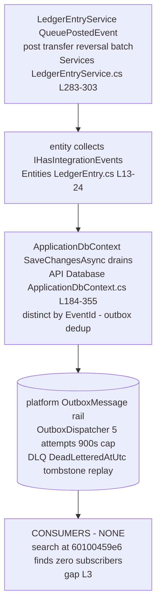

# Finance.Ledgers — event inventory

> Module `GameGuild.Finance.Ledgers` · Documented against `develop` commit `60100459e6`.
> Citation shorthand: `Ledgers:` = `apps/api/Source/Modules/GameGuild.Finance.Ledgers/`, `Contracts:` = `apps/api/Source/Modules/GameGuild.Finance.Contracts/`, `API:` = `apps/api/Source/GameGuild.API/`.

## 1. The one durable integration event — `finance.ledger-entry.posted.v1`

| Property | Value | Evidence |
|---|---|---|
| Record | `FinanceLedgerEntryPostedEventV1` | `Contracts:/FinanceIntegrationEvents.cs:31-42` |
| Event name / source | `finance.ledger-entry.posted.v1` / `Finance.Ledgers` | `:40-41` |
| Payload | ledgerId, entryId, referenceNumber, currencyCode, amount, entryType, transactionDate — all `[NonPersonalEventData]` | `:32-38` |
| Correlation | operation context correlation/causation ids when available, else fresh correlation | `Services/LedgerEntryService.cs:299-301` |
| Emitters | `PostEntryAsync`, `PostTransferAsync` (×2 legs), `ReverseEntryAsync` (+pair), `PostBatchAsync` (dormant) | `:72, 121-122, 143, 157, 254` |
| Validator | `DurableIntegrationEventValidator` on drain | `API:/Database/ApplicationDbContext.cs:196` |
| Contract linkage | expected event of `PostEntry`/`PostTransfer`/`ReverseEntry` use-case contracts | `Ledgers:/Architecture/UseCaseEventContracts.g.cs:4-6` |
| Consumers | **none** — no handler, worker, or subscription exists for the event name | gap L3 |

Retry/DLQ posture: the platform rail gives bounded retries + dead-letter + replay (`API:/Core/Eventing/OutboxDispatcher.cs`) — the best posture in the money family — but with zero consumers the guarantees are unexercised.

## 2. Domain events — declared-dead (12 records, zero constructions)

`Events/LedgerDomainEvents.cs` declares a rich in-module event model; **none is ever constructed anywhere** (verified by search at `60100459e6` — no `new`/`with` expression on any of them outside the file itself):

| Record | Lines | Would document |
|---|---|---|
| `LedgerCreatedEvent` | `:20-28` | root/child creation |
| `LedgerMovedEvent` | `:33-41` | subtree moves (D4 path) |
| `LedgerStatusChangedEvent` | `:46-52` | lifecycle (D3 path) |
| `LedgerArchivedEvent` | `:57-61` | archiving (D3/D6 path) |
| `LedgerStatsRefreshedEvent` | `:66-72` | cache refresh (D9/D10 path) |
| `EntryPostedEvent` | `:81-94` | entry posting (exists only as the durable V1 above) |
| `TransferCompletedEvent` | `:99-109` | transfers |
| `EntryReversedEvent` | `:114-122` | reversals |
| `EntryStatusChangedEvent` | `:127-134` | status changes (D8/D11 paths) |
| `VirtualLedgerCreatedEvent` / `VirtualLedgerFilterUpdatedEvent` / `VirtualLedgerDeletedEvent` | `:143-171` | virtual lifecycle (D1/D12/D13 paths) |

This is the G4 guard's exact shape (dead domain events, issue #1184) except these records are **not** `DurableIntegrationEvent`s and sit outside the guard's scanned set — hence absent from `apps/api/tests/GameGuild.API.UnitTests/Architecture/wiring-gap-baseline.txt` (G4 section lists Subscriptions/Features/Tenants/Learning only). Gap L5 proposes extending the guard.

## 3. Generic operation events

The 7 live commands carry `UseCaseEventContractAttribute` (`Ledgers:/Architecture/UseCaseEventContracts.g.cs:2-8`) → each execution emits the platform's generic durable operation event (the observable audit rail for ledger mutations). The 20 dead types have no contract — if any were ever wired without adding a contract, the guard pipeline would flag it at build time.

## 4. Audit logging (best-effort structured logs)

`LedgerEntryService.LogFinanceAudit` (`Services/LedgerEntryService.cs:305-323`) writes structured `Finance audit event {type}` log lines for every mutation (posted/transfer/reversed/updated/deleted/batch/reconciled) with `AuditEvent=true, AuditCategory=Finance`. These are **logs, not ledger evidence** — no hash chain, no tamper evidence (contrast Compliance.Audit's ECDSA chains and Economy's journal integrity increments). For a financial book of record this is the weakest audit rail in the money family (STRIDE 5.2).
