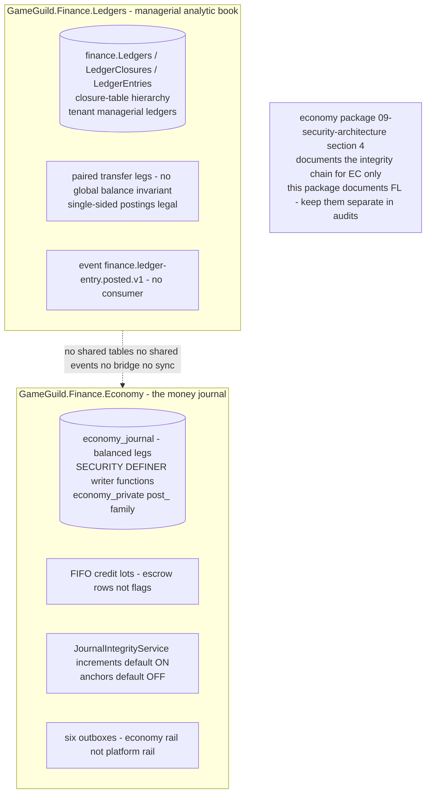

# Finance.Ledgers — cross-module sequences

> Module `GameGuild.Finance.Ledgers` · Documented against `develop` commit `60100459e6`.
> Citation shorthand: `Ledgers:` = `apps/api/Source/Modules/GameGuild.Finance.Ledgers/`, `Economy:` = `apps/api/Source/Modules/GameGuild.Finance.Economy/`, `API:` = `apps/api/Source/GameGuild.API/`.

## 1. Entry posting → platform outbox (the only outbound sequence that exists)

```mermaid
sequenceDiagram
    participant Actor as tenant actor LedgersWrite
    participant Ctrl as LedgerEntriesController
    participant H as PostEntryHandler
    participant S as LedgerEntryService
    participant E as LedgerEntry aggregate
    participant DB as ApplicationDbContext SaveChanges
    participant Out as OutboxDispatcher rail
    Actor->>Ctrl: POST ledgers id entries
    Ctrl->>H: PostEntryCommand actor-pinned
    H->>S: PostEntryAsync
    S->>E: Create + Post - status Posted
    S->>E: AddIntegrationEvent FinanceLedgerEntryPostedEventV1<br/>L283-303 correlation from operation context
    E-->>S: entry
    S->>DB: AddAsync
    DB->>DB: drain IHasIntegrationEvents - dedup by EventId<br/>API ApplicationDbContext.cs L184-355
    DB->>Out: OutboxMessage finance.ledger-entry.posted.v1
    Out-->>Out: 5 attempts 900s cap DLQ replay - NO CONSUMER L3
    S-->>Ctrl: 201 entry dto
```

Timeouts/failure verdicts: the event write is **transactional with the entry** (same `SaveChanges`) — an outbox failure rolls back the posting; there is no async leg to lose. The failure mode is the downstream silence (L3).

## 2. Reversal with transfer pair (double-sided undo)

```mermaid
sequenceDiagram
    participant Actor as tenant actor
    participant S as LedgerEntryService
    participant R as original entry
    participant P as pair entry
    participant Out as platform outbox
    Actor->>S: ReverseEntryAsync id reason
    S->>R: CreateReversal - opposite type Posted reversal<br/>original becomes Voided
    R-->>S: reversal row
    S->>Out: queue reversal posted event for original ledger
    alt R.TransferPairEntryId set L151-153
        S->>P: load pair - not Voided
        S->>P: CreateReversal same reason
        S->>Out: queue reversal posted event for pair ledger
    end
    S->>S: single SaveChanges - both legs or neither
```

## 3. The boundary contract with the Economy double-entry journal

Two ledger systems coexist under `GameGuild.Finance.*`; they are **disjoint by design and by implementation**:



The contract, stated once for future auditors:

| Question | Answer |
|---|---|
| Does Economy money movement post into `finance.LedgerEntries`? | **No** — no call site, no consumer of `finance.ledger-entry.posted.v1`, no shared transaction. |
| Does Finance.Ledgers move money? | **No** — it is an analytic/managerial book; nothing in it gates or triggers Economy writer functions. |
| Which one has double-entry integrity? | Economy (balanced-legs invariants inside writer functions). Finance.Ledgers balances are aggregations of posted entries; single-sided entries are legal (`01-user-flows.md` §2). |
| Reconciliation between them? | **None exists** — a managerial ledger can disagree with the money journal indefinitely with no detector (gap L6). |

## 4. What other modules would consume (nothing does)

| Potential consumer | Would want | Reality |
|---|---|---|
| Commerce.Payments `FinancialLedgerEntry` | Payments has its own `FinancialLedgerEntry` entity + dead EF config (`apps/api/tests/.../wiring-gap-baseline.txt:27`, issue #1184) — a *third* ledger concept inside Payments | no reference to `finance.Ledgers` anywhere in Payments |
| Compliance.Audit | finance audit events | only best-effort log lines (`04-event-inventory.md` §4) — not in any audit sink |
| Analytics / reporting | rollup reads | no caller outside the module's own controllers |

The module is a self-contained island: reads and writes exist only through its 24 routes, plus one outbound event nobody reads.
