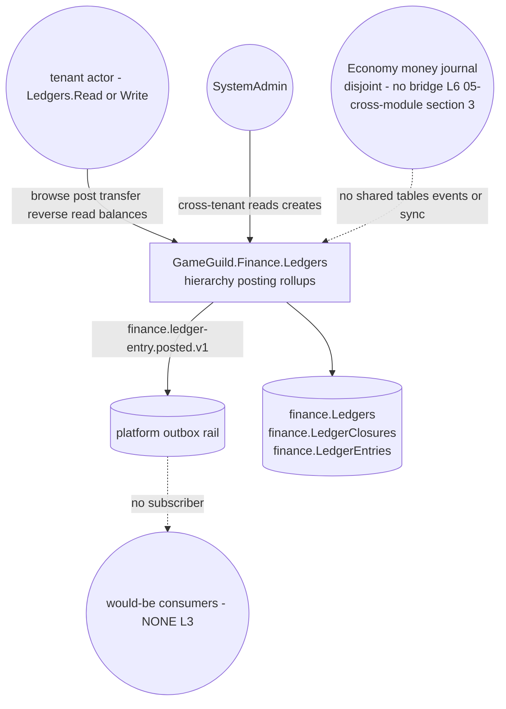
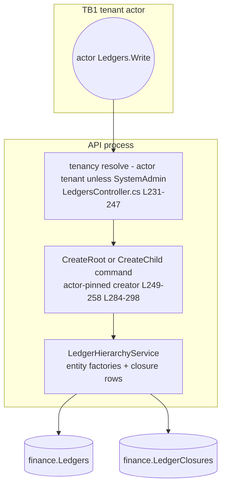
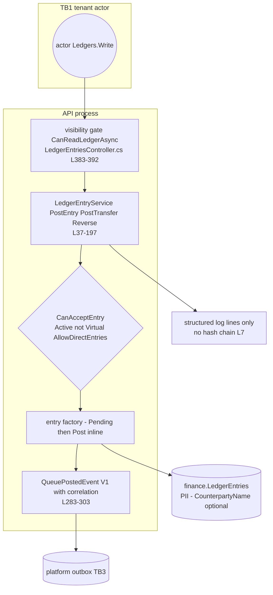
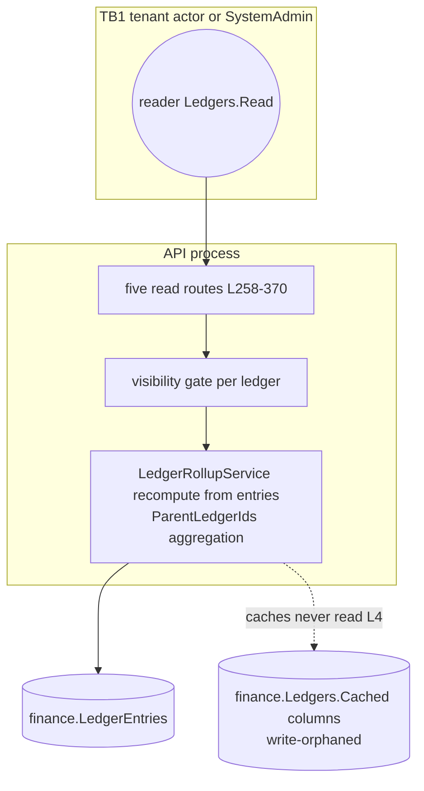
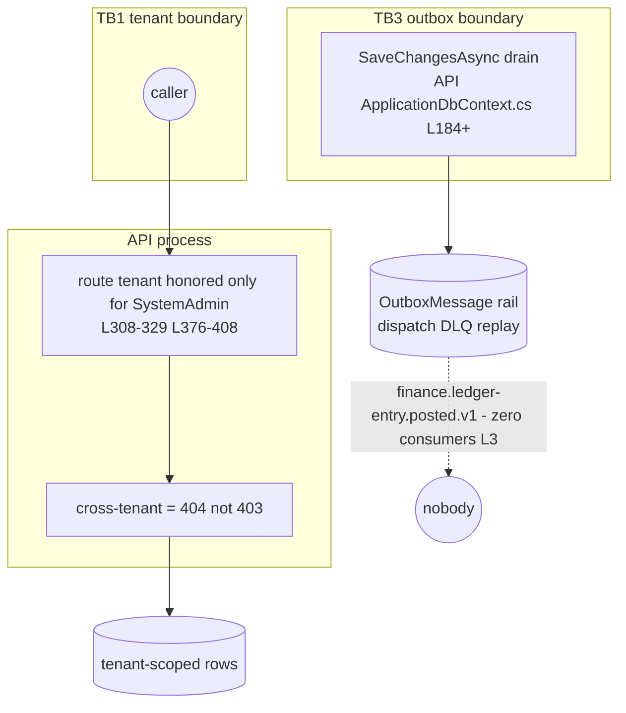

# Finance.Ledgers — data-flow diagrams

> Module `GameGuild.Finance.Ledgers` · Documented against `develop` commit `60100459e6`.
> PII note: the module stores no personal identifiers beyond actor/creator user ids; entries carry counterparty *names* (`CounterpartyName`, `Entities/LedgerEntry.cs:110-112`) — flagged below.

## Level 0 — context

Trust boundaries: TB1 authenticated tenant actor → API; TB1a SystemAdmin (tenant clamp bypass); TB2 API → finance schema (in-process EF); TB3 API → platform outbox (transactional write, external dispatch).

## F1 — Tree mutation (level 1)

Dormant legs: move (D4), status (D3), budget (D5), delete (D6) — commands exist, deepest implementations exist, no handler/route (`02-cqrs-wiring-matrix.md` §3).

## F2 — Entry posting / transfer / reversal (level 1)

PII: `CounterpartyName` (`Entities/LedgerEntry.cs:110`) is the only free-text counterparty field — crosses TB1 and is excluded from the event payload (`Contracts:/FinanceIntegrationEvents.cs:32-38`).

## F3 — Rollup reads (level 1)

## F4/F5 — Tenant scoping and egress (level 1)

## Boundary inventory

| Boundary | Crossers | Control |
|---|---|---|
| TB1 tenant actor → API | 24 routes | `[Authorize]` + `Ledgers.Read`/`Ledgers.Write`; actor-pinned identity fields; 404 tenant cloaking; no rate limiting |
| TB1a SystemAdmin | cross-tenant reads/creates | typed admin claim; unlogged reads (STRIDE 4.1) |
| TB2 API ↔ finance schema | 3 tables | in-process EF; unique keys for tenant/code, sequence, closure pairs; optimistic RowVersion on entities |
| TB3 API → platform outbox | one event type | transactional write, dedup by EventId, validator on drain; downstream consumers: none (L3) |
| TB-Economy (documentation boundary) | nothing | disjoint ledgers, no bridge, no reconciliation (L6) |
