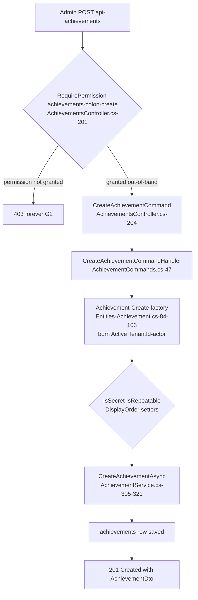
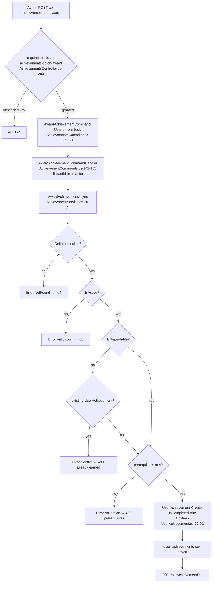
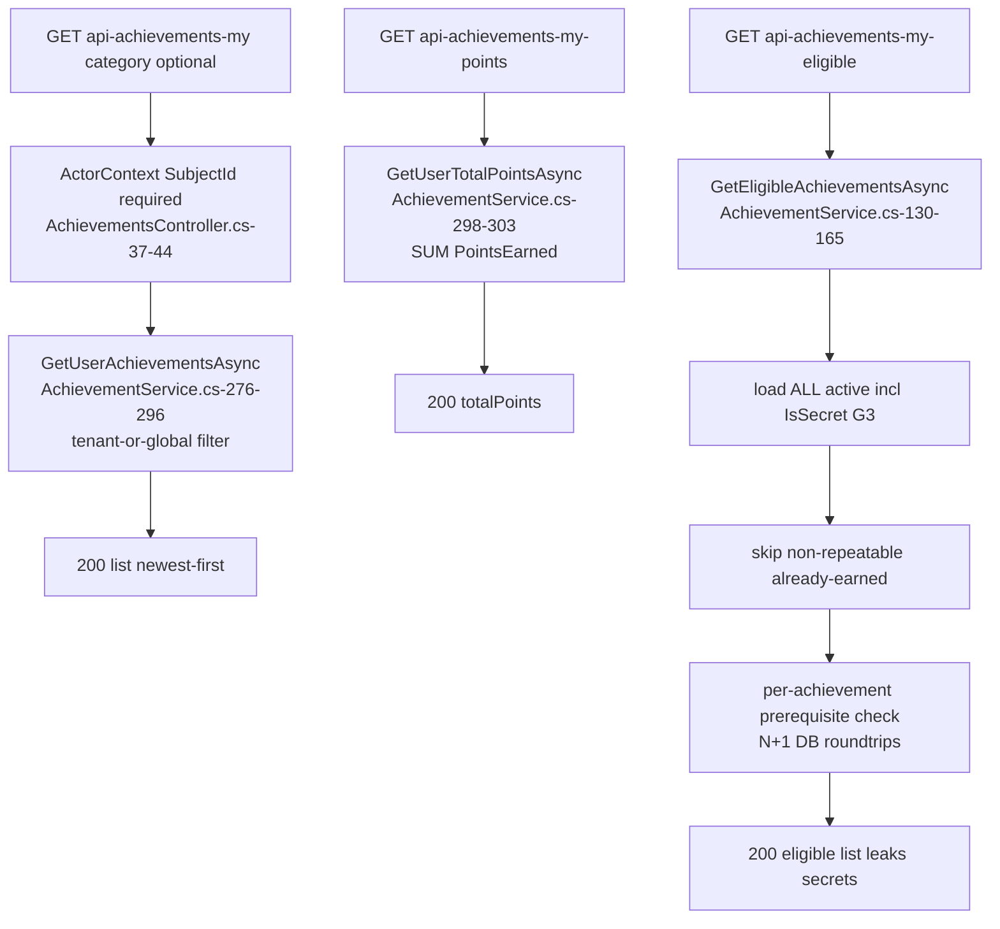
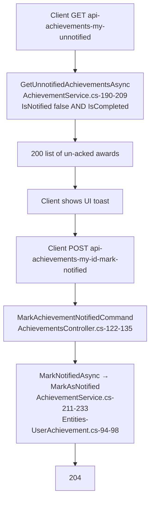
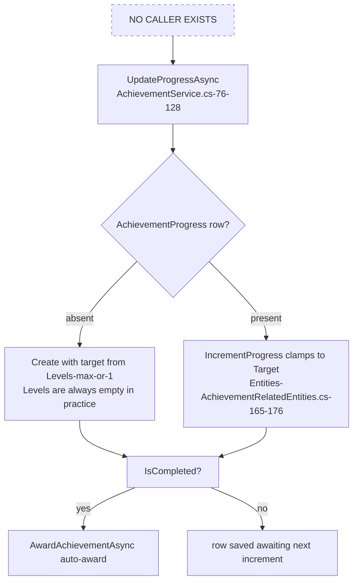

# Gamification.Achievements — User flows

> Module `GameGuild.Gamification.Achievements` · develop `ce31d5850c`. Shorthand `Ach:` = module root, `API:` = `apps/api/Source/GameGuild.API/`.
> Flow numbering F1-F4 matches 07-stride family numbering and 08-dfds L1 numbering.

## F1 — Admin defines an achievement (permission-gated; keys unseeded → currently 403)

Edge cases:

| Case | Behavior | Evidence |
|---|---|---|
| No validator on the request body | Name empty / Points negative pass to the factory; `Name` empty is stored as-is (factory does not require it) | `Ach:/Controllers/AchievementsController.cs:202-223` (no `[FromQuery]` validation, no FluentValidation in module) |
| Levels/prerequisites cannot be authored | The create handler sets scalars only; `AchievementLevel`/`AchievementPrerequisite` rows have **no creation path** | `Ach:/Commands/AchievementCommands.cs:52-77`; `Entities/Achievement.cs:78-81` collections remain empty |
| Update toggles lifecycle | `IsActive` false → `Deactivate()`, true → `Activate()`; `UpdatePoints` clamps to ≥0 | `Ach:/Commands/AchievementCommands.cs:100-115`; `Entities/Achievement.cs:106-122` |
| Delete cascades user history | `OnDelete(DeleteBehavior.Cascade)` removes all `user_achievements` rows for the definition | `Ach:/Configuration/AchievementEntityConfiguration.cs:45-48` |
| Failure mode | Any service exception → 500 with raw error; `NotFound` → 404 | `AchievementsController.cs:216-219, 247-254` |

## F2 — Admin awards an achievement to a user (manual award; the only live grant path)

Edge cases:

| Case | Behavior | Evidence |
|---|---|---|
| Target user taken from body, not actor | Any user id can be awarded by whoever holds the permission | `Ach:/Controllers/AchievementsController.cs:285` (`request.UserId`) |
| Duplicate-award race | Check-then-insert without transaction/unique index; the `(UserId, AchievementId)` index is explicitly non-unique — concurrent requests can double-award a non-repeatable | `Ach:/Services/AchievementService.cs:40-49`; `Entities/UserAchievement.cs:17` |
| Prerequisite semantics | `RequiresCompletion` demands `ua.IsCompleted`; `MinimumLevel` compares `ua.Level` (always 0 in practice — levels unreachable) | `Ach:/Services/AchievementService.cs:365-387` |
| Tenant cross-scope | Award uses the **actor's** tenant, not the target user's; a global (`TenantId == null`) definition is awardable from any tenant | `AchievementCommands.cs:150-154`; `AchievementService.cs:58` |
| No notification emitted | Nothing creates a Notification row or domain event on award | `AchievementService.cs:58-67` (only a log line) |

## F3 — User reads earned / eligible / points

Edge cases:

| Case | Behavior | Evidence |
|---|---|---|
| Anonymous catalog | `GET /` and `GET /{id}` are `[AllowAnonymous]`; secrets excluded from list (`includeSecrets:false`) but **not** from by-id | `AchievementsController.cs:163-178, 183-195`; `AchievementService.cs:243-274` vs `:235-241` |
| Eligibility includes secret definitions | No `IsSecret` filter in the eligible query — names/descriptions of secrets disclosed to any authenticated user | `Ach:/Services/AchievementService.cs:134-137` |
| By-id has no tenant filter | Any tenant's definition is readable by id (definitions are near-global anyway; tenant field is advisory) | `AchievementService.cs:235-241` |
| Points recompute per call | No cached total; sum over user_achievements each request | `AchievementService.cs:298-303` |
| Eligibility N+1 | `CheckPrerequisitesInternalAsync` per candidate loads the user's full award list each time | `AchievementService.cs:146-156, 370-372` |

## F4 — The unnotified handshake (client polls; server marks)

Edge cases:

| Case | Behavior | Evidence |
|---|---|---|
| No ownership check on mark-notified | The command takes the `userAchievementId` route value only — **any authenticated user can ack anyone's award** (id must be guessed; not checked against actor) | `Ach:/Controllers/AchievementsController.cs:122-135`; `Commands/AchievementCommands.cs:40-45` |
| No delivery mechanism | Polling is the only transport; no Notification row, no push, no event | grep `NotificationType.AchievementUnlocked` — zero producers |
| Repeat ack | `MarkAsNotified` is idempotent (`IsNotified = true` again) | `Entities/UserAchievement.cs:94-98` |
| Route prefix mismatch | `my/{userAchievementId}/mark-notified` mutates a UserAchievement, not an Achievement — the id namespace is user_awards, documented as such | `AchievementsController.cs:122` |

## F5 — Incremental progress toward an achievement (DESIGNED — unreachable, G1)

Edge cases:

| Case | Behavior | Evidence |
|---|---|---|
| Zero construction sites | `AchievementProgress.Create` is called only inside `UpdateProgressAsync`; no handler/route/worker invokes the service method | grep over `Source/` — only `Ach:/Services/AchievementService.cs:102` |
| Target always 1 without levels | `Levels.Any()` is false for every API-created achievement → target defaults to 1 → a single increment would complete | `AchievementService.cs:98-100` |
| Levels unreachable anyway | No route or handler creates `AchievementLevel` rows | see F1 edge table |
