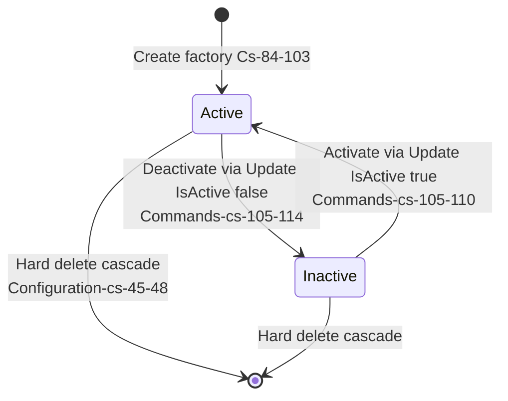
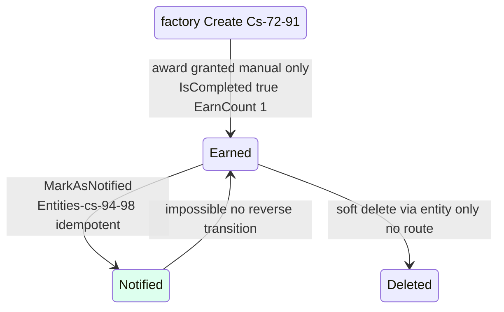
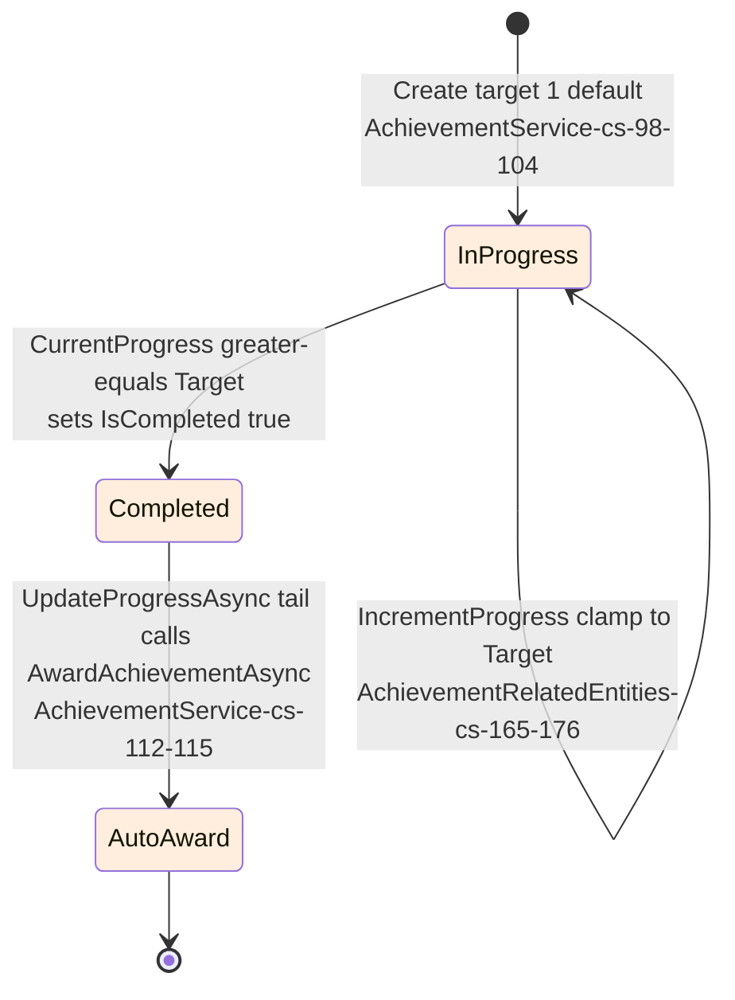

# Gamification.Achievements — State machines

> Module `GameGuild.Gamification.Achievements` · develop `ce31d5850c`. Shorthand `Ach:` = module root.
> All diagrams `stateDiagram-v2`; unreachable states and missing guards are annotated inline.

## 1. Achievement definition lifecycle

The definition lifecycle is a **boolean flag, not a state machine** — there is no Draft; every definition is born `Active` (`Ach:/Entities/Achievement.cs:101`).

| Guard | Status |
|---|---|
| Transition guard | none needed (boolean toggle, `Entities/Achievement.cs:106-116`) |
| Deactivate side effects | **none** — existing awards keep their points; inactive definitions merely refuse new awards (`AchievementService.cs:34-37`) |
| Delete guard | **none** — deleting a definition cascades away every `user_achievements` row for it (history destroyed); contrast Ledger soft-delete guard |

## 2. Award lifecycle (`UserAchievement`)

Edge cases and honesty notes:

| Case | Behavior | Evidence |
|---|---|---|
| Repeat awards create **sibling rows**, not a state transition | for `IsRepeatable` definitions each award inserts a new `UserAchievement` (`AchievementService.cs:58`); `IncrementEarnCount` (`Entities/UserAchievement.cs:110-114`) is never called — EarnCount is stuck at 1 on every row | write-orphaned (02 §3 S5) |
| `IsCompleted` is born true | the only creation factory sets it; the `Progress`-based completion path (`IncrementProgress :100-108`) belongs to the dead progress pipeline | `Entities/UserAchievement.cs:85` |
| No revoke/un-award transition exists | once granted, an award is only removable by deleting the definition (cascade) or direct DB edit | module grep — no method |
| Notified is a client-acked flag, not delivery | see 04/05 — no transport exists | |

## 3. Progress lifecycle (`AchievementProgress`) — designed, unreachable

> **Entire machine unreachable** (G1): `UpdateProgressAsync` has no caller. Rows cannot be created through any route, handler, worker, or event. Shaded states document the designed behavior only.

## 4. Prerequisite satisfaction (virtual state per definition × user)

Not a persisted machine — evaluated on demand in `CheckPrerequisitesInternalAsync` (`Ach:/Services/AchievementService.cs:365-387`):

- `RequiresCompletion=true` requires an award row with `IsCompleted` (always true in practice);
- `MinimumLevel` compares `UserAchievement.Level` — **always null→0** because levels are uncreatable (02 §3 S2), so any `MinimumLevel > 0` prerequisite is unsatisfiable → the gated achievement becomes permanently unearnable. Guard-interaction bug of the dead surface: harmless today only because nothing can create prerequisite rows either.

## 5. Notification-honesty invariant (the `IsNotified` contract)

| Invariant | Truth |
|---|---|
| "Notified" means "the platform delivered an award notice" | **false** — it means "some client acked this row via `my/{id}/mark-notified`" (`Ach:/Controllers/AchievementsController.cs:122-135`); no server-side delivery exists (04 §3) |
| The ack is actor-scoped | **false** — the command carries no user comparison; any authenticated caller can ack any award id (07 §4.3, gap G5) |
