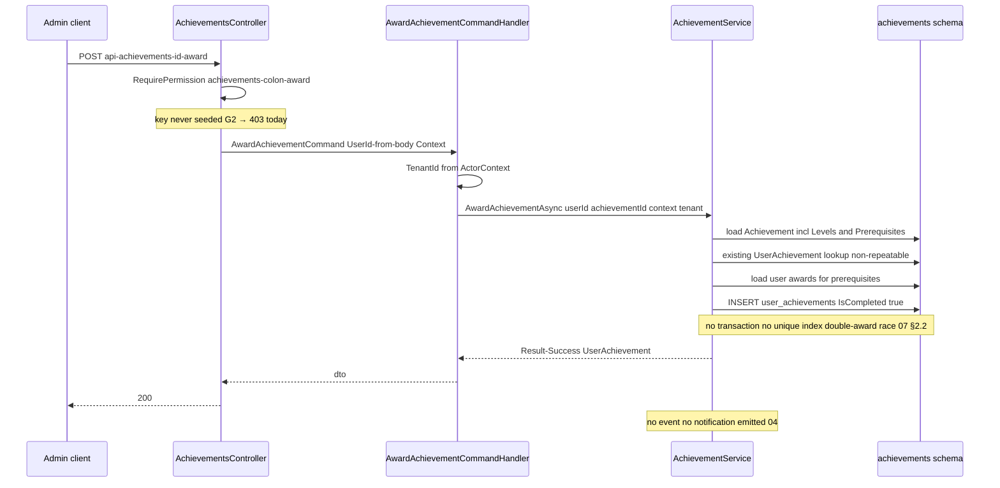
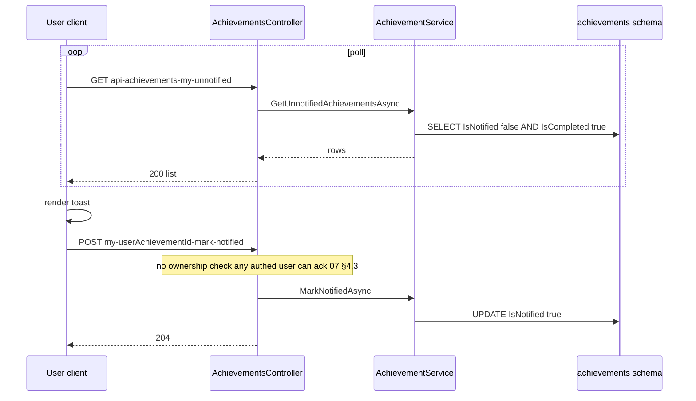
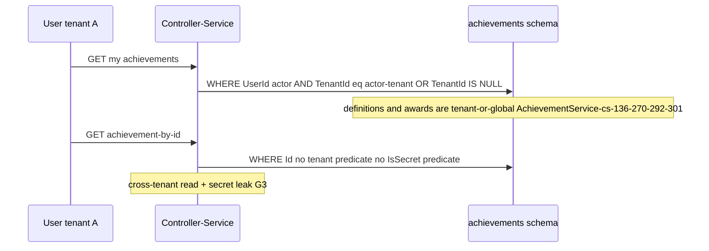

# Gamification.Achievements — Cross-module sequences

> Module `GameGuild.Gamification.Achievements` · develop `ce31d5850c`. Shorthand `Ach:`, `Notif:` = `apps/api/Source/Modules/GameGuild.Notifications/`.

## 1. Manual award — the only live end-to-end path

## 2. The client-polled notify loop (what "notification" means here)

Contrast with every other consumer of Notifications: Identity/Billing/Learning producers call `INotificationService.SendAsync` which persists a Notification row and lets the dispatchers deliver it (see docs/notifications/05). Achievements has **no such call site** — the bridge is the client itself.

## 3. The missing bridge, both directions

| Direction | Designed carrier | Reality |
|---|---|---|
| Achievements → Notifications (award notice) | `AchievementEarnedEvent` → hypothetical subscriber → `SendAsync(AchievementUnlocked)` | event never constructed (04 §1); `NotificationType.AchievementUnlocked` has zero producers — the preference toggle for the Achievements category guards nothing |
| Any module → Achievements (progress tick) | module would call `IAchievementService.UpdateProgressAsync` after e.g. post-created / course-completed | zero callers (G1); Posts' `PostCreatedEvent` family is itself dead (social-platform N2) — a dead emitter pointing at a dead receiver |

## 4. Tenant boundary contract

- Definitions created via API carry the creating actor's tenant (`Ach:/Commands/AchievementCommands.cs:60`); nothing stops a global definition being awarded in any tenant (award tenant = actor's).
- There is no per-tenant achievement catalog separation: the catalog route (`[AllowAnonymous]`, `AchievementsController.cs:163-178`) ignores tenant entirely.
