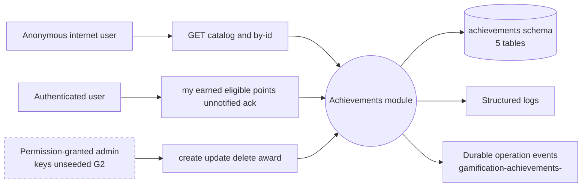
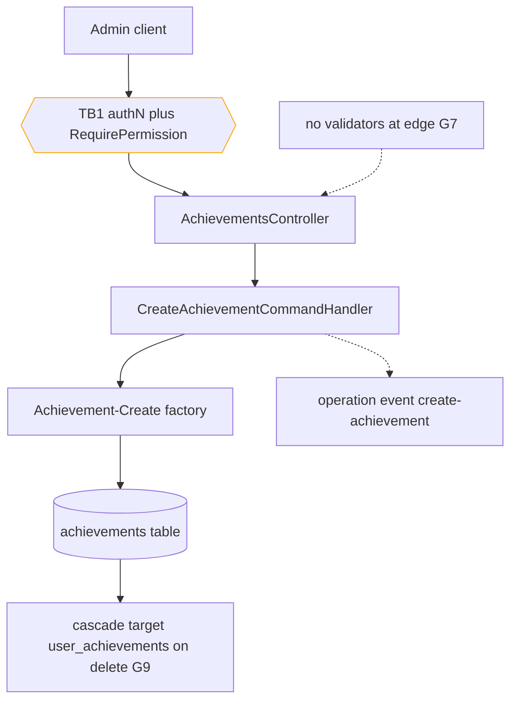
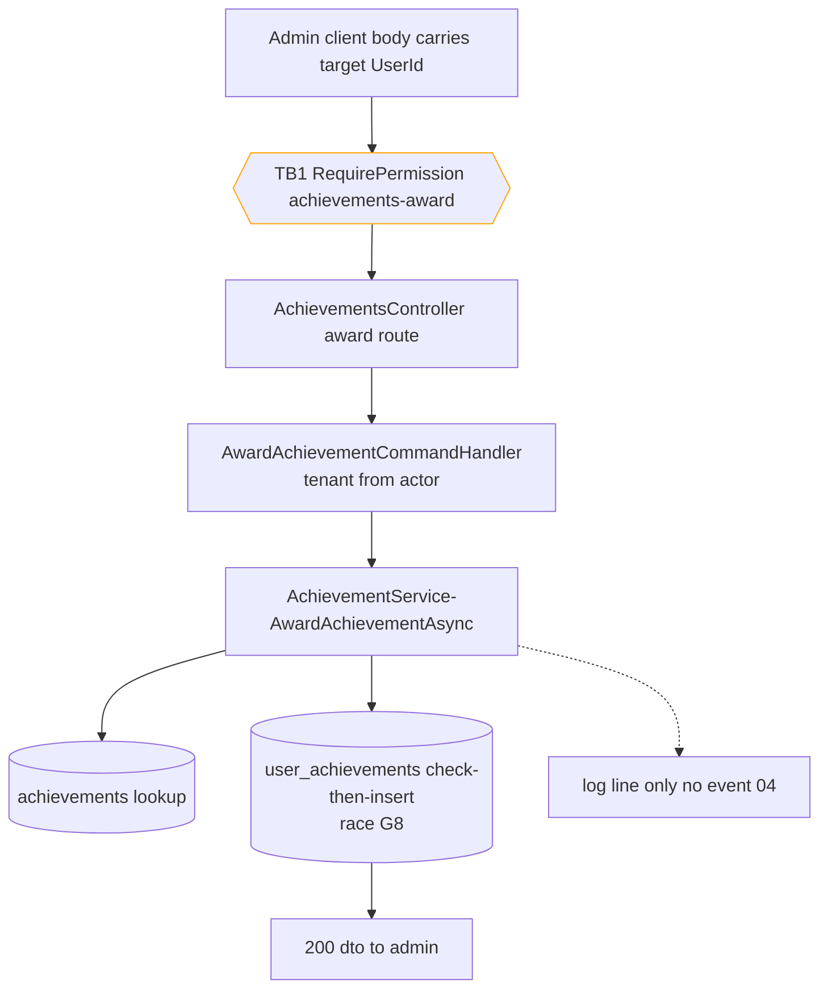
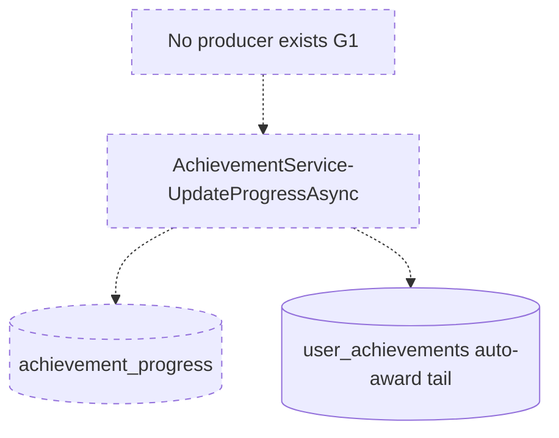

# Gamification.Achievements — Data-flow diagrams

> Module `GameGuild.Gamification.Achievements` · develop `ce31d5850c`. L0 context + L1 per flow family (numbering matches 01/07).

## L0 — Context



Trust boundaries crossed: TB1 internet→API (authN via Identity), TB2 API→DB (EF Core), TB3 API→operation-event rail (platform outbox infra).

## L1-F1 — Definition CRUD



## L1-F2 — Manual award



## L1-F3 — User reads

```mermaid
flowchart TD
    U1[Authenticated user] --> TB1{{TB1 [Authorize]}}
    U2[Anonymous] --> TB1
    TB1 --> C[AchievementsController reads]
    C --> D[AchievementService queries]
    D --> E[(achievements incl IsSecret leak paths G3)]
    D --> F[(user_achievements scoped by actor)]
    D --> G[200 responses with secret names on two paths]
    style TB1 stroke:orange
```

## L1-F4 — Unnotified handshake

```mermaid
flowchart TD
    A[User client] --> TB1{{TB1 [Authorize] no ownership check G5}}
    TB1 --> B[GET my-unnotified]
    B --> C[(user_achievements IsNotified false)]
    C --> D[200 list]
    A --> E[POST my-id-mark-notified]
    E --> F[MarkAchievementNotifiedCommand]
    F --> G[(UPDATE IsNotified true any id)]
    G -.-> H[no transport exists client ack only]
    style TB1 stroke:orange
```

## L1-F5 — Dead progress pipeline (context only)



## Data stores summary

| Store | Table | Written by | Read by |
|---|---|---|---|
| definitions | `achievements` | create/update/delete handlers | all reads, award |
| awards | `user_achievements` | award handler, mark-notified | my/points/unnotified, prerequisite checks |
| tiers | `achievement_levels` | **nothing** (S2) | progress target derivation (dead) |
| prereqs | `achievement_prerequisites` | **nothing** (S3) | award/eligible checks |
| progress | `achievement_progress` | **nothing** (S1) | nothing |
