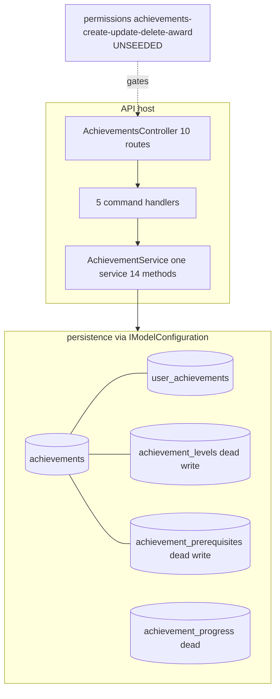

# Gamification.Achievements — Security architecture

> Module `GameGuild.Gamification.Achievements` · develop `ce31d5850c`.

## 1. Component view

- One controller, one service — no repository layer (service queries `IApplicationDbContext` directly), no validators, no workers, no event subscribers.
- Handlers exist for every command (02 §2) — the Ledger-class dead-request problem does not repeat; deadness here lives in the service/entity layer (02 §3).

## 2. Permission map

| Surface | Gate | Resolved by | Seeded? | Effective behavior |
|---|---|---|---|---|
| `my`, `my/points`, `my/unnotified`, `eligible`, `mark-notified` | `[Authorize]` | JWT + ActorContext | n/a | any authenticated user |
| catalog list, by-id | `[AllowAnonymous]` | none | n/a | internet-readable (secrets excluded on list only) |
| create / update / delete / award | `RequirePermission("achievements:…")` | tenant permission engine (`ResourcePermissionAuthorizationFilter.cs:527-536`) | **no** | 403 for everyone (fail-closed) until keys are defined, seeded, and granted |

Tenant scoping: reads filter `TenantId == actor OR NULL` (global definitions shared); by-id ignores tenant; award stamps the actor's tenant on the award row. There is no tenant-isolation invariant on definitions — treat the catalog as platform-global.

## 3. Integrity properties — and non-properties

**Properties held:**

1. Awards reference existing, active definitions (award re-loads and checks `IsActive` — `AchievementService.cs:28-37`).
2. Non-repeatables refuse a second award in the single-threaded path (`:40-49`).
3. Award points derive from the definition at award time; later definition edits do not rewrite past awards (`PointsEarned` snapshotted on the row).
4. `IsNotified` only ever moves false→true (`Entities/UserAchievement.cs:94-98`).

**Non-properties (documented so nobody assumes them):**

1. **No award idempotency/uniqueness** — concurrent duplicates possible (G8).
2. **No balanced-points ledger** — points are a denormalized SUM with no double-entry counterpart (contrast Finance.Ledgers/Economy journal); there is nothing to reconcile against.
3. **No award provenance** — the row stores caller-supplied `Context` free text, not the awarding principal; the durable operation event of the award command is the only durable who-did-what.
4. **No definition immutability** — points/metadata of a live definition can be rewritten; historical awards keep old points, future awards use new (silent re-pricing).
5. **No delivery guarantee for "notification"** — `IsNotified` is a client ack, not platform delivery (03 §5).

## 4. Fail verdicts (from 07)

| Family | Verdict | Blocking gap |
|---|---|---|
| F1 definition CRUD | fail-closed (dead) | G2 unseeded keys |
| F2 manual award | fail (integrity, once reachable) | G8 race; award provenance |
| F3 user reads | **fail** (disclosure) | G3 secret leaks |
| F4 handshake | **fail** (spoofed ack) | G5 ownership |
| F5 persistence | fail (destructive delete) | G9 cascade |

## 5. Deployment invariants

1. Migration `20261102105545_AddLedgersRatingsAndAchievementsTables` must be applied before enabling the module (tables are new in #1169); the `AchievementsModelConfiguration` bridge (`AchievementEntityConfiguration.cs:139-149`) must remain referenced by the host assembly scan.
2. `AddAchievementsModule` must stay in `ApiProductComposition` (`:193`) and the module in `EnabledModules` (`:81`) — removing either re-creates the #1158 dead-module state silently (services unresolved → 500s), though the TableMaterializationGuard baseline now catches the table half.
3. If `achievements:*` permissions are seeded later, seed **all four** and grant narrowly (award is the trust-sensitive one — it mints user-facing recognition).
4. Do not couple `GetUserTotalPointsAsync` output to any economy value without re-running STRIDE family 2 (07) — points integrity is informational-grade today.
5. Keep the module out of any data-minimization critical path: `Context` jsonb is unvalidated caller text persisted verbatim (`Notification`-style metadata protection does not exist here).
