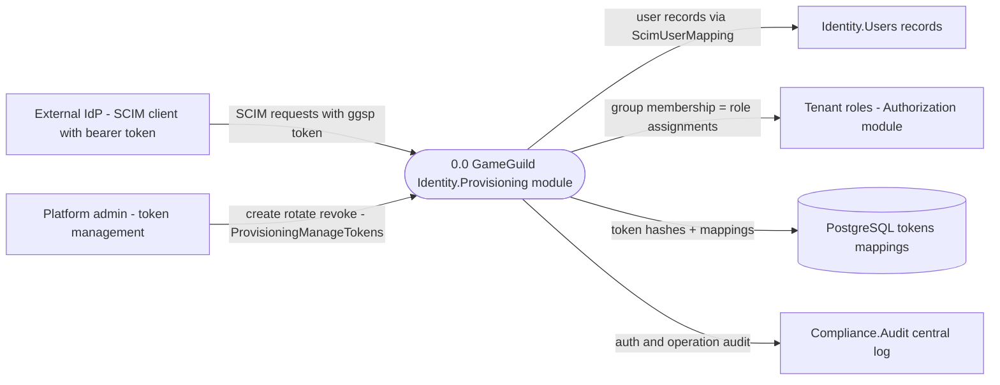
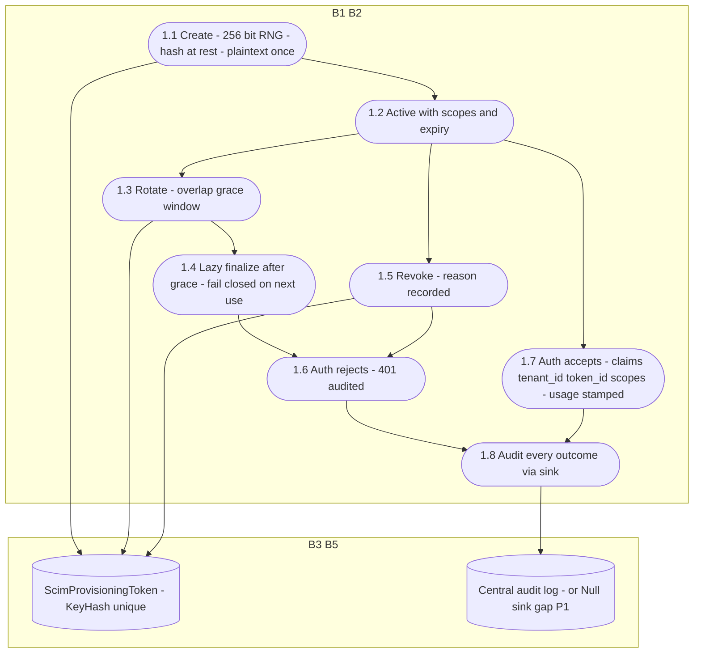
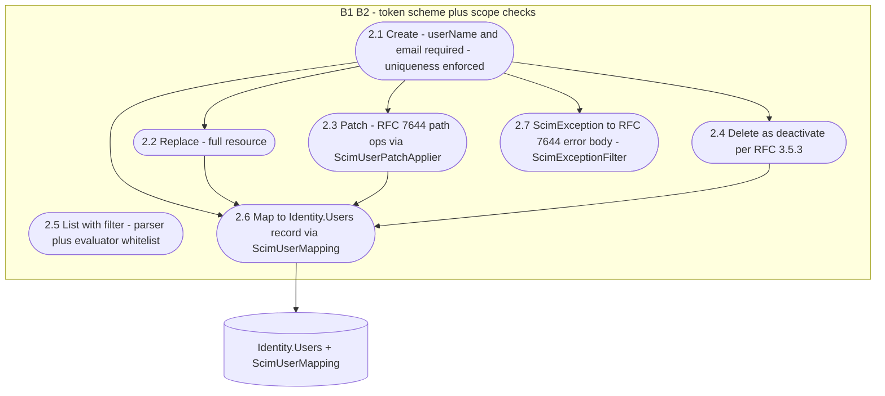
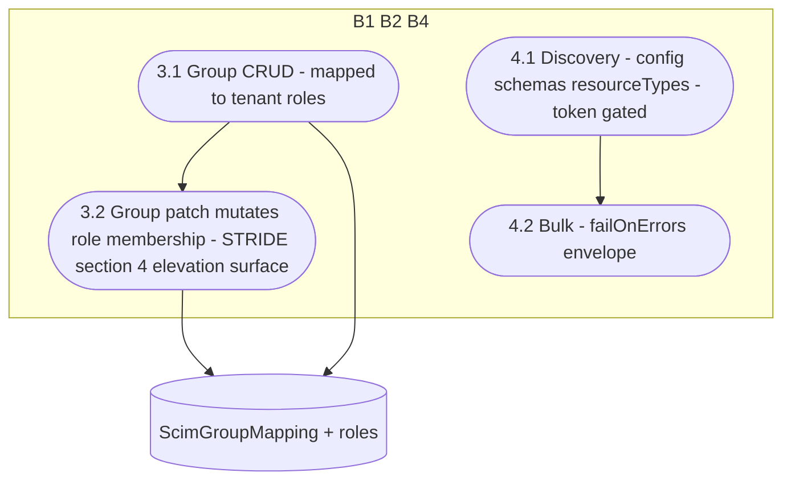

# Identity.Provisioning Data Flow Diagrams

> `develop` 7ae5a28a65 · Level-0 + level-1 per family. Notation per `docs/security/auth-dfds.md` §1. Paths relative to `apps/api/Source/Modules/GameGuild.Identity.Provisioning/` unless stated.

## 1. Level 0 — context

Boundaries: B1 IdP→API (TLS + bearer); B2 token→tenant scope; B3 SCIM→Users; B4 SCIM→roles; B5 module→audit.

## 2. Level 1 — F1 tokens

## 3. Level 1 — F2 SCIM users

## 4. Level 1 — F3 SCIM groups and F4 discovery/bulk

## 5. Coverage matrix

| Family | DFD | Highest-risk flow | STRIDE |
|---|---|---|---|
| F1 tokens | §2 | 1.8 Null-sink audit loss (P1) | §2 |
| F2 users | §3 | 2.6 external writes to user records | §3 |
| F3 groups | §4 | 3.2 role-membership writes by token (P6) | §4 |
| F4 discovery/bulk | §4 | 4.2 partial-failure envelopes | §5 |
