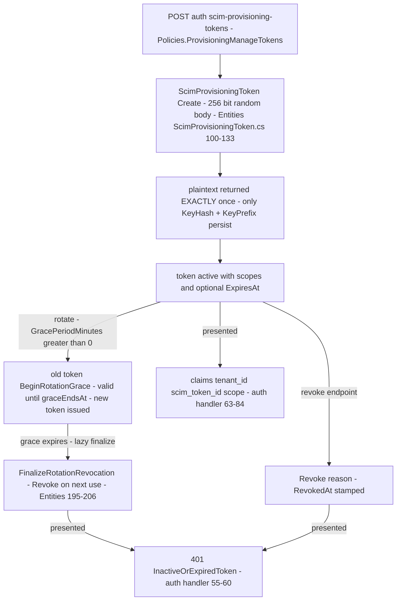

# Provisioning Token Lifecycle Flow — create, rotate with grace, revoke, per-request authentication

> Family F1 of `GameGuild.Identity.Provisioning` · `develop` 7ae5a28a65. Paths relative to `apps/api/Source/Modules/GameGuild.Identity.Provisioning/` unless stated.

## 1. The flow

## 2. Per-request authentication

`ScimProvisioningAuthenticationHandler` (custom scheme, `ScimProvisioningAuthenticationOptions.SchemeName`):

| Step | Behavior | Evidence |
|---|---|---|
| prefix check | non-`ggsp_`-shaped tokens return `NoResult` (left to other schemes, fail-closed later) | `Authentication/ScimProvisioningAuthenticationHandler.cs:40-44` |
| lookup | SHA-256 hash lookup via `GetByKeyHashAsync` | `:49` |
| unknown token | `401 InvalidToken` + audit | `:51-55` |
| validity | `IsValid()` checks IsActive, expiry, rotation-grace; **lazily finalizes** an expired-grace token's revocation on use | `:56-60`; `Entities/ScimProvisioningToken.cs:142-158` |
| usage stamp | `RecordUsageAsync` per successful auth | `:62` |
| claims | `tenant_id`, `scim_token_id`, `auth_method`, `sub`, one `scope` claim per granted scope | `:64-80` |
| audit | success and every failure reason recorded through the sink | `:85,102-110` |
| error | exceptions → `401 AuthenticationError` (fail-closed, audited) | `:96-99` |

## 3. Edge matrix

| Edge | Guard | Result | Evidence |
|---|---|---|---|
| create with empty name | `ArgumentException.ThrowIfNullOrWhiteSpace` | 500/400 | `Entities/ScimProvisioningToken.cs:105` |
| rotate with `GracePeriodMinutes <= 0` | grace only applied when `minutes > 0` — immediate cutover | old token dies at once | `Commands/ScimProvisioningTokenCommands.cs:205-206` |
| use a grace-expired token (first time after expiry) | fail + lazy finalize revocation persisted | 401, then permanently revoked | `Authentication/…Handler.cs:56-60`; `Entities/…Token.cs:195-206` |
| expired-but-unrevoked token | `IsValid` fails closed on `ExpiresAt` | 401 | `Entities/…Token.cs:150-152` |
| token-admin by non-holder | `Policies.ProvisioningManageTokens` per action | 403 | `Controllers/ScimProvisioningTokensAdminController.cs:22,35,46,64` |
| token replay after revoke | unique KeyHash lookup + RevokedAt check | 401 audited | `Entities/…Token.cs:142-148` |
| duplicate token hash collision | unique index on KeyHash | DB rejection (practically impossible: 256-bit) | `:15` |

## 4. Token-admin endpoints

| Route | Request | Notes |
|---|---|---|
| POST `v{v}/auth/scim-provisioning-tokens` | `CreateScimProvisioningTokenCommand` | returns plaintext once + metadata |
| GET `v{v}/auth/scim-provisioning-tokens` | list (no hashes exposed) | admin read |
| POST `…/{tokenId}:rotate` | `RotateScimProvisioningTokenCommand(GracePeriodMinutes)` | overlap window |
| POST `…/{tokenId}:revoke` | `RevokeScimProvisioningTokenCommand` | immediate |
