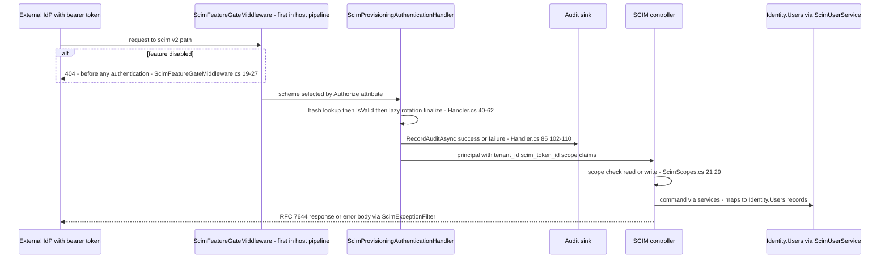
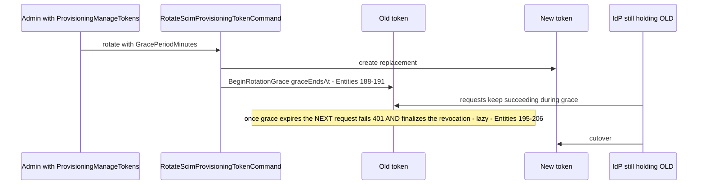
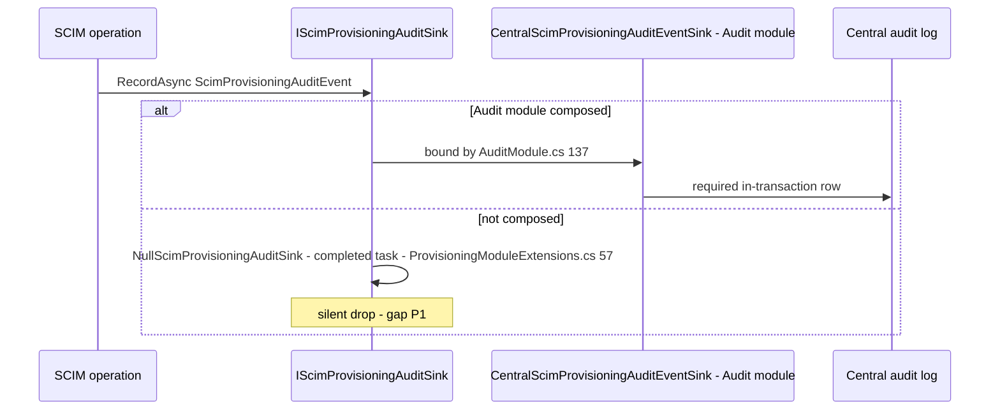

# Identity.Provisioning — Sequences (lite)

> `develop` 7ae5a28a65 · Cross-module sequences only. Paths relative to `apps/api/Source/Modules/GameGuild.Identity.Provisioning/` unless stated.

## 1. IdP request → gate → token auth → SCIM controller

Verdicts: feature gate **fail-closed (404)**; auth **fail-closed (401)**; scope **fail-closed (403)**; audit best-effort only in the Null-sink misconfiguration (gap P1).

## 2. Token rotation overlap (zero-downtime IdP cutover)

## 3. SCIM write → central audit fan-out

