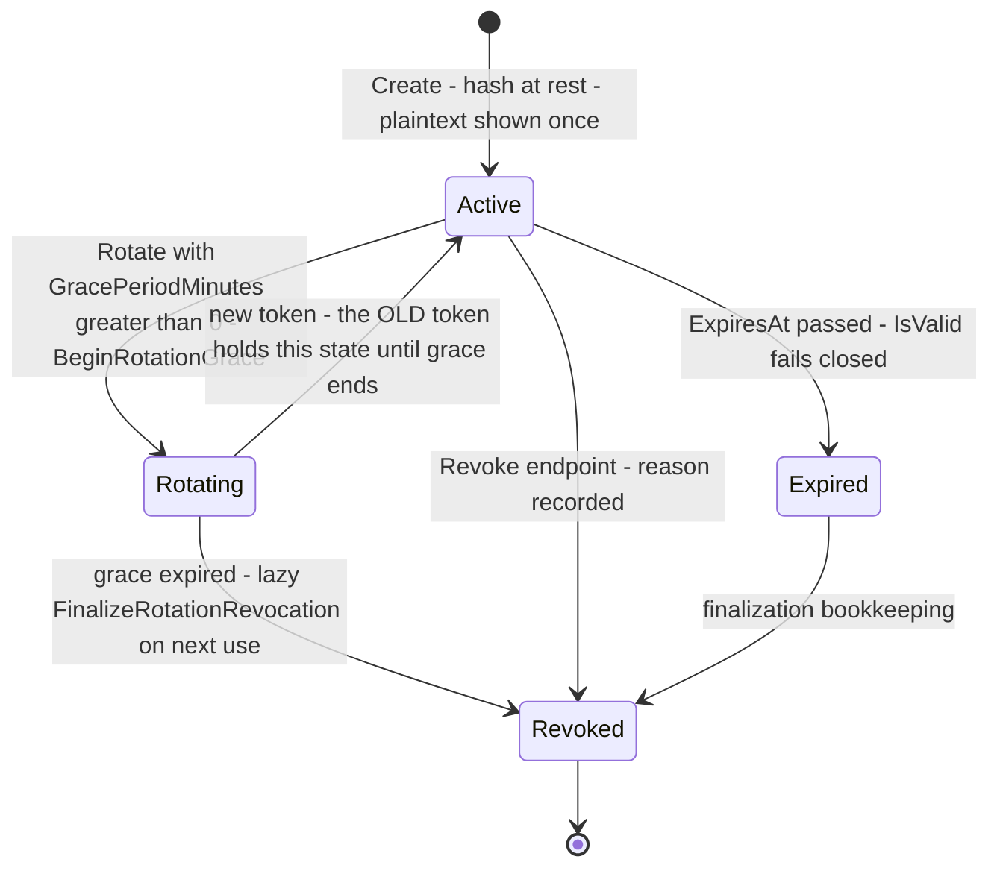
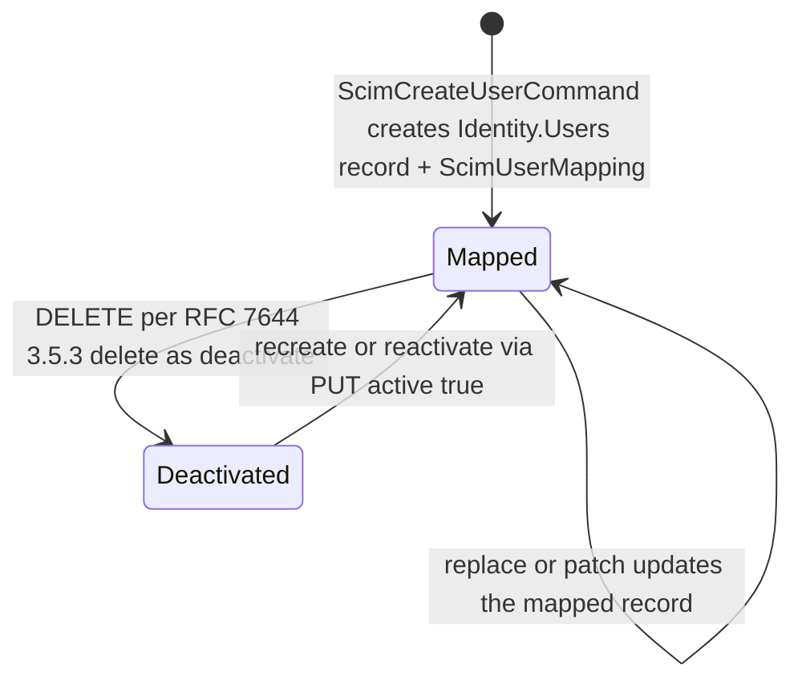

# Identity.Provisioning State Machines

> `develop` 7ae5a28a65 · Mermaid `stateDiagram-v2`, no parentheses or colons in labels. Paths relative to `apps/api/Source/Modules/GameGuild.Identity.Provisioning/`.

## 1. ScimProvisioningToken lifecycle

Transitions audit (`Entities/ScimProvisioningToken.cs`):

| Transition | Guard | Evidence |
|---|---|---|
| → Rotating | rotation command; grace only when `minutes > 0` | `Commands/ScimProvisioningTokenCommands.cs:205-206`; `Entities/…Token.cs:188-191` |
| Rotating → Revoked (lazy) | `IsRotationGraceExpired` + not already revoked/inactive | `:195-206` — `FinalizeRotationRevocationAsync` called from the auth handler (`Authentication/…Handler.cs:56-60`) |
| any → rejected at auth | `IsValid` = not RevokedAt ∧ not expired ∧ not grace-expired ∧ IsActive | `:142-158` |
| → Revoked (direct) | `Revoke(reason)` stamps `RevokedAt` | `:176-180` |

## 2. SCIM user mapping states (RFC 7644 resource lifecycle)

No hard-unmap state exists — once mapped, the `ScimUserMapping` row persists (mapping stability for IdP round-trips).

## 3. Group (=role) mapping

Not a state machine: `ScimGroupMapping` rows tie SCIM group ids to `roleId`s; patch operations mutate role membership additively/removably. Role lifecycle itself belongs to `GameGuild.Identity.Authorization` (`docs/authorization/flows/roles-lifecycle-flow.md`).
