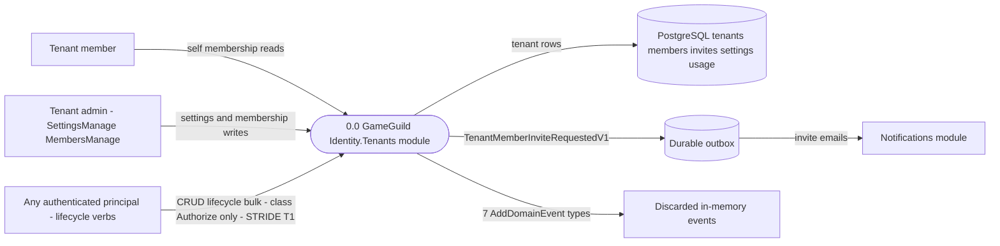
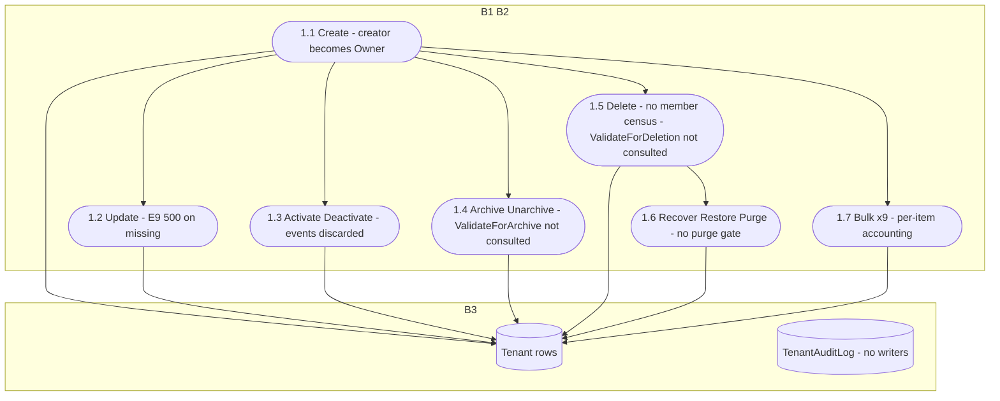
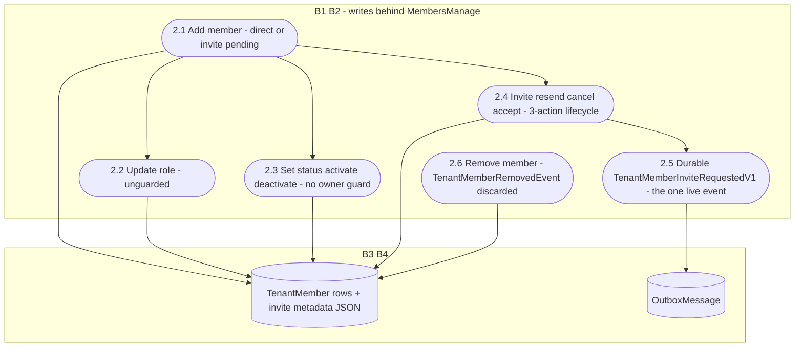

# Identity.Tenants Data Flow Diagrams

> `develop` 7ae5a28a65 · Level-0 + level-1 per family. Notation per `docs/security/auth-dfds.md` §1. Paths relative to `apps/api/Source/Modules/GameGuild.Identity.Tenants/` unless stated.

## 1. Level 0 — context



Boundaries: B1 client→API; B2 any-tenant→tenant-data (the takeover surface); B3 module→PostgreSQL; B4 outbox→Notifications.

## 2. Level 1 — F1 lifecycle



## 3. Level 1 — F2 memberships and invites



## 4. Level 1 — F3 tenant resolution

```mermaid
flowchart TD
    subgraph MW["B1 middleware - before authorization"]
        R1(["3.1 X-Tenant-Id header"]) --> R6({"3.6 Resolution arbiter"})
        R2(["3.2 Host domain"]) --> R6
        R3(["3.3 Query string"]) --> R6
        R4(["3.4 Route value"]) --> R6
        R5(["3.5 JWT claim"]) --> R6
        R6 -->|"resolved"| R7(["3.7 Tenant bound to context"])
        R6 -->|"anonymous unresolved"| R8(["3.8 Default tenant - GetDefaultTenantQuery"])
        R6 -->|"authenticated unresolved"| R9(["3.9 No fallback - anti cross-tenant guard - TenantMiddleware.cs 360-368"])
    end
```

## 5. Coverage matrix

| Family | DFD | Highest-risk flow | STRIDE |
|---|---|---|---|
| F1 lifecycle | §2 | 1.5 delete without census (T1/T1a) | §2 |
| F2 memberships | §3 | 2.6 member-remove invisible (T8) | §3 |
| F3 resolution | §4 | 3.6 header-first ladder + default-tenant guard | §4 |
