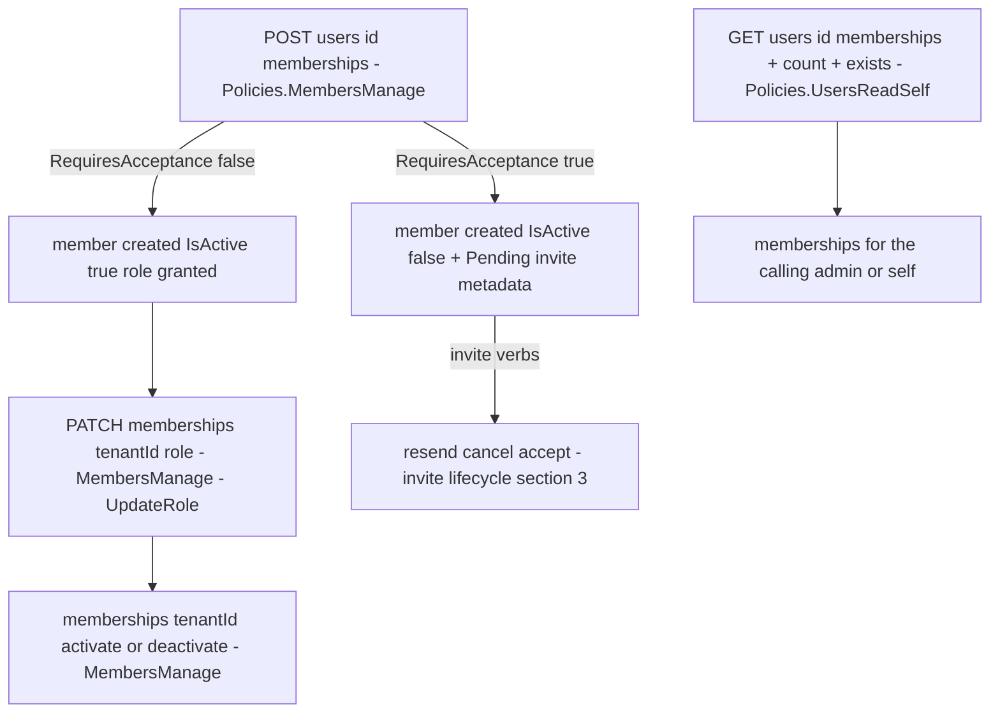
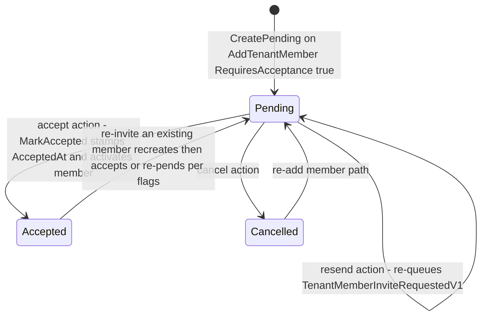

# Membership & Invites Flow — members, roles, the 3-action invite lifecycle, tenant resolution

> Family F2 of `GameGuild.Identity.Tenants` · `develop` 7ae5a28a65. Paths relative to `apps/api/Source/Modules/GameGuild.Identity.Tenants/` unless stated.

## 1. Membership flow (`UserMembershipsController`, 440 lines)

Membership state lives on `TenantMember` (`IsActive` flag + `Role` + JSON `Metadata` hosting the invite record, `Entities/TenantMember.cs:140`; `UpdateRole`/`Activate`/`Deactivate` at `:172,183,194`). Tenant-add validation (`ValidateForMemberAddition`) guards capacity and duplication at the entity layer (`Entities/Tenant.cs:207+`).

## 2. Tenant resolution middleware — where tenancy comes from

`Middleware/TenantMiddleware.cs` resolves per request: `X-Tenant-Id` header → host domain → query string → route value → JWT claim; **anonymous** traffic falls back to the platform default tenant, and **authenticated** traffic that resolved nothing does NOT get the default — an explicit anti-cross-tenant-authorization guard (`:360-368`, with the comment "silently binding them to the default tenant would create a cross-tenant authorization risk"). Registered in the host pipeline between token revocation and actor capture (`GameGuild.API/Core/Setup/PipelineExtensions.cs:109`).

## 3. Invite lifecycle (`TenantMemberInviteMetadata`)

Statuses: `Pending`, `Accepted`, `Cancelled` (`Entities/TenantMemberInviteMetadata.cs:5-10`). Actions via `UpdateTenantMemberInviteCommand { Resend=1, Cancel=2, Accept=3 }` (`Commands/UpdateTenantMemberInvite/UpdateTenantMemberInviteCommand.cs:5-15`), exposed as `invite:resend`, `invite:cancel` (both `MembersManage`) and `invite:accept` (self, `[Authorize]` route on the invitee).

The **one live durable event** of this module rides here: an email-bearing invite queues `TenantMemberInviteRequestedV1` via `AddIntegrationEvent` (`Commands/AddTenantMember/AddTenantMemberCommandHandler.cs:125-133`) — consumed by the Notifications module (`GameGuild.Notifications/NotificationsModule.cs:92`, `TenantInviteRequestedHandler`). The command contract declares it as `ConditionalEventTypes` (`Architecture/UseCaseEventContracts.g.cs:3,19`): only email-bearing creates/resends emit it.

Edge matrix:

| Edge | Guard | Result | Evidence |
|---|---|---|---|
| add an existing active member | dedupe path → reactivate/re-invite branches | 200 with distinct message | `Commands/AddTenantMember/AddTenantMemberCommandHandler.cs:70-113` |
| invite without invitee email | `QueueInviteEmail` no-ops | member created, no event, no email | `:135-141` |
| accept an already-accepted invite | metadata re-stamped | 200 idempotent | `:70-73` (`MarkAccepted`) |
| role change to the same role | `UpdateRole` unguarded | 200 | `Entities/TenantMember.cs:194` |
| deactivate the Owner membership | **no owner-protection guard** | 200 — tenant can be left ownerless | absence in `Commands/SetTenantMembershipStatus/` |
| cross-tenant membership write | route policy `MembersManage` + membership checks in rules | 403 for non-holders | `Controllers/UserMembershipsController.cs:35` |

## 4. Usage tracking & plan changes

`TrackUsage` commands + `Entities/UsageTracking.cs` accumulate per-tenant usage; `ChangeTenantPlan` exists as a command folder — plan-change has **no event** (the designed `TenantSubscriptionPlanChangedEvent` is dead, G4 baseline) so downstream billing/limits only notice on next read.
