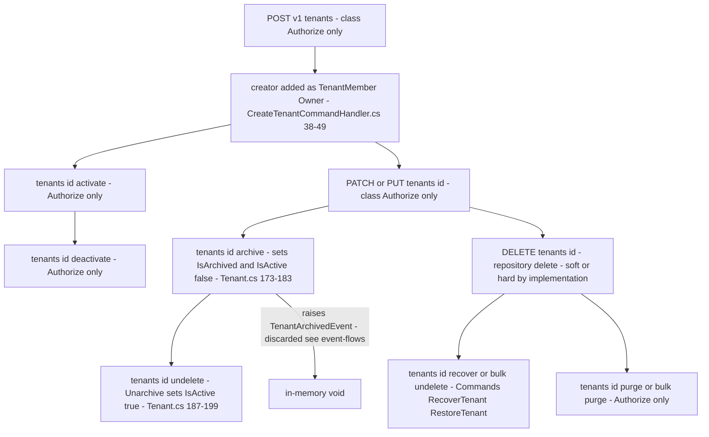

# Tenant Lifecycle Flow — create, update, activate, archive, delete, purge

> Family F1 of `GameGuild.Identity.Tenants` · `develop` 7ae5a28a65. Paths relative to `apps/api/Source/Modules/GameGuild.Identity.Tenants/` unless stated.

## 1. The flow

## 2. Endpoint inventory (F1)

| Route | Request | Auth | Handler |
|---|---|---|---|
| POST `v{v}/tenants` | `CreateTenantCommand` | `[Authorize]` (class) — self-service, creator becomes Owner | `Commands/CreateTenant/` |
| GET `v{v}/tenants` / `tenants/{id}` | `GetTenantsPageQuery` / `GetTenantByIdQuery` (+slug/active/search variants) | `[Authorize]` (class) | `Queries/` |
| PATCH/PUT `v{v}/tenants/{id}` | `UpdateTenantCommand` | `[Authorize]` (class) | `Commands/UpdateTenant/` |
| DELETE `v{v}/tenants/{id}` | `DeleteTenantCommand` | `[Authorize]` (class) | `Commands/DeleteTenant/` |
| POST `tenants:validate` | `ValidateTenantCommand` | `[Authorize]` (class) | `Commands/ValidateTenant/` |
| `tenants/{id}:activate/:deactivate/:archive/:undelete/:purge` | lifecycle commands | `[Authorize]` (class) | `Commands/Activate|Deactivate|Archive|Restore|*Tenant/` |
| `tenants/{id}/audit-log` | `GetTenantAuditLogQuery` | `[Authorize]` (class) | `Queries/GetTenantAuditLog/` |
| bulk `tenants:create/update/replace/delete/activate/deactivate/archive/undelete/purge` | `Bulk*TenantsCommand` ×9 | `[Authorize]` (class) | `Commands/Bulk*/` |
| settings `tenants/{id}/settings[…feature-flags/system-limits/integration-settings]` | settings ops | **`SettingsRead`/`SettingsManage`** | `Commands/TenantSettingsOperations.cs` |
| metadata `tenants/{id}/metadata[/custom-fields|/tags]` | metadata ops | `[Authorize]` (class) | `Commands/TenantMetadataOperations.cs` |

## 3. Edge matrix

| Edge | Guard | Result | Evidence |
|---|---|---|---|
| create with duplicate slug | `IsSlugUniqueAsync` check → `InvalidOperationException` | **500** (not 409) | `Commands/CreateTenant/CreateTenantCommandHandler.cs:24-28` |
| update missing tenant | `tenant == null → InvalidOperationException` | **500** (E9 class) | `Commands/UpdateTenant/UpdateTenantCommandHandler.cs:16` |
| deactivate missing tenant | same | **500** | `Commands/DeactivateTenant/DeactivateTenantCommandHandler.cs:16` |
| audit-log for missing tenant | `KeyNotFoundException` | **500** | `Queries/GetTenantAuditLog/GetTenantAuditLogQueryHandler.cs:20` |
| archive an archived tenant | no guard — re-stamps `ArchivedAt` | 200 | `Entities/Tenant.cs:173-183` |
| archive without reason | default `reason = ""` | 200 | `:173` |
| unarchive a non-archived tenant | no guard | 200, reactivates anyway | `:187-199` |
| delete a tenant with active members | **no census** — `DeleteTenantCommandHandler` deletes outright | 200, members orphaned | `Commands/DeleteTenant/DeleteTenantCommandHandler.cs:11-19` |
| bulk delete with HardDelete flag | per-item try/catch | 200 + accounting | `Commands/BulkDeleteTenants/BulkDeleteTenantsCommandHandler.cs:19-30` |
| lifecycle on another user's tenant | **none — see STRIDE §2** | 200 | absence of checks across `Commands/` |

## 4. The E9 class — not-found→500 (full list)

| Site | Exception | Should be |
|---|---|---|
| `Queries/GetTenantAuditLog/GetTenantAuditLogQueryHandler.cs:20` | `KeyNotFoundException` | 404 |
| `Commands/UpdateTenant/UpdateTenantCommandHandler.cs:16` | `InvalidOperationException` | 404 |
| `Commands/DeactivateTenant/DeactivateTenantCommandHandler.cs:16` | `InvalidOperationException` | 404 |
| `Services/TenantService.cs:77,91,100,112,127,143` (dead code, same pattern) | `InvalidOperationException` | 404 |

Mapping: only `DomainException`/`EntityNotFoundException` get 404/422 (`GameGuild.SharedKernel/Middlewares/ExceptionHandlingMiddleware.cs:124-133`); everything else falls to the 500 handler (`:143`).
