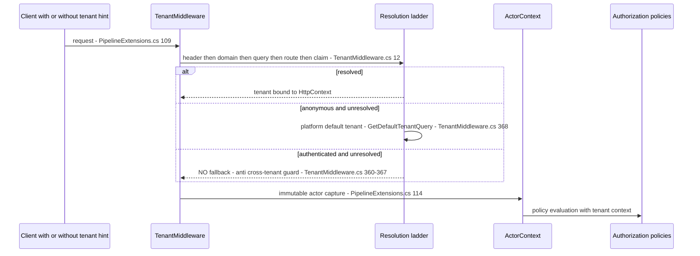
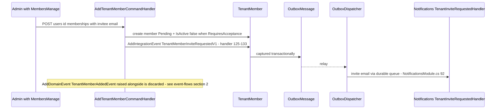
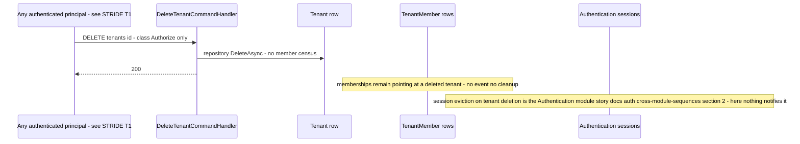

# Identity.Tenants — Sequences (lite)

> `develop` 7ae5a28a65 · Cross-module sequences only. Paths relative to `apps/api/Source/Modules/GameGuild.Identity.Tenants/` unless stated.

## 1. Request → tenant resolution → authorization (the per-request frame)

Verdict: **fail-closed for authenticated cross-tenant ambiguity** (no default-tenant binding); anonymous traffic is intentionally default-tenant scoped.

## 2. Invite delivery (the module's one durable outbound)

Verdict: invite email **durable**; the member-added side-signal **lost**.

## 3. Tenant deletion vs members and sessions (absent coordination)

## 4. Plan change (absent flow)

Plan changes are owned by Commerce.Billing (`OrchestrateSubscriptionPlanChange`); this module keeps only the orphan `PlanChangeRequest` DTO (`Commands/ChangeTenantPlan/PlanChangeRequest.cs`). The designed `TenantSubscriptionPlanChangedEvent` is dead (G4) — tenant-scoped limits/features learn of a plan change only on next read.
