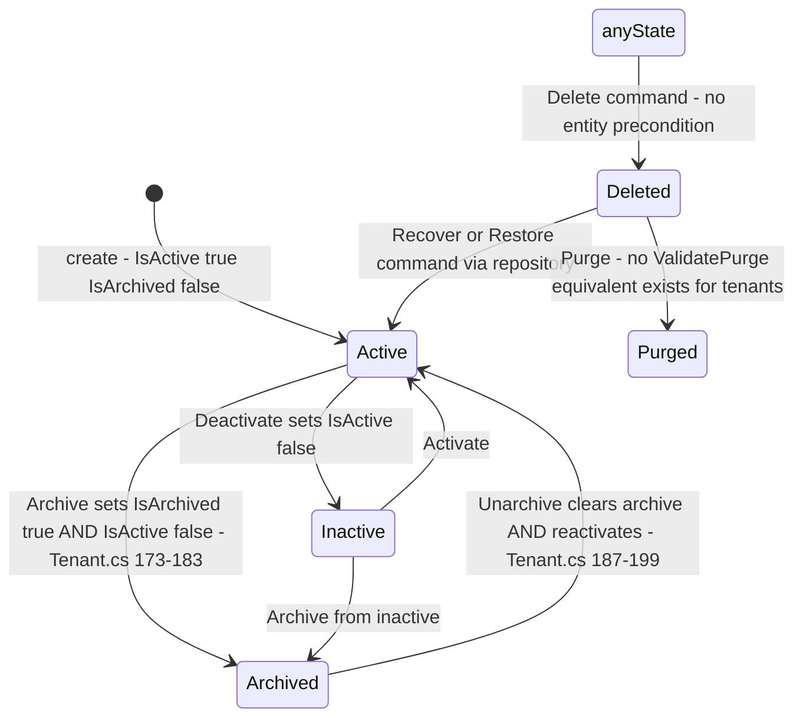
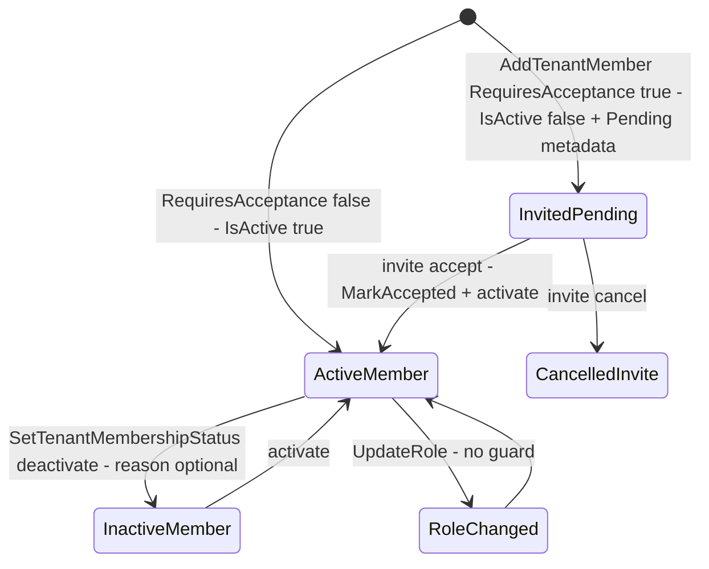

# Identity.Tenants State Machines

> `develop` 7ae5a28a65 · Mermaid `stateDiagram-v2`, no parentheses or colons in labels. Paths relative to `apps/api/Source/Modules/GameGuild.Identity.Tenants/`.

## 1. Tenant activity × archive — derived, flag-written

Like Users, the tenant has no status column: `IsActive` and `IsArchived` flags, mutated by unguarded methods that also stamp timestamps.

Transitions audit:

| Transition | Guard | Evidence |
|---|---|---|
| → Archived | `ValidateForArchive` result type exists (`Entities/Tenant.cs:278`) but the archive **command does not consult it** | `Entities/Tenant.cs:173-183` vs `Commands/ArchiveTenant/` |
| → Deleted | none (no member census — contrast Users `ValidatePurge`) | `Commands/DeleteTenant/DeleteTenantCommandHandler.cs:11-19` |
| Archive→Active via Unarchive | unconditional | `Entities/Tenant.cs:187-199` |

Validation result types that exist on the entity but are consulted only partially: `ValidateForMemberAddition` (`:207`), `ValidateConfiguration` (`:237`), `ValidateForArchive` (`:278`), `ValidateForDeletion` (`:293`) — the deletion validator is not called by the delete handler (see `gaps.md` T1a).

## 2. Membership state

Roles: `TenantRole` (`TenantRole.cs`, Owner/Admin/Member family). No state guards on role change or status flips (`Entities/TenantMember.cs:172-194`).

## 3. Invite metadata state

`Pending → Accepted | Cancelled` with `MarkAccepted(now)` stamping `AcceptedAt` (`Entities/TenantMemberInviteMetadata.cs:5-45`); full anatomy in `flows/membership-and-invites-flow.md` §3.

## 4. Usage tracking

`Entities/UsageTracking.cs` accumulates counters — not a state machine; `TrackUsageCommand` appends usage records (validated), consumed by quota/limit checks elsewhere.
