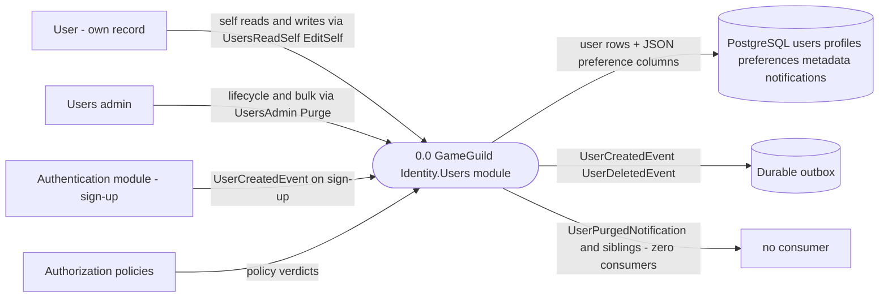
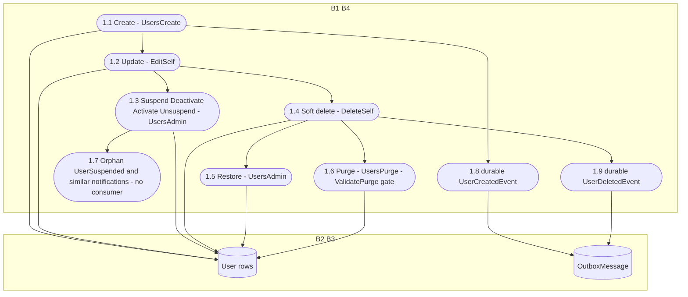
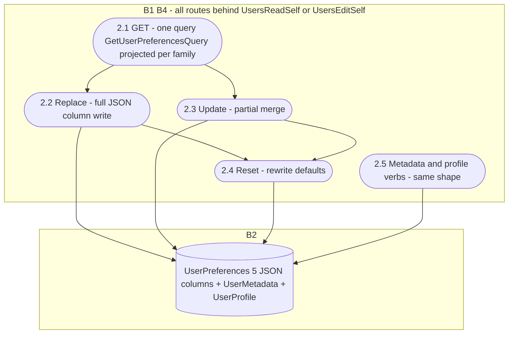
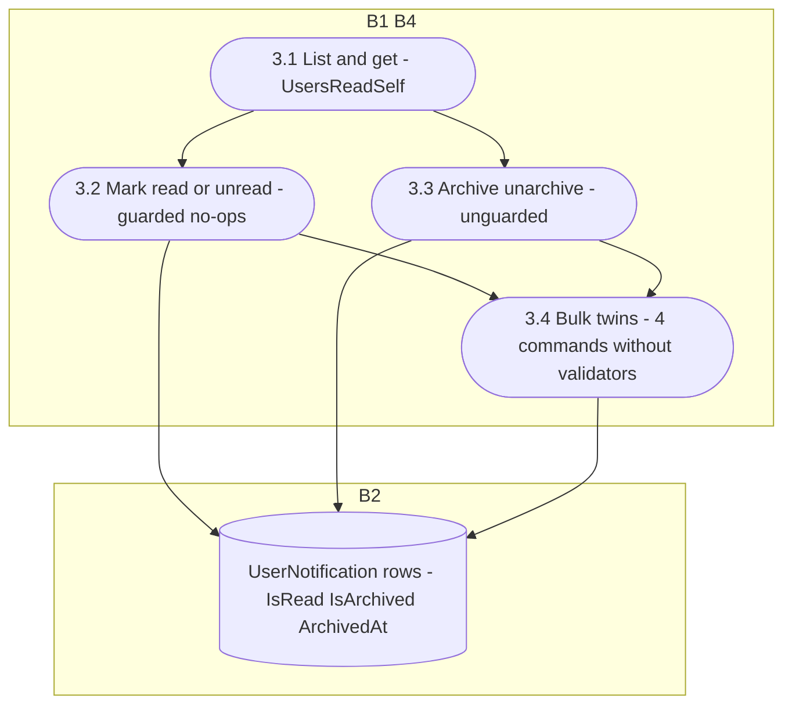

# Identity.Users Data Flow Diagrams

> `develop` 7ae5a28a65 · Level-0 + level-1 per family. Notation per `docs/security/auth-dfds.md` §1. Paths relative to `apps/api/Source/Modules/GameGuild.Identity.Users/` unless stated.

## 1. Level 0 — context

Boundaries: B1 client→API (attribute gate), B2 module→PostgreSQL, B3 module→outbox (durable), B4 self↔any-user (policy layer).

## 2. Level 1 — F1 lifecycle

## 3. Level 1 — F2 preferences / metadata / profile

## 4. Level 1 — F3 per-user notifications

## 5. Coverage matrix

| Family | DFD | Highest-risk flow | STRIDE |
|---|---|---|---|
| F1 lifecycle | §2 | 1.7 orphan producers (invisible suspensions) | §2 |
| F2 preferences | §3 | 2.2/2.4 no-audit PII writes; split-brain notification prefs | §3 |
| F3 notifications | §4 | 3.4 unvalidated bulk verbs | §4 |
