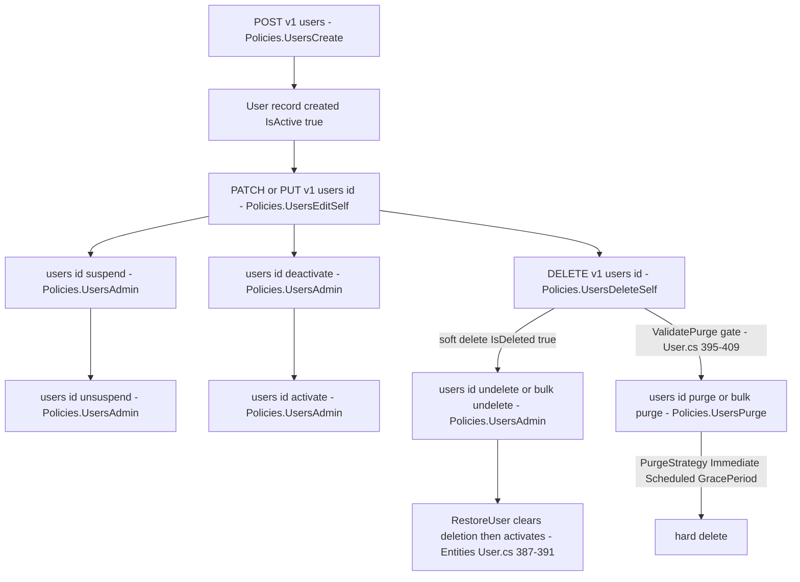

# User Lifecycle Flow — create, update, suspend, deactivate, soft-delete, restore, purge

> Family F1 of `GameGuild.Identity.Users` · `develop` 7ae5a28a65.
> Covers `UsersController` (6 endpoints), `UsersBulkController` (21 endpoints: 10 bulk + 11 single admin actions). Paths relative to `apps/api/Source/Modules/GameGuild.Identity.Users/` unless stated.

## 1. The flow

## 2. Endpoint inventory (F1)

| Route | Request | Policy | Handler | Notes |
|---|---|---|---|---|
| POST `v{v}/users` | `CreateUserCommand` | `UsersCreate` | `Commands/CreateUser/CreateUserCommandHandler.cs` | publishes durable `UserCreatedEvent` (`:20`) |
| GET `v{v}/users` | `GetUsersQuery` | `UsersRead` (controller) | `Queries/GetUsersQuery.cs` | paged list |
| GET `v{v}/users/{id}` | `GetUserByIdQuery` | `UsersReadSelf` | `Queries/GetUserById/` | validator present |
| PATCH/PUT `v{v}/users/{id}` | `UpdateUserCommand` | `UsersEditSelf` | `Commands/UpdateUser/` | |
| DELETE `v{v}/users/{id}` | `DeleteUserCommand` | `UsersDeleteSelf` | `Commands/DeleteUser/` | durable `UserDeletedEvent` (`DeleteUserCommandHandler.cs:25`) |
| POST `users:create/update/replace/delete/activate/deactivate/suspend/unsuspend/undelete/purge` (bulk) | `Bulk*UsersCommand` ×10 | `UsersCreate/Update/Update/Delete/Admin/Admin/Admin/Admin/Admin/Purge` | `Commands/Bulk*/` | all carry `BulkOperationResponse` accounting |
| POST `users/{id}:activate/deactivate/suspend/unsuspend/undelete` | single admin commands | `UsersAdmin` | `Commands/*/` | |

## 3. Edge matrix

| Edge | Guard | Result | Evidence |
|---|---|---|---|
| create duplicate | slug/email uniqueness | 422/409 via validator | `Commands/CreateUser/CreateUserCommandValidator.cs` |
| suspend an already-suspended user | **none** — flag overwrite | 200, idempotent | `Entities/User.cs:306-313` |
| deactivate a suspended user | **none** — both flags coexist | 200; status becomes Inactive (Suspended) | `ValueObjects/UserStatus.cs:62-67` |
| delete an active user | **none** — no "suspend first" gate | 200, soft delete | `Commands/DeleteUser/DeleteUserCommandHandler.cs` |
| restore a non-deleted user | **none** — Restore runs unconditionally | 200, re-activates | `Entities/User.cs:387-391` |
| purge without soft delete | `ValidatePurge` throws | 500 (`InvalidOperationException` → generic 500) | `Entities/User.cs:395-403` |
| purge with active tenant memberships | `ValidatePurge` throws | 500 | `Entities/User.cs:405-409` |
| bulk ops on missing ids | per-item try/catch | 200 with failed-count accounting | `Commands/BulkDeleteUsers/BulkDeleteUsersCommandHandler.cs` |
| unsuspend → sign-in | `CanSignIn` = `IsActive` (suspension alone does NOT block sign-in) | sign-in allowed while suspended | `ValueObjects/UserStatus.cs:56` — cross-check with Authentication module lockout policy |
| suspended user performs actions | `CanPerformActions` = `IsActive && !IsSuspended` | blocked where checked | `Entities/User.cs:414` |

## 4. Purge strategies

`PurgeStrategy { Immediate, Scheduled, GracePeriod }` (`Commands/PurgeUser/PurgeUserCommand.cs:8`), default `GracePeriod` on bulk (`Commands/BulkPurgeUsers/BulkPurgeUsersCommand.cs:10`). The strategy string rides the `UserPurgedNotification` (`:47` in the bulk handler) — but nothing consumes it (see `event-flows.md`), so "scheduled" and "grace period" currently differ only in the notification payload.

## 5. Authorization contract (summary — full anatomy in the preferences flow)

All lifecycle admin actions sit behind `Policies.UsersAdmin` etc.; the *self* endpoints (`UsersEditSelf`, `UsersDeleteSelf`) inherit the same `SelfOrPermission` lookup contract — see `flows/preferences-and-notifications-flow.md` §2 for why ordinary users 403 on self actions.
